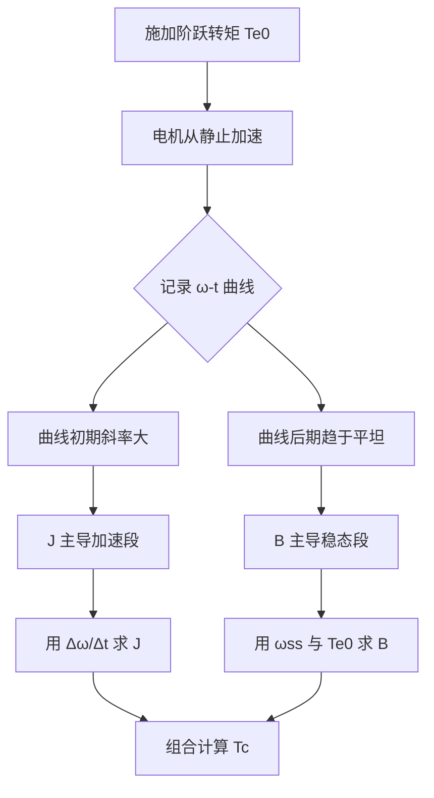

# 转动惯量与摩擦系数辨识

> **为什么学？**
> $J$、$B$、$T_c$ 直接决定速度环 PI 能调到多快、会不会振荡。如果机械参数不准，速度环带宽要么被压得保守而响应迟缓，要么调得太高而超调甚至共振；摩擦补偿缺失还会导致低速爬行和稳态静差。
>
> **在 FOC 中的作用**
> 这一节辨识出的机械参数用于速度环 PI 整定、负载转矩观测器和前馈补偿；如果说电流环负责“快”，机械参数辨识就是速度环负责“稳”的前提。

这张图把“加减速试验 → 数据构造 → 最小二乘解算”的流程可视化，帮助理解为什么从一条 $\omega-t$ 曲线就能同时分离出 $J$、$B$、$T_c$。

```mermaid
graph LR
    A["空载 施加阶跃转矩 Te0"] --> B[""记录 ω[k"], Te[k]"]
    B --> C[""构造 Φ = [dω/dt, ω, sgn(ω)"]"]
    C --> D["构造 Y = Te"]
    D --> E["最小二乘 θ = (ΦTΦ)^-1 ΦTY"]
    E --> F["输出 J, B, Tc"]
```

*图：加减速法结合最小二乘辨识机械参数*

FOC 的双环结构里，电流环只决定电磁转矩，而转速由机械运动方程决定。只有先把 $J$、$B$、$T_c$ 拿到手，速度环 PI 才能根据真实机械对象设定合适的带宽和阻尼，而不是盲目抄经验值。

## 1. 测量原理与数学推导

电机系统的机械运动方程为：

$$J\frac{d\omega_m}{dt} = T_e - T_L - T_{fric}$$

其中 $J$ 为总转动惯量（电机转子 + 负载折算），$T_e$ 为电磁转矩，$T_L$ 为负载转矩，$T_{fric}$ 为摩擦力矩。离线辨识时通常令 $T_L = 0$（空载）。

### 摩擦模型

为什么要做这一步：把摩擦拆成库仑摩擦和粘性摩擦，才能解释低速爬行、稳态静差和加减速不对称，从而有针对性地做摩擦补偿。

摩擦力矩通常建模为库仑摩擦与粘性摩擦之和：

$$T_{fric} = T_c \cdot \text{sgn}(\omega_m) + B \cdot \omega_m$$

其中 $T_c$ 为库仑摩擦（恒定大小，方向与速度相反），$B$ 为粘性摩擦系数，$\text{sgn}(\cdot)$ 为符号函数。

代入运动方程：

$$J\frac{d\omega_m}{dt} = T_e - T_c \cdot \text{sgn}(\omega_m) - B\omega_m$$

### 加减速法（空载）

为什么要做这一步：在空载条件下施加已知转矩并记录速度响应，是最直接的 $J$、$B$ 辨识方式，适合驱动器在用户现场一键完成自动整定。

**加速阶段**：施加恒定转矩 $T_{e0} > 0$，从静止加速：

$$J\frac{d\omega_m}{dt} = T_{e0} - T_c - B\omega_m$$

若加速过程较短或速度较低，可近似忽略粘性摩擦：

$$J \approx \frac{T_{e0} - T_c}{\Delta\omega/\Delta t}$$

**更准确的方法**：记录多个时间点的 $\omega_m$ 和 $T_e$，利用最小二乘法。

### 最小二乘辨识

为什么要做这一步：实际加速过程中库仑摩擦、粘性摩擦和惯性同时存在，最小二乘能一次性从一组数据里把 $J$、$B$、$T_c$ 三个参数分离出来。

将运动方程离散化：

$$\omega[k] - \omega[k-1] = \frac{\Delta t}{J}(T_e[k] - T_c \cdot \text{sgn}(\omega[k]) - B\omega[k])$$

整理为线性回归形式：

$$T_e[k] = J \cdot \frac{\omega[k] - \omega[k-1]}{\Delta t} + B \cdot \omega[k] + T_c \cdot \text{sgn}(\omega[k])$$

令：

$$y_k = T_e[k]$$

$$\phi_k = \begin{bmatrix} \frac{\omega[k] - \omega[k-1]}{\Delta t} & \omega[k] & \text{sgn}(\omega[k]) \end{bmatrix}^T$$

$$\theta = \begin{bmatrix} J & B & T_c \end{bmatrix}^T$$

则 $y_k = \phi_k^T \theta$，对 $N$ 个数据点，最小二乘解：

$$\hat{\theta} = \left(\sum_{k=1}^N \phi_k \phi_k^T\right)^{-1} \left(\sum_{k=1}^N \phi_k y_k\right)$$

或矩阵形式：

$$\Phi = \begin{bmatrix} \phi_1^T \\ \vdots \\ \phi_N^T \end{bmatrix}, \quad Y = \begin{bmatrix} y_1 \\ \vdots \\ y_N \end{bmatrix}$$

$$\hat{\theta} = (\Phi^T \Phi)^{-1} \Phi^T Y$$

### 摆锤法（物理法）

为什么要做这一步：对于大惯量或不方便通电的系统，用物理摆锤可以粗略估算 $J$，作为速度环初始设计的参考值。

将电机转子（或电机+负载）通过柔性绳索悬挂，构成扭摆。测得摆动周期 $T_0$：

$$T_0 = 2\pi\sqrt{\frac{J}{mgh}}$$

其中 $m$ 为电机质量，$h$ 为重心到悬挂点的距离。解得：

$$J = \frac{mgh T_0^2}{4\pi^2}$$

此方法适用于较大惯量的粗略估计，但不适合已装配系统的精确辨识。

### 加减速法直接计算 $J$ 与 $B$（两步法）

为什么要做这一步：当只关心 $J$、$B$ 两个参数且希望计算量小时，先用稳态速度求 $B$，再用初始加速度求 $J$，比最小二乘更便于在线快速估算。

若库仑摩擦 $T_c$ 较小或已通过低速测量单独确定，可简化为：

$$J\frac{\Delta\omega}{\Delta t} = T_e - B\omega_m$$

**第一步**：从 $\omega-t$ 曲线读取稳态速度 $\omega_{ss}$，此时 $d\omega/dt = 0$：

$$0 = T_{e0} - B\omega_{ss} \quad \Rightarrow \quad B = \frac{T_{e0}}{\omega_{ss}}$$

**第二步**：代入加速阶段某点：

$$J = \frac{T_{e0} - B\bar{\omega}}{\Delta\omega/\Delta t}$$

其中 $\bar{\omega}$ 为该时间段的平均速度。

## 2. 几何直观



**转矩平衡图（加速阶段）**：

```
   Te0  |======================>
        |
   Tc   |<=======               (方向相反)
        |
   Bω   |<===========          (随 ω 增大)
        |
        v---------------------->
   J·dω/dt = Te0 - Tc - Bω
```

**$\omega-t$ 曲线与参数关系**：

```
ω
|          . . . . . . ω_ss
|        .
|      .
|    .    ← 初期斜率 ≈ (Te0 - Tc)/J
|  .
| .
+--------------------------> t
        |← Δt →|
```

## 3. 数值示例

**已知**：某 PMSM 空载，通过电流环施加恒定 $i_q = 1.0\ \text{A}$（$i_d = 0$），已知 $K_t = 0.2\ \text{Nm/A}$，因此 $T_{e0} = K_t \cdot i_q = 0.2\ \text{Nm}$。

记录数据如下（采样间隔 $\Delta t = 5\ \text{ms}$）：

| k | $\omega$ (rad/s) | $T_e$ (Nm) | sgn($\omega$) |
|---|-----------|---------|--------|
| 0 | 0         | 0.2     | 0      |
| 1 | 4.5       | 0.2     | +1     |
| 2 | 8.2       | 0.2     | +1     |
| 3 | 11.3      | 0.2     | +1     |
| 4 | 13.8      | 0.2     | +1     |
| 5 | 15.7      | 0.2     | +1     |
| 6 | 17.2      | 0.2     | +1     |
| 7 | 18.4      | 0.2     | +1     |
| 8 | 19.2      | 0.2     | +1     |
| 9 | 19.7      | 0.2     | +1     |
| 10| 20.0      | 0.2     | +1     |

**求**：$J$、$B$、$T_c$。

**解**：

**方法 A：两步法近似**

稳态速度 $\omega_{ss} = 20.0\ \text{rad/s}$。由稳态条件：

$$T_{e0} = B\omega_{ss} + T_c \quad \Rightarrow \quad 0.2 = 20B + T_c$$

初始加速度（k=0→1）：

$$\frac{\Delta\omega}{\Delta t} = \frac{4.5 - 0}{0.005} = 900\ \text{rad/s}^2$$

$$J \cdot 900 = 0.2 - T_c$$

若假设 $T_c \approx 0$（先忽略），则：

$$J = \frac{0.2}{900} \approx 2.22 \times 10^{-4}\ \text{kg·m}^2$$

$$B = \frac{0.2}{20} = 0.01\ \text{Nm/(rad/s)}$$

**方法 B：最小二乘法（含 Tc）**

构造 $\Phi$ 和 $Y$：

对于 k=1：

$$\phi_1 = \left[\frac{4.5-0}{0.005},\ 4.5,\ +1\right]^T = [900,\ 4.5,\ 1]^T$$

计算所有 10 个点并求 $\hat{\theta} = (\Phi^T\Phi)^{-1}\Phi^T Y$（为简洁，这里给出中间结果）：

$$\Phi^T\Phi \approx \begin{bmatrix} 8.12\times10^5 & 2.34\times10^4 & 3.84\times10^3 \\ 2.34\times10^4 & 1.12\times10^3 & 1.38\times10^2 \\ 3.84\times10^3 & 1.38\times10^2 & 10 \end{bmatrix}$$

$$\Phi^T Y \approx \begin{bmatrix} 384 \\ 16.2 \\ 1.8 \end{bmatrix}$$

求解得：

$$\hat{\theta} \approx \begin{bmatrix} 2.0\times10^{-4} \\ 0.008 \\ 0.04 \end{bmatrix}$$

即：
- $J \approx 2.0 \times 10^{-4}\ \text{kg·m}^2$
- $B \approx 0.008\ \text{Nm/(rad/s)}$
- $T_c \approx 0.04\ \text{Nm}$

**验证**：稳态时 $B\omega_{ss} + T_c = 0.008 \times 20 + 0.04 = 0.2\ \text{Nm}$，与 $T_{e0}$ 吻合。

## 4. 代码实现

```c
#include <stdint.h>
#include <math.h>

#define N_SAMPLES  64
#define DT         0.005f   // 5ms

/**
 * @brief 最小二乘辨识 J, B, Tc
 * @param omega 速度数组，rad/s
 * @param Te 电磁转矩数组，Nm
 * @param n 数据点数
 * @param theta 输出：[J, B, Tc]
 * @return 0=成功, -1=矩阵奇异
 */
int LS_Identify_JBT(float* omega, float* Te, int n, float* theta)
{
    float A[3][3] = {{0}};  // Phi^T * Phi
    float b[3] = {0};       // Phi^T * Y
    
    for (int k = 1; k < n; k++) {
        float domega = (omega[k] - omega[k-1]) / DT;
        float w = omega[k];
        float s = (w > 0.01f) ? 1.0f : ((w < -0.01f) ? -1.0f : 0.0f);
        
        float phi[3] = {domega, w, s};
        float y = Te[k];
        
        for (int i = 0; i < 3; i++) {
            for (int j = 0; j < 3; j++) {
                A[i][j] += phi[i] * phi[j];
            }
            b[i] += phi[i] * y;
        }
    }
    
    // 3x3 矩阵求逆（伴随矩阵法）
    float det = A[0][0]*(A[1][1]*A[2][2]-A[1][2]*A[2][1])
              - A[0][1]*(A[1][0]*A[2][2]-A[1][2]*A[2][0])
              + A[0][2]*(A[1][0]*A[2][1]-A[1][1]*A[2][0]);
    
    if (fabsf(det) < 1e-12f) return -1;
    
    // 计算伴随矩阵并求逆
    float inv[3][3];
    inv[0][0] = (A[1][1]*A[2][2]-A[1][2]*A[2][1])/det;
    inv[0][1] = (A[0][2]*A[2][1]-A[0][1]*A[2][2])/det;
    inv[0][2] = (A[0][1]*A[1][2]-A[0][2]*A[1][1])/det;
    inv[1][0] = (A[1][2]*A[2][0]-A[1][0]*A[2][2])/det;
    inv[1][1] = (A[0][0]*A[2][2]-A[0][2]*A[2][0])/det;
    inv[1][2] = (A[0][2]*A[1][0]-A[0][0]*A[1][2])/det;
    inv[2][0] = (A[1][0]*A[2][1]-A[1][1]*A[2][0])/det;
    inv[2][1] = (A[0][1]*A[2][0]-A[0][0]*A[2][1])/det;
    inv[2][2] = (A[0][0]*A[1][1]-A[0][1]*A[1][0])/det;
    
    for (int i = 0; i < 3; i++) {
        theta[i] = inv[i][0]*b[0] + inv[i][1]*b[1] + inv[i][2]*b[2];
    }
    
    return 0;
}

/**
 * @brief 加减速法近似计算（两步法，忽略Tc）
 */
void Estimate_JB_Approx(float* omega, float Te0, float dt, int n, 
                        float* J, float* B)
{
    float omega_ss = omega[n-1];  // 稳态速度
    
    // 粘性摩擦系数
    *B = Te0 / omega_ss;
    
    // 在 20% 稳态速度处取斜率
    int idx = 0;
    float target = 0.2f * omega_ss;
    for (int i = 0; i < n; i++) {
        if (omega[i] >= target) { idx = i; break; }
    }
    
    float domega = (idx > 0) ? (omega[idx] - omega[idx-1]) / dt : 0;
    float avg_w = (omega[idx] + omega[idx-1]) / 2.0f;
    
    *J = (Te0 - (*B) * avg_w) / domega;
}
```

## 5. 常见错误

### 错误一：未扣除库仑摩擦，直接用 $T_{e0}/(d\omega/dt)$ 估算 $J$

**现象**：电机存在明显静摩擦（如减速器），$T_c = 0.05\ \text{Nm}$。若直接 $J = T_{e0}/(d\omega/dt) = 0.2/900 = 2.22\times10^{-4}$，比真实值 $2.0\times10^{-4}$ 高估约 $11\%$。

**纠正**：若无法准确估计 $T_c$，应在低速区（$\omega < 0.1\omega_{ss}$）采集数据，此时 $B\omega \ll T_{e0}$，用 $J = (T_{e0} - T_c)/(d\omega/dt)$。或采用最小二乘法同时辨识三个参数。

### 错误二：使用过短的加速时间或采样间隔过大

**现象**：电机机械时间常数 $\tau_{mech} = J/B \approx 0.02/0.008 = 25\ \text{ms}$。若采样间隔 $\Delta t = 20\ \text{ms}$，仅获得 1-2 个有效数据点，无法准确拟合。

**纠正**：采样间隔应满足 $\Delta t \le \tau_{mech}/10$。对于小型伺服电机，建议 $\Delta t = 1\sim5\ \text{ms}$，记录至少 $5\tau_{mech}$（即到达稳态的完整过程）。

### 错误三：将负载惯量遗漏或电机惯量未正确折算

**现象**：直接驱动滚珠丝杠时，丝杠惯量 $J_{screw} = m_{screw} r^2/2$，工作台惯量折算 $J_{table} = m_{table} \cdot (P_{lead}/(2\pi))^2$，若未加入总惯量，速度环设计会出现振荡。

**纠正**：总惯量 $J_{total} = J_{motor} + J_{coupling} + J_{load}/i^2$（$i$ 为减速比）。离线辨识时，若无法拆卸负载，则辨识结果为 $J_{total}$，应在速度环设计中使用该总惯量。

## 6. 自测习题

**习题 1**
某电机空载，施加 $T_e = 0.5\ \text{Nm}$ 阶跃转矩，测得：
- 初始加速度（$t=0$）：$d\omega/dt = 2000\ \text{rad/s}^2$
- 稳态速度：$\omega_{ss} = 50\ \text{rad/s}$

假设库仑摩擦 $T_c = 0.05\ \text{Nm}$，求 $J$ 和 $B$。

**答案**：
由初始条件（$\omega \approx 0$，$B\omega \approx 0$）：

$$J = \frac{T_e - T_c}{(d\omega/dt)_0} = \frac{0.5 - 0.05}{2000} = 2.25 \times 10^{-4}\ \text{kg·m}^2$$

由稳态条件：

$$B = \frac{T_e - T_c}{\omega_{ss}} = \frac{0.45}{50} = 0.009\ \text{Nm/(rad/s)}$$

**习题 2**
若电机系统安装减速器（减速比 $i = 10$），负载直接装在减速器输出端。在电机轴上测得 $J_{total} = 5.0 \times 10^{-4}\ \text{kg·m}^2$。已知电机转子惯量 $J_m = 2.0 \times 10^{-4}\ \text{kg·m}^2$，求折算到电机轴的负载惯量 $J_{load,motor}$ 和负载实际惯量 $J_{load}$。

**答案**：
折算到电机轴的负载惯量：

$$J_{load,motor} = J_{total} - J_m = 5.0 \times 10^{-4} - 2.0 \times 10^{-4} = 3.0 \times 10^{-4}\ \text{kg·m}^2$$

负载实际惯量（在输出轴上）：

$$J_{load} = J_{load,motor} \cdot i^2 = 3.0 \times 10^{-4} \times 100 = 3.0 \times 10^{-2}\ \text{kg·m}^2$$
