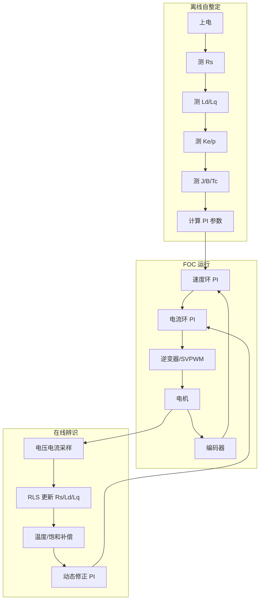
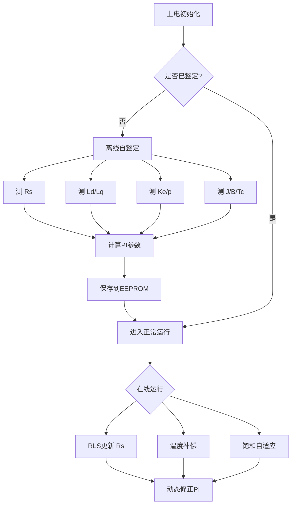

# 自整定与自动参数辨识

> **为什么学？**
> 手动测量全部电机参数既费时又容易出错，而运行中温度上升和磁饱和会让参数漂移。如果不做自整定和在线辨识，FOC 的控制器参数会逐渐与实际对象失配，出现电流响应变差、速度振荡或发热异常。
>
> **在 FOC 中的作用**
> 这一节把前面几节的离线辨识方法封装成上电自动流程，并用递归最小二乘等在线算法持续修正 $R_s$、$L_d$、$L_q$ 等参数；它是让 FOC 从“实验室调参”走向“现场即插即用”的关键环节。

这张图把自整定与在线辨识放在 FOC 双环架构里看：离线流程负责上电初值，在线 RLS 负责运行中跟踪参数漂移，两者共同修正电流环与速度环。



*图：自整定与在线辨识在 FOC 中的位置*

FOC 的性能高度依赖电机模型参数。自整定把电阻、电感、反电动势、机械参数的测量在上电时自动跑一遍，在线辨识则在运行中持续跟踪参数变化，两者配合才能保证电流环和速度环始终工作在正确的模型上。

## 1. 测量原理与数学推导

现代伺服驱动器通常集成 **离线自整定（Auto-tuning）** 功能，在上电后或首次运行前自动辨识电机参数，并据此计算电流环、速度环 PI 增益。对于参数时变的场景（如温升导致电阻变化），还需 **在线自适应（Online Adaptation）** 算法。

### 离线自整定流程

为什么要做这一步：上电后依次测量 $R_s$、$L_d/L_q$、$K_e$、$p$、$J/B/T_c$，才能为电流环和速度环 PI 提供一组完整且相互匹配的初始参数。

标准五步法：

1. **直流电阻辨识**：向某两相通直流，用四线法测 $R_s$；
2. **dq 电感辨识**：d 轴和 q 轴分别定位，注入阶跃电压测 $L_d$、$L_q$；
3. **反电动势常数辨识**：反拖法或开环恒速法测 $K_e$；
4. **极对数辨识**：通过频率比确定 $p$；
5. **机械参数辨识**：加减速法测 $J$、$B$、$T_c$。

根据上述参数，电流环 PI 增益可按极点配置计算：

$$K_p = \frac{L_d}{\tau_{cl}}, \quad K_i = \frac{R_s}{\tau_{cl}} \quad (\text{d轴})$$

$$K_p = \frac{L_q}{\tau_{cl}}, \quad K_i = \frac{R_s}{\tau_{cl}} \quad (\text{q轴})$$

其中 $\tau_{cl}$ 为期望电流环闭环时间常数。

### 在线参数辨识：递归最小二乘（RLS）

为什么要做这一步：运行中电阻随温度升高、电感随饱和变化，RLS 利用每一拍的电压电流数据持续修正模型，防止 PI 参数与实际对象失配。

电机参数随温度、磁饱和程度变化。以电阻在线辨识为例，电压方程离散化后：

$$u_d[k] = R_s i_d[k] + L_d \frac{i_d[k]-i_d[k-1]}{T_s} - \omega_e L_q i_q[k]$$

将已知量移到左侧：

$$y[k] = u_d[k] - L_d \frac{\Delta i_d}{T_s} + \omega_e L_q i_q[k] = R_s \cdot i_d[k]$$

定义回归变量 $\phi[k] = i_d[k]$，待估计参数 $\theta = R_s$。

标准 RLS 递推公式：

$$\hat{\theta}[k] = \hat{\theta}[k-1] + K[k](y[k] - \phi^T[k]\hat{\theta}[k-1])$$

$$K[k] = \frac{P[k-1]\phi[k]}{\lambda + \phi^T[k]P[k-1]\phi[k]}$$

$$P[k] = \frac{1}{\lambda}(I - K[k]\phi^T[k])P[k-1]$$

其中：
- $\lambda \in (0,1]$ 为遗忘因子，$\lambda < 1$ 使旧数据指数衰减，典型值 $0.95 \sim 0.995$；
- $P[k]$ 为估计误差协方差矩阵（标量情形为方差）；
- $K[k]$ 为卡尔曼增益。

### 多参数联合辨识（电阻 + 电感）

为什么要做这一步：当 $R_s$ 和 $L_d$ 同时漂移时，单一方程无法区分两者，必须扩展回归向量同时辨识多个参数。

对于 dq 轴电压方程，若 $L_d$、$L_q$ 也需在线更新，将方程整理为：

$$y[k] = u_d[k] + \omega_e L_q i_q[k] = R_s i_d[k] + L_d \frac{\Delta i_d}{T_s}$$

此时 $\phi[k] = \begin{bmatrix} i_d[k] & \Delta i_d/T_s \end{bmatrix}^T$，$\theta = \begin{bmatrix} R_s & L_d \end{bmatrix}^T$。

$P[k]$ 为 $2\times2$ 矩阵，$K[k]$ 为 $2\times1$ 向量。

### 收敛性分析

为什么要做这一步：RLS 只有在电流指令足够“丰富”时才收敛；识别持续激励条件能避免在恒流稳态下盲目更新参数导致发散或估计值偏离真值。

RLS 收敛的充分条件是 **持续激励（Persistent Excitation, PE）**：输入信号 $\phi[k]$ 必须包含足够丰富的频率成分，使信息矩阵：

$$\lim_{N\to\infty} \sum_{k=1}^N \phi[k]\phi^T[k] > 0$$

即正定。对于直流电阻辨识，要求 $i_d$ 或 $i_q$ 有波动；若电流恒定（如稳态 $I_q = I_{ref}$），$\phi$ 为常数，无法区分 $R_s$ 与电压误差。

**协方差重置（Covariance Reset）**：当电机长时间处于稳态，$P[k]$ 可能趋于零（估计变得僵化）。策略性地在检测到大幅扰动时重置 $P$ 为 $P_0 = \alpha I$（$\alpha = 1 \sim 10$），使算法恢复对参数变化的敏感性。

## 2. 几何直观



**RLS 收敛过程的几何直观**：

```
参数空间 (Rs, Ld)
  |
  |        × 目标真值 (0.5, 1.2m)
  |       /
  |      /  ← 估计轨迹
  |     /
  |    × 初始估计 (0.3, 0.8m)
  |
  +---------------------->
  
  每次新数据 (ud, id, Δid) 到来，
  沿梯度方向修正估计值，
  P[k] 大小决定步长（置信度）
```

**遗忘因子的作用**：

```
数据权重
  |
  |    \      λ=1.0 (无遗忘)
  |     \____
  |      \
  |       \___ λ=0.95 (有遗忘)
  |        \___
  +----------------> 时间
        旧数据权重指数衰减
```

## 3. 数值示例

### 离线自整定：PI 参数计算

**已知**：通过前述离线测量得到某 PMSM 参数：
- $R_s = 0.5\ \Omega$
- $L_d = 1.0\ \text{mH}$, $L_q = 1.5\ \text{mH}$
- $K_e = 0.025\ \text{V/(rad/s)}$, $p = 4$
- $J = 2.0\times10^{-4}\ \text{kg·m}^2$, $B = 0.01\ \text{Nm/(rad/s)}$

设计电流环带宽 $f_{ci} = 500\ \text{Hz}$，对应闭环时间常数 $\tau_{cl} = 1/(2\pi f_{ci}) \approx 0.318\ \text{ms}$。

**求**：d 轴和 q 轴电流环 PI 参数。

**解**：

**d 轴**：

$$K_{pd} = \frac{L_d}{\tau_{cl}} = \frac{1.0\times10^{-3}}{3.18\times10^{-4}} = 3.14\ \Omega$$

$$K_{id} = \frac{R_s}{\tau_{cl}} = \frac{0.5}{3.18\times10^{-4}} = 1572\ \Omega/\text{s} = 1.572\ \text{k}\Omega/\text{s}$$

**q 轴**：

$$K_{pq} = \frac{L_q}{\tau_{cl}} = \frac{1.5\times10^{-3}}{3.18\times10^{-4}} = 4.71\ \Omega$$

$$K_{iq} = \frac{R_s}{\tau_{cl}} = 1572\ \Omega/\text{s}$$

**验证带宽**：

电流环闭环传递函数近似为一阶惯性：

$$G_{cl}(s) = \frac{1}{1 + s\tau_{cl}} = \frac{1}{1 + s/\omega_{ci}}$$

$\omega_{ci} = 2\pi \times 500 = 3141\ \text{rad/s}$，闭环带宽 $f_{ci} = 500\ \text{Hz}$，满足典型设计指标。

### 在线 RLS：单参数 $R_s$ 辨识

**已知**：电机静止，$\omega_e = 0$，向 d 轴注入阶梯变化电流。采样周期 $T_s = 1\ \text{ms}$，遗忘因子 $\lambda = 0.95$。

| k | $i_d$ (A) | $u_d$ (V) |
|---|-----------|-----------|
| 1 | 1.0       | 0.52      |
| 2 | 2.0       | 1.01      |
| 3 | 3.0       | 1.48      |
| 4 | 4.0       | 2.02      |

初始化：$\hat{\theta}[0] = 0.4\ \Omega$，$P[0] = 10$。

回归变量 $\phi[k] = i_d[k]$，输出 $y[k] = u_d[k]$（静止时 $u_d = R_s i_d$）。

**递推过程**：

**k=1**：
- 预测误差：$e_1 = y_1 - \phi_1\hat{\theta}[0] = 0.52 - 1.0 \times 0.4 = 0.12\ \text{V}$
- 增益：$K_1 = P[0]\phi_1 / (\lambda + \phi_1 P[0] \phi_1) = 10 \times 1.0 / (0.95 + 1.0 \times 10 \times 1.0) = 10/10.95 = 0.913$
- 更新：$\hat{\theta}[1] = 0.4 + 0.913 \times 0.12 = 0.5096\ \Omega$
- 协方差：$P[1] = (1 - 0.913 \times 1.0) \times 10 / 0.95 = 0.087 \times 10 / 0.95 = 0.916$

**k=2**：
- 预测误差：$e_2 = 1.01 - 2.0 \times 0.5096 = 1.01 - 1.0192 = -0.0092\ \text{V}$
- 增益：$K_2 = 0.916 \times 2.0 / (0.95 + 2.0 \times 0.916 \times 2.0) = 1.832 / 4.614 = 0.397$
- 更新：$\hat{\theta}[2] = 0.5096 + 0.397 \times (-0.0092) = 0.5060\ \Omega$
- 协方差：$P[2] = (1 - 0.397 \times 2.0) \times 0.916 / 0.95 = 0.206 \times 0.916 / 0.95 = 0.199$

**k=3**：
- 预测误差：$e_3 = 1.48 - 3.0 \times 0.5060 = 1.48 - 1.518 = -0.038\ \text{V}$
- 增益：$K_3 = 0.199 \times 3.0 / (0.95 + 3.0 \times 0.199 \times 3.0) = 0.597 / 2.741 = 0.218$
- 更新：$\hat{\theta}[3] = 0.5060 + 0.218 \times (-0.038) = 0.4977\ \Omega$
- 协方差：$P[3] = (1 - 0.218 \times 3.0) \times 0.199 / 0.95 = 0.346 \times 0.199 / 0.95 = 0.0725$

**k=4**：
- 预测误差：$e_4 = 2.02 - 4.0 \times 0.4977 = 2.02 - 1.991 = 0.029\ \text{V}$
- 增益：$K_4 = 0.0725 \times 4.0 / (0.95 + 4.0 \times 0.0725 \times 4.0) = 0.29 / 2.11 = 0.137$
- 更新：$\hat{\theta}[4] = 0.4977 + 0.137 \times 0.029 = 0.5017\ \Omega$

**最终结果**：$R_s \approx 0.50\ \Omega$，与真实值（斜率 $2.02/4.0 = 0.505$）吻合。随着迭代进行，$P[k]$ 从 $10 \to 0.0725 \to 0.027$ 逐渐减小，说明算法对估计值越来越"自信"，新数据的修正权重降低。

## 4. 代码实现

```c
#include <stdint.h>
#include <math.h>

#define RLS_LAMBDA  0.98f    // 遗忘因子
#define RLS_P0      10.0f    // 初始协方差

/**
 * @brief 递归最小二乘（标量/单参数）
 * @param theta 估计参数（传入上次估计，传出更新值）
 * @param P     协方差（传入上次值，传出更新值）
 * @param phi   回归变量
 * @param y     观测输出
 */
void RLS_Update_Scalar(float* theta, float* P, float phi, float y)
{
    float e = y - phi * (*theta);           // 预测误差
    float denom = RLS_LAMBDA + phi * (*P) * phi;
    float K = (*P) * phi / denom;           // 卡尔曼增益
    *theta = *theta + K * e;                // 参数更新
    *P = (1.0f - K * phi) * (*P) / RLS_LAMBDA;  // 协方差更新
}

/**
 * @brief 2参数 RLS（如同时辨识 Rs 和 Ld）
 * @param theta [2] 参数向量 [Rs, Ld]
 * @param P     [2x2] 协方差矩阵
 * @param phi   [2] 回归向量 [id, Δid/Ts]
 * @param y     观测输出
 */
void RLS_Update_2Param(float theta[2], float P[2][2], 
                       float phi[2], float y)
{
    // 计算预测误差
    float y_pred = phi[0]*theta[0] + phi[1]*theta[1];
    float e = y - y_pred;
    
    // 计算 P * phi
    float Pphi[2];
    Pphi[0] = P[0][0]*phi[0] + P[0][1]*phi[1];
    Pphi[1] = P[1][0]*phi[0] + P[1][1]*phi[1];
    
    // 计算 phi^T * P * phi
    float phiPphi = phi[0]*Pphi[0] + phi[1]*Pphi[1];
    float denom = RLS_LAMBDA + phiPphi;
    
    // 卡尔曼增益 K = Pphi / denom
    float K[2];
    K[0] = Pphi[0] / denom;
    K[1] = Pphi[1] / denom;
    
    // 更新参数
    theta[0] += K[0] * e;
    theta[1] += K[1] * e;
    
    // 更新协方差 P = (I - K*phi^T)*P / lambda
    float newP[2][2];
    for (int i = 0; i < 2; i++) {
        for (int j = 0; j < 2; j++) {
            newP[i][j] = (P[i][j] - K[i]*phi[j]*P[i][j]) / RLS_LAMBDA;
            // 更精确形式：newP = (P - K*phi^T*P) / lambda
        }
    }
    // 实际代码应使用完整矩阵运算
}

/**
 * @brief 离线自整定主流程（伪代码）
 */
void AutoTuning_Offline(void)
{
    MotorParams_t params;
    
    // Step 1: 测量 Rs
    params.Rs = Measure_Rs_FourWire(1.0f);  // 1A 测试电流
    
    // Step 2: 测量 Ld, Lq
    AlignRotorToDaxis();
    params.Ld = Measure_L_Incremental(10.0f);  // 10V 阶跃
    
    AlignRotorToQaxis();
    params.Lq = Measure_L_Incremental(10.0f);
    
    // Step 3: 测量 Ke 和 p（反拖法或开环法）
    // ... 需外部驱动或开环运行
    
    // Step 4: 测量 J, B, Tc
    params.J = Estimate_J_AccelDecel();
    params.B = Estimate_B_SteadyState();
    params.Tc = Estimate_Tc_LowSpeed();
    
    // Step 5: 计算 PI 参数
    float tau_cl = 1.0f / (2.0f * M_PI * 500.0f);  // 500Hz 带宽
    params.Kp_d = params.Ld / tau_cl;
    params.Ki_d = params.Rs / tau_cl;
    params.Kp_q = params.Lq / tau_cl;
    params.Ki_q = params.Rs / tau_cl;
    
    // 保存到非易失存储
    SaveParams_ToEEPROM(&params);
}

/**
 * @brief 在线 Rs 自适应（在 FOC 中断中调用）
 */
void Online_Rs_Adaptation(float ud, float id, float id_prev, 
                          float omega_e, float iq, float Ld, float Lq,
                          float* Rs_est, float* P_cov)
{
    float Ts = 50e-6f;  // 50us 中断周期
    float y = ud + omega_e * Lq * iq - Ld * (id - id_prev) / Ts;
    float phi = id;
    
    RLS_Update_Scalar(Rs_est, P_cov, phi, y);
}
```

## 5. 常见错误

### 错误一：未检查持续激励条件，在稳态恒流时运行 RLS

**现象**：电机以恒定转速稳态运行，$i_d = 0$、$i_q = I_{ref}$ 恒定。此时 $\phi = i_q$ 为常数，信息矩阵 $\sum \phi\phi^T = N \cdot I_{ref}^2$ 虽正定，但只能确定一个有效方向。若试图同时辨识 $R_s$ 和 $L_q$，两者在方程中线性相关，无法唯一辨识。

**纠正**：确保输入电流包含足够丰富的频率成分。例如，在 d 轴叠加 PRBS（伪随机二进制序列）扰动，或利用正常速度调节过程中的电流波动。对于多参数联合辨识，必须满足持续激励条件，通常要求至少 $n$ 个独立频率成分（$n$ 为待估参数个数）。

### 错误二：遗忘因子选择不当

**现象**：
- $\lambda = 1.0$（无遗忘）：电机温度从 $25^\circ\text{C}$ 升至 $60^\circ\text{C}$，$R_s$ 增大 $14\%$，但 RLS 仍收敛到旧值，PI 参数不匹配，电流响应超调。
- $\lambda = 0.5$（遗忘过快）：噪声导致 $P[k]$ 不稳定，$R_s$ 估计值在 $0.4\sim0.6\ \Omega$ 之间剧烈振荡。

**纠正**：
- 慢变参数（温度导致的 $R_s$ 变化）：$\lambda = 0.995\sim0.999$，等效记忆长度 $N_{eq} = 1/(1-\lambda) = 1000\sim1000$ 个采样点。
- 快变参数或需要快速跟踪：$\lambda = 0.95\sim0.98$，$N_{eq} = 50\sim50$ 个采样点。
- 启动阶段可用较小 $\lambda$（快速收敛），稳态后切换至较大 $\lambda$（平滑估计）。

### 错误三：协方差矩阵初始化 $P_0$ 过小或过大

**现象**：$P_0 = 0.001$ 时，RLS 前 100 步几乎不更新参数，收敛极慢；$P_0 = 10000$ 时，初始几步估计值剧烈震荡，甚至发散。

**纠正**：$P_0$ 反映对初始猜测的不确定度。若初始猜测误差约 $50\%$，设 $P_0 = (0.5\theta_{guess})^2$。典型值 $P_0 = 1\sim10$ 对于标量参数。多参数情形，$P_0$ 应为对角阵，各元素对应各参数先验方差。

### 错误四：未进行协方差重置，算法陷入"僵化"

**现象**：电机运行 1 小时后，$P[k]$ 衰减至 $10^{-6}$，此时负载突变导致真实 $R_s$ 变化（温升），但 RLS 修正量 $K[k]e[k] \approx 0$，无法跟踪。

**纠正**：设定阈值，当 $P[k] < P_{min}$ 或检测到外部扰动（如电流指令阶跃、速度突变）时，将 $P$ 重置为 $P_{reset} = 0.1 P_0$。

## 6. 自测习题

**习题 1**
已知某 PMSM $R_s = 0.6\ \Omega$，$L_d = 1.2\ \text{mH}$。设计电流环带宽 $f_{ci} = 400\ \text{Hz}$。求 d 轴 PI 参数 $K_p$ 和 $K_i$。若实际 $L_d$ 因饱和下降至 $0.9\ \text{mH}$，而 PI 参数未更新，实际闭环带宽变为多少？

**答案**：

期望闭环时间常数：

$$\tau_{cl} = \frac{1}{2\pi f_{ci}} = \frac{1}{2\pi \times 400} = 0.398\ \text{ms}$$

PI 参数：

$$K_p = \frac{L_d}{\tau_{cl}} = \frac{1.2\times10^{-3}}{0.398\times10^{-3}} = 3.02\ \Omega$$

$$K_i = \frac{R_s}{\tau_{cl}} = \frac{0.6}{0.398\times10^{-3}} = 1508\ \Omega/\text{s}$$

当 $L_d$ 实际降至 $0.9\ \text{mH}$，实际时间常数：

$$\tau_{cl,actual} = \frac{L_{d,actual}}{K_p} = \frac{0.9\times10^{-3}}{3.02} = 0.298\ \text{ms}$$

实际带宽：

$$f_{ci,actual} = \frac{1}{2\pi \tau_{cl,actual}} = \frac{1}{2\pi \times 0.298\times10^{-3}} \approx 534\ \text{Hz}$$

带宽升高 $33.5\%$，相角裕度下降，可能引发振荡。此题说明在线电感辨识的重要性。

**习题 2**
在单参数 RLS 中，已知 $P[k-1] = 2.0$，$\lambda = 0.95$，$\phi[k] = 3.0$，$y[k] = 1.5$，$\hat{\theta}[k-1] = 0.4$。求 $K[k]$、$\hat{\theta}[k]$ 和 $P[k]$。

**答案**：

预测误差：

$$e[k] = y[k] - \phi[k]\hat{\theta}[k-1] = 1.5 - 3.0 \times 0.4 = 0.3$$

卡尔曼增益：

$$K[k] = \frac{P[k-1]\phi[k]}{\lambda + \phi[k]P[k-1]\phi[k]} = \frac{2.0 \times 3.0}{0.95 + 3.0 \times 2.0 \times 3.0} = \frac{6.0}{18.95} = 0.317$$

参数更新：

$$\hat{\theta}[k] = 0.4 + 0.317 \times 0.3 = 0.495$$

协方差更新：

$$P[k] = \frac{(1 - K[k]\phi[k])P[k-1]}{\lambda} = \frac{(1 - 0.317 \times 3.0) \times 2.0}{0.95} = \frac{0.049 \times 2.0}{0.95} = 0.103$$

结果：$\hat{\theta}[k] = 0.495$，$P[k] = 0.103$。$P$ 从 $2.0$ 骤降至 $0.103$，说明一步之后算法置信度大幅提高。
