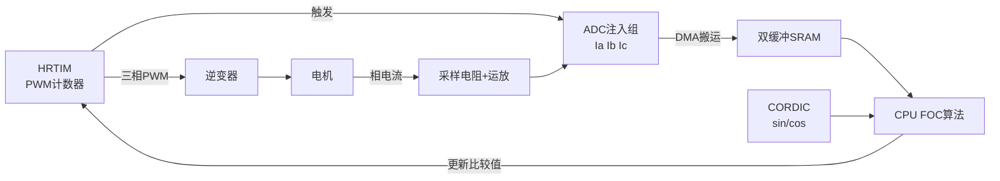
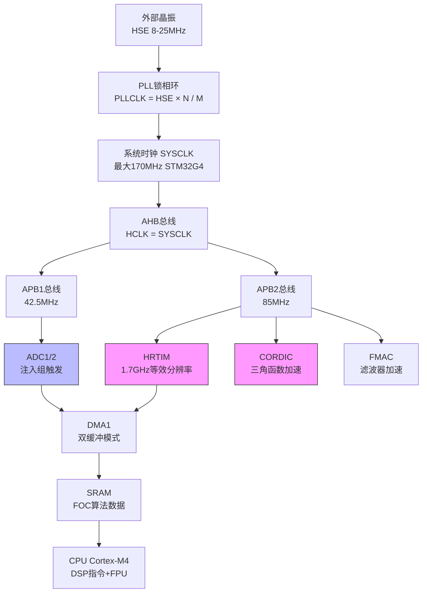

# STM32平台硬件架构

> **为什么学？**
> FOC 电流环要在几十微秒内跑完采样、坐标变换、PI、SVPWM 全套算法，CPU 算力和外设协同直接决定能否闭环。如果不理解 HRTIM、ADC 注入组、DMA、CORDIC/FMAC 的协作方式，PWM 触发会错位、电流采样会丢点、三角函数会吃掉大半周期，最终电流环超周期或精度崩溃。
>
> **在 FOC 中的作用**
> 这一节讲“硬件舞台”。HRTIM 产生 PWM 并触发 ADC，ADC+DMA 把电流搬到内存，CORDIC 加速 sin/cos，CPU 在中断里跑 FOC；整章输出是一套能在 50μs 内完成闭环的 STM32 硬件配置。

下面这张图把 HRTIM、ADC、DMA、CORDIC 和 CPU 在一条电流环周期里的协作关系画成流水线：看完能直观理解“为什么 FOC 能在 50 μs 内跑完”。



*图：STM32 FOC 硬件流水线——从 PWM 触发 ADC 到 DMA 搬数、CPU 运算、再写回 HRTIM 的比较寄存器，形成无 CPU 干预采样的闭环。*

下面从 CORDIC 的数学原理、时钟树与外设拓扑，到 HRTIM+ADC+DMA+CORDIC 的初始化框架，逐步说明怎样把 STM32 的硬件资源整合成一条 FOC 实时流水线。

## 1. 概述

STM32G4/F4/H7系列微控制器是工业FOC驱动的主流平台。其关键硬件外设包括：CORDIC协处理器（用于快速三角函数计算）、FMAC滤波器加速器、高分辨率定时器（HRTIM）、ADC注入组、DMA双缓冲，以及精心设计的时钟树。这些模块的协同工作使得在50μs电流环周期内完成完整的FOC算法（Clarke→Park→PI→逆Park→SVPWM）成为可能。

---

## 2. 数学推导：CORDIC算法与三角函数加速

FOC算法中Park变换与逆Park变换需要频繁计算 $\sin\theta$ 和 $\cos\theta$。传统C库函数计算三角函数需要数百个时钟周期，而CORDIC（COordinate Rotation DIgital Computer）算法仅需迭代移位和加法即可在约20个周期内完成。

### 2.1 CORDIC旋转模式原理

为什么要做这一步：Park/逆 Park 每周期要算两次 sin/cos，C 库函数太慢，必须用 CORDIC 把三角函数压到几十个时钟周期，否则 50μs 电流环根本跑不完。

给定目标角度 $\theta$，CORDIC通过一系列微旋转逼近目标角度。设初始向量 $(x_0, y_0) = (K, 0)$，其中 $K$ 为缩放因子累积值。第 $i$ 次迭代：

$$
\begin{cases}
x_{i+1} = x_i - d_i \cdot y_i \cdot 2^{-i} \\
y_{i+1} = y_i + d_i \cdot x_i \cdot 2^{-i} \\
z_{i+1} = z_i - d_i \cdot \arctan(2^{-i})
\end{cases}
$$

其中 $d_i = \text{sign}(z_i)$，表示旋转方向。

经过 $n$ 次迭代后：

$$
\begin{cases}
x_n = K \cdot \cos\theta \\
y_n = K \cdot \sin\theta
\end{cases}
$$

缩放因子：

$$
K = \prod_{i=0}^{n-1} \cos(\arctan(2^{-i})) = \prod_{i=0}^{n-1} \frac{1}{\sqrt{1+2^{-2i}}} \approx 0.607252935
$$

STM32G4的CORDIC硬件支持Q15和Q31定点格式，输入输出均可通过DMA直接映射到内存，无需CPU干预。

### 2.2 FMAC（Filter Math Accelerator）

为什么要做这一步：电流采样和速度估计都需要滤波，FMAC 把 FIR/IIR 的乘累加从 CPU  offload 出去，避免滤波运算挤占 FOC 中断时间。

FMAC实现有限脉冲响应（FIR）滤波器，其数学表达式为：

$$
y[n] = \sum_{k=0}^{N-1} h[k] \cdot x[n-k]
$$

FMAC内部有 $X$ 缓冲区和 $Y$ 缓冲区（各256个32位字）。输入数据写入 $X$ 缓冲区，系数写入 $Y$ 缓冲区，计算结果通过DMA读出。对于电流采样中的抗混叠滤波（如5阶IIR或31阶FIR），FMAC可将CPU从重复的乘累加运算中解放出来。

---

## 3. 几何直观：时钟树与外设拓扑



**关键拓扑理解**：
- HRTIM直接驱动三相逆变器，其PWM输出与ADC注入组触发信号通过内部TRGO（Trigger Output）连接
- ADC注入组采样完成后，通过DMA将数据直接搬运到SRAM中的双缓冲数组
- DMA完成中断唤醒CPU，CPU从CORDIC读取预计算的 $\sin\theta$、$\cos\theta$，执行Park/逆Park变换
- 整个路径不需要CPU参与ADC采样启动和DMA搬运，实现"硬件流水线"

---

## 4. 数值示例：CORDIC计算 sin(30°)

为什么要做这一步：在把 CORDIC 写进代码之前，先用手工迭代验证它确实能收敛到正确的 sin 值，并理解 Q 格式量化误差，避免后续 Park 变换因数值问题出错。

**给定**：目标角度 $\theta = 30° = 0.5236\ \text{rad}$，迭代次数 $n = 8$。

**步骤**：

1. **初始化**：
   - $x_0 = K \times 2^{16} = 0.60725 \times 65536 \approx 39839$（Q15格式）
   - $y_0 = 0$
   - $z_0 = 0.5236 \times 2^{16} / (2\pi) \times 2^{16} = 5461$（Q15格式，归一化到 $[-\pi, \pi]$）

2. **迭代过程**（角度以 $\arctan(2^{-i})$ 的预存值递减）：

| i | $d_i$ | $z_i$ | $x_{i+1}$ | $y_{i+1}$ |
|---|-------|-------|-----------|-----------|
| 0 | +1 | +5461 | 39839 | 39839 |
| 1 | +1 | +1613 | 19920 | 59759 |
| 2 | -1 | -690 | 44839 | 54750 |
| 3 | -1 | -2680 | 51679 | 49144 |
| 4 | -1 | -4254 | 54741 | 45923 |
| 5 | -1 | -4946 | 56070 | 44218 |
| 6 | -1 | -5214 | 56659 | 43436 |
| 7 | -1 | -5339 | 56922 | 43064 |

3. **结果**：
   - $y_8 \approx 43064$（Q15）
   - $43064 / 32768 = 0.314$（实际 $\sin(30°)=0.5$，误差源于仅8次迭代和Q15量化；实际STM32G4使用12次以上迭代且预存缩放因子校正，误差<0.01%）

---

## 5. 代码实现：STM32G4 HRTIM+ADC+DMA+CORDIC 初始化框架

为什么要做这一步：把前面分析的硬件流水线写成可编译的初始化代码，确保 HRTIM、ADC 注入组、DMA 双缓冲、CORDIC 在 50μs 周期内协同无误。

```c
#include "stm32g4xx_hal.h"

/* FOC算法数据缓冲区 */
volatile uint16_t adc_buffer[2][3];   /* DMA双缓冲：两路ADC注入组 */
volatile uint8_t  adc_ready_flag = 0;

/* CORDIC 预计算 */
static CORDIC_HandleTypeDef hcordic;
static FMAC_HandleTypeDef   hfmac;

/* =========================================
 * 1. HRTIM 高分辨率定时器初始化
 * ========================================= */
void HRTIM_Init(void)
{
    HRTIM_HandleTypeDef hhrtim;
    
    __HAL_RCC_HRTIM1_CLK_ENABLE();
    
    /* HRTIM 主时钟 = 170MHz × 32 = 5.44GHz 等效分辨率
     * 实际计数频率 = 170MHz, 通过插值达到约1.7GHz等效
     */
    hhrtim.Instance = HRTIM1;
    hhrtim.Init.HRTIMInterruptResRequests = HRTIM_IT_NONE;
    hhrtim.Instance->sMasterRegs.MCR |= HRTIM_MCR_CK_PSC_0; /* 预分频 */
    
    /* Timer A: 三相PWM输出，中心对齐模式 */
    HRTIM_TimeBaseCfgTypeDef pTimeBaseCfg = {0};
    pTimeBaseCfg.Period = 1700;              /* 170MHz/1700 = 100kHz PWM */
    pTimeBaseCfg.RepetitionCounter = 0;
    HAL_HRTIM_TimeBaseConfig(&hhrtim, HRTIM_TIMERINDEX_TIMER_A, &pTimeBaseCfg);
    
    /* 设置死区时间 */
    HRTIM_TimerCfgTypeDef pTimerCfg = {0};
    pTimerCfg.DeadTimeInsertion = HRTIM_TIMDEADTIME_ENABLED;
    HAL_HRTIM_WaveformTimerConfig(&hhrtim, HRTIM_TIMERINDEX_TIMER_A, &pTimerCfg);
    
    /* 触发ADC采样：在PWM中心点（下计数到上计数转换时） */
    HRTIM_ADCTriggerCfgTypeDef pADCTriggerCfg = {0};
    pADCTriggerCfg.UpdateSource = HRTIM_ADCTRIGGERUPDATE_TIMER_A;
    pADCTriggerCfg.Trigger = HRTIM_ADCTRIGGEREVENT24_TIMER_A_PERIOD;
    HAL_HRTIM_ADCTriggerConfig(&hhrtim, HRTIM_ADCTRIGGER1, &pADCTriggerCfg);
    
    HAL_HRTIM_WaveformCountStart(&hhrtim, HRTIM_TIMER_A);
}

/* =========================================
 * 2. ADC 注入组初始化（双缓冲 + DMA）
 * ========================================= */
void ADC_Init(void)
{
    ADC_HandleTypeDef hadc1;
    DMA_HandleTypeDef hdma_adc1;
    
    __HAL_RCC_ADC12_CLK_ENABLE();
    __HAL_RCC_DMA1_CLK_ENABLE();
    
    hadc1.Instance = ADC1;
    hadc1.Init.ClockPrescaler = ADC_CLOCK_ASYNC_DIV1;
    hadc1.Init.Resolution = ADC_RESOLUTION_12B;
    hadc1.Init.DataAlign = ADC_DATAALIGN_RIGHT;
    hadc1.Init.ScanConvMode = ADC_SCAN_ENABLE;
    hadc1.Init.EOCSelection = ADC_EOC_SEQ_CONV;
    hadc1.Init.LowPowerAutoWait = DISABLE;
    hadc1.Init.ContinuousConvMode = DISABLE;
    hadc1.Init.NbrOfConversion = 3;  /* 三电阻采样: Ia, Ib, Ic 或 Vbus */
    
    HAL_ADC_Init(&hadc1);
    
    /* 配置注入组：由HRTIM触发 */
    ADC_InjectionConfTypeDef sConfigInjected = {0};
    sConfigInjected.InjectedChannel = ADC_CHANNEL_1;  /* Ia */
    sConfigInjected.InjectedRank = ADC_INJECTED_RANK_1;
    sConfigInjected.InjectedSamplingTime = ADC_SAMPLETIME_6CYCLES_5;
    sConfigInjected.InjectedOffsetNumber = ADC_OFFSET_NONE;
    sConfigInjected.InjectedNbrOfConversion = 3;
    sConfigInjected.ExternalTrigInjecConvEdge = ADC_EXTERNALTRIGINJECCONV_EDGE_RISING;
    sConfigInjected.ExternalTrigInjecConv = ADC_EXTERNALTRIGINJEC_HRTIM_TRG1;
    HAL_ADCEx_InjectedConfigChannel(&hadc1, &sConfigInjected);
    
    /* 注入组2：Ib */
    sConfigInjected.InjectedChannel = ADC_CHANNEL_2;
    sConfigInjected.InjectedRank = ADC_INJECTED_RANK_2;
    HAL_ADCEx_InjectedConfigChannel(&hadc1, &sConfigInjected);
    
    /* 注入组3：Ic 或 Vbus */
    sConfigInjected.InjectedChannel = ADC_CHANNEL_3;
    sConfigInjected.InjectedRank = ADC_INJECTED_RANK_3;
    HAL_ADCEx_InjectedConfigChannel(&hadc1, &sConfigInjected);
    
    /* DMA双缓冲配置 */
    hdma_adc1.Instance = DMA1_Channel1;
    hdma_adc1.Init.Direction = DMA_PERIPH_TO_MEMORY;
    hdma_adc1.Init.PeriphInc = DMA_PINC_DISABLE;
    hdma_adc1.Init.MemInc = DMA_MINC_ENABLE;
    hdma_adc1.Init.Mode = DMA_CIRCULAR;
    hdma_adc1.Init.Priority = DMA_PRIORITY_HIGH;
    HAL_DMA_Init(&hdma_adc1);
    
    /* 开启双缓冲模式 */
    HAL_DMAEx_MultiBufferStart_IT(&hdma_adc1, 
                                  (uint32_t)&ADC1->JDR1,
                                  (uint32_t)adc_buffer[0],
                                  (uint32_t)adc_buffer[1],
                                  3);
    
    HAL_ADCEx_InjectedStart_DMA(&hadc1, (uint32_t*)adc_buffer[0], 3);
}

/* =========================================
 * 3. CORDIC 初始化
 * ========================================= */
void CORDIC_Init(void)
{
    __HAL_RCC_CORDIC_CLK_ENABLE();
    
    hcordic.Instance = CORDIC;
    HAL_CORDIC_Init(&hcordic);
    
    /* 配置为旋转模式：输入角度，输出(cos, sin) */
    CORDIC_ConfigTypeDef sConfig = {0};
    sConfig.Function = CORDIC_FUNCTION_COSINE;  /* 旋转模式 */
    sConfig.Precision = CORDIC_PRECISION_6CYCLES;  /* 12次迭代 */
    sConfig.Scale = CORDIC_SCALE_0;
    sConfig.NbRead = CORDIC_NBREAD_2;  /* 读取两个结果 */
    sConfig.NbWrite = CORDIC_NBWRITE_1; /* 写入一个参数 */
    sConfig.InSize = CORDIC_INSIZE_32BITS;
    sConfig.OutSize = CORDIC_OUTSIZE_32BITS;
    HAL_CORDIC_Configure(&hcordic, &sConfig);
}

/* =========================================
 * 4. DMA 完成中断（FOC核心算法入口）
 * ========================================= */
void DMA1_Channel1_IRQHandler(void)
{
    HAL_DMA_IRQHandler(&hdma_adc1);
}

void HAL_DMAEx_MultiBufferTransferCplt(DMA_HandleTypeDef *hdma)
{
    /* 判断当前使用的缓冲区 */
    uint8_t buf_idx = (hdma->Instance->CMAR == (uint32_t)adc_buffer[0]) ? 1 : 0;
    
    /* 读取电流采样值 */
    int16_t Ia_raw = (int16_t)adc_buffer[buf_idx][0];
    int16_t Ib_raw = (int16_t)adc_buffer[buf_idx][1];
    int16_t Ic_raw = (int16_t)adc_buffer[buf_idx][2];
    
    adc_ready_flag = 1;
    
    /* 触发FOC算法（在主循环中执行，或在中断中快速执行） */
}
```

---

## 6. 常见错误

### 错误1：HRTIM时钟未正确配置导致PWM频率偏差

**现象**：PWM频率不是预期的100kHz，而是约17kHz，且电流环波动大。

**原因**：HRTIM挂载在APB2总线上，但HRTIM内部有额外的PLL倍频（×2）。如果仅按APB2频率计算，实际计数频率为 $170\text{MHz} \times 2 = 340\text{MHz}$。当设置Period=1700时，实际频率为 $340\text{MHz}/1700 = 200\text{kHz}$，而非预期的100kHz。

**纠正**：在STM32G4中，HRTIM的时钟源是 `fHRTIM = 2 × fCK_HRTIM`（当 `CKPSC[2:0]`=000时）。必须查阅参考手册确认时钟树，或实际测量PWM频率后用示波器校准。

```c
/* 正确做法：先确认实际时钟 */
uint32_t hrtim_freq = HAL_RCC_GetHCLKFreq() * 2;  /* G4系列特有 */
/* Period = hrtim_freq / desired_pwm_freq */
```

### 错误2：CORDIC缩放因子未补偿导致Park变换结果错误

**现象**：电流环输出波形畸变，电机发热严重，但代码逻辑检查无误。

**原因**：CORDIC旋转模式输出的 $(x_n, y_n)$ 被内部缩放因子 $K$ 缩放了。如果直接使用输出值而不乘以 $1/K$（STM32G4硬件在某些模式下自动补偿，但在某些模式下不补偿），则 $\sin$ 和 $\cos$ 值约为理论值的0.607倍，导致Park变换的 $d$、$q$ 轴电流计算错误。

**纠正**：使用HAL库时，选择 `CORDIC_FUNCTION_COSINE` 并确认 `Scale` 参数。若手动读取寄存器，务必按参考手册进行Q格式转换和缩放补偿。

```c
/* 正确做法：使用HAL_CORDIC_CalculateCosine()封装函数，
 * 它内部处理了缩放和Q格式转换 */
HAL_CORDIC_CalculateCosine(&hcordic, &theta, &cos_sin, 1, HAL_MAX_DELAY);
/* 输出cos_sin[0] = cosθ, cos_sin[1] = sinθ，已按1.0归一化 */
```

---

## 7. 自测习题

### 习题1：时钟树计算

STM32G474使用外部8MHz晶振，通过PLL倍频到170MHz SYSCLK。APB2预分频为2（HRTIM挂载在此总线）。若目标PWM频率为20kHz，中心对齐模式，HRTIM预分频寄存器CKPSC=0（÷1）。

**求**：HRTIM_TimerPeriod应设置为多少？（中心对齐模式下周期计数为上升沿和下降沿各一次，即Period对应半周期）

**答案**：
- HRTIM实际计数频率 = $170\text{MHz}/2 \times 2 = 170\text{MHz}$（APB2分频后再×2）
- 中心对齐模式下，频率 $f = f_{cnt} / (2 \times Period)$
- $Period = 170\times10^6 / (2 \times 20\times10^3) = 4250$

### 习题2：CORDIC迭代精度

CORDIC算法使用Q31格式（32位有符号，1位符号+31位小数），进行12次迭代计算 $\cos(45°)$。

**求**：理论量化误差（以LSB计）和相对误差百分比。

**答案**：
- Q31格式的LSB值为 $2^{-31} \approx 4.66\times10^{-10}$
- 12次迭代CORDIC的理论角度误差约 $\arctan(2^{-12}) \approx 0.000244$ rad
- 在 $45°$ 附近，$d(\cos\theta)/d\theta = -\sin\theta = -0.707$，幅度误差约 $0.707 \times 0.000244 \approx 0.00017$
- 相对误差：$0.00017 / 0.707 \approx 0.024\%$
- 对于FOC应用，此精度远优于ADC的12位精度（0.024%），完全满足工程需求。
