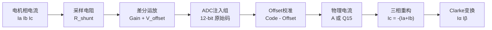
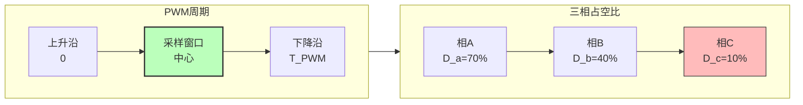

# ADC电流采样与三相重构

> **为什么学？**
> FOC 的输入是定子电流，而 ADC 测到的是运放输出电压；采样时刻错了会采到开关噪声，三相重构错了会给 Park 变换送去错误的 $I_d$、$I_q$。如果不理解采样窗口、Offset 校准和重构原理，电流环会出现零漂、抖动甚至失控。
>
> **在 FOC 中的作用**
> 这一节是 FOC 闭环的“入口”。它把逆变器下桥臂的电压信号还原成 $I_a$、$I_b$、$I_c$，为 Clarke 变换和电流 PI 控制器提供准确的反馈量。

下面先推导三相重构的数学依据，再讨论采样时刻选择、Offset 校准、抗混叠滤波等工程细节，说明如何把硬件 ADC 的原始码变成 FOC 能用的电流值。

这张图把“相电流 → 电压 → ADC 码 → 校准电流 → 三相重构”的完整链路画出来，便于理解低侧采样中每一步的物理意义和误差来源。



*图：从相电流到 Clarke 变换前的信号链——帮你把采样电阻、运放偏置、ADC 码值、Offset 校准和三相重构串成一条可落地的数据流。*

下面先推导三相重构的数学依据，再讨论采样时刻选择、Offset 校准和抗混叠滤波等工程细节，说明如何把硬件 ADC 的原始码变成 FOC 能用的电流值。

## 1. 概述

FOC算法的输入是定子电流 $I_a$、$I_b$、$I_c$，而ADC的物理输入是运放输出的电压信号。电流采样策略分为双电阻采样（测量两相，重构第三相）和三电阻采样（同时测量三相）。本章从数学原理出发，推导三相重构公式，讨论采样时刻选择、Offset校准、抗混叠滤波等工程细节。

---

## 2. 数学推导：三相重构与采样时刻

### 2.1 双电阻采样的三相重构

为什么要做这一步：三电阻成本高、ADC 通道多，双电阻方案靠 KCL 重构第三相可以省一路采样，但前提是理解 $I_a+I_b+I_c=0$ 的约束和误差传递。

三相电机满足基尔霍夫电流定律（KCL）：

$$
I_a + I_b + I_c = 0
$$

因此，若同时测量 $I_a$ 和 $I_b$，第三相可由下式重构：

$$
I_c = -(I_a + I_b)
$$

### 2.2 采样时刻的选择：为什么要在PWM"ON"期中心采样？

三相逆变器的每相桥臂由上下两个功率器件组成。采样窗口取决于分流电阻位置：相线内置（inline）分流器几乎可连续观察相电流；低侧分流器只有在该相电流确实流经低侧支路及其分流器、且放大器已从开关瞬态恢复时才有效。不能只根据“上管 ON”或“下管 ON”一句话判断，也不能认为低侧分流器整个 PWM 周期都可采样。

对低侧分流器，常把触发点放在某个有效导通窗口的中部，以同时远离前后开关边沿。在电压近似恒定、一个窗口内电流斜率近似线性时，中点样值可近似该窗口平均值；它不保证严格等于整个 PWM 周期平均电流。采样目标首先是获得与控制时刻一致、无开关污染的瞬时电流，而不是机械地追求“PWM ON 期中心”。

设某一待测低侧支路的连续有效导通时间为 $T_{on,low}$。扣除器件切换、消隐和模拟前端建立时间后，可用窗口应满足：

$$
T_{usable}=T_{on,low}-t_{blank,left}-t_{blank,right}
$$

为避免采样到MOSFET开关瞬态（上升/下降沿约数百纳秒到1微秒），有效采样窗口需满足：

$$
T_{usable}>t_{acq}+t_{conv}+t_{margin}
$$

各时间必须由所用栅极驱动、功率器件、分流放大器、ADC 采样时间和触发链路确定。占空比到 $T_{on,low}$ 的换算还依赖高有效/低有效、中心/边沿对齐及续流状态，不能用统一的 $\min(D_a,D_b,D_c)T_{PWM}$ 代替。

### 2.3 三电阻采样 vs 双电阻采样

| 方案 | 采样电阻数 | 适用条件 | 优点 | 缺点 |
|------|-----------|----------|------|------|
| 三低侧电阻 | 3 | 至少两相存在同步有效窗口 | 可冗余校验，通常少做一相代数重构 | 仍受低侧导通窗口限制 |
| 双低侧电阻 | 2 | 两个被测支路在触发点都有效 | 节省一个分流器和放大通道 | 高调制比/扇区边界可能缺窗口 |
| 三相线内置电阻 | 3 | 受放大器共模范围与恢复时间约束 | 采样窗口最宽，可直接测三相 | 共模瞬变、成本与布局难度更高 |

双低侧电阻方案必须保证两个测量值对应同一控制时刻或经过斜率补偿，并且两路都有效；否则用 $i_c=-(i_a+i_b)$ 只会传播错误。接近调制边界时常用扇区相关的采样点移动、PWM 脉冲移位、上一周期预测或切换到可观测的相组合。具体能力取决于 MCU 的定时器—ADC 触发资源。

---

## 3. 几何直观：SVPWM周期内的采样窗口



**SVPWM周期中的采样时机分析**：

```
PWM计数（中心对齐）:

     ^
     |         ___________
Ua   |        /|          |\
     |       / |          | \
     |      /  |          |  \
     |_____/   |          |   \___________
     0      T1 T2       T3 T4          T_PWM

Ub:  ____/|\____________/|\____________
     0   T1 T2        T3 T4

Uc:  /\________________/\
    T1 T2              T3 T4

采样触发时刻: 由当前扇区和零/有效矢量持续时间计算
              只有处于 000 且低侧支路已建立时，三低侧分流器才可能同时有效
```

**关键理解**：七段式 SVPWM 的两个零矢量并不等价于低侧采样。`000` 可为三低侧分流器提供共同窗口，`111` 则使上桥臂导通，低侧分流器通常不可见；中心点究竟落在哪个矢量还取决于序列排列。应根据实际开关状态计算有效窗口，并在窗口中部留足消隐和建立时间。中点采样只能降低纹波偏差，不能声称纹波“平均为零”。

---

## 4. 数值示例：给定电流值，手工计算ADC原始码和重构结果

为什么要做这一步：把采样电阻、运放增益、ADC 分辨率、Offset 校准串成一个完整算例，才能在写代码前确认量程、分辨率和零漂处理是否正确。

**给定参数**：
- 电机额定电流：$I_{rated} = 5\ \text{A}$（有效值）
- 采样电阻：$R_{shunt} = 0.01\ \Omega$
- 运放增益：$G_{amp} = 20$（差分放大）
- ADC参考电压：$V_{ref} = 3.3\ \text{V}$，12位分辨率
- 瞬时值：$I_a = 3.0\ \text{A}$，$I_b = -2.0\ \text{A}$

**求**：ADC原始码、重构 $I_c$、以及考虑Offset后的校准值。

**步骤1：计算运放输出电压**

运放输入端电压（单端对地）：

$$
V_{shunt} = I \cdot R_{shunt}
$$

运放输出：

$$
V_{out} = V_{offset} + I \cdot R_{shunt} \cdot G_{amp}
$$

通常 $V_{offset} = V_{ref}/2 = 1.65\ \text{V}$（双向电流测量）。

- $V_{a} = 1.65 + 3.0 \times 0.01 \times 20 = 1.65 + 0.6 = 2.25\ \text{V}$
- $V_{b} = 1.65 + (-2.0) \times 0.01 \times 20 = 1.65 - 0.4 = 1.25\ \text{V}$

**步骤2：计算ADC原始码**

12位ADC：$Code = V_{out} / V_{ref} \times 4096$

- $Code_a = 2.25 / 3.3 \times 4096 = 2793$
- $Code_b = 1.25 / 3.3 \times 4096 = 1552$

**步骤3：电流值计算（含Offset校准）**

Offset校准：在电机静止时（$I=0$），采样多组ADC码求平均，得到 $Code_{offset}$。

假设测得 $Code_{offset} = 2048$（对应 $V_{offset}=1.65$V）。

电流计算公式：

$$
I = \frac{Code - Code_{offset}}{4096} \cdot \frac{V_{ref}}{R_{shunt} \cdot G_{amp}}
$$

- $I_a = (2793 - 2048) / 4096 \times 3.3 / (0.01 \times 20) = 745/4096 \times 16.5 = 3.00\ \text{A}$ ✓
- $I_b = (1552 - 2048) / 4096 \times 16.5 = -496/4096 \times 16.5 = -2.00\ \text{A}$ ✓

**步骤4：三相重构**

$$
I_c = -(I_a + I_b) = -(3.0 + (-2.0)) = -1.0\ \text{A}
$$

验证 $V_c = 1.65 + (-1.0) \times 0.01 \times 20 = 1.45\ \text{V}$，$Code_c = 1.45/3.3 \times 4096 = 1799$。

---

## 5. 代码实现：双电阻采样 + 三相重构 + Offset校准

为什么要做这一步：前面的公式要落地成可运行的 C 代码，包括 Offset 自动校准、双电阻重构、三电阻直采和数字滤波，确保每次 FOC 中断都能拿到可靠的电流。

```c
#include <stdint.h>

/* =========================================
 * 电流采样参数与数据结构
 * ========================================= */
#define ADC_RESOLUTION     4096    /* 12位ADC */
#define VREF_MV            3300    /* 3.3V */
#define RSHUNT_MOHM        10000   /* 10mΩ = 0.01Ω */
#define GAIN_AMP_X10       200     /* 增益20.0，放大10倍存储 */

/* Q格式：电流以 mA 为单位，Q15格式 */
#define CURRENT_Q          15

typedef struct {
    int16_t offset_a;      /* ADC offset校准值 */
    int16_t offset_b;
    int16_t offset_c;      /* 三电阻采样时有效 */
    int32_t Ia;            /* Q15, 单位mA */
    int32_t Ib;
    int32_t Ic;
    uint16_t raw_a;        /* ADC原始码 */
    uint16_t raw_b;
    uint16_t raw_c;
} CurrentSample_t;

CurrentSample_t g_current = {0};

/* =========================================
 * 1. Offset校准（电机静止时调用）
 * ========================================= */
void CurrentOffsetCalibrate(void)
{
    uint32_t sum_a = 0, sum_b = 0;
    const uint32_t samples = 256;  /* 平均256次 */
    
    for (uint32_t i = 0; i < samples; i++) {
        /* 等待ADC转换完成（由HRTIM触发） */
        while (!ADC_JEOC_FLAG);  /* 伪代码 */
        sum_a += ADC1->JDR1;     /* 注入组1: Ia */
        sum_b += ADC1->JDR2;     /* 注入组2: Ib */
    }
    
    g_current.offset_a = (int16_t)(sum_a / samples);
    g_current.offset_b = (int16_t)(sum_b / samples);
}

/* =========================================
 * 2. 双电阻采样 + 三相重构
 * ========================================= */
void CurrentSample_Reconstruct(void)
{
    /* 读取原始ADC值（DMA已完成搬运） */
    g_current.raw_a = ADC_DMA_Buffer[0];
    g_current.raw_b = ADC_DMA_Buffer[1];
    
    /* 减去Offset，得到有符号差值 */
    int16_t diff_a = (int16_t)g_current.raw_a - g_current.offset_a;
    int16_t diff_b = (int16_t)g_current.raw_b - g_current.offset_b;
    
    /* 转换为电流值（Q15格式，单位mA）
     * 
     * I = (Code - Offset) / 4096 * Vref / (Rshunt * Gain)
     *   = diff * 3300 / 4096 / (10000e-6 * 20)
     *   = diff * 3300 / 4096 / 0.2
     *   = diff * 3300 / 819.2
     *   ≈ diff * 4.028 (mA/LSB)
     * 
     * Q15转换: I_Q15 = diff * 4.028 * 32768 / 1000
     *               = diff * 131.8
     * 取近似: I_Q15 = diff * 132 / 1
     */
    const int32_t scale_factor = 132;  /* 预先标定 */
    
    g_current.Ia = ((int32_t)diff_a * scale_factor) >> CURRENT_Q;
    g_current.Ib = ((int32_t)diff_b * scale_factor) >> CURRENT_Q;
    
    /* 三相重构：Ic = -(Ia + Ib) */
    g_current.Ic = -(g_current.Ia + g_current.Ib);
}

/* =========================================
 * 3. 三电阻采样（直接读取三相）
 * ========================================= */
void CurrentSample_ThreePhase(void)
{
    g_current.raw_a = ADC_DMA_Buffer[0];
    g_current.raw_b = ADC_DMA_Buffer[1];
    g_current.raw_c = ADC_DMA_Buffer[2];  /* 第三路ADC */
    
    int16_t diff_a = (int16_t)g_current.raw_a - g_current.offset_a;
    int16_t diff_b = (int16_t)g_current.raw_b - g_current.offset_b;
    int16_t diff_c = (int16_t)g_current.raw_c - g_current.offset_c;
    
    const int32_t scale_factor = 132;
    
    g_current.Ia = ((int32_t)diff_a * scale_factor) >> CURRENT_Q;
    g_current.Ib = ((int32_t)diff_b * scale_factor) >> CURRENT_Q;
    g_current.Ic = ((int32_t)diff_c * scale_factor) >> CURRENT_Q;
}

/* =========================================
 * 4. 抗混叠数字滤波（一阶IIR低通）
 * ========================================= */
typedef struct {
    int32_t y_prev;  /* 上一次的输出 */
    int16_t alpha;   /* 滤波系数 Q15, 0~1 */
} IIR_LPF_t;

IIR_LPF_t lpf_ia = {.alpha = 3277};  /* 0.1 in Q15 */
IIR_LPF_t lpf_ib = {.alpha = 3277};
IIR_LPF_t lpf_ic = {.alpha = 3277};

int32_t IIR_Filter_Step(IIR_LPF_t *lpf, int32_t x)
{
    /* y = alpha * x + (1-alpha) * y_prev
     *   = y_prev + alpha * (x - y_prev) */
    int32_t diff = x - lpf->y_prev;
    lpf->y_prev = lpf->y_prev + ((diff * lpf->alpha) >> 15);
    return lpf->y_prev;
}

void CurrentApplyFilter(void)
{
    g_current.Ia = IIR_Filter_Step(&lpf_ia, g_current.Ia);
    g_current.Ib = IIR_Filter_Step(&lpf_ib, g_current.Ib);
    g_current.Ic = IIR_Filter_Step(&lpf_ic, g_current.Ic);
}
```

---

## 6. 常见错误

### 错误1：Offset校准时机错误，导致零漂

**现象**：电机静止时，软件显示电流不为零，$I_d$、$I_q$ 有直流分量，电机产生高频噪声或轻微振动。

**原因**：Offset校准在逆变器上电但未启动PWM时进行，此时采样电阻上的电压确实为零。但如果在校准后修改了PWM死区时间或运放配置，导致实际偏移发生变化，则校准值失效。另一种常见错误是在电机旋转时进行校准（例如误触发校准指令），此时电流非零，校准值完全错误。

**纠正**：
1. 等模拟电源、参考源和放大器进入规格允许的稳定区后再校准；等待时间按器件启动指标和实测确定，不固定写成 100 ms
2. 校准期间确认功率级不会向电机施加电压、相电流为零，且采用与运行时相同的 ADC 采样时间和通道配置
3. 每次上电重新平均通常比只读取 Flash 历史值更能覆盖温漂；若保存工厂标定值，也应把它与本次零电流校准、温度诊断和合理范围检查结合

```c
/* 上电校准流程 */
void PowerOnCalibrationSequence(void) {
    Disable_PWM_Output();           /* 确保三相桥臂关闭 */
    /* 此处等待模拟前端稳定：使用器件就绪标志或项目验证后的延时 */
    CurrentOffsetCalibrate();       /* 执行校准 */
    Enable_PWM_Output();            /* 允许启动 */
}
```

### 错误2：低占空比时双电阻采样失效，重构电流跳变

**现象**：低速大负载时，电机抖动；轻载低速时，电流波形出现毛刺。

**原因**：接近高调制比、过调制或某些扇区边界时，某个低侧有效窗口可能被压缩。若仍固定在 PWM 中心采样，触发点可能落在不可见状态或开关恢复区，第三相重构随之跳变。

**纠正**：
1. **添加采样有效性判断**：直接以定时器 tick 计算每一路低侧连续窗口，扣除消隐、建立、采集和裕量后再判定
2. **扇区相关触发或脉冲移位**：把触发点移入两路均可观测的窗口，必要时调整零矢量分配并补偿采样时刻差
3. **更换采样拓扑**：三低侧电阻可增加可选相组合但不会根除窗口限制；若需要更连续的可观测性，可评估相线内置分流器或隔离式相电流传感器

```c
/* 单路低侧窗口检查；low_on_ticks 由当前PWM模式与扇区计算 */
uint8_t IsLowSideWindowValid(uint16_t low_on_ticks,
                             uint16_t blanking_ticks,
                             uint16_t adc_ticks,
                             uint16_t margin_ticks) {
    uint32_t required = 2u * blanking_ticks + adc_ticks + margin_ticks;
    return (uint32_t)low_on_ticks > required;
}
```

---

## 7. 自测习题

### 习题1：ADC采样量程设计

已知电机峰值电流 $I_{peak} = 15\ \text{A}$，采样电阻 $R_{shunt} = 5\ \text{mΩ}$，运放增益 $G = 25$，ADC为12位（$V_{ref}=3.3$V，单极性输入）。

**求**：
1. 运放偏置电压 $V_{offset}$ 应设为多少才能覆盖±15A范围？
2. 电流分辨率为多少 mA/LSB？
3. 若采用10mΩ采样电阻但保持相同分辨率，运放增益应改为多少？

**答案**：
1. 原增益下满量程电流产生的信号幅值为 $15\times0.005\times25=1.875\ \text{V}$。单极性 3.3 V ADC 若要对称覆盖正负电流，应取 $V_{offset}\approx1.65\ \text{V}$，可用正负摆幅只有 1.65 V，因此原增益无法覆盖 $\pm15\ \text{A}$。令 $15\times0.005\times G\le1.65$，得 $G\le22$；实际还要为放大器输出摆幅、偏置误差和过流留裕量，工程取值应略低于 22。把偏置改为 1.875 V 不能解决问题，因为正向输出会达到 $3.75\ \text{V}$ 并超出 ADC 范围。
2. 若暂按理想 $G=22$ 计算，1 LSB 为 $3.3/4096=0.806$ mV，对应 $0.806\ \text{mV}/(0.005\ \Omega\times22)=7.33$ mA/LSB。这只是量化步距；有效分辨率还受 ADC 噪声、参考源、放大器噪声和 PWM 共模瞬态限制。
3. 若 $R_{shunt}=10$ mΩ，保持 $7.33$ mA/LSB：$G = 0.806\ \text{mV} / (0.01\ \Omega \times 0.00733\ \text{A}) = 11$。

### 习题2：三相重构误差分析

双电阻采样时，测得 $I_a = 5.00$ A（误差+2%），$I_b = -3.00$ A（误差-1%），真实值满足 $I_a + I_b + I_c = 0$。

**求**：重构的 $I_c$ 的相对误差百分比。

**答案**：
- 测量值：$I_a' = 5.00 \times 1.02 = 5.10$ A，$I_b' = -3.00 \times 0.99 = -2.97$ A
- 重构：$I_c' = -(5.10 + (-2.97)) = -2.13$ A
- 真实值：$I_c = -(5.00 + (-3.00)) = -2.00$ A
- 相对误差：$(-2.13 - (-2.00)) / (-2.00) \times 100\% = +6.5\%$

注意：重构误差不是简单的误差叠加，而是取决于误差方向和数值大小。若 $I_a$ 和 $I_b$ 误差同向，则 $I_c$ 误差更大；若反向，可能部分抵消。
