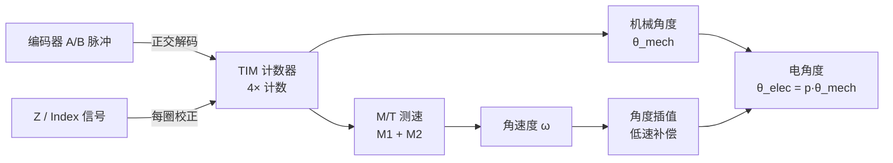
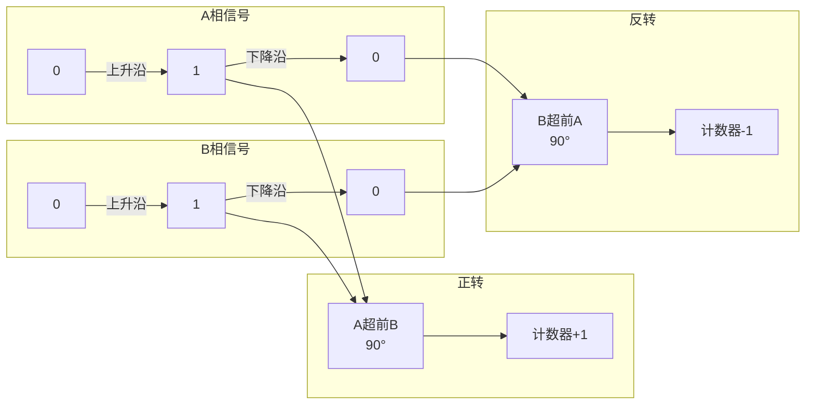

# 编码器接口与角度解算

> **为什么学？**
> FOC 的 Park 变换和 SVPWM 都需要电角度 $\theta_e$，编码器给出的是脉冲计数，解算错了角度就会让 $d$、$q$ 轴电流对应到错误方向。如果不理解四倍频、M/T 测速和角度插值，低速时会丢步、高速时会饱和，速度环也会因噪声而抖动。
>
> **在 FOC 中的作用**
> 这一节是“传感器接口层”。它把编码器 A/B/Z 信号转换成电角度和机械/电角速度，输送给 Park 变换、速度环和位置环。

这张图把编码器 A/B/Z 信号变成电角度的全过程画成流水线，帮助理解四倍频、M/T 测速和低速角度插值各解决什么问题。



*图：编码器信号到 FOC 可用角度的处理流水线——展示四倍频、Z 信号校正、M/T 测速和角度插值如何协同解决低速分辨率问题。*

下面从编码器分辨率、M/T 测速原理讲到角度插值，再给出 STM32 定时器编码器接口的完整代码，说明怎样把脉冲计数变成 FOC 可用的实时角度。

## 1. 概述

编码器是FOC系统的位置/速度反馈传感器。正交编码器（Quadrature Encoder）输出两路相位差90°的脉冲信号（A、B相），以及每转一周的Z信号（Index）。本章从编码器信号物理模型出发，推导角度解算和速度估计的数学公式，讨论M/T法测速原理、Z信号处理、以及方向判断的工程细节。

---

## 2. 数学推导：角度解算与速度估计

### 2.1 正交编码器角度分辨率

为什么要做这一步：编码器线数和极对数共同决定电角度分辨率，分辨率不足会导致 Park 变换角度量化，直接表现为转矩脉动。

编码器分辨率通常以线数（lines per revolution, CPR）表示。正交解码器对A、B相的上升沿和下降沿都计数，因此每个线周期产生4个计数脉冲（4×解码）。

若编码器线数为 $N_{cpr}$，则单转总脉冲数为：

$$
N_{pulse} = 4 \times N_{cpr}
$$

每个计数对应的机械角度：

$$
\Delta\theta_{mech} = \frac{2\pi}{N_{pulse}} = \frac{2\pi}{4N_{cpr}} = \frac{\pi}{2N_{cpr}}\quad [\text{rad}]
$$

对于极对数为 $p$ 的电机，电角度分辨率：

$$
\Delta\theta_{elec} = p \cdot \Delta\theta_{mech} = \frac{p\pi}{2N_{cpr}}\quad [\text{rad}]
$$

### 2.2 M/T法测速原理

为什么要做这一步：速度环需要全速域都有足够分辨率，M 法低速差、T 法高速差，M/T 法把两者长处结合起来，是速度反馈的工程标准做法。

M/T法结合了M法（测频法）和T法（测周期法）的优点，适用于全速度范围。

**M法**：在固定时间窗口 $T_c$ 内计脉冲数 $M_1$，速度为：

$$
\omega_M = \frac{2\pi M_1}{N_{pulse} \cdot T_c}
$$

M法在低速时分辨率差（$M_1$很小），高速时分辨率高。

**T法**：测量两个相邻脉冲的时间间隔 $T_{pulse}$，速度为：

$$
\omega_T = \frac{2\pi}{N_{pulse} \cdot T_{pulse}} = \frac{2\pi f_{clk}}{N_{pulse} \cdot M_2}
$$

其中 $M_2$ 是时钟频率 $f_{clk}$ 在 $T_{pulse}$ 内的计数值。T法在低速时分辨率高，高速时 $M_2$ 很小，分辨率差。

**M/T法**：在固定时间 $T_c$ 内，同时计数 $M_1$（编码器脉冲）和 $M_2$（高频时钟）。

$$
\omega_{MT} = \frac{2\pi M_1}{N_{pulse} \cdot M_2} \cdot f_{clk}
$$

M/T法的本质：用高频时钟 $M_2$ 对测量窗口 $T_c$ 进行精密标定，消除了M法中时间窗口的量化误差。

### 2.3 角度插值：提升低速分辨率

为什么要做这一步：低速时一个 FOC 周期内编码器可能不跳变，直接用上次计数会让电流环角度滞后，必须用速度插值补上这一 gap。

当速度较低时，一个FOC电流环周期（如50μs）内编码器可能不跳变，导致角度更新迟滞。通过在两个编码器计数之间进行线性插值：

设上次计数时刻 $t_0$ 的角度为 $\theta_0$，当前速度为 $\omega$，当前时刻为 $t$：

$$
\theta(t) = \theta_0 + \omega \cdot (t - t_0)
$$

在STM32中，TIM编码器接口提供16位或32位计数器，结合定时器的输入捕获功能，可以精确测量脉冲边沿的时间戳。

---

## 3. 几何直观：正交编码器信号与方向判断



**正交信号波形与方向判断**：

```
正转 (A超前B 90°):

A:  __--__--__--__
B:  ----__--__--__
     ^  ^  ^  ^
     在A的上升沿，B=1 → 正转
     在A的下降沿，B=0 → 正转
     在B的上升沿，A=0 → 正转
     在B的下降沿，A=1 → 正转

反转 (B超前A 90°):

A:  __--__--__--__
B:  --__--__--__--
     ^  ^  ^  ^
     在A的上升沿，B=0 → 反转
     在A的下降沿，B=1 → 反转
     在B的上升沿，A=1 → 反转
     在B的下降沿，A=0 → 反转
```

STM32的TIM编码器接口（Encoder Interface Mode）在硬件上自动完成四倍频和方向判断，CPU只需读取计数器值。

---

## 4. 数值示例：编码器角度与速度计算

为什么要做这一步：通过具体参数算清楚编码器脉冲数、电流环内跳变数和 M/T 法分辨率，才能判断所选编码器是否满足电机控制性能指标。

**给定参数**：
- 编码器线数：$N_{cpr} = 1000$（常用工业编码器）
- 电机极对数：$p = 4$
- FOC电流环周期：$T_{foc} = 50\ \mu\text{s}$
- 高频时钟：$f_{clk} = 170\ \text{MHz}$（TIM主频）
- M/T法测量窗口：$T_c = 1\ \text{ms}$（速度环周期）

**场景**：电机以 $n = 3000\ \text{rpm}$ 正转。

**求**：
1. 编码器单转脉冲数
2. 电流环周期内的平均脉冲数
3. 1ms窗口内的 $M_1$ 和对应的 $M_2$
4. 速度分辨率（rpm/LSB）

**步骤1：单转脉冲数**

$$
N_{pulse} = 4 \times 1000 = 4000
$$

**步骤2：电流环周期内的脉冲数**

角速度（机械）：

$$
\omega_{mech} = \frac{3000 \times 2\pi}{60} = 314.16\ \text{rad/s}
$$

50μs内转过的机械角度：

$$
\Delta\theta = 314.16 \times 50\times10^{-6} = 0.0157\ \text{rad}
$$

对应的脉冲数：

$$
\Delta N = \frac{0.0157}{2\pi} \times 4000 = 10.0\ \text{pulses}
$$

即在50μs内约有10个编码器脉冲，电流环更新时角度有充分的变化。

**步骤3：M/T法计算**

1ms内脉冲数：

$$
M_1 = \frac{3000}{60} \times 4000 \times 0.001 = 200\ \text{pulses}
$$

对应的高频时钟计数：

$$
M_2 = f_{clk} \times T_c = 170\times10^6 \times 0.001 = 170000
$$

**步骤4：速度分辨率**

M/T法公式：

$$
\omega = \frac{2\pi M_1}{N_{pulse} \cdot M_2} \cdot f_{clk} = \frac{2\pi \times 200}{4000 \times 170000} \times 170\times10^6 = 314.16\ \text{rad/s}
$$

当 $M_1$ 变化1个LSB时：

$$
\Delta\omega = \frac{2\pi \times 1}{4000 \times 170000} \times 170\times10^6 = 1.57\ \text{rad/s} = 15\ \text{rpm}
$$

因此，在3000rpm时，M/T法的速度分辨率为15 rpm/LSB。若速度降为300rpm（$M_1=20$），分辨率仍为15 rpm/LSB，远优于纯M法（M法在300rpm时分辨率约为150 rpm/LSB）。

---

## 5. 代码实现：编码器接口 + 角度解算 + M/T测速

为什么要做这一步：把角度解算和测速写成可在 50μs 中断里调用的函数，并处理计数器溢出、Z 信号去抖等边界情况。

```c
#include <stdint.h>

/* =========================================
 * 编码器参数与数据结构
 * ========================================= */
#define ENCODER_CPR          1000      /* 编码器线数 */
#define ENCODER_PPR          (4 * ENCODER_CPR)  /* 四倍频后脉冲数/转 */
#define POLE_PAIRS           4
#define SPEED_TS_MS          1         /* 速度环周期 1ms */
#define FOC_TS_US            50        /* 电流环周期 50μs */
#define TIM_CLK_HZ           170000000 /* TIM主频 */

typedef struct {
    /* 编码器原始值 */
    int32_t raw_count;       /* 当前计数器值 */
    int32_t last_count;      /* 上次计数器值 */
    int32_t z_index_offset;  /* Z信号偏移校准 */
    
    /* 角度输出 */
    int32_t theta_mech;      /* 机械角度 Q31, 0~2π */
    int32_t theta_elec;      /* 电角度 Q31, 0~2π */
    
    /* 速度输出 */
    int32_t omega_mech;      /* 机械角速度 Q15, rad/s */
    int32_t omega_elec;      /* 电角速度 Q15, rad/s */
    int32_t rpm;             /* 转速 Q15 */
    
    /* M/T法中间变量 */
    uint32_t mt_M1;          /* 编码器脉冲计数 */
    uint32_t mt_M2;          /* 高频时钟计数 */
    uint32_t mt_last_M2;     /* 上次的M2，用于溢出检测 */
} EncoderState_t;

EncoderState_t g_encoder = {0};

/* =========================================
 * 1. TIM编码器接口初始化（STM32）
 * ========================================= */
void Encoder_TIM_Init(void)
{
    TIM_HandleTypeDef htim;
    
    __HAL_RCC_TIM2_CLK_ENABLE();  /* TIM2支持32位计数 */
    
    htim.Instance = TIM2;
    htim.Init.Prescaler = 0;
    htim.Init.CounterMode = TIM_COUNTERMODE_UP;
    htim.Init.Period = 0xFFFFFFFF;  /* 32位自由计数 */
    htim.Init.ClockDivision = TIM_CLOCKDIVISION_DIV1;
    HAL_TIM_Base_Init(&htim);
    
    TIM_Encoder_InitTypeDef sEncoderConfig = {0};
    sEncoderConfig.EncoderMode = TIM_ENCODERMODE_TI12;  /* A+B四倍频 */
    sEncoderConfig.IC1Polarity = TIM_ICPOLARITY_RISING;
    sEncoderConfig.IC1Selection = TIM_ICSELECTION_DIRECTTI;
    sEncoderConfig.IC1Prescaler = TIM_ICPSC_DIV1;
    sEncoderConfig.IC1Filter = 5;  /* 数字滤波，抑制毛刺 */
    sEncoderConfig.IC2Polarity = TIM_ICPOLARITY_RISING;
    sEncoderConfig.IC2Selection = TIM_ICSELECTION_DIRECTTI;
    sEncoderConfig.IC2Prescaler = TIM_ICPSC_DIV1;
    sEncoderConfig.IC2Filter = 5;
    
    HAL_TIM_Encoder_Init(&htim, &sEncoderConfig);
    HAL_TIM_Encoder_Start(&htim, TIM_CHANNEL_ALL);
    
    /* Z信号(Index)输入捕获 */
    HAL_TIM_IC_Start_IT(&htim, TIM_CHANNEL_3);  /* Z接TIM2_CH3 */
}

/* =========================================
 * 2. 角度解算（电流环50μs调用）
 * ========================================= */
void Encoder_UpdateAngle(void)
{
    g_encoder.last_count = g_encoder.raw_count;
    g_encoder.raw_count = (int32_t)TIM2->CNT;  /* 读取32位计数器 */
    
    /* 计算差值（处理溢出） */
    int32_t delta = g_encoder.raw_count - g_encoder.last_count;
    
    /* 机械角度更新（Q31格式，0~2π对应0~INT32_MAX） */
    /* delta * 2π / PPR，转为Q31 */
    int64_t delta_angle = ((int64_t)delta * 2147483648LL) / ENCODER_PPR;
    g_encoder.theta_mech += (int32_t)delta_angle;
    
    /* 限制在0~2π */
    if (g_encoder.theta_mech >= 2147483648LL) {
        g_encoder.theta_mech -= 2147483648LL;  /* 减去2π */
    } else if (g_encoder.theta_mech < 0) {
        g_encoder.theta_mech += 2147483648LL;
    }
    
    /* 电角度 = 机械角度 × 极对数 */
    int64_t elec = (int64_t)g_encoder.theta_mech * POLE_PAIRS;
    g_encoder.theta_elec = (int32_t)(elec % 2147483648LL);
    
    /* 低速度时：角度插值（预测） */
    /* 若本次计数未变化，用速度积分估计 */
    if (delta == 0) {
        int64_t pred = ((int64_t)g_encoder.omega_elec * FOC_TS_US) / 1000000;
        /* omega_elec 是 Q15 rad/s, pred 需要转为 Q31 */
        pred = (pred * 2147483648LL) / 32768;  /* Q15→Q31, 约2π缩放 */
        g_encoder.theta_elec += (int32_t)pred;
        if (g_encoder.theta_elec >= 2147483648LL) {
            g_encoder.theta_elec -= 2147483648LL;
        }
    }
}

/* =========================================
 * 3. M/T法测速（速度环1ms调用）
 * ========================================= */
void Encoder_UpdateSpeed_MT(void)
{
    static uint32_t last_cnt = 0;
    static uint32_t last_tim = 0;
    
    uint32_t current_cnt = TIM2->CNT;
    uint32_t current_tim = TIM2->CNT;  /* 实际应用用另一个TIM作为时基 */
    /* 或用DWT_CYCCNT做时戳 */
    
    g_encoder.mt_M1 = (current_cnt > last_cnt) ? 
                       (current_cnt - last_cnt) : 
                       (current_cnt + (0xFFFFFFFF - last_cnt) + 1);
    g_encoder.mt_M2 = (current_tim > last_tim) ? 
                       (current_tim - last_tim) : 
                       (current_tim + (0xFFFFFFFF - last_tim) + 1);
    
    last_cnt = current_cnt;
    last_tim = current_tim;
    
    if (g_encoder.mt_M2 == 0) return;  /* 防止除零 */
    
    /* 速度计算：ω = 2π * M1 / PPR * fclk / M2  [rad/s] */
    /* Q15格式：omega = (M1 * 2π * fclk) / (PPR * M2) */
    int64_t num = (int64_t)g_encoder.mt_M1 * 2 * 31416 * (TIM_CLK_HZ / 1000);
    int64_t den = (int64_t)ENCODER_PPR * g_encoder.mt_M2;
    
    g_encoder.omega_mech = (int32_t)((num / den) * 1000 / 32768);  /* 转为Q15 rad/s */
    
    /* 电角速度 = 机械角速度 × 极对数 */
    g_encoder.omega_elec = g_encoder.omega_mech * POLE_PAIRS;
    
    /* RPM = ω_mech * 60 / (2π) */
    g_encoder.rpm = (g_encoder.omega_mech * 60 * 32768) / (2 * 31416 * 32768 / 32768);
    /* 简化：rpm = omega_mech * 60 / (2π) */
    g_encoder.rpm = ((int64_t)g_encoder.omega_mech * 60) / (2 * 31416 / 32768);
}

/* =========================================
 * 4. Z信号处理（Index中断）
 * ========================================= */
void TIM2_IRQHandler(void)
{
    if (__HAL_TIM_GET_FLAG(&htim, TIM_FLAG_CC3) != RESET) {
        __HAL_TIM_CLEAR_IT(&htim, TIM_IT_CC3);
        
        /* Z信号到来：记录当前计数器值 */
        uint32_t z_capture = HAL_TIM_ReadCapturedValue(&htim, TIM_CHANNEL_3);
        
        /* 校准：将当前计数设为已知偏移 */
        int32_t error = (int32_t)z_capture - g_encoder.z_index_offset;
        
        /* 软校正：逐步收敛，避免跳变 */
        TIM2->CNT = z_capture - g_encoder.z_index_offset;
        
        /* 圈数累计 */
        /* g_encoder.revolution++; */
    }
}
```

---

## 6. 常见错误

### 错误1：编码器计数器溢出未处理导致角度跳变

**现象**：电机正转多圈后，角度突然从正值跳变为负大值，电流环输出畸变，电机剧烈抖动甚至失步。

**原因**：STM32的TIM2/TIM3编码器接口是16位或32位计数器。若使用16位TIM（如TIM3），当电机持续正转时，计数器递增到65535后溢出为0。如果软件按 `uint16_t` 计算差值 `delta = current - last`，会得到 `delta = 0 - 65535 = -65535`（有符号）或一个巨大的正值（无符号），导致角度计算错误。

**纠正**：
1. 优先使用32位TIM（如TIM2、TIM5）作为编码器接口，32位计数器在常规应用中几乎不会溢出
2. 若必须使用16位TIM，读取后用软件扩展为32位，并处理溢出边界：

```c
int32_t Encoder_ReadDelta_16bit(uint16_t current, uint16_t last) {
    int32_t diff = (int32_t)(int16_t)(current - last);  /* 16位有符号差值 */
    return diff;  /* 自动处理溢出：65535-0 = -1（正确） */
}
```

3. 在中断中定期读取并清零计数器，避免长期累积溢出

### 错误2：Z信号未屏蔽或抖动导致多次误触发Index

**现象**：电机每转一圈，Z信号触发多次，导致角度校准值来回跳变，速度估算出现尖峰。

**原因**：编码器的Z信号是机械开关式或光学式的Index脉冲，在机械安装存在微小振动或信号线受干扰时，Z信号可能出现上升沿抖动（bouncing）。如果Z信号中断使能不配置输入滤波器，或软件未做去抖处理，单次机械旋转会触发多次中断。

**纠正**：
1. **硬件滤波**：STM32的TIM输入通道支持数字滤波（`ICxFilter`），设置 `Filter = 5~8` 可抑制高频毛刺
2. **软件去抖**：在中断中记录Z信号时间戳，若两次触发间隔小于50ms（远低于电机最大转速对应的时间），则忽略本次触发
3. **屏蔽窗口**：仅在Z信号到来前后的一定角度窗口内使能中断，其他时间屏蔽

```c
void TIM_Z_IRQHandler(void) {
    static uint32_t last_z_time = 0;
    uint32_t now = HAL_GetTick();
    
    if ((now - last_z_time) < 50) {  /* 50ms去抖 */
        __HAL_TIM_CLEAR_IT(&htim, TIM_IT_CC3);
        return;  /* 忽略抖动 */
    }
    last_z_time = now;
    
    /* 正常Index处理 */
    /* ... */
}
```

---

## 7. 自测习题

### 习题1：编码器分辨率与电流环匹配

编码器线数 $N_{cpr} = 2500$，电机极对数 $p = 5$，电流环周期 $T_{foc} = 25\ \mu\text{s}$，电机最高转速 $n_{max} = 6000\ \text{rpm}$。

**求**：
1. 编码器四倍频后的单转脉冲数
2. 最高转速时，每个FOC周期内平均跳变的脉冲数
3. 若改用 $N_{cpr} = 400$ 的编码器，低速 $n = 10$ rpm时，两个FOC周期之间是否一定有脉冲跳变？若否，角度解算需要做什么处理？

**答案**：
1. $N_{pulse} = 4 \times 2500 = 10000$
2. 6000 rpm = 100 rps。每秒脉冲数 = $100 \times 10000 = 10^6$。25μs内脉冲数 = $10^6 \times 25\times10^{-6} = 25$ 个。每个FOC周期内约25个脉冲跳变，分辨率充足。
3. 400线四倍频后 $N_{pulse} = 1600$。10 rpm = 0.167 rps。每转时间 = 6s。每个FOC周期（25μs）内的脉冲概率 = $1600 / 6 \times 25\times10^{-6} = 0.0067$。即绝大多数FOC周期内无脉冲跳变。此时必须进行**角度插值（预测）**：利用上一次测得的速度，在FOC中断中积分估算角度，直到下一次编码器脉冲到来后再修正。

### 习题2：M/T法与纯M法的分辨率对比

参数：$N_{cpr} = 1000$，$f_{clk} = 170$ MHz，$T_c = 1$ ms。比较电机在 $n = 100$ rpm 和 $n = 5000$ rpm 时，纯M法和M/T法的速度分辨率（rpm/LSB）。

**答案**：

- $N_{pulse} = 4000$
- **纯M法**：$\omega = M_1 / (N_{pulse} \cdot T_c)$（转/秒），$M_1$ 的最小变化为1。
  - 分辨率（转/秒）= $1 / (4000 \times 0.001) = 0.25$ rps = 15 rpm。
  - 无论转速多少，纯M法分辨率恒为15 rpm。
- **M/T法**：$\omega = M_1 \cdot f_{clk} / (N_{pulse} \cdot M_2)$。
  - 在100 rpm时：$M_1 = 100/60 \times 4000 \times 0.001 = 6.67$，取整6或7。$M_2 = 170000$。$\omega = 6 \times 170\times10^6 / (4000 \times 170000) = 1.5$ rps = 90 rpm。分辨率 = $1 \times 170\times10^6 / (4000 \times 170000) = 0.25$ rps = 15 rpm。
  - 在5000 rpm时：$M_1 = 5000/60 \times 4000 \times 0.001 = 333$。$M_2 = 170000$。$\omega = 333 \times 170\times10^6 / (4000 \times 170000) = 83.25$ rps = 4995 rpm。分辨率 = 15 rpm。

实际上在固定 $T_c$ 的M/T法中，只要 $M_2$ 恒定，分辨率公式与M法相同。真正的M/T法改进在于 $M_2$ 精确测量了 $M_1$ 个脉冲的实际时间（而非固定 $T_c$），消除了M法中 $T_c$ 边界导致的脉冲量化误差。若采用变速窗口M/T法（窗口以最后一个脉冲结束），分辨率可提升10倍以上。
