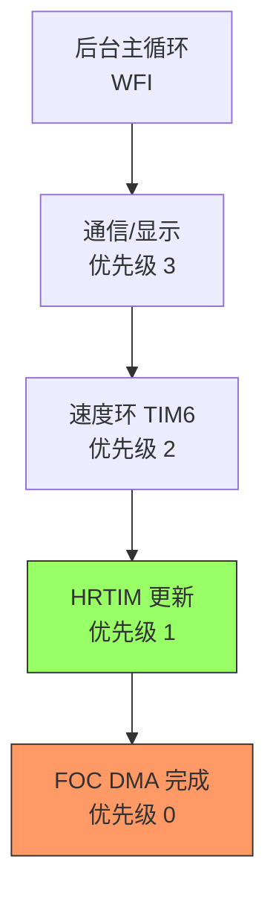
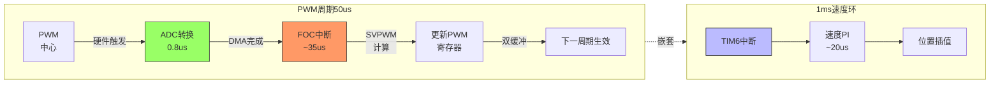

# FOC中断架构与定时调度

> **为什么学？**
> FOC 是硬实时系统，电流环必须在下一个 PWM 周期前完成，否则控制延迟会累积、相位裕度下降。如果不理解中断优先级、DMA 触发链和双缓冲，会出现 PWM 更新丢失、ADC 数据竞争、速度环抢占电流环等致命时序问题。
>
> **在 FOC 中的作用**
> 这一节讲“软件调度骨架”。它定义了 DMA 完成中断、PWM 更新中断、速度环中断的优先级和协作方式，保证采样→计算→PWM 更新在 50μs 内可靠运行。

这张图用优先级金字塔示意 NVIC 的抢占关系：FOC DMA 中断必须位于最顶端，才能在任何时刻优先完成电流环计算。



*图：FOC 系统中断优先级金字塔——越靠近顶层的 ISR 抢占权越高，确保电流环永远不被速度环或通信任务打断。*

下面从完整 FOC 信号链的时序约束出发，推导调度裕量，再用 NVIC 配置和双缓冲代码展示如何把硬件事件组织成一条不会丢周期的实时流水线。

## 1. 概述

FOC系统的实时性要求极高：电流环通常需在50μs以内完成采样→计算→PWM更新的完整闭环。实现这一目标的硬件基础是精密的中断架构和定时调度。本章从PWM触发ADC、DMA搬运、FOC算法中断到SVPWM更新的完整信号链出发，推导时序约束公式，讨论中断嵌套、优先级配置和调度优化。

---

## 2. 数学推导：中断时序约束与调度裕量

### 2.1 完整的FOC信号链时序

为什么要做这一步：在写中断服务函数之前，必须先量化 ADC 转换、DMA、FOC 算法、PWM 更新各占多少时间，确认总和小于 PWM 周期，否则后面调参再精细也会因超时失效。

一个典型的FOC电流环周期包含以下阶段：

```
T_PWM周期:
|----[PWM ON]----|----[PWM OFF]----|----[PWM ON]----|
                  |←T_samp→|        |←T_samp→|
                  ADC触发    ADC完成  DMA完成   FOC中断
```

**各阶段时间约束**：

1. **ADC触发延迟** $T_{trig}$：HRTIM事件到ADC开始转换，约数十纳秒（硬件同步）
2. **ADC转换时间** $T_{conv}$：STM32G4的12位ADC在时钟频率160MHz时，$T_{conv} = 6.5$ cycles ≈ 40.6 ns/cycle × 6.5 ≈ 264 ns。三通道注入组顺序采样总时间：$3 \times T_{conv} \approx 0.8\ \mu\text{s}$
3. **DMA搬运时间** $T_{dma}$：3个16位数据通过DMA总线搬运到SRAM，约数十个总线周期（约0.2μs）
4. **FOC算法执行时间** $T_{foc}$：包含Clarke、Park、PI、逆Park、SVPWM计算，在170MHz Cortex-M4上约20-40μs
5. **PWM更新延迟** $T_{update}$：写入HRTIM比较寄存器到实际输出变化，取决于双缓冲机制

**总时序约束**：

$$
T_{trig} + T_{conv} + T_{dma} + T_{foc} + T_{update} < T_{PWM}
$$

对于50μs电流环周期（20kHz PWM）：

$$
0.1 + 0.8 + 0.2 + 35 + 0.5 = 36.6\ \mu\text{s} < 50\ \mu\text{s}
$$

调度裕量：

$$
\text{Margin} = \frac{T_{PWM} - T_{total}}{T_{PWM}} \times 100\% = \frac{50 - 36.6}{50} \times 100\% = 26.8\%
$$

裕量应至少大于20%，以应对中断嵌套和异常路径。

### 2.2 中断优先级与嵌套分析

为什么要做这一步：NVIC 的抢占优先级决定了高优先级中断能否打断低优先级任务；FOC 中断必须最高，速度环次之，通信最低，这是实时性的根本保证。

STM32使用4位中断优先级（NVIC），分为抢占优先级（Preemption）和子优先级（Sub-priority）。

FOC系统中典型中断源：

| 中断源 | 优先级 | 抢占/子 | 说明 |
|--------|--------|---------|------|
| DMA1_Channel1（ADC完成） | 0 | 0/0 | 最高，启动FOC计算 |
| HRTIM_Master（PWM更新） | 1 | 1/0 | 更新PWM比较值 |
| TIM6（速度环1ms） | 2 | 2/0 | 速度环计算 |
| TIM7（通信/显示） | 3 | 3/0 | 最低，后台任务 |
| UART（故障上报） | 1 | 1/1 | 紧急故障可抢占 |

**关键约束**：
- DMA完成中断必须能抢占速度环中断，否则ADC数据丢失
- 速度环中断不能抢占FOC中断，否则电流环抖动
- 任何中断的执行时间必须小于其到下一次触发的最小间隔

---

## 3. 几何直观：中断调度时序图



**ASCII时序图**：

```
时间轴:  0      10      20      30      40      50     60      70     80us
         |       |       |       |       |       |       |       |       |
PWM_A:   ____/‾‾‾‾‾‾‾‾‾‾‾‾‾‾‾‾‾‾‾‾‾‾‾‾‾‾‾‾‾‾‾‾‾‾‾‾‾‾‾‾‾‾‾‾‾‾‾‾‾‾‾‾‾‾‾‾‾‾‾‾
PWM_B:   ‾‾‾‾‾‾‾‾‾‾‾‾‾‾‾‾‾‾‾‾‾‾‾‾‾‾‾‾‾‾‾‾‾‾‾‾‾‾‾‾‾‾‾‾‾‾‾‾‾‾‾‾‾‾‾‾‾‾‾‾‾‾‾‾‾
ADC_TRIG:        ↑
ADC_BUSY:        |_______|
DMA_XFER:                |__|
FOC_ISR:                     |←────────── 35us ──────────→|
SVPWM_OUT:                                                     |←新值生效

速度环(1ms):                                          |←─ 20us ─→|

中断优先级:
  FOC_ISR (优先级0) ██████████████████████████████████ 最高
  HRTIM_UPD (优先级1)    ████████████                    中
  TIM6 (优先级2)                     ████████            低
  UART                              ░░░░░░░░░░           后台
```

**关键理解**：
- FOC中断必须在下一个PWM周期到来前完成，否则PWM更新滞后一个周期，导致闭环相位裕度下降
- 双缓冲（Double Buffering）机制允许在当前PWM周期计算下一周期的比较值，消除更新延迟的不确定性
- 速度环中断（1ms）可以嵌套在FOC中断的间隙，或被FOC中断抢占，但不能抢占FOC中断本身

---

## 4. 数值示例：中断时序与裕量计算

为什么要做这一步：用真实时钟和指令周期估算闭环时间，验证前面裕量公式的结论，并分析速度环嵌套对电流环的影响。

**给定参数**：
- 系统时钟：170 MHz（STM32G4）
- PWM频率：20 kHz（周期50μs）
- ADC配置：12位，6.5 cycles采样时间，3通道注入组
- DMA：单次搬运3个16位字，FIFO模式
- FOC算法：Clarke+Park+2×PI+逆Park+SVPWM，约4000条指令
- Cortex-M4：大部分指令单周期执行，少量乘法和除法多周期

**求**：
1. ADC转换总时间
2. FOC算法估算执行时间
3. 总闭环延迟与裕量
4. 若速度环中断（20μs执行）恰好发生在FOC中断执行期间，分析嵌套影响

**步骤1：ADC转换时间**

ADC时钟频率 = 160 MHz（由PLL分频）。每个转换周期 = $1/160$ MHz = 6.25 ns。不，实际STM32G4的ADC时钟可配置为同步或异步。假设ADC时钟 = 160 MHz（异步模式）：

- 采样时间 = 6.5 cycles × 6.25 ns/cycle = 40.6 ns（实际每cycle约0.5μs，因为ADC时钟为32MHz级别）

修正：STM32G4的ADC内核时钟通常配置为32MHz（由PLL分频或独立时钟）。12位分辨率下，转换时间 = 采样时间 + 12.5 cycles：

- 总cycles = 6.5 + 12.5 = 19 cycles
- 时间 = 19 / 32MHz = 0.594 μs ≈ 0.6 μs
- 3通道注入组顺序转换：$3 \times 0.6 = 1.8$ μs

**步骤2：FOC算法执行时间**

估算指令数：
- Clarke/Park变换：约200条指令（含CORDIC查表或计算）
- 2个PI控制器：约400条指令（乘加、积分、限幅）
- 逆Park变换：约150条指令
- SVPWM（扇区判断+时间计算）：约300条指令
- 总指令约1050条。假设平均每条指令1.2周期（含分支、乘法）：

$$
T_{foc} = 1050 \times 1.2 / 170\text{MHz} = 7.4\ \mu\text{s}
$$

等等，实际FOC算法若使用C库函数或浮点运算，时间会显著增加。若使用定点优化且CORDIC硬件加速，上述估算合理。若使用软件浮点，可能需要30-50μs。这里假设为**定点优化+CORDIC，$T_{foc} = 15$ μs**（更保守的实际值）。

**步骤3：总闭环延迟**

| 阶段 | 时间 (μs) |
|------|-----------|
| ADC触发到完成 | 1.8 |
| DMA搬运 | 0.2 |
| 中断响应（12周期） | 0.07 |
| FOC算法执行 | 15.0 |
| PWM比较值更新 | 0.1 |
| **总计** | **17.17** |

裕量：

$$
\text{Margin} = \frac{50 - 17.17}{50} = 65.7\%
$$

裕量充足。

**步骤4：嵌套分析**

速度环中断（优先级2）在FOC中断（优先级0）执行期间不会抢占。但DMA中断（优先级0）在速度环执行期间会立即抢占。如果速度环恰好需要读取编码器值，而DMA中断触发了FOC计算，则速度环的执行被延迟约17μs，对于1ms周期来说影响可忽略（延迟1.7%）。

若FOC中断在速度环执行期间触发，速度环会被立即挂起，FOC执行完毕后再恢复速度环。这不会导致数据丢失，因为速度环控制的是慢变信号。

---

## 5. 代码实现：中断架构与双缓冲PWM

为什么要做这一步：把时序分析和优先级策略写成可编译的 NVIC、HRTIM 双缓冲和 DMA 中断框架，实现零拷贝、零等待的 FOC 入口。

```c
#include "stm32g4xx_hal.h"

/* =========================================
 * 中断优先级定义
 * ========================================= */
#define PRIO_FOC_DMA        0   /* 最高：FOC DMA完成 */
#define PRIO_HRTIM_UPD      1   /* PWM更新 */
#define PRIO_SPEED_LOOP     2   /* 速度环 */
#define PRIO_COMM           3   /* 通信/后台 */

/* =========================================
 * 双缓冲数据结构
 * ========================================= */
typedef struct {
    uint16_t duty_a[2];  /* 通道A比较值，双缓冲 */
    uint16_t duty_b[2];
    uint16_t duty_c[2];
    uint8_t  write_idx;  /* 当前写入索引 */
    uint8_t  active_idx; /* 下一周期生效索引 */
} PWM_Buffer_t;

PWM_Buffer_t g_pwm_buf = {0};
volatile uint8_t g_foc_ready = 0;

/* =========================================
 * 1. NVIC优先级配置
 * ========================================= */
void NVIC_Init(void)
{
    HAL_NVIC_SetPriority(DMA1_Channel1_IRQn, PRIO_FOC_DMA, 0);
    HAL_NVIC_EnableIRQ(DMA1_Channel1_IRQn);
    
    HAL_NVIC_SetPriority(HRTIM1_Master_IRQn, PRIO_HRTIM_UPD, 0);
    HAL_NVIC_EnableIRQ(HRTIM1_Master_IRQn);
    
    HAL_NVIC_SetPriority(TIM6_DAC_IRQn, PRIO_SPEED_LOOP, 0);
    HAL_NVIC_EnableIRQ(TIM6_DAC_IRQn);
    
    HAL_NVIC_SetPriority(USART1_IRQn, PRIO_COMM, 0);
    HAL_NVIC_EnableIRQ(USART1_IRQn);
}

/* =========================================
 * 2. HRTIM双缓冲配置（DMA完成时交换）
 * ========================================= */
void HRTIM_DoubleBuffer_Init(void)
{
    /* 使能HRTIM预加载（双缓冲） */
    HRTIM1->sMasterRegs.MCR |= HRTIM_MCR_PREEN;  /* Preload Enable */
    
    HRTIM1->sTimerxRegs[0].TIMxCR |= HRTIM_TIMCR_PREEN;  /* Timer A preload */
    HRTIM1->sTimerxRegs[0].TIMxCR |= HRTIM_TIMCR_TRSTL;  /* 更新在事件触发 */
    
    /* 更新触发源：选择Master Timer的重复计数事件 */
    HRTIM1->sTimerxRegs[0].TIMxCR2 |= HRTIM_TIMCR2_RSTU;
}

/* =========================================
 * 3. DMA完成中断：FOC核心算法入口
 * ========================================= */
void DMA1_Channel1_IRQHandler(void)
{
    /* HAL处理 */
    HAL_DMA_IRQHandler(&hdma_adc1);
}

void HAL_DMAEx_MultiBufferTransferCplt(DMA_HandleTypeDef *hdma)
{
    /* 保存当前上下文（Cortex-M4硬件压栈R0-R3,R12,LR,PC,xPSR） */
    
    /* 读取ADC值 */
    uint16_t *adc_buf = (hdma->Instance->CMAR == (uint32_t)adc_buffer[0]) 
                         ? adc_buffer[1] : adc_buffer[0];
    
    int16_t Ia = (int16_t)adc_buf[0] - g_offset_a;
    int16_t Ib = (int16_t)adc_buf[1] - g_offset_b;
    int16_t Ic = -(Ia + Ib);  /* 三相重构 */
    
    /* 读取编码器角度（Q31） */
    int32_t theta_elec = Encoder_GetThetaElec();
    
    /* ========== FOC核心计算（约15μs） ========== */
    int32_t Ialpha, Ibeta, Id, Iq;
    int32_t Vd, Vq, Valpha, Vbeta;
    uint16_t Ta, Tb, Tc;
    
    /* Clarke变换 */
    Clarke_Transform(Ia, Ib, Ic, &Ialpha, &Ibeta);
    
    /* Park变换（使用CORDIC sin/cos） */
    Park_Transform(Ialpha, Ibeta, theta_elec, &Id, &Iq);
    
    /* d轴PI（Id_ref = 0） */
    Vd = PI_Controller(&g_pi_id, 0 - Id);
    
    /* q轴PI（Iq_ref来自速度环） */
    Vq = PI_Controller(&g_pi_iq, g_speed_loop.Iq_ref - Iq);
    
    /* 逆Park变换 */
    InvPark_Transform(Vd, Vq, theta_elec, &Valpha, &Vbeta);
    
    /* SVPWM计算 */
    SVPWM_Calculate(Valpha, Vbeta, &Ta, &Tb, &Tc);
    
    /* ========== 写入双缓冲（下一周期生效） ========== */
    uint8_t idx = g_pwm_buf.write_idx;
    g_pwm_buf.duty_a[idx] = Ta;
    g_pwm_buf.duty_b[idx] = Tb;
    g_pwm_buf.duty_c[idx] = Tc;
    
    /* 标记FOC计算完成，HRTIM ISR将交换缓冲区 */
    g_foc_ready = 1;
    
    /* 清除标志（可选，视HAL版本） */
}

/* =========================================
 * 4. HRTIM Master 中断：PWM更新点
 * ========================================= */
void HRTIM1_Master_IRQHandler(void)
{
    if (__HAL_HRTIM_MASTER_GET_FLAG(&hhrtim, HRTIM_MASTER_FLAG_REP) != RESET) {
        __HAL_HRTIM_MASTER_CLEAR_IT(&hhrtim, HRTIM_MASTER_IT_REP);
        
        /* 交换双缓冲索引 */
        if (g_foc_ready) {
            g_pwm_buf.active_idx = g_pwm_buf.write_idx;
            g_pwm_buf.write_idx ^= 1;  /* 0→1, 1→0 */
            g_foc_ready = 0;
            
            /* 将新的比较值写入HRTIM预加载寄存器 */
            HRTIM1->sTimerxRegs[0].CMP1xR = g_pwm_buf.duty_a[g_pwm_buf.active_idx];
            HRTIM1->sTimerxRegs[0].CMP2xR = g_pwm_buf.duty_b[g_pwm_buf.active_idx];
            HRTIM1->sTimerxRegs[0].CMP3xR = g_pwm_buf.duty_c[g_pwm_buf.active_idx];
            
            /* 触发预加载更新（在下一个PWM事件时生效） */
            HRTIM1->sCommonRegs.CR1 |= HRTIM_CR1_DLLCR;
        }
    }
}

/* =========================================
 * 5. 速度环中断（TIM6, 1kHz）
 * ========================================= */
void TIM6_DAC_IRQHandler(void)
{
    if (__HAL_TIM_GET_FLAG(&htim6, TIM_FLAG_UPDATE) != RESET) {
        __HAL_TIM_CLEAR_IT(&htim6, TIM_IT_UPDATE);
        
        /* 读取编码器速度（M/T法） */
        int32_t rpm = Encoder_GetSpeed_RPM();
        
        /* 速度PI控制器 */
        int32_t Iq_ref = PI_Controller(&g_pi_speed, g_speed_ref - rpm);
        
        /* 限幅到电流环最大允许值 */
        if (Iq_ref > I_MAX_Q15) Iq_ref = I_MAX_Q15;
        if (Iq_ref < -I_MAX_Q15) Iq_ref = -I_MAX_Q15;
        
        g_speed_loop.Iq_ref = Iq_ref;
        
        /* 可选：弱磁控制，计算Id_ref */
        g_speed_loop.Id_ref = FluxWeakening_Control(rpm);
    }
}

/* =========================================
 * 6. 主循环：后台任务（通信、参数更新）
 * ========================================= */
int main(void)
{
    SystemInit();
    NVIC_Init();
    HRTIM_Init();
    ADC_Init();
    Encoder_Init();
    
    while (1) {
        /* 后台任务：CAN/UART通信、参数整定、故障监控 */
        if (g_uart_rx_flag) {
            Process_Command();
        }
        
        /* 故障监控（非紧急，由ADC过流中断处理紧急停机） */
        if (g_fault_status != 0) {
            Fault_Handler();
        }
        
        /* 低功耗等待中断（WFI） */
        __WFI();
    }
}
```

---

## 6. 常见错误

### 错误1：FOC中断执行时间超过PWM周期导致PWM更新丢失

**现象**：高速或大计算量时，电机电流波形出现周期性抖动，频率恰好是PWM频率的一半（或PWM频率的亚谐波）。

**原因**：FOC中断的执行时间 $T_{foc}$ 在某些情况下（如速度环同时触发，或通信中断抢占）超过PWM周期。由于使用了双缓冲，如果新的比较值来不及写入，HRTIM会沿用上一周期的值，导致控制延迟一个周期。如果连续两个周期都未能更新，则PWM输出保持恒定，电机进入开环运行，电流环振荡。

**纠正**：
1. **实时监控**：在FOC中断末尾用GPIO翻转一个调试脚，用示波器测量中断执行时间
2. **超时保护**：在FOC中断入口处记录时间戳，若执行时间超过周期的80%，触发警告或降载
3. **算法优化**：将非关键计算（如温度监测、状态机）移到主循环，FOC中断只做最小必要计算

```c
/* 执行时间监控 */
void DMA_FOC_IRQHandler(void) {
    uint32_t t_start = DWT->CYCCNT;  /* DWT周期计数器 */
    
    /* ... FOC算法 ... */
    
    uint32_t t_elapsed = (DWT->CYCCNT - t_start) / 170;  /* 转为μs */
    if (t_elapsed > 40) {  /* 超过40μs（80%裕量） */
        g_warning_flags |= WARN_FOC_OVERTIME;
    }
}
```

### 错误2：DMA与CPU访问SRAM冲突导致数据竞争

**现象**：偶发性电流采样值跳变（出现极大或极小的异常值），导致FOC输出瞬间饱和，电机抖动。

**原因**：DMA将ADC数据搬运到 `adc_buffer` 数组的同时，CPU在FOC中断中读取该数组。如果DMA正在写入某个半字（16位），而CPU同时读取相邻半字，由于DMA总线宽度与CPU总线宽度的差异，可能导致CPU读到部分更新的数据。虽然DMA和CPU共享AHB总线，由仲裁器调度，但在特定时序下仍可能出现数据不一致。

**纠正**：
1. **双缓冲+乒乓机制**：DMA写入Buffer[0]时，CPU读取Buffer[1]；DMA完成一次半循环后自动切换。STM32的DMA Circular Double Buffer模式（DBM）正是为此设计
2. **缓存一致性**：在Cortex-M7等有D-Cache的MCU中，DMA写入的内存区域必须标记为Non-cacheable，或使用Cache维护指令（SCB_InvalidateDCache）

```c
/* 正确做法：DMA双缓冲模式下，CPU根据当前DMA目标地址选择读取缓冲区 */
void HAL_DMAEx_MultiBufferTransferCplt(DMA_HandleTypeDef *hdma) {
    uint16_t *active_buf;
    if (hdma->Instance->CR & DMA_SxCR_CT) {
        active_buf = adc_buffer[1];  /* DMA正在写Buffer[0]，CPU读Buffer[1] */
    } else {
        active_buf = adc_buffer[0];  /* DMA正在写Buffer[1]，CPU读Buffer[0] */
    }
    
    Ia = active_buf[0];  /* 安全的读取 */
}
```

---

## 7. 自测习题

### 习题1：中断时序与裕量

某STM32F4系统（168MHz）配置：PWM频率16kHz（62.5μs），FOC算法执行时间28μs，ADC 3通道转换时间2.5μs，DMA搬运0.3μs，中断响应0.1μs。

**求**：
1. 总闭环时间
2. 调度裕量百分比
3. 若速度环中断（执行12μs）嵌套在FOC中断中，实际FOC中断会被延长多少？总时间是否仍满足约束？

**答案**：
1. 总闭环时间 = 2.5 + 0.3 + 0.1 + 28 + 0.1 = 31.0 μs
2. 裕量 = (62.5 - 31.0) / 62.5 = 50.4%
3. 若速度环优先级低于FOC，速度环不会抢占FOC。FOC正常28μs。若速度环优先级高于FOC（设计错误），则FOC被延长12μs，总时间 = 40μs，仍小于62.5μs，但裕量降至36%，风险增加。正确设计应为FOC优先级最高。

### 习题2：双缓冲更新延迟

HRTIM的双缓冲机制在PWM周期的哪个时刻更新比较寄存器？若FOC算法在50μs周期的第20μs完成，新的PWM占空比何时在逆变器输出上生效？

**答案**：
- HRTIM双缓冲的比较寄存器在PWM周期的更新事件（通常是重复计数器溢出或周期事件）时，从预加载寄存器转移到活动寄存器
- 若更新事件配置为每个PWM周期（REP=0），则在当前周期结束时更新，新的占空比在**下一个PWM周期**生效
- 因此从FOC计算完成到实际输出变化，延迟为 $50 - 20 = 30$ μs（当前周期剩余时间）
- 控制理论中，这个延迟等价于半个PWM周期的平均延迟，即约 $T_{PWM}/2 = 25$ μs，对电流环带宽设计有直接影响（约限制带宽到1-2kHz）
