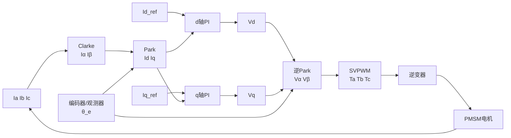
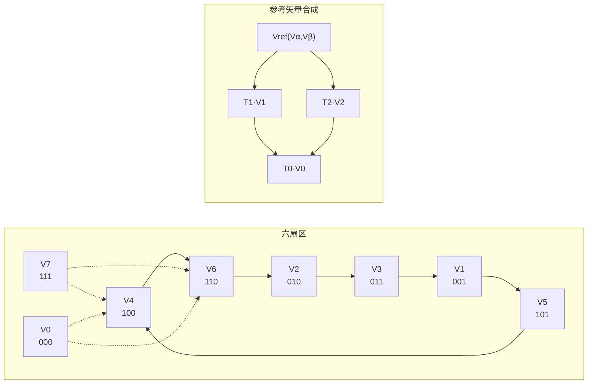

# 电流环50μs实时实现

> **为什么学？**
> 电流环是 FOC 的最内环，直接决定转矩响应和电流跟踪精度。如果 Park 变换、PI 离散化或 SVPWM 实现有误，电机将发热、抖动甚至失控。50μs 实时实现还涉及定点运算、Q 格式和 CORDIC 优化，是理论到产品的关键一跃。
>
> **在 FOC 中的作用**
> 这一节是“核心控制律落地”。它把 Clarke、Park、电流 PI、逆 Park、SVPWM 串成完整的 50μs 中断例程，输出三相 PWM 占空比给逆变器。

这张图把 50 μs 电流环的所有环节串成一张控制框图：先看清信号怎么从 $abc$ 走到 $dq$，再变回三相 PWM，能帮助记忆每个模块的输入输出。



*图：FOC 电流环完整信号流——从三相电流采样到 SVPWM 输出，展示 Park 变换把交流量变成直流量后 PI 控制器才能无静差跟踪的核心思想。*

下面先回顾各模块的数学公式，再用手工算例验证整个链路，最后给出完整的定点 C 代码，说明如何在资源受限的 MCU 上稳定跑完一个电流环周期。

## 1. 概述

电流环是FOC系统的最内环，直接决定转矩响应速度和电流跟踪精度。本章完整展示从ADC采样到SVPWM输出的50μs实时实现：Clarke变换、Park变换、PI控制器、逆Park变换、SVPWM调制的全代码框架。涵盖定点运算、Q格式、CORDIC查表优化和周期验证方法。

---

## 2. 数学推导：FOC核心算法公式回顾

### 2.1 Clarke变换（等幅值）

为什么要做这一步：三相电流耦合在 120° 绕组里，Clarke 变换把它们投影到正交的 αβ 坐标系，是后续旋转变换和矢量控制的第一步。

$$
\begin{cases}
I_\alpha = I_a \\
I_\beta = \dfrac{I_a + 2I_b}{\sqrt{3}}
\end{cases}
$$

等幅值Clarke变换的逆变换：

$$
\begin{cases}
I_a = I_\alpha \\
I_b = \dfrac{-I_\alpha + \sqrt{3}I_\beta}{2} \\
I_c = \dfrac{-I_\alpha - \sqrt{3}I_\beta}{2}
\end{cases}
$$

### 2.2 Park变换

为什么要做这一步：αβ 坐标系下电流仍是交流量，Park 变换跟着转子旋转后，$I_d$、$I_q$ 变成直流量，PI 控制器才能无静差地控制转矩分量。

$$
\begin{cases}
I_d = I_\alpha \cos\theta + I_\beta \sin\theta \\
I_q = -I_\alpha \sin\theta + I_\beta \cos\theta
\end{cases}
$$

逆Park变换：

$$
\begin{cases}
V_\alpha = V_d \cos\theta - V_q \sin\theta \\
V_\beta = V_d \sin\theta + V_q \cos\theta
\end{cases}
$$

### 2.3 PI控制器（离散化，后向欧拉）

为什么要做这一步：离散化后的 PI 是电流环的“大脑”，抗饱和处理决定系统在大扰动下是否积分饱和、是否出现恢复振荡。

连续域：

$$
u(t) = K_p \cdot e(t) + K_i \int e(t) dt
$$

离散化（采样周期 $T_s$）：

$$
\begin{cases}
u[k] = K_p \cdot e[k] + K_i \cdot T_s \cdot \sum_{n=0}^{k} e[n] \\
\text{或等价地：} \\
u[k] = K_p \cdot e[k] + y_i[k] \\
y_i[k] = y_i[k-1] + K_i \cdot T_s \cdot e[k]
\end{cases}
$$

**抗饱和（积分分离）**：当输出饱和时，停止积分更新：

```
if (v > V_MAX) {
    v = V_MAX;
    /* 不更新积分项 */
} else if (v < V_MIN) {
    v = V_MIN;
    /* 不更新积分项 */
} else {
    y_i[k] = y_i[k-1] + Ki * Ts * e[k];
}
```

### 2.4 SVPWM：扇区判断与作用时间

为什么要做这一步：PI 输出的是 $V_d$、$V_q$，必须还原成三相 PWM 占空比才能驱动逆变器；SVPWM 用基本电压矢量合成参考矢量，提高母线电压利用率。

给定 $V_\alpha, V_\beta$，求扇区 $S \in \{1,2,3,4,5,6\}$ 和基本矢量作用时间 $T_1, T_2, T_0$。

**中间变量**：

$$
\begin{cases}
U_1 = V_\beta \\
U_2 = \dfrac{-V_\beta + \sqrt{3}V_\alpha}{2} \\
U_3 = \dfrac{-V_\beta - \sqrt{3}V_\alpha}{2}
\end{cases}
$$

**扇区判断**：

| 条件 | 扇区 |
|------|------|
| $U_1 > 0$ 且 $U_2 > 0$ 且 $U_3 < 0$ | 1 |
| $U_1 > 0$ 且 $U_2 < 0$ 且 $U_3 < 0$ | 2 |
| ... | ... |

**作用时间**（设 $T_{PWM}$ 为PWM周期，$V_{DC}$ 为母线电压）：

$$
T_{PWM} = T_1 + T_2 + T_0
$$

令 $T_s = T_{PWM}$，$X, Y, Z$ 为扇区相关变量：

| 扇区 | $T_1$ | $T_2$ |
|------|-------|-------|
| 1 | $-U_3 \cdot T_s / V_{DC}$ | $U_2 \cdot T_s / V_{DC}$ |
| 2 | $U_1 \cdot T_s / V_{DC}$ | $U_3 \cdot T_s / V_{DC}$ |
| ... | ... | ... |

零矢量时间：

$$
T_0 = T_s - T_1 - T_2
$$

---

## 3. 几何直观：SVPWM六扇区与矢量合成



**ASCII矢量图**：

```
                 V2(010)
                  ↑
                  |
       V3(011) ←  |  → V1(001)
                  |
    V4(100) ←----+----→ V6(110)
                  |
       V5(101) ←  |  → V0/V7(000/111)
                  |
                  ↓
              
    六扇区划分（以30°为边界）：
    
           U1>0  U2>0
        扇区1  |  扇区2
              \|/
    U3>0 ------+------ U3<0
              /|\
        扇区6  |  扇区3
           U1<0 U2<0
              
    扇区1: U1>0, U2>0, U3<0  (0°~60°)
    扇区2: U1>0, U2<0, U3<0  (60°~120°)
    扇区3: U1<0, U2<0, U3>0  (120°~180°)
    ...
```

---

## 4. 数值示例：完整的50μs电流环手工计算

为什么要做这一步：用一个完整算例把 Clarke→Park→PI→逆 Park→SVPWM 串起来，验证每一步的数值和边界处理（如过调制），是代码落地前最好的 sanity check。

**给定参数**：
- 电机：PMSM，$R_s = 0.5\ \Omega$，$L_d = L_q = 1.2\ \text{mH}$，$p = 4$，$\psi_f = 0.05\ \text{Wb}$
- 采样：$I_a = 2.0$ A，$I_b = -1.5$ A，$I_c = -(I_a+I_b) = -0.5$ A
- 电角度：$\theta = 30° = \pi/6$
- 电流给定：$I_d^* = 0$，$I_q^* = 3.0$ A（来自速度环）
- PI参数：$K_p = 2.0$，$K_i = 200$（连续域），$T_s = 50\ \mu$s

**步骤1：Clarke变换**

$$
I_\alpha = I_a = 2.0\ \text{A}
$$

$$
I_\beta = \frac{I_a + 2I_b}{\sqrt{3}} = \frac{2.0 + 2(-1.5)}{1.732} = \frac{-1.0}{1.732} = -0.577\ \text{A}
$$

**步骤2：Park变换**

$$\cos(30°) = 0.866, \quad \sin(30°) = 0.5$$

$$
I_d = 2.0 \times 0.866 + (-0.577) \times 0.5 = 1.732 - 0.289 = 1.443\ \text{A}
$$

$$
I_q = -2.0 \times 0.5 + (-0.577) \times 0.866 = -1.0 - 0.5 = -1.5\ \text{A}
$$

注意：这里 $I_d \neq 0$ 是因为当前电流不是最佳控制角度，PI控制器将调节电压使 $I_d \to 0$。

**步骤3：PI控制器（离散域）**

离散积分增益：$K_i' = K_i \cdot T_s = 200 \times 50\times10^{-6} = 0.01$

d轴误差：$e_d = I_d^* - I_d = 0 - 1.443 = -1.443$ A

假设上一次积分输出 $y_{i,d}[k-1] = 0$：

$$V_d = K_p \cdot e_d + y_{i,d}[k-1] = 2.0 \times (-1.443) + 0 = -2.886\ \text{V}$$

$$y_{i,d}[k] = 0 + 0.01 \times (-1.443) = -0.01443\ \text{V}$$

q轴误差：$e_q = I_q^* - I_q = 3.0 - (-1.5) = 4.5$ A

$$V_q = 2.0 \times 4.5 + 0 = 9.0\ \text{V}$$

$$y_{i,q}[k] = 0 + 0.01 \times 4.5 = 0.045\ \text{V}$$

**步骤4：反电动势补偿（可选）**

假设转速较低，反电动势 $E = p\omega\psi_f$ 很小，暂忽略。若需补偿：

$$V_d' = V_d - \omega L_q I_q$$
$$V_q' = V_q + \omega L_d I_d + \omega\psi_f$$

**步骤5：逆Park变换**

$$V_\alpha = V_d \cos\theta - V_q \sin\theta = (-2.886)(0.866) - (9.0)(0.5) = -2.5 - 4.5 = -7.0\ \text{V}$$

$$V_\beta = V_d \sin\theta + V_q \cos\theta = (-2.886)(0.5) + (9.0)(0.866) = -1.443 + 7.794 = 6.35\ \text{V}$$

**步骤6：SVPWM计算**

假设 $V_{DC} = 24$ V，$T_s = 50$ μs。

$$U_1 = V_\beta = 6.35$$
$$U_2 = (-6.35 + 1.732 \times (-7.0)) / 2 = (-6.35 - 12.12) / 2 = -9.24$$
$$U_3 = (-6.35 - 1.732 \times (-7.0)) / 2 = (-6.35 + 12.12) / 2 = 2.88$$

判断：$U_1 > 0$，$U_2 < 0$，$U_3 > 0$ → 扇区2。

扇区2作用时间：

$$T_1 = U_1 \cdot T_s / V_{DC} = 6.35 \times 50\mu / 24 = 13.23\ \mu\text{s}$$
$$T_2 = -U_3 \cdot T_s / V_{DC} = -2.88 \times 50\mu / 24 = -6.0\ \mu\text{s}$$

$T_2 < 0$ 说明参考矢量超出线性调制区，发生过调制。需限制：

$$T_{sum} = T_1 + T_2 = 13.23 - 6.0 = 7.23\ \mu\text{s}$$

由于 $T_{sum} < T_s$，可以线性缩放（实际上这里不需要，因为 $T_2$ 为负意味着 $T_1$ 过大，应饱和处理）。

实际应做饱和处理：当 $T_1 < 0$ 时令 $T_1 = 0$，当 $T_2 < 0$ 时令 $T_2 = 0$，然后重新计算：

修正后：$T_2 = 0$（因为负值无效），$T_1 = 13.23$ μs。

检查：$T_1 < T_s$（13.23 < 50），有效。

零矢量时间：$T_0 = 50 - 13.23 - 0 = 36.77$ μs。

**步骤7：7段式SVPWM开关时刻**

扇区2的矢量序列：$V_0 \to V_2 \to V_3 \to V_7 \to V_3 \to V_2 \to V_0$（对称7段）。

比较值（中心对齐模式，以 $T_s/2 = 25$ μs为中心）：
- $T_a = (T_s - T_1 - T_2)/4 = 36.77/4 = 9.19$ μs
- $T_b = T_a + T_1/2 = 9.19 + 6.62 = 15.81$ μs
- $T_c = T_b + T_2/2 = 15.81 + 0 = 15.81$ μs

---

## 5. 代码实现：50μs完整FOC定点代码

为什么要做这一步：理论公式在 50μs 内跑完必须用定点和硬件加速；下面给出可直接嵌入中断的 Q15/Q31 实现，并强调溢出、扇区边界等工程陷阱。

```c
#include <stdint.h>

/* =========================================
 * Q格式定义
 * ========================================= */
#define Q_CURRENT   15   /* 电流: 1.0 = 32768, 范围 ±1A */
#define Q_ANGLE     31   /* 角度: 0~2π = 0~2147483647 */
#define Q_VOLTAGE   15   /* 电压: 1.0 = 32768, 范围 ±VDC */
#define Q_PI        15   /* PI增益: 1.0 = 32768 */
#define ONE_OVER_SQRT3  18919  /* 1/sqrt(3) in Q15: 0.57735*32768 */
#define SQRT3           56756  /* sqrt(3) in Q15: 1.732*32768 */

/* =========================================
 * 数据结构
 * ========================================= */
typedef struct {
    int32_t Kp;        /* Q15 */
    int32_t Ki;        /* Q15: Ki*Ts */
    int32_t integral;  /* Q15 */
    int32_t output_max; /* Q15 */
    int32_t output_min; /* Q15 */
} PI_Controller_t;

typedef struct {
    int32_t Ia; int32_t Ib; int32_t Ic;  /* Q15, A */
    int32_t Ialpha; int32_t Ibeta;       /* Q15 */
    int32_t Id; int32_t Iq;              /* Q15 */
    int32_t Vd; int32_t Vq;              /* Q15 */
    int32_t Valpha; int32_t Vbeta;       /* Q15 */
    uint16_t Ta; uint16_t Tb; uint16_t Tc; /* HRTIM比较值 */
    uint32_t theta;                      /* Q31, 电角度 */
} FOC_State_t;

FOC_State_t g_foc = {0};
PI_Controller_t g_pi_d = {.Kp = 65536, .Ki = 327, .output_max = 15729, .output_min = -15729};
PI_Controller_t g_pi_q = {.Kp = 65536, .Ki = 327, .output_max = 15729, .output_min = -15729};
/* 注：VDC=24V，最大输出限制为 24*0.577*32768/24 ≈ 18919 (Q15)，但需留裕量 */

/* =========================================
 * 1. 定点乘法：Q15 * Q15 -> Q15
 * ========================================= */
static inline int32_t mul_q15(int32_t a, int32_t b)
{
    return (int32_t)((int64_t)a * b >> 15);
}

/* =========================================
 * 2. Clarke变换（等幅值，Q15）
 * ========================================= */
void Clarke_Transform(int32_t Ia, int32_t Ib, int32_t *Ialpha, int32_t *Ibeta)
{
    *Ialpha = Ia;
    /* Ibeta = (Ia + 2*Ib) / sqrt(3) */
    int32_t tmp = Ia + (Ib << 1);  /* Ia + 2*Ib */
    *Ibeta = (int32_t)((int64_t)tmp * ONE_OVER_SQRT3 >> 15);
}

/* =========================================
 * 3. Park变换（Q15电流，Q31角度）
 * ========================================= */
void Park_Transform(int32_t Ialpha, int32_t Ibeta, uint32_t theta, int32_t *Id, int32_t *Iq)
{
    /* 通过CORDIC或查表获取 sin/cos */
    int32_t sin_theta, cos_theta;
    CORDIC_GetSinCos(theta, &sin_theta, &cos_theta);  /* Q15输出 */
    
    *Id = mul_q15(Ialpha, cos_theta) + mul_q15(Ibeta, sin_theta);
    *Iq = -mul_q15(Ialpha, sin_theta) + mul_q15(Ibeta, cos_theta);
}

/* =========================================
 * 4. PI控制器（带抗饱和）
 * ========================================= */
int32_t PI_Update(PI_Controller_t *pi, int32_t error)
{
    int32_t P = mul_q15(pi->Kp, error);
    int32_t I = pi->integral + mul_q15(pi->Ki, error);
    int32_t output = P + I;
    
    /* 输出限幅与积分抗饱和 */
    if (output > pi->output_max) {
        output = pi->output_max;
        /* 仅当积分方向与饱和方向一致时冻结积分 */
        if (error > 0) I = pi->integral;  /* 正饱和且误差正，不增积分 */
    } else if (output < pi->output_min) {
        output = pi->output_min;
        if (error < 0) I = pi->integral;  /* 负饱和且误差负，不减积分 */
    }
    
    pi->integral = I;
    return output;
}

/* =========================================
 * 5. 逆Park变换
 * ========================================= */
void InvPark_Transform(int32_t Vd, int32_t Vq, uint32_t theta, int32_t *Valpha, int32_t *Vbeta)
{
    int32_t sin_theta, cos_theta;
    CORDIC_GetSinCos(theta, &sin_theta, &cos_theta);
    
    *Valpha = mul_q15(Vd, cos_theta) - mul_q15(Vq, sin_theta);
    *Vbeta = mul_q15(Vd, sin_theta) + mul_q15(Vq, cos_theta);
}

/* =========================================
 * 6. SVPWM计算（定点，Q15输入->HRTIM比较值）
 * ========================================= */
#define PWM_PERIOD      1700    /* 170MHz/100kHz = 1700, 实际50μs对应不同频率 */
#define VDC_Q15         786432  /* 24V in Q15: 24*32768 */

typedef struct {
    uint16_t Ta; uint16_t Tb; uint16_t Tc;
    uint8_t sector;
} SVPWM_Result_t;

void SVPWM_Calculate(int32_t Valpha, int32_t Vbeta, SVPWM_Result_t *res)
{
    /* U1 = Vbeta, U2 = (-Vbeta + sqrt(3)*Valpha)/2, U3 = (-Vbeta - sqrt(3)*Valpha)/2 */
    int32_t U1 = Vbeta;
    int32_t tmp1 = (-Vbeta + mul_q15(SQRT3, Valpha)) >> 1;
    int32_t tmp2 = (-Vbeta - mul_q15(SQRT3, Valpha)) >> 1;
    int32_t U2 = tmp1;
    int32_t U3 = tmp2;
    
    /* 扇区判断（利用符号位） */
    uint8_t sector = 0;
    if (U1 > 0) sector |= 1;
    if (U2 > 0) sector |= 2;
    if (U3 > 0) sector |= 4;
    
    /* 扇区映射表：sector_code -> 实际扇区(1~6) */
    static const uint8_t sector_table[8] = {0, 2, 6, 1, 4, 3, 5, 0};
    res->sector = sector_table[sector];
    
    /* 计算T1, T2 (Q15 -> 比较值) */
    int32_t T1 = 0, T2 = 0;
    int32_t Vdc_inv = (1 << 15) / 24;  /* 1/VDC in Q15，应预先计算 */
    
    switch (res->sector) {
        case 1: T1 = -mul_q15(U3, Vdc_inv); T2 = mul_q15(U2, Vdc_inv); break;
        case 2: T1 = -mul_q15(U1, Vdc_inv); T2 = -mul_q15(U3, Vdc_inv); break;
        case 3: T1 = mul_q15(U2, Vdc_inv); T2 = mul_q15(U1, Vdc_inv); break;
        case 4: T1 = -mul_q15(U3, Vdc_inv); T2 = -mul_q15(U1, Vdc_inv); break;
        case 5: T1 = mul_q15(U1, Vdc_inv); T2 = mul_q15(U3, Vdc_inv); break;
        case 6: T1 = -mul_q15(U2, Vdc_inv); T2 = -mul_q15(U3, Vdc_inv); break;
    }
    
    /* 饱和处理：T1, T2 转换为PWM周期内的占空比 */
    int32_t T1n = (T1 * PWM_PERIOD) >> 15;
    int32_t T2n = (T2 * PWM_PERIOD) >> 15;
    
    if (T1n < 0) T1n = 0;
    if (T2n < 0) T2n = 0;
    if (T1n + T2n > PWM_PERIOD) {
        int32_t scale = (PWM_PERIOD << 15) / (T1n + T2n);
        T1n = (T1n * scale) >> 15;
        T2n = (T2n * scale) >> 15;
    }
    
    int32_t T0 = PWM_PERIOD - T1n - T2n;
    
    /* 7段式对称调制，计算比较值 */
    int32_t ta = (T0 >> 1) + (T1n >> 1) + (T2n >> 1);
    int32_t tb = (T0 >> 1) + (T2n >> 1) - (T1n >> 1);
    int32_t tc = (T0 >> 1) - (T1n >> 1) - (T2n >> 1);
    
    /* 扇区到比较值映射 */
    switch (res->sector) {
        case 1: res->Ta = ta; res->Tb = tb; res->Tc = tc; break;
        case 2: res->Ta = tb; res->Tb = ta; res->Tc = tc; break;
        case 3: res->Ta = tc; res->Tb = ta; res->Tc = tb; break;
        case 4: res->Ta = tc; res->Tb = tb; res->Tc = ta; break;
        case 5: res->Ta = tb; res->Tb = tc; res->Tc = ta; break;
        case 6: res->Ta = ta; res->Tb = tc; res->Tc = tb; break;
    }
}

/* =========================================
 * 7. 完整FOC电流环（50μs入口）
 * ========================================= */
void FOC_CurrentLoop_ISR(void)
{
    /* 记录进入时间（用于调试） */
    uint32_t t_start = DWT->CYCCNT;
    
    /* 1. 读取电流（DMA已完成） */
    int32_t Ia = adc_to_current(ADC_Buffer[0]);
    int32_t Ib = adc_to_current(ADC_Buffer[1]);
    int32_t Ic = -(Ia + Ib);  /* 三相重构 */
    
    /* 2. 读取电角度 */
    uint32_t theta = Encoder_GetThetaElec_Q31();
    g_foc.theta = theta;
    
    /* 3. Clarke变换 */
    Clarke_Transform(Ia, Ib, &g_foc.Ialpha, &g_foc.Ibeta);
    
    /* 4. Park变换 */
    Park_Transform(g_foc.Ialpha, g_foc.Ibeta, theta, &g_foc.Id, &g_foc.Iq);
    
    /* 5. d轴PI（Id_ref = 0） */
    g_foc.Vd = PI_Update(&g_pi_d, -g_foc.Id);
    
    /* 6. q轴PI（Iq_ref来自速度环） */
    g_foc.Vq = PI_Update(&g_pi_q, g_speed_loop.Iq_ref - g_foc.Iq);
    
    /* 7. 逆Park变换 */
    InvPark_Transform(g_foc.Vd, g_foc.Vq, theta, &g_foc.Valpha, &g_foc.Vbeta);
    
    /* 8. SVPWM */
    SVPWM_Result_t svpwm;
    SVPWM_Calculate(g_foc.Valpha, g_foc.Vbeta, &svpwm);
    
    /* 9. 写入PWM比较值（双缓冲，下一周期生效） */
    g_pwm_buf.duty_a[g_pwm_buf.write_idx] = svpwm.Ta;
    g_pwm_buf.duty_b[g_pwm_buf.write_idx] = svpwm.Tb;
    g_pwm_buf.duty_c[g_pwm_buf.write_idx] = svpwm.Tc;
    g_foc_ready = 1;
    
    /* 10. 执行时间验证 */
    uint32_t t_elapsed = (DWT->CYCCNT - t_start) / 170;  /* μs */
    if (t_elapsed > 45) {
        g_fault_flags |= FAULT_FOC_OVERTIME;
    }
}

/* =========================================
 * 8. CORDIC sin/cos 查表优化（软件后备）
 * ========================================= */
void CORDIC_GetSinCos(uint32_t theta_q31, int32_t *sin_val, int32_t *cos_val)
{
#ifdef USE_HW_CORDIC
    HAL_CORDIC_CalculateCosine(&hcordic, &theta_q31, sin_val, 1, 0);
    /* sin_val[0]=cos, sin_val[1]=sin */
    int32_t tmp = sin_val[0];
    sin_val[0] = sin_val[1];
    sin_val[1] = tmp;
#else
    /* 软件查表：256点正弦表，Q15 */
    static const int16_t sin_table[257] = { /* 预生成: sin(2π*i/256)*32768 */ };
    uint32_t idx = theta_q31 >> 23;  /* 取高8位，0~255 */
    uint32_t frac = (theta_q31 >> 15) & 0xFF;  /* 线性插值 */
    
    int32_t s1 = sin_table[idx];
    int32_t s2 = sin_table[idx + 1];
    *sin_val = s1 + ((s2 - s1) * (int32_t)frac >> 8);
    
    /* cos(θ) = sin(θ + π/2) */
    uint32_t idx_c = (idx + 64) & 0xFF;
    int32_t c1 = sin_table[idx_c];
    int32_t c2 = sin_table[(idx_c + 1) & 0xFF];
    *cos_val = c1 + ((c2 - c1) * (int32_t)frac >> 8);
#endif
}
```

---

## 6. 常见错误

### 错误1：Q格式溢出导致Park变换结果跳变

**现象**：电机在特定角度（如90°、180°、270°）附近，电流环输出出现尖峰，电机抖动。

**原因**：定点运算中，Q15的乘法 $a \times b$ 结果范围为 $[-1, 1] \times [-1, 1] = [-1, 1]$。但如果两个操作数都接近最大幅值（如 $0.9 \times 0.9 = 0.81$），结果仍在范围内。真正的问题在于：当 $I_\alpha = 1.0$（Q15=32768，实际最大值32767），$\cos\theta = 1.0$ 时，乘积为 $32767 \times 32767 = 1073709056$，右移15位后为 $32767$，正确。但如果中间结果用32位有符号整数保存，$32767 \times 32767$ 不会超过32位最大值（$2^{31}-1 = 2147483647$），安全。但在更高Q格式（如Q20）或更大数值时，中间乘积可能溢出。

**纠正**：
1. 确保中间乘积使用64位整数（`int64_t`）再右移
2. 在Clarke变换中，$I_\beta = (I_a + 2I_b) / \sqrt{3}$。若 $I_a$ 和 $I_b$ 均接近满量程，$I_a + 2I_b$ 可能溢出32位。应先做除法或缩放：

```c
/* 错误做法（可能溢出） */
int32_t tmp = Ia + (Ib << 1);  /* 若Ia=32767, Ib=32767, tmp=98301, 安全 */
/* 但如果是Q20格式，tmp可能溢出 */

/* 安全做法 */
int32_t Ibeta = ((int64_t)Ia * ONE_OVER_SQRT3 >> 15) 
              + ((int64_t)Ib * 2 * ONE_OVER_SQRT3 >> 15);
```

3. 对电流采样值进行限幅，确保进入Clarke变换前不超出额定范围

### 错误2：SVPWM扇区判断符号边界错误

**现象**：电机在特定角度区间（如60°、120°边界）出现输出跳变，电流波形畸变。

**原因**：SVPWM的扇区判断依赖 $U_1, U_2, U_3$ 的符号。当参考矢量恰好落在两个扇区的边界上（如 $U_1 = 0$），由于定点运算的量化误差，$U_1$ 可能在一个FOC周期为-1，下一个周期为+1，导致扇区在两个相邻值之间来回振荡。这会导致 $T_1$ 或 $T_2$ 在0和一个小值之间跳变，PWM输出抖动。

**纠正**：
1. **添加扇区滞环**：当参考矢量靠近边界时，维持上一周期的扇区判断，避免来回跳变
2. **增大判断裕量**：不直接判断 $U_1 > 0$，而是判断 $U_1 > \epsilon$（如 $\epsilon = 10$ LSB in Q15）
3. **使用更精确的查表法**：预先计算每个扇区的边界条件，用角度直接查表而非符号判断

```c
/* 滞环扇区判断 */
static uint8_t last_sector = 1;

uint8_t SectorJudge_WithHysteresis(int32_t U1, int32_t U2, int32_t U3) {
    uint8_t sector = 0;
    int32_t eps = 50;  /* Q15，约0.15%的裕量 */
    if (U1 > eps) sector |= 1;
    if (U2 > eps) sector |= 2;
    if (U3 > eps) sector |= 4;
    
    uint8_t new_sector = sector_table[sector];
    
    /* 如果新扇区与上一扇区相邻，使用上一扇区 */
    if (abs(new_sector - last_sector) <= 1 || abs(new_sector - last_sector) == 5) {
        /* 仅在明确越过边界时才切换 */
        if (U1 > eps*3 || U2 > eps*3 || U3 > eps*3) {
            last_sector = new_sector;
        }
    } else {
        last_sector = new_sector;
    }
    return last_sector;
}
```

---

## 7. 自测习题

### 习题1：定点运算精度

电流值在Q15格式中表示，$I_\alpha = 0.866$ A（对应Q15值=28378），$\cos\theta = 0.5$（对应Q15值=16384）。

**求**：计算 $I_d = I_\alpha \cdot \cos\theta$ 的定点结果（Q15值）和对应的浮点值，与理论浮点结果对比，求相对误差。

**答案**：
- 定点乘法：$(28378 \times 16384) >> 15 = 14189$
- 转为浮点：$14189 / 32768 = 0.4320$ A
- 理论浮点：$0.866 \times 0.5 = 0.4330$ A
- 绝对误差：$0.4330 - 0.4320 = 0.0010$ A
- 相对误差：$0.0010 / 0.4330 = 0.23\%$
- 对于12位ADC（0.024%精度），0.23%的量化误差可接受，但累积误差需注意

### 习题2：SVPWM过调制判断

给定 $V_{DC} = 48$ V，$V_\alpha = 30$ V，$V_\beta = 25$ V。判断参考矢量是否在线性调制区内。若过调制，计算线性调制下的最大允许幅值。

**答案**：
- 参考矢量幅值：$|V_{ref}| = \sqrt{30^2 + 25^2} = 39.05$ V
- 线性调制区最大幅值（六边形内切圆）：$V_{max} = V_{DC} / \sqrt{3} = 48 / 1.732 = 27.71$ V
- $39.05 > 27.71$，过调制！
- 最大允许幅值为 $27.71$ V，对应调制比 $M = 39.05 / 27.71 = 1.41$（大于1，确认过调制）
- 修正方法：将 $(V_\alpha, V_\beta)$ 等比例缩放：$V_\alpha' = 30 \times 27.71/39.05 = 21.27$ V，$V_\beta' = 25 \times 27.71/39.05 = 17.73$ V
