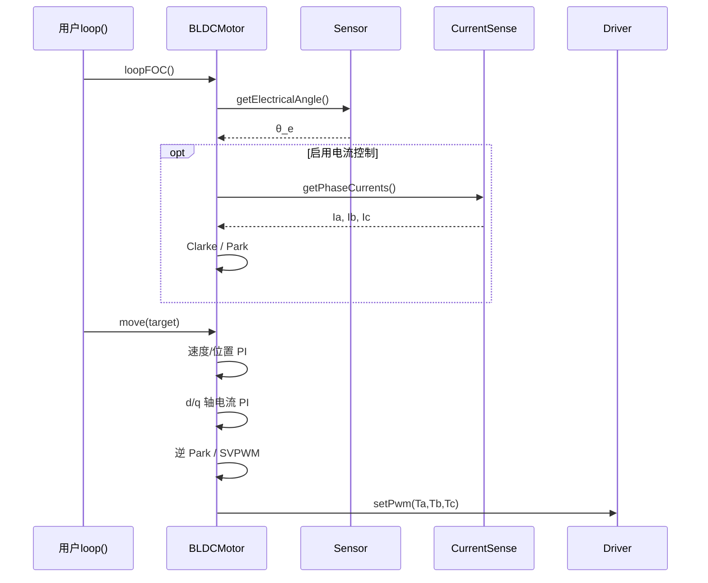
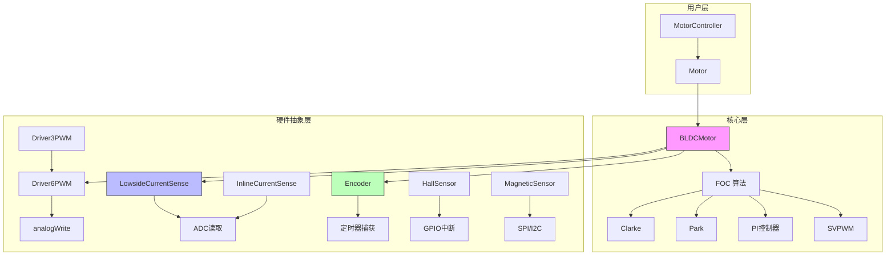

# SimpleFOC源码精读

> **为什么学？**
> SimpleFOC 是学习和快速验证 FOC 的热门开源库，但它在变量命名、坐标变换细节和平台适配层上容易让人踩坑。如果不理解它如何把 Clarke/Park、PI、SVPWM 封装成类，以及 low-side/inline 电流采样的差异，移植或调试时会找错入口、算错角度。
>
> **在 FOC 中的作用**
> 这一节从“代码阅读”视角拆解一个完整 FOC 库的架构：Sensor、CurrentSense、Driver、BLDCMotor 如何协作，最终输出三相电压。

这张图用序列图展示 SimpleFOC 在一个控制周期里“先采样、再控制、最后输出”的调用顺序，帮助区分 `loopFOC()` 和 `move(target)` 的职责边界。



*图：SimpleFOC 运行时调用时序——从用户 `loop()` 到 `BLDCMotor` 再到传感器、电流采样和驱动器，厘清 `loopFOC()` 和 `move()` 的分工。*

下面先复习 SimpleFOC 中浮点实现的坐标变换与滤波公式，再梳理类架构和数据流，最后精读核心类代码，说明每个模块在 FOC 链路中的职责。

## 1. 概述

SimpleFOC 是一个开源的基于 Arduino 的 FOC 电机控制库，支持 STM32、ESP32、RP2040 等多种平台。它以其简洁的 API 设计和模块化架构著称，是学习 FOC 代码实现和快速原型验证的极佳素材。本章深入解析其库架构、核心类设计、传感器抽象、驱动器接口、以及 low-side/inline 电流采样实现。

---

## 2. 数学推导：SimpleFOC 中的坐标变换与低通滤波

### 2.1 Clarke 与 Park 的浮点实现

为什么要做这一步：SimpleFOC 用浮点隐藏了定点细节，但公式与标准 FOC 一致；先确认数学形式，再读代码才不会被变量命名误导。

SimpleFOC 默认使用 `float` 浮点运算，在支持 FPU 的平台上（如 STM32F4、ESP32）效率较高，但在无 FPU 的 8 位 AVR 上依赖软件浮点库。

等幅值 Clarke 变换（SimpleFOC 代码中的 `clarke` 函数）：

$$
\begin{cases}
i_\alpha = i_a \\
i_\beta = \dfrac{i_a + 2i_b}{\sqrt{3}}
\end{cases}
$$

Park 变换（`park` 函数）：

$$
\begin{cases}
i_d = i_\alpha \cos\theta + i_\beta \sin\theta \\
i_q = -i_\alpha \sin\theta + i_\beta \cos\theta
\end{cases}
$$

逆 Park 变换（`inverse_park` 函数）：

$$
\begin{cases}
v_\alpha = v_d \cos\theta - v_q \sin\theta \\
v_\beta = v_d \sin\theta + v_q \cos\theta
\end{cases}
$$

SimpleFOC 的三角函数计算使用 `_sin` 和 `_cos` 宏，默认映射到 `sinf`/`cosf`。在 STM32 平台上，可通过编译选项启用 `arm_sin_f32` 等 CMSIS-DSP 函数。

### 2.2 低通滤波器（LPF）的数学形式

为什么要做这一步：速度和电流采样都有噪声，LPF 的截止频率直接影响速度环稳定性和电流反馈延迟，是调参时必须量化的环节。

SimpleFOC 中速度环和电流采样都使用一阶 IIR 低通滤波器：

$$
y[k] = (1-\alpha) \cdot y[k-1] + \alpha \cdot x[k]
$$

其中 $\alpha = T_s / (T_s + \tau)$，$\tau$ 为滤波时间常数。代码中通过 `Tf` 参数设置：

```cpp
float alpha = Tf / (Tf + Ts);  // Ts 为调用周期
```

当 `Tf = 0` 时，滤波器关闭，输出直接等于输入。

---

## 3. 几何直观：SimpleFOC 类架构与数据流



**ASCII 数据流图**：

```
  +-----------------------------------------------------------+
  |                      BLDCMotor (motor)                   |
  |  +------------------+  +------------------+  +------------+ |
  |  | Sensor (编码器)  |->| 电角度/速度      |->| 速度PI     | |
  |  +------------------+  +------------------+  +------------+ |
  |         |                                     |           |
  |         v                                     v           |
  |  +------------------+  +------------+  +----------------+ |
  |  | CurrentSense    |->| Ia,Ib,Ic   |->| Clarke/Park   | |
  |  +------------------+  +------------+  +----------------+ |
  |         |                              |    |    |        |
  |         |                              v    v    v        |
  |         |                          +------------------+  |
  |         |                          |  d轴PI / q轴PI    |  |
  |         |                          +------------------+  |
  |         |                              |                 |
  |         |                              v                 |
  |         |                          +------------------+  |
  |         |                          | 逆Park / SVPWM    |  |
  |         |                          +------------------+  |
  |         |                              |                 |
  |         +------------------------------+                 |
  |                                        v                 |
  |  +--------------------------------------------------+   |
  |  |                Driver (PWM驱动)                      |  |
  |  |  move(a,b,c) -> analogWrite -> PWM占空比           |  |
  |  +--------------------------------------------------+   |
  +-----------------------------------------------------------+
```

**关键理解**：SimpleFOC 的核心是 `BLDCMotor` 类，它持有 `Driver` 和 `Sensor` 的指针。用户调用 `motor.init()` 和 `motor.initFOC()` 完成初始化，然后在 `loop()` 中调用 `motor.loopFOC()` 和 `motor.move(target)`。

---

## 4. 数值示例：SimpleFOC 参数换算与运行流程

为什么要做这一步：通过参数换算把库里的抽象设置（CPR、极对数、PI 增益、电压限制）变成具体数值，才能判断配置是否合理。

**给定参数**：
- 电机：无刷直流电机，极对数 $p = 7$
- 编码器：500 CPR
- 电源电压：$V_{DC} = 12$ V
- 目标速度：$10$ rad/s
- 电压限制：$voltage_limit = 6$ V
- 电流限制：$current_limit = 2$ A

**SimpleFOC 初始化代码**：

```cpp
BLDCMotor motor = BLDCMotor(7);               // 极对数7
BLDCDriver3PWM driver = BLDCDriver3PWM(9,5,6,11); // PWM引脚
Encoder encoder = Encoder(2, 3, 500, 7);      // A=2, B=3, 500CPR

void setup() {
    driver.voltage_power_supply = 12;
    driver.voltage_limit = 6;
    driver.init();
    
    encoder.init();
    motor.linkDriver(&driver);
    motor.linkSensor(&encoder);
    
    motor.voltage_limit = 6;
    motor.current_limit = 2;
    motor.controller = MotionControlType::velocity; // 速度模式
    motor.PID_velocity.P = 0.5;
    motor.PID_velocity.I = 10;
    motor.LPF_velocity.Tf = 0.01;
    
    motor.init();
    motor.initFOC();
}

void loop() {
    motor.loopFOC();      // 执行电流环/FOC计算
    motor.move(10);       // 目标速度10 rad/s
}
```

**求**：
1. 编码器角度到电角度的换算系数
2. 速度环 PI 的离散积分增益（假设 loop() 调用周期约 1ms）
3. 若当前速度为 8 rad/s，速度环 PI 的输出电流给定是多少？（假设误差累积为 0）

**步骤1：编码器角度换算**

SimpleFOC 中，`Encoder::getAngle()` 返回机械角度（rad），`Sensor::getElectricalAngle()` 通过 `Sensor::getMechanicalAngle() * pole_pairs` 得到电角度。

编码器 500 CPR，四倍频后每转 2000 计数。

机械角度分辨率：$2\pi / 2000 = 0.00314$ rad/计数。

电角度分辨率：$0.00314 \times 7 = 0.0220$ rad/计数 = $1.26°$/计数。

**步骤2：速度环 PI 离散增益**

`PID_velocity.I = 10` 在 SimpleFOC 中实际上是 $K_i$（连续域积分增益）。

离散积分增益：$K_i' = K_i \times T_s = 10 \times 0.001 = 0.01$。

SimpleFOC 的 `PIDController` 内部以微秒为单位积分：

```cpp
float PIDController::operator() (float error) {
    float output = P * error + I * integral + D * (error - last_error);
    integral += error * (timestamp - last_timestamp) * 1e-6f;
    /* ... */
}
```

因此离散积分增益是动态的，取决于实际调用间隔。

**步骤3：速度环输出**

误差：$e = 10 - 8 = 2$ rad/s。

假设积分项累积 = 0.1，微分项 = 0：

$$I_q^* = K_p \cdot e + K_i \cdot \text{integral} = 0.5 \times 2 + 10 \times 0.1 = 1.0 + 1.0 = 2.0\ \text{A}$$

达到电流限幅值。

---

## 5. 代码实现：SimpleFOC 核心类精读

为什么要做这一步：SimpleFOC 的类封装让 FOC 流程分散在多个文件中；下面集中展示 Sensor、CurrentSense、BLDCMotor::loopFOC/move 的伪代码/关键片段，帮读者抓住主线。

```cpp
/* =========================================
 * 1. Sensor 抽象基类：所有传感器的统一接口
 * ========================================= */
class Sensor {
public:
    virtual float getAngle() = 0;           // 机械角度 [rad]
    virtual float getVelocity() = 0;        // 机械速度 [rad/s]
    virtual int32_t getFullRotations() = 0; // 整圈数
    
    // 获取电角度（通用实现，基于极对数）
    float getElectricalAngle(int pole_pairs) {
        return _normalizeAngle(getAngle() * pole_pairs);
    }
    
    float getElectricalVelocity(int pole_pairs) {
        return getVelocity() * pole_pairs;
    }
    
    // 通用角度归一化到 [0, 2π)
    static float _normalizeAngle(float angle) {
        float a = fmod(angle + _PI, 2*_PI);  // 先映射到 [-π, π)
        return a - _PI;                        // 再映射到 [-π, π]
    }
};

/* =========================================
 * 2. LowsideCurrentSense：下桥臂采样
 * ========================================= */
class LowsideCurrentSense : public CurrentSense {
public:
    float gain;          // 运放增益
    float shunt_resistor; // 采样电阻 [Ω]
    float offset_ia, offset_ib, offset_ic; // 偏置校准
    
    // 核心：读取两相/三相电流
    PhaseCurrent_s getPhaseCurrents() {
        PhaseCurrent_s current;
        current.a = (readADC(pinA) - offset_ia) / (gain * shunt_resistor);
        current.b = (readADC(pinB) - offset_ib) / (gain * shunt_resistor);
        // 第三相通过三相重构：Ic = -(Ia + Ib)
        current.c = -(current.a + current.b);
        return current;
    }
    
    // 校准：采样 Offset
    void calibrateOffsets() {
        offset_ia = offset_ib = offset_ic = 0;
        for(int i = 0; i < 1000; i++) {
            offset_ia += readADC(pinA);
            offset_ib += readADC(pinB);
        }
        offset_ia /= 1000.0;
        offset_ib /= 1000.0;
    }
};

/* =========================================
 * 3. InlineCurrentSense：相线串联采样
 * ========================================= */
class InlineCurrentSense : public CurrentSense {
    // 与 Lowside 类似，但采样电阻在相线与电机之间
    // 优点：整个PWM周期均可采样，无窗口限制
    // 缺点：需要隔离/高共模抑制运放
};

/* =========================================
 * 4. BLDCMotor::loopFOC() 核心流程
 * ========================================= */
void BLDCMotor::loopFOC() {
    // 1. 读取电角度
    electrical_angle = sensor->getElectricalAngle(pole_pairs);
    
    // 2. 电流采样（如果启用电流控制）
    if(current_sense) {
        current = current_sense->getPhaseCurrents();
        
        // 3. Clarke 变换
        current.q = current.a;
        current.d = (current.a + 2.0*current.b) / _SQRT3;  // 等幅值
        
        // 4. Park 变换
        float cd = _cos(electrical_angle);
        float sd = _sin(electrical_angle);
        current.d = current.d * cd + current.q * sd;     // Id
        current.q = current.q * cd - current.d * sd;     // Iq (注意源码中的写法)
        // 实际源码中：
        // float I_alpha = current.q;  // 注意源码变量命名与通常定义相反
        // float I_beta = current.d;
        // current.d = I_alpha * cd + I_beta * sd;
        // current.q = I_beta * cd - I_alpha * sd;
    }
    
    // 5. 电压前馈/解耦（可选）
    // ...
}

/* =========================================
 * 5. BLDCMotor::move(float target) 控制律
 * ========================================= */
void BLDCMotor::move(float target) {
    switch(controller) {
        case MotionControlType::torque:
            // 直接转矩控制：target = Iq_ref 或电压给定
            if(torque_controller == TorqueControlType::foc_current) {
                PID_current_q.target = target;
            } else {
                voltage.q = target;  // 电压模式
            }
            break;
            
        case MotionControlType::velocity:
            // 速度环：target = 速度给定
            PID_velocity.target = target;
            PID_current_q.target = PID_velocity(velocity - sensor->getVelocity());
            break;
            
        case MotionControlType::angle:
            // 位置环：target = 角度给定
            PID_angle.target = target;
            PID_velocity.target = PID_angle(sensor->getAngle() - target);
            PID_current_q.target = PID_velocity(velocity - sensor->getVelocity());
            break;
    }
    
    // 6. 电流环执行（如果启用）
    if(torque_controller == TorqueControlType::foc_current) {
        // d轴 PI
        voltage.d = PID_current_d(current.d);
        // q轴 PI
        voltage.q = PID_current_q(current.q);
    }
    
    // 7. 逆 Park 变换
    float cd = _cos(electrical_angle);
    float sd = _sin(electrical_angle);
    voltage.alpha = voltage.d * cd - voltage.q * sd;
    voltage.beta = voltage.d * sd + voltage.q * cd;
    
    // 8. SVPWM
    setPhaseVoltage(voltage.alpha, voltage.beta, electrical_angle);
}

/* =========================================
 * 6. SVPWM 实现（setPhaseVoltage）
 * ========================================= */
void BLDCMotor::setPhaseVoltage(float Ualpha, float Ubeta, float angle_el) {
    // 中心对齐模式下的 SVPWM
    float U1 = Ubeta;
    float U2 = (-Ubeta + _SQRT3 * Ualpha) / 2.0;
    float U3 = (-Ubeta - _SQRT3 * Ualpha) / 2.0;
    
    int sector = 0;
    if(U1 > 0) sector = 1;
    if(U2 > 0) sector += 2;
    if(U3 > 0) sector += 4;
    
    float T1=0, T2=0, T0=0;
    float T1n=0, T2n=0;
    
    switch(sector) {
        case 1: T1 = -U3; T2 = U2; break;
        case 2: T1 = U1; T2 = U3; break;
        case 3: T1 = U2; T2 = -U1; break;
        case 4: T1 = -U3; T2 = U1; break;  // 源码中的扇区映射
        case 5: T1 = -U2; T2 = U3; break;
        case 6: T1 = U1; T2 = -U2; break;
    }
    
    // 标幺化到 PWM 周期
    T1n = T1 * voltage_limit / Udc;  // 简化的线性调制
    T2n = T2 * voltage_limit / Udc;
    
    if(T1n + T2n > voltage_limit) {
        float scale = voltage_limit / (T1n + T2n);
        T1n *= scale;
        T2n *= scale;
    }
    
    T0 = voltage_limit - T1n - T2n;
    
    // 计算三相占空比并写入 Driver
    float Ta, Tb, Tc;
    switch(sector) {
        case 1: Ta = T1n + T2n + T0/2; Tb = T2n + T0/2; Tc = T0/2; break;
        case 2: Ta = T1n + T0/2; Tb = T1n + T2n + T0/2; Tc = T0/2; break;
        // ... 其他扇区类似
    }
    
    driver->setPwm(Ta, Tb, Tc);
}
```

---

## 6. 常见错误

### 错误1：Arduino 定时器冲突导致 PWM 频率错误

**现象**：使用 SimpleFOC 的 `BLDCDriver3PWM` 时，电机发出尖锐高频噪声，电流波形异常，或根本不动。

**原因**：Arduino 的 `analogWrite()` 使用定时器产生 PWM，而编码器（如 `Encoder` 类）也依赖硬件定时器。在 Arduino Uno（仅 Timer1、Timer2）上，如果编码器占用了与 PWM 相同的定时器，会导致 PWM 频率被意外修改，或编码器中断与 PWM 更新冲突。例如，Arduino Uno 的引脚 9、10 使用 Timer1，而 `Encoder` 库默认也使用 Timer1 进行中断计时。

**纠正**：
1. **查阅引脚-定时器映射表**：确保 PWM 引脚和编码器中断引脚不共享同一个定时器
2. **使用平台专属驱动**：在 STM32 上直接使用 `HardwareTimer` 而非 Arduino 的 `analogWrite`，避免定时器冲突
3. **SimpleFOC 的 `Driver3PWM` 配置**：明确指定 `pwm_frequency` 参数，并检查是否与编码器中断频率兼容

```cpp
// 正确做法：在 STM32 上使用硬件定时器，而非 Arduino 兼容层
BLDCDriver6PWM driver = BLDCDriver6PWM(PA8, PA9, PA10, PB13, PB14, PB15);
driver.pwm_frequency = 20000;  // 20kHz
// Encoder 使用独立的定时器（如 TIM2、TIM3）
Encoder encoder = Encoder(PA0, PA1, 1000, 7);  // 使用外部中断而非定时器
```

### 错误2：电流采样 Offset 未校准导致 FOC 初始化失败

**现象**：调用 `motor.initFOC()` 时电机剧烈抖动，或 `motor.initFOC()` 返回失败，提示电流过大。

**原因**：SimpleFOC 的 `initFOC()` 在初始化时会执行一次电角度对齐（align voltage），需要准确的电流反馈。如果 `LowsideCurrentSense` 的 `offset_ia`/`offset_ib` 未校准（默认为0），而实际运放偏置电压为 1.65V（对应 ADC 码值约 2048），则软件会将偏置解读为电流，导致电流环误判。

**纠正**：
1. **在 `initFOC()` 前必须调用 `current_sense.calibrateOffsets()`**
2. **确保校准时电机静止、PWM 未输出**：SimpleFOC 的 `calibrateOffsets()` 会短暂关闭 PWM，但某些平台适配层可能不执行此操作
3. **手动校准**：在 `setup()` 中先初始化电流采样，再校准，最后初始化电机

```cpp
void setup() {
    // 先初始化驱动器但不使能输出
    driver.init();
    driver.disable();
    
    // 初始化并校准电流采样
    current_sense.init();
    current_sense.calibrateOffsets();  // 必须！
    
    // 再初始化电机
    motor.linkDriver(&driver);
    motor.linkCurrentSense(&current_sense);
    motor.init();
    motor.initFOC();  // 此时电流采样已校准
}
```

---

## 7. 自测习题

### 习题1：SimpleFOC 编码器电角度分辨率

使用 1024 CPR 编码器，电机极对数 $p = 11$。SimpleFOC 的 `getElectricalAngle()` 使用浮点 `float`（IEEE 754 单精度，24位尾数）。

**求**：
1. 编码器四倍频后的单转计数
2. 电角度分辨率（每计数对应的电角度，以度和 rad 表示）
3. 与 `float` 的精度极限（约 $2^{-24} \times 2\pi$）相比，编码器是否是电角度计算中的瓶颈？

**答案**：
1. $N = 4 \times 1024 = 4096$ 计数/转
2. 电角度分辨率 = $2\pi \times 11 / 4096 = 0.01687$ rad = $0.967°$。这是机械/编码器的分辨率。
3. `float` 的角度精度：$2\pi / 2^{24} = 3.73\times10^{-7}$ rad = $0.000021°$，远优于编码器分辨率。因此编码器是瓶颈，`float` 足够。

### 习题2：SimpleFOC LPF 滤波器带宽

`LPF_velocity.Tf = 0.05`（5ms），速度环调用周期 $T_s = 1$ ms。

**求**：等效一阶低通滤波器的 -3dB 截止频率 $f_c$。

**答案**：
- SimpleFOC 的 LPF 公式：$y[k] = (1-\alpha)y[k-1] + \alpha x[k]$，其中 $\alpha = \dfrac{T_s}{T_s + Tf} = \dfrac{1}{1+50} = 0.0196$
- 一阶 IIR 的 -3dB 频率：$f_c = \dfrac{1}{2\pi} \cdot \dfrac{\alpha}{(1-\alpha)T_s} \approx \dfrac{1}{2\pi \cdot Tf} = \dfrac{1}{2\pi \times 0.005} = 31.8$ Hz
- 更精确：$f_c = \dfrac{1}{2\pi} \arccos\left(\dfrac{2(1-\alpha) - \alpha^2}{2(1-\alpha)}\right) \approx 31.7$ Hz
