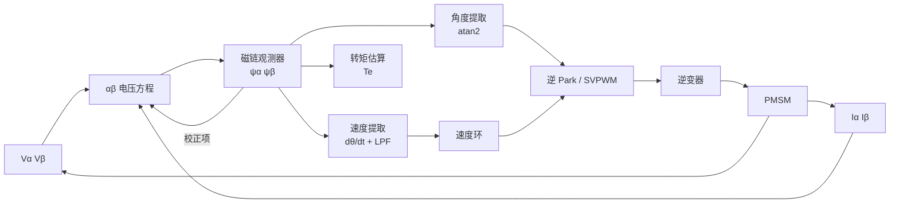
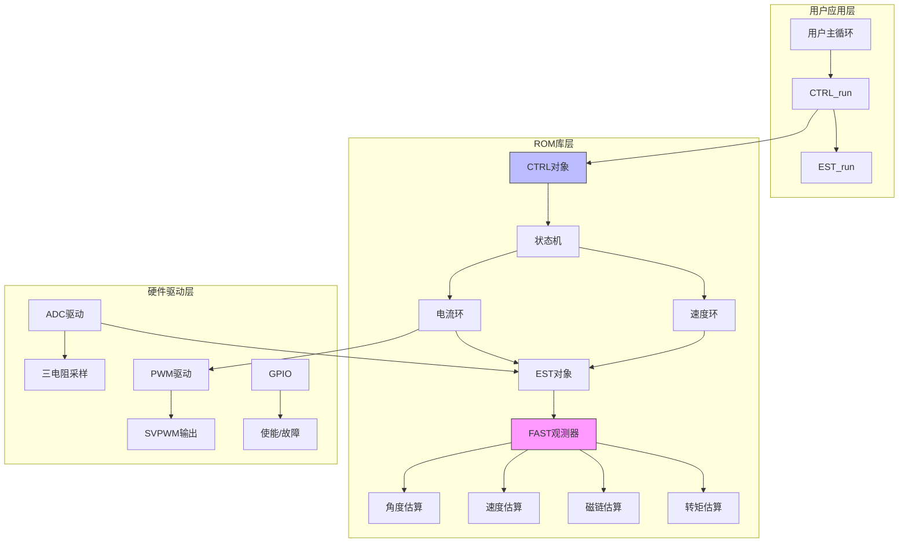

# TI InstaSPIN架构解析

> **为什么学？**
> 工业无传感器 FOC 依赖观测器估计角度和速度，FAST 观测器是其中的代表。如果不理解它的状态空间模型、磁链提取和低速可观测性限制，会把无法收敛的故障归咎于 PI 参数，或在低速区错误地直接切入闭环。
>
> **在 FOC 中的作用**
> 这一节讲“无传感器方案的黑匣子”。FAST 观测器替代编码器提供角度、速度、磁链和转矩估算，InstaSPIN 通过 ROM 库 API 把它封装成可调用模块，与电流环、速度环共同完成全速域控制。

这张图把 FAST 观测器放进完整 FOC 闭环里：看清它如何从 $v_{\alpha\beta}$、$i_{\alpha\beta}$ 观测出磁链，再反解出角度、速度和转矩，就能理解无传感器 FOC 的“黑匣子”逻辑。



*图：FAST 观测器在 FOC 闭环中的位置——利用电压、电流观测磁链，再从磁链矢量同时提取角度、速度和转矩，替代编码器完成无传感器控制。*

下面从 PMSM 状态空间模型出发，推导 FAST 观测器的磁链/角度/速度/转矩估算原理，再解析 InstaSPIN 的 ROM 库架构和调用方式，说明无传感器 FOC 在工程中如何落地。

## 1. 概述

TI InstaSPIN（Instantaneous Spin）是德州仪器（Texas Instruments）推出的电机控制解决方案，核心是其独有的 FAST（Flux, Angle, Speed, Torque）观测器——一种以无传感器控制为目标、同时提供精确磁链和转矩估算的先进观测器。InstaSPIN 将 FAST 算法以二进制 ROM 库形式固化在特定 C2000 系列 DSP 中（如 Piccolo F2802x/F2805x/F2806x），通过 API 调用即可实现电机参数自动识别和全速域无传感器 FOC 控制。本章解析其架构、ROM 库调用机制、FAST 观测器原理，以及电机参数自动识别流程。

---

## 2. 数学推导：FAST 观测器核心原理

FAST 观测器并非传统的反电动势积分模型，而是基于电机完整的状态空间模型，通过自适应观测器同时估算磁链、角度、速度和转矩。

### 2.1 PMSM 状态空间模型

为什么要做这一步：FAST 观测器不是简单反电动势积分，而是基于 αβ 电压方程构建状态观测；先写出状态空间模型，才能理解校正项和磁链提取的来历。

在 $\alpha\beta$ 静止坐标系下：

$$
\begin{cases}
\dfrac{d i_\alpha}{dt} = \dfrac{1}{L} (v_\alpha - R_s i_\alpha - e_\alpha) \\
\dfrac{d i_\beta}{dt} = \dfrac{1}{L} (v_\beta - R_s i_\beta - e_\beta)
\end{cases}
$$

其中反电动势：

$$
\begin{cases}
e_\alpha = -\dfrac{d\psi_\alpha}{dt} = -\omega \psi_f \sin\theta \\
e_\beta = \dfrac{d\psi_\beta}{dt} = \omega \psi_f \cos\theta
\end{cases}
$$

### 2.2 FAST 观测器结构

为什么要做这一步：无传感器控制的关键是同时估计磁链幅值和角度，FAST 用电流误差修正磁链估算，解决了纯积分器的零漂问题。

FAST 观测器将反电动势模型改写为磁链观测形式：

$$
\dfrac{d \hat{\psi}_\alpha}{dt} = v_\alpha - R_s i_\alpha - L \dfrac{d i_\alpha}{dt} + \text{correction}
$$

通过注入校正项（基于电流估算误差），使磁链估算收敛到真实值。FAST 的独特之处在于：

1. **同时估算磁链矢量**：不仅估算角度，还估算磁链幅值，用于转矩计算
2. **自适应增益**：观测器增益根据速度自动调整，低速时高增益以快速收敛，高速时低增益以抑制噪声
3. **角度解耦**：利用磁链矢量的反正切提取角度，避免了纯积分器的直流漂移问题

角度提取：

$$
\hat{\theta} = \arctan2(-\hat{\psi}_\alpha, \hat{\psi}_\beta)
$$

速度提取：通过对角度进行微分后滤波：

$$
\hat{\omega} = \dfrac{d\hat{\theta}}{dt} \cdot \text{LPF}
$$

转矩估算（基于磁链和电流）：

$$
\hat{T}_e = \dfrac{3}{2} p (\hat{\psi}_\alpha i_\beta - \hat{\psi}_\beta i_\alpha)
$$

---

## 3. 几何直观：FAST 观测器与 ROM 库架构



**ASCII 架构图**：

```
  +-----------------------------------------------------------+
  |                    用户 C 代码 (Flash)                       |
  |  +-----------------------------------------------------+  |
  |  |  main() -> CTRL_run() -> EST_run()                  |  |
  |  |  用户配置：Rs, Ld, Lq, flux, 电流/速度环PI           |  |
  |  +-----------------------------------------------------+  |
  |                        |                                  |
  |                        v                                  |
  |  +-----------------------------------------------------+  |
  |  |              ROM 库 (不可修改，只调用 API)            |  |
  |  |  +-----------+  +-----------+  +----------------+  |  |
  |  |  | CTRL 状态机 |  |  FAST     |  |  电机参数识别  |  |  |
  |  |  | (含电流环)  |  | 观测器    |  |  (Rs, L, flux) |  |  |
  |  |  +-----------+  +-----------+  +----------------+  |  |
  |  |        |             |                                 |  |
  |  |        v             v                                 |  |
  |  |  +----------------------------------------------+    |  |
  |  |  |  硬件抽象层 (HAL)                              |    |  |
  |  |  |  ADC -> FOC -> SVPWM -> GPIO                   |    |  |
  |  |  +----------------------------------------------+    |  |
  |  +-----------------------------------------------------+  |
  +-----------------------------------------------------------+
  
  ROM 与 Flash 的关系：
  - ROM 中固化的是经过 TI 优化的二进制库函数
  - Flash 中存放用户配置和状态机调用代码
  - RAM 中存放 CTRL 对象和 EST 对象的运行时数据
```

**关键理解**：
- FAST 观测器运行在 ROM 中，用户无法修改其内部算法，只能通过 `EST_run()` 和 `EST_set`/`EST_get` 系列 API 交互
- ROM 库还包含自动参数识别（Auto-ID）算法，通过向电机注入特定波形的电压信号，测量电流响应，从而离线辨识 $R_s$、$L_d$、$L_q$、$\psi_f$、$J$（转动惯量）
- 整个 ROM 库使用 Q 格式定点运算，与 C2000 的 IQmath 库兼容

---

## 4. 数值示例：FAST 观测器收敛与参数识别

为什么要做这一步：用具体电机参数验证 FAST 估算的磁链、转矩数值，并估算低速可观测边界，才能判断无传感器方案是否适合目标应用。

**给定参数**：
- 电机：PMSM，$R_s = 2.5\ \Omega$，$L_d = L_q = 5\ \text{mH}$，$\psi_f = 0.08\ \text{Wb}$，$p = 4$
- FAST 观测器初始角度：$\hat{\theta}_0 = 0$（假设未知），真实角度 $\theta = 45°$
- 初始速度：$\omega = 100$ rad/s（电角速度）

**求**：
1. FAST 观测器初始角度误差下的磁链估算误差
2. 转矩估算公式中的系数
3. 若电流采样值为 $I_\alpha = 2.0$ A，$I_\beta = 1.0$ A，估算转矩

**步骤1：磁链估算与角度误差**

观测器内部维护磁链估算值 $\hat{\psi}_\alpha$、$\hat{\psi}_\beta$。初始角度错误时，估计量能否收敛以及收敛时间取决于电机参数、运行速度、激励、离散实现和观测器配置；不能脱离这些条件承诺“数毫秒内完成”。以下只验证磁链—电流叉积形式的转矩计算，不代表 FAST 内部专有算法的逐步复现。

磁链真实值：

$$
\psi_\alpha = \psi_f \cos\theta = 0.08 \times 0.707 = 0.0566\ \text{Wb}
$$
$$
\psi_\beta = \psi_f \sin\theta = 0.08 \times 0.707 = 0.0566\ \text{Wb}
$$

**步骤2：转矩公式系数**

$$
k_\tau = \frac{3}{2}p=\frac{3}{2}\times4=6
$$

**步骤3：转矩估算**

$$
\hat{T}_e = 6 \times (\psi_\alpha i_\beta - \psi_\beta i_\alpha)
$$

代入估算的磁链（假设已收敛到真实值）：

$$
\hat{T}_e=6\times[(0.0566)(1.0)-(0.0566)(2.0)]\approx-0.340\ \text{N·m}
$$

负号表示在本文 $\alpha\beta$ 轴和正转矩约定下，该磁链—电流夹角产生反向转矩；转矩幅值约为 $0.340\ \text{N·m}$。不能为了得到正值而直接取绝对值，控制器应保留符号以区分电动与再生方向。

---

## 5. 代码实现：InstaSPIN 用户层调用框架

为什么要做这一步：FAST 算法在 ROM 中固化，用户只需配置和调用 API；下面展示 C2000 上从初始化、参数设置到 ADC 中断的调用框架。

```c
/* =========================================
 * TI InstaSPIN 用户层代码框架 (C2000)
 * ========================================= */
#include "sw/modules/cla/src/32b/float/cla.h"  /* 如果使用CLA */
#include "sw/solutions/instaspin_foc/src/user.h"
#include "ctrl.h"
#include "est.h"

/* =========================================
 * 1. 全局对象声明
 * ========================================= */
CTRL_Obj ctrl;          /* 控制对象（Flash 中定义） */
EST_Obj est;            /* FAST 观测器对象（Flash 中定义） */
HAL_Obj hal;            /* 硬件抽象对象 */

USER_Params userParams; /* 用户参数 */

/* =========================================
 * 2. 系统初始化与参数配置
 * ========================================= */
void main(void) {
    /* 初始化 HAL：ADC、PWM、GPIO */
    HAL_init(&hal, sizeof(hal));
    
    /* 初始化用户参数 */
    USER_setParams(&userParams);
    
    /* 初始化 CTRL 对象 */
    CTRL_Obj *ctrlHandle = CTRL_initCtrl(ctrl, sizeof(ctrl));
    
    /* 初始化 EST 对象（FAST 观测器） */
    EST_Obj *estHandle = EST_initEst(est, sizeof(est));
    
    /* 设置电机参数（手动或自动识别） */
    /* 方式一：手动输入已知参数 */
    EST_setRsOnLine(handle, _IQ(2.5));       /* Rs = 2.5Ω, IQ24 */
    EST_setLs_d(handle, _IQ(0.005));         /* Ld = 5mH, IQ24 */
    EST_setLs_q(handle, _IQ(0.005));         /* Lq = 5mH */
    EST_setFlux(handle, _IQ(0.08));          /* 永磁磁链 = 0.08Wb */
    
    /* 方式二：自动参数识别（推荐） */
    /* CTRL_setup(ctrlHandle);  // 内部调用 Auto-ID */
    
    /* 设置电流环 PI 参数 */
    CTRL_setKp(ctrlHandle, CTRL_Type_PID_Id, _IQ(2.0));  /* d轴 Kp */
    CTRL_setKi(ctrlHandle, CTRL_Type_PID_Id, _IQ(0.1));  /* d轴 Ki */
    CTRL_setKp(ctrlHandle, CTRL_Type_PID_Iq, _IQ(2.0));  /* q轴 Kp */
    CTRL_setKi(ctrlHandle, CTRL_Type_PID_Iq, _IQ(0.1));  /* q轴 Ki */
    
    /* 设置速度环 PI */
    CTRL_setKp(ctrlHandle, CTRL_Type_PID_spd, _IQ(0.5));
    CTRL_setKi(ctrlHandle, CTRL_Type_PID_spd, _IQ(0.02));
    
    /* 配置硬件中断 */
    HAL_setupADCs(&hal);
    HAL_setupPWMs(&hal, USER_PWM_FREQ_kHz);
    HAL_setupGPIOs(&hal);
    
    /* 使能中断并启动 */
    HAL_enableADCInts(&hal);
    HAL_enablePWMInts(&hal);
    HAL_enableDebugInt(&hal);
    
    /* 主循环（后台任务） */
    for(;;) {
        /* 等待主中断标志（由 ADC 中断设置） */
        while(!gMainInterruptFlag) { }
        gMainInterruptFlag = 0;
        
        /* 运行 FOC 控制器 */
        CTRL_run(ctrlHandle, ctrlHandle, estHandle);
        
        /* 读取状态并更新用户界面 */
        float speed_rpm = EST_getFm_rpm(estHandle);
        float torque_Nm = EST_getTorque_Nm(estHandle);
        
        /* 后台通信、参数整定等 */
    }
}

/* =========================================
 * 3. ADC 中断：FOC 实时入口
 * ========================================= */
interrupt void ADC_ISR(void) {
    /* 读取 ADC 采样值 */
    HAL_readADCData(&hal, &gAdcData);
    
    /* 电流值转换为标幺值 (PU) */
    _iq Ia = _IQdiv(gAdcData.Ia, USER_IQ_FULL_SCALE_CURRENT_A);
    _iq Ib = _IQdiv(gAdcData.Ib, USER_IQ_FULL_SCALE_CURRENT_A);
    
    /* 设置 CTRL 对象的输入 */
    CTRL_setIa(ctrlHandle, Ia);
    CTRL_setIb(ctrlHandle, Ib);
    
    /* 设置速度给定（从速度环或外部指令） */
    CTRL_setSpdRef(ctrlHandle, gSpeedRef_pu);
    
    /* 标记主中断，由主循环调用 CTRL_run */
    gMainInterruptFlag = 1;
    
    /* 清除中断标志 */
    HAL_clearADCIntFlag(&hal);
    HAL_ackADCInt(&hal);
}

/* =========================================
 * 4. FAST 观测器 API 调用示例
 * ========================================= */
void FAST_Observer_Usage(void) {
    /* 获取估算的电角度 */
    _iq angle_pu = EST_getAngle_pu(estHandle);  /* 0~1.0 对应 0~2π */
    
    /* 获取估算的电速度 */
    _iq speed_pu = EST_getFm_pu(estHandle);     /* 标幺速度 */
    float speed_rpm = EST_getFm_rpm(estHandle); /* 实际 RPM */
    
    /* 获取估算的磁链 */
    _iq flux_pu = EST_getFlux_pu(estHandle);
    
    /* 获取估算的转矩 */
    _iq torque_pu = EST_getTorque_pu(estHandle);
    float torque_Nm = EST_getTorque_Nm(estHandle);
    
    /* 获取 Rs 在线估算值（温度补偿用） */
    _iq Rs_online = EST_getRsOnLine_pu(estHandle);
    
    /* 检查观测器状态 */
    bool isFluxEnabled = EST_isFluxEnabled(estHandle);
    bool isMotorIdentified = EST_isMotorIdentified(estHandle);
    
    /* 重置观测器（如发生故障后） */
    EST_setFlag_enableFlux(estHandle, TRUE);
    EST_setFlag_resetEstimator(estHandle, TRUE);
}

/* =========================================
 * 5. 电机参数自动识别（Auto-ID）流程
 * ========================================= */
void Motor_AutoIdentification(void) {
    /* 阶段1：直流电阻测量 */
    /* 注入直流电压，测量稳态电流，Rs = Vdc / Idc */
    
    /* 阶段2：电感测量 */
    /* 注入高频交流电压（如 1kHz），测量电流幅值和相位 */
    /* L = V_ac / (2πf * I_ac) */
    
    /* 阶段3：反电动势常数测量 */
    /* 开环拖动到恒定速度，测量反电动势电压 */
    /* Ke = V_emf / ω */
    
    /* 阶段4：转动惯量测量 */
    /* 施加阶跃转矩，测量加速度，J = T / (dω/dt) */
    
    /* 以上流程由 ROM 库自动执行，用户只需调用： */
    CTRL_setup(ctrlHandle);  /* 启动完整 Auto-ID */
    
    /* 等待识别完成 */
    while(!EST_isMotorIdentified(estHandle)) {
        /* 可在后台运行 */
    }
    
    /* 保存参数到 Flash */
    float Rs = _IQtoF(EST_getRsOnLine_pu(estHandle)) * USER_IQ_FULL_SCALE_CURRENT_A / USER_IQ_FULL_SCALE_VOLTAGE_V;
    float Ld = _IQtoF(EST_getLs_d_pu(estHandle)) * USER_IQ_FULL_SCALE_VOLTAGE_V / (USER_IQ_FULL_SCALE_CURRENT_A * USER_IQ_FULL_SCALE_FREQ_Hz);
    /* ... */
}
```

---

## 6. 常见错误

### 错误1：IQ 格式换算错误导致参数输入错误

**现象**：FAST 观测器无法收敛，电机启动时剧烈抖动或反转，或电流环输出饱和。

**原因**：C2000 的 IQmath 库使用定点 Q 格式，例如 IQ24 表示小数点在第 24 位之后。所有物理量（电压、电流、电阻、电感）在进入 ROM 库前必须转换为标幺值（Per Unit, PU）。如果用户直接将欧姆值（如 $R_s = 2.5$）传入 `_IQ(2.5)`，但系统的基准电压为 24V、基准电流为 10A，则实际电阻标幺值应为 $R_{pu} = 2.5 / (24/10) = 1.04$，而非 2.5。

**纠正**：
1. **严格使用标幺值**：所有物理量必须按基准值归一化
2. **使用 USER 宏**：TI 提供的 `USER_IQ_FULL_SCALE_*` 宏定义了基准值，应使用这些宏进行换算
3. **验证 Auto-ID 结果**：Auto-ID 完成后，将辨识出的参数与实际电机铭牌对比，偏差应在 ±20% 以内

```c
/* 正确的标幺化 */
#define USER_IQ_FULL_SCALE_VOLTAGE_V  24.0
#define USER_IQ_FULL_SCALE_CURRENT_A    10.0
#define USER_IQ_FULL_SCALE_FREQ_Hz      400.0

_iq Rs_pu = _IQ(2.5 / (USER_IQ_FULL_SCALE_VOLTAGE_V / USER_IQ_FULL_SCALE_CURRENT_A));
/* = _IQ(2.5 / 2.4) = _IQ(1.0417) */

/* 或者直接使用 USER 提供的函数 */
_iq Rs_pu = _IQmpy(_IQ(2.5), USER_IQ_FULL_SCALE_CURRENT_A / USER_IQ_FULL_SCALE_VOLTAGE_V);
```

### 错误2：FAST 观测器在低速区（<1Hz）失步

**现象**：电机启动阶段或极低速运行时，FAST 估算的角度来回跳变，无法建立稳定闭环，导致电机抖动或失步停车。

**原因**：FAST 观测器基于反电动势模型，而反电动势 $E = \omega\psi_f$ 与速度成正比。当速度趋近于零时，反电动势幅值极小，被电流采样噪声和死区效应淹没，观测器失去可观测性。虽然 FAST 通过自适应增益在低速时提高灵敏度，但低于一定阈值（通常为额定频率的 1-2%）时仍无法可靠工作。

**纠正**：
1. **开环启动（I-F 启动）**：在速度低于 FAST 收敛阈值时，采用强制电流/频率斜坡开环拖动，待速度提升到约 5-10% 额定速度后，切换到 FAST 闭环
2. **高频注入（HFI）辅助**：在 InstaSPIN-MOTION 中支持 HFI 与 FAST 的混合模式，低速用 HFI，高速用 FAST
3. **调整观测器参数**：增大低速区的观测器增益（通过 `EST_setFlag_estState()`），但会牺牲高速区的噪声性能
4. **启动电流足够大**：确保启动时的 $I_q$ 电流能产生足够信噪比的反电动势信号

```c
/* InstaSPIN 启动状态机 */
typedef enum {
    STARTUP_STATE_IDLE = 0,
    STARTUP_STATE_ALIGN,      /* 直流对齐 */
    STARTUP_STATE_RAMP,       /* I-F 开环斜坡 */
    STARTUP_STATE_CLOSELOOP,  /* FAST 闭环切换 */
    STARTUP_STATE_RUN
} StartupState_e;

/* 切换判据：速度 > 阈值且观测器收敛 */
bool canSwitchToCloseLoop = (EST_getFm_Hz(estHandle) > 5.0) && 
                            (EST_isAngleConverged(estHandle) == TRUE);
```

---

## 7. 自测习题

### 习题1：FAST 观测器可观测性分析

已知电机参数：$R_s = 1\ \Omega$，$L = 2$ mH，$\psi_f = 0.05$ Wb。FAST 观测器在电流采样精度为 10 mA（噪声峰峰值）、死区效应等效电压误差为 0.5 V 的条件下工作。

**求**：FAST 观测器能可靠工作的最小电角速度（rad/s），假设反电动势必须大于总噪声电压的 3 倍（信噪比 > 3）。

**答案**：
- 总噪声电压：$V_{noise} = 0.5 + I_{noise} \times R_s = 0.5 + 0.01 \times 1 = 0.51$ V
- 可靠工作的最小反电动势：$E_{min} = 3 \times 0.51 = 1.53$ V
- 反电动势：$E = \omega \cdot \psi_f$
- $\omega_{min} = E_{min} / \psi_f = 1.53 / 0.05 = 30.6$ rad/s
- 换算为转速（机械）：$n_{min} = \omega_{min} / p \times 60 / (2\pi)$，若 $p = 4$，则 $n_{min} = 30.6 / 4 \times 60 / 6.28 = 73.2$ rpm
- 换算为电频率：$f_{min} = 30.6 / (2\pi) = 4.87$ Hz
- 因此 FAST 在约 5 Hz 以上才能可靠工作，低于此频率需开环或 HFI。

### 习题2：IQ 格式与标幺值换算

C2000 系统基准值：$V_{base} = 24$ V，$I_{base} = 5$ A，$f_{base} = 400$ Hz。

**求**：
1. 电阻基准值 $R_{base}$
2. 电感基准值 $L_{base}$
3. 实际电机 $R_s = 3.0\ \Omega$，$L_d = 8$ mH 的标幺值
4. 在 IQ24 格式下，这两个标幺值的十六进制表示（近似值）

**答案**：
1. $R_{base} = V_{base} / I_{base} = 24 / 5 = 4.8\ \Omega$
2. $L_{base} = R_{base} / (2\pi f_{base}) = 4.8 / (2\pi \times 400) = 1.909\ \text{mH}$
3. $R_{pu} = 3.0 / 4.8 = 0.625$，$L_{pu} = 8 / 1.909 = 4.19$
4. IQ24 格式：整数部分 × $2^{24}$ + 小数部分 × $2^{24}$
   - $R_{pu}$: $0.625 \times 2^{24} = 10485760 = 0xA00000$
   - $L_{pu}$: $4.19 \times 2^{24} = 70254520 = 0x042F3A58$（约 $0x042F3A58$）
   - 注意：$L_{pu} > 1.0$ 在 IQ24 中需要用 32 位有符号整数表示，4.19 × 16777216 = 70254520，在 32 位范围内（最大 2147483647），有效。
