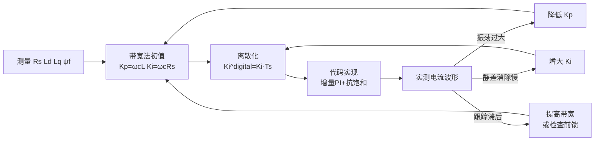
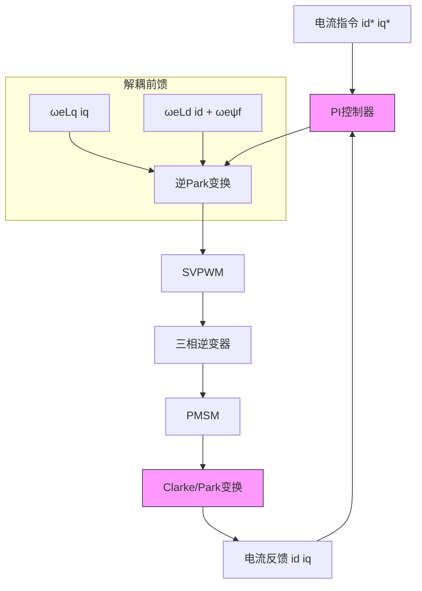

# 电流环调试与PI整定方法

> **为什么学？**
> 电流环是FOC最内环，直接决定电机能否按指令输出转矩。如果PI参数整定不当，会出现电流振荡、跟踪滞后、相电流畸变，严重时导致速度环失稳或硬件过流保护频繁触发。
>
> **在 FOC 中的作用**
> 电流环接收速度环输出的 d/q 轴电流指令，通过PI调节把实际电流跟踪到指令值，并输出 d/q 轴电压给逆Park变换和SVPWM。它是连接"期望转矩"与"实际电压"的核心执行层。

下面这张图把电流环 PI 整定工作流浓缩为五步：先测电机参数，再按目标带宽计算 $K_p/K_i$，把连续控制器映射到离散实现，加入抗饱和，最后根据实际相电流波形和时序测量复核参数。



*图：电流环 PI 整定与调试闭环*

本节从dq轴电流环的小信号模型出发，推导PI参数的整定公式，并说明如何把连续域参数安全地离散到MCU代码中。理解这些推导，才能在调试现场根据电流波形快速判断是比例增益过大、积分过强还是前馈不足。

## 1. 数学推导：dq轴电流环模型与PI控制器设计

### 1.1 被控对象模型

为什么要做这一步：电流环设计的第一步是把耦合的dq轴电压方程解耦成两个独立的一阶惯性环节，否则d、q轴互相干扰，PI控制器无法分别调节。

在旋转坐标系（dq轴）下，PMSM的电压方程为：

$$
\begin{cases}
u_d = R_s i_d + L_d \frac{di_d}{dt} - \omega_e L_q i_q \\
u_q = R_s i_q + L_q \frac{di_q}{dt} + \omega_e L_d i_d + \omega_e \psi_f
\end{cases}
$$

其中 $R_s$ 为定子电阻，$L_d$、$L_q$ 为 dq 轴电感，$\omega_e$ 为电角速度，$\psi_f$ 为永磁体磁链。

若采用前馈解耦，令 PI 输出分别为 $v_{d,PI}$、$v_{q,PI}$，电压指令为：

$$
\begin{cases}
u_d^* = v_{d,PI} - \omega_e L_q i_q \\
u_q^* = v_{q,PI} + \omega_e L_d i_d + \omega_e \psi_f
\end{cases}
$$

则解耦后的电流环被控对象简化为两个独立的一阶惯性环节：

$$
G_{id}(s) = \frac{1}{R_s + sL_d} = \frac{1/R_s}{1 + s\tau_d}, \quad \tau_d = \frac{L_d}{R_s}
$$

$$
G_{iq}(s) = \frac{1}{R_s + sL_q} = \frac{1/R_s}{1 + s\tau_q}, \quad \tau_q = \frac{L_q}{R_s}
$$

### 1.2 PI控制器标准形式

电流环PI控制器采用并联形式：

$$
G_{PI}(s) = K_p + \frac{K_i}{s} = K_p \frac{1 + sT_i}{sT_i}
$$

其中 $T_i = K_p / K_i$ 为积分时间常数。

### 1.3 零极点对消与目标带宽整定

为什么要做这一步：在明确被控对象后，需要选择PI参数使闭环既有足够带宽跟踪电流指令，又不会因相位裕度不足而振荡。

以下先推导理想 RL 对象的带宽法初值。它没有显式包含数字延迟，不能据此固定声称相位裕度为 $45°$；实际裕度要由含采样、计算和 PWM 更新延迟的开环模型计算。

开环传递函数：

$$
G_{OL}(s) = G_{PI}(s) \cdot G_{plant}(s) = K_p \frac{1 + sT_i}{sT_i} \cdot \frac{1}{R_s + sL}
$$

令 $T_i = \tau = L/R_s$（与电机时间常数匹配），则零极点对消，得到：

$$
G_{OL}(s) = \frac{K_p}{sT_i R_s} = \frac{K_i}{s R_s}
$$

此时**开环**化为纯积分环节；单位负反馈闭环是一阶系统。选取目标交越频率 $\omega_c$：

$$
|G_{OL}(j\omega_c)| = 1 \Rightarrow \frac{K_p}{\omega_c T_i R_s} = 1
$$

解得：

$$
K_p = \omega_c L, \quad K_i = \omega_c R_s
$$

这是工程上最常用的电流环PI整定公式。若定义电流环带宽为 $f_{ci} = \omega_c / (2\pi)$，则：

$$
\boxed{K_p = 2\pi f_{ci} \cdot L, \quad K_i = 2\pi f_{ci} \cdot R_s}
$$

### 1.4 Ziegler-Nichols阶跃响应法

为什么要做这一步：当电机参数不准确或无法精确测量电感电阻时，可以通过阶跃响应实验直接从波形提取特征，避免依赖标称参数。

对开环被控对象施加阶跃电压 $V_{step}$，记录电流响应曲线。从响应曲线上获取：

- 稳态电流值 $I_{ss} = V_{step} / R_s$
- 等效延迟时间 $L_{delay}$（响应起跳到切线交点）
- 等效时间常数 $T$（切线斜率对应的惯性时间常数）

则ZN整定参数为：

$$
K_p = \frac{1.2 \cdot T}{K \cdot L_{delay}}, \quad K_i = \frac{2}{L_{delay}}
$$

其中 $K = 1/R_s$ 为对象稳态增益。

## 2. 几何直观：电流环闭环极点与带宽关系



**零极点对消的几何解释**：

将被控对象 $1/(R_s+sL)$ 的极点 $s=-R_s/L$ 与 PI 零点 $s=-K_i/K_p$ 对消后，理想开环只剩原点积分极点；单位负反馈形成一个闭环极点 $s=-K_p/L=-\omega_c$，因此名义闭环是一阶系统。参数误差和数字延迟会使对消不完全并引入额外动态。

```
s平面示意图：

        jω
         │
    ×    │    闭环极点
   ──────┼─────→ σ
    -R/L │
         │
         
理想零极点对消后，闭环极点位于：s = -ωc
或 s = -ζωn ± jωn√(1-ζ²)（若Ti ≠ τ）
```

## 3. 数值示例：电流环PI参数计算

**给定参数**：
- $R_s = 0.5\,\Omega$
- $L_d = L_q = 2.0\,\text{mH}$（表贴式PMSM）
- 目标电流环带宽 $f_{ci} = 1\,\text{kHz}$
- 采样频率 $f_s = 20\,\text{kHz}$（对应50μs周期）

**计算步骤**：

1. 电机电磁时间常数：

$$
\tau = \frac{L}{R_s} = \frac{2.0 \times 10^{-3}}{0.5} = 4\,\text{ms}
$$

2. 目标角频率：

$$
\omega_c = 2\pi f_{ci} = 2\pi \times 1000 = 6283.2\,\text{rad/s}
$$

3. PI参数：

$$
K_p = \omega_c L = 6283.2 \times 2.0 \times 10^{-3} = 12.57\,\Omega \cdot \text{H} / \text{s} = 12.57\,\text{V/A}
$$

$$
K_i = \omega_c R_s = 6283.2 \times 0.5 = 3141.6\,\text{V/(A·s)} = 3141.6\,\text{Ω/s}
$$

4. 离散化（后向欧拉法）：

$$
K_i^{digital} = K_i \cdot T_s = 3141.6 \times 50 \times 10^{-6} = 0.1571\,\text{V/A}
$$

离散PI增量形式：

$$
\Delta u(k) = K_p [e(k) - e(k-1)] + K_i^{digital} \cdot e(k)
$$

5. 验证带宽约束：

根据经验，电流环带宽一般不超过采样频率的1/10：

$$
f_{ci} \leq \frac{f_s}{10} = \frac{20000}{10} = 2\,\text{kHz}
$$

1kHz 满足要求，留有足够裕量。

## 4. 代码实现：C语言电流环PI控制器

为什么要做这一步：离散实现时若直接把连续域Ki写入寄存器，积分作用会随采样周期放大或缩小，必须把单位统一并把输出限幅和抗饱和做进去。

```c
/* 电流环PI控制器结构体 */
typedef struct {
    float Kp;           /* 比例增益 */
    float Ki;           /* 积分增益 (已乘Ts) */
    float integral;     /* 积分累积 */
    float out_max;      /* 输出上限 (Vdc/sqrt(3)) */
    float out_min;      /* 输出下限 */
    float feedforward;  /* 前馈项 */
} CurrentController_t;

/* 电流环PI计算 - 增量式，带抗饱和 */
float Current_PI_Control(CurrentController_t *ctrl, 
                          float ref, 
                          float fb, 
                          float feedforward)
{
    float error = ref - fb;
    
    /* 积分累积（条件积分：仅当未饱和时累积） */
    float integral_new = ctrl->integral + ctrl->Ki * error;
    
    /* 比例+积分输出 */
    float output = ctrl->Kp * error + integral_new + feedforward;
    
    /* 输出限幅 */
    float output_sat;
    if (output > ctrl->out_max) {
        output_sat = ctrl->out_max;
    } else if (output < ctrl->out_min) {
        output_sat = ctrl->out_min;
    } else {
        output_sat = output;
    }
    
    /* 抗饱和：仅当未饱和时更新积分 */
    if (output == output_sat) {
        ctrl->integral = integral_new;
    }
    /* 若饱和，积分保持原值（条件积分法） */
    
    return output_sat;
}

/* 典型调用示例（在50μs PWM中断中） */
void FOC_Current_Loop(void)
{
    /* 1. 读取ADC电流采样 */
    float ia = ADC_GetPhaseA();
    float ib = ADC_GetPhaseB();
    
    /* 2. Clarke变换 */
    float i_alpha = ia;
    float i_beta  = (ia + 2.0f * ib) / sqrt3;  /* 等幅值变换 */
    
    /* 3. Park变换（需电角度θ） */
    float cos_theta = cosf(theta_e);
    float sin_theta = sinf(theta_e);
    float id =  i_alpha * cos_theta + i_beta * sin_theta;
    float iq = -i_alpha * sin_theta + i_beta * cos_theta;
    
    /* 4. 速度环输出作为Iq指令（Id*=0） */
    float id_ref = 0.0f;
    float iq_ref = Speed_Loop_Output;  /* 来自速度环 */
    
    /* 5. 计算解耦前馈项 */
    float v_d_ff = -omega_e * Lq * iq;
    float v_q_ff =  omega_e * Ld * id + omega_e * psi_f;
    
    /* 6. PI控制器 */
    float vd = Current_PI_Control(&Ctrl_d, id_ref, id, v_d_ff);
    float vq = Current_PI_Control(&Ctrl_q, iq_ref, iq, v_q_ff);
    
    /* 7. 逆Park + SVPWM */
    /* ... 后续电压调制 ... */
}
```

## 5. 常见错误

### 错误1：PI参数单位混淆，将连续域 $K_i$ 直接写入离散程序

**错误表现**：连续域计算得 $K_i = 3141.6$，程序员直接将此值写入寄存器，未乘 $T_s$。结果积分作用过强，电流环剧烈振荡。

**原因分析**：连续域 $K_i$ 的单位是 V/(A·s)，离散实现时必须转换为 $K_i^{digital} = K_i \cdot T_s$，单位变为 V/A，与 $K_p$ 一致。

**纠正方法**：
- 在代码中明确定义：`Ki_digital = Ki_continuous * PWM_PERIOD`
- 或改用位置式PI，积分项直接存储为 `integral += error * Ki * Ts`，其中 `Ki` 用连续域值
- 调试时打印积分项累积速率，观察是否每周期增量合理

### 错误2：忽略反电动势前馈，速度升高时电流环饱和

**错误表现**：低速时电流环跟踪良好，转速升高到50%额定后，q轴电流出现明显跟踪误差，甚至振荡。

**原因分析**：$v_q=Ri_q+L\frac{di_q}{dt}+\omega_e\psi_f$。随速度上升，永磁反电动势持续占用电压裕量；具体占比取决于母线电压、磁链、转速、负载和调制方式，不能固定写成 30%～50%。接近电压边界时，即使加入前馈也无法消除物理饱和。

**纠正方法**：
- 在高速或高带宽需求下加入反电动势前馈：$v_q^*=v_{q,PI}+\omega_e\psi_f$，并配合矢量限幅与抗积分饱和
- 若 $\psi_f$ 未知，可用 $\omega_e \cdot K_e$ 估计，其中 $K_e$ 为反电动势常数
- 前馈不必完全精确，剩余误差由 PI 校正；允许误差应根据电压裕量、目标带宽和参数温漂验证，不采用固定 20% 阈值

## 6. 自测习题

### 习题1：PI参数计算

某PMSM参数：$R_s = 0.8\,\Omega$，$L_q = 5\,\text{mH}$，$L_d = 3\,\text{mH}$，目标电流环带宽 $f_{ci} = 500\,\text{Hz}$，采样周期 $T_s = 100\,\mu\text{s}$。分别计算：

(a) d轴和q轴的连续域 $K_p$、$K_i$
(b) 离散域积分增益 $K_i^{digital}$

**答案**：

(a) d轴：$K_{pd} = 2\pi \times 500 \times 3\times10^{-3} = 9.42$，$K_{id} = 2\pi \times 500 \times 0.8 = 2513.3$

q轴：$K_{pq} = 2\pi \times 500 \times 5\times10^{-3} = 15.71$，$K_{iq} = 2\pi \times 500 \times 0.8 = 2513.3$

(b) $K_i^{digital} = 2513.3 \times 100\times10^{-6} = 0.2513$

### 习题2：带宽约束验证

若某MCU的最高PWM频率为40kHz，电流中断周期为25μs。按照"电流环带宽 ≤ 1/10采样频率"的经验法则，允许的最大电流环带宽是多少？若电机电感 $L = 1\,\text{mH}$，$R_s = 0.2\,\Omega$，对应的 $K_p$ 上限为多少？

**答案**：

$f_{ci,max} = f_s / 10 = 40\text{kHz} / 10 = 4\text{kHz}$

$K_{p,max} = 2\pi \times 4000 \times 1\times10^{-3} = 25.13\,\text{V/A}$

（注：实际工程中通常只取1~2kHz，以留足相位裕度应对数字延迟。）
