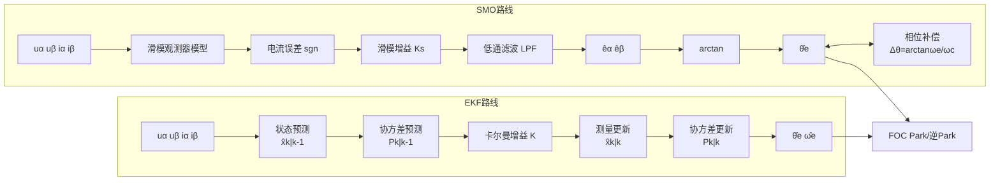
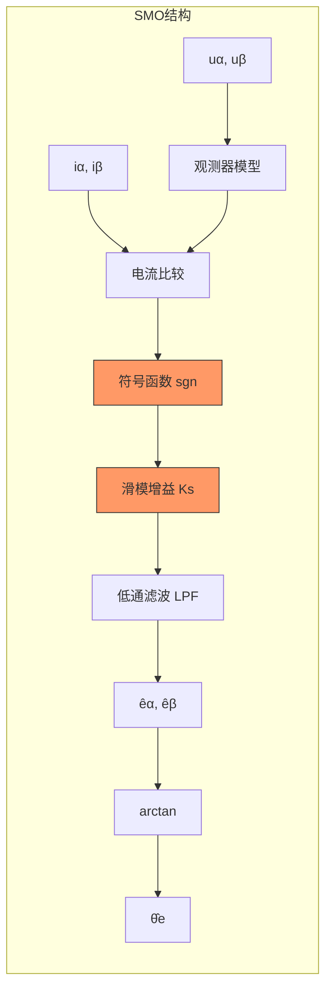

# 观测器参数调优

> **为什么学？**
> 无传感器FOC依赖观测器估算转子位置和速度。观测器增益或滤波参数选错，会导致角度滞后、低速失锁、高速抖振，进而让Park变换用错角度，电流环出现无法消除的d轴分量。
>
> **在 FOC 中的作用**
> 观测器位于电流环上游，为Park/逆Park变换提供转子电角度和电角速度。它的输出精度直接决定FOC能否实现正交解耦，是无传感器方案替代编码器的关键环节。

下面这张图对比了 SMO 与 EKF 两条无传感器角度估计路线。SMO 从电流误差出发，通过符号函数与低通滤波提取反电动势，结构简单但需补偿相位延迟；EKF 则把电流与反电动势同时作为状态，用预测-更新两步权衡模型与测量的可信度。这张图能帮你在调参前先选对观测器架构。



*图：SMO 与 EKF 无传感器角度估计路线对比*

本节从滑模观测器和扩展卡尔曼滤波两条路线出发，讲解增益选取、低通滤波和相位补偿的工程依据。掌握这些调参原则，才能在不同转速区段把角度估计误差控制在电流环可容忍的范围内。

## 1. 数学推导：滑模观测器与扩展卡尔曼滤波

### 1.1 滑模观测器（SMO）基本模型

为什么要做这一步：无传感器方案无法直接测量转子角度，只能利用αβ坐标系下的电流方程反推反电动势，再从反电动势中提取角度信息。

在 $\alpha\beta$ 静止坐标系下，PMSM的电流方程为：

$$
\frac{di_\alpha}{dt} = -\frac{R_s}{L_s} i_\alpha + \frac{1}{L_s} u_\alpha - \frac{1}{L_s} e_\alpha
$$

$$
\frac{di_\beta}{dt} = -\frac{R_s}{L_s} i_\beta + \frac{1}{L_s} u_\beta - \frac{1}{L_s} e_\beta
$$

其中反电动势 $e_\alpha = -\omega_e \psi_f \sin\theta_e$，$e_\beta = \omega_e \psi_f \cos\theta_e$。

构造滑模观测器：

$$
\frac{d\hat{i}_\alpha}{dt} = -\frac{R_s}{L_s} \hat{i}_\alpha + \frac{1}{L_s} u_\alpha - \frac{1}{L_s} K_s \cdot \text{sgn}(\hat{i}_\alpha - i_\alpha)
$$

$$
\frac{d\hat{i}_\beta}{dt} = -\frac{R_s}{L_s} \hat{i}_\beta + \frac{1}{L_s} u_\beta - \frac{1}{L_s} K_s \cdot \text{sgn}(\hat{i}_\beta - i_\beta)
$$

定义电流误差 $e_i = \hat{i} - i$，其动态方程为：

$$
\frac{de_i}{dt} = -\frac{R_s}{L_s} e_i - \frac{1}{L_s} (K_s \cdot \text{sgn}(e_i) - e_{emf})
$$

### 1.2 滑模增益设计

为什么要做这一步：滑模增益必须足够大以压制反电动势和噪声，但过大会引起高频抖振，因此需要先根据最高转速下的反电动势幅值确定下限。

根据滑模到达条件 $e_i \cdot \dot{e}_i < 0$，取Lyapunov函数 $V = \frac{1}{2} e_i^2$，则：

$$
\dot{V} = e_i \dot{e}_i = e_i \left(-\frac{R_s}{L_s} e_i - \frac{K_s}{L_s} \text{sgn}(e_i) + \frac{e_{emf}}{L_s}\right)
$$

为保证 $\dot{V} < 0$，需要：

$$
K_s > |e_{emf}|_{max} = \omega_{e,max} \psi_f
$$

即滑模增益必须大于反电动势的最大幅值。若 $\omega_{e,max} = 4000\,\text{rpm} = 418.9\,\text{rad/s}$（电角速度），$\psi_f = 0.05\,\text{Wb}$，则：

$$
K_s > 418.9 \times 0.05 = 20.9\,\text{V}
$$

### 1.3 等效控制与低通滤波

为什么要做这一步：符号函数输出的高频切换信号不能直接用于角度计算，必须用低通滤波提取其等效反电动势平均值。

当系统进入滑模面后，切换项的平均值即为等效反电动势：

$$
z_\alpha = K_s \cdot \text{sgn}(\hat{i}_\alpha - i_\alpha) \xrightarrow{\text{LPF}} e_\alpha
$$

$$
z_\beta = K_s \cdot \text{sgn}(\hat{i}_\beta - i_\beta) \xrightarrow{\text{LPF}} e_\beta
$$

通过一阶低通滤波器提取等效控制：

$$
\hat{e}_\alpha = \frac{\omega_c}{s + \omega_c} z_\alpha, \quad \hat{e}_\beta = \frac{\omega_c}{s + \omega_c} z_\beta
$$

角度和速度估计：

$$
\hat{\theta}_e = -\arctan\left(\frac{\hat{e}_\alpha}{\hat{e}_\beta}\right)
$$

$$
\hat{\omega}_e = \frac{\sqrt{\hat{e}_\alpha^2 + \hat{e}_\beta^2}}{\psi_f}
$$

### 1.4 EKF状态方程

为什么要做这一步：当电流采样噪声较大或电机参数变化明显时，EKF通过权衡模型预测与测量更新，可以获得比SMO更平滑的角度估计。

选取状态向量 $\mathbf{x} = [i_\alpha, i_\beta, e_\alpha, e_\beta]^T$，由于反电动势变化慢于电流，可建模为：

$$
\dot{\mathbf{x}} = \mathbf{A}\mathbf{x} + \mathbf{B}\mathbf{u} + \mathbf{w}
$$

其中：

$$
\mathbf{A} = \begin{bmatrix}
-R_s/L_s & 0 & -1/L_s & 0 \\
0 & -R_s/L_s & 0 & -1/L_s \\
0 & 0 & 0 & -\omega_e \\
0 & 0 & \omega_e & 0
\end{bmatrix}, \quad
\mathbf{B} = \begin{bmatrix}
1/L_s & 0 \\
0 & 1/L_s \\
0 & 0 \\
0 & 0
\end{bmatrix}
$$

EKF的噪声协方差矩阵 $Q$（过程噪声）和 $R$（测量噪声）是关键调参对象：

- $Q$ 越大：信任模型预测越少，更依赖测量更新，响应快但噪声敏感
- $R$ 越大：信任测量越少，更依赖模型预测，平滑但可能滞后

## 2. 几何直观：观测器收敛与滑模面



**滑模面几何解释**：

```
         îα
         │
         │    ╱ 滑模面 e_iα = 0
    ─────┼───╱──────────
         │  ╱  
         │ ╱   轨迹在滑模面两侧切换
         │╱    （抖振）
         └──────────────→ iα
         实际电流轨迹
```

在误差相平面中，滑模面 $e_i = 0$ 是一条直线。当轨迹在滑模面两侧高速切换时，形成的平均轨迹沿滑模面滑向原点。$K_s$ 决定切换的"推力"，$K_s$ 过小则无法到达滑模面；$K_s$ 过大则抖振剧烈。

**LPF引入的相位延迟**：

低通滤波器的截止频率 $\omega_c$ 与相位延迟 $\phi$ 的关系：

$$
\phi = -\arctan\left(\frac{\omega_e}{\omega_c}\right)
$$

若 $\omega_c = 2\omega_e$，则 $\phi = -\arctan(0.5) \approx -26.6°$。这意味着估计的角度比真实角度滞后约26.6°，必须进行补偿。

## 3. 数值示例：SMO参数设计与验证

**给定电机参数**：
- $R_s = 0.5\,\Omega$
- $L_s = 2.0\,\text{mH}$（表贴式，$L_d = L_q = L_s$）
- $\psi_f = 0.04\,\text{Wb}$
- 极对数 $P = 4$
- 额定转速 $3000\,\text{rpm}$（机械）

**计算步骤**：

1. 最大电角速度：

$$
\omega_{e,max} = P \cdot \frac{2\pi n_{mech}}{60} = 4 \times \frac{2\pi \times 3000}{60} = 1256.6\,\text{rad/s}
$$

2. 滑模增益下限：

$$
K_{s,min} = \omega_{e,max} \psi_f = 1256.6 \times 0.04 = 50.26\,\text{V}
$$

取工程裕量2倍：$K_s = 100\,\text{V}$

3. 低通滤波器截止频率选择：

反电动势基频最高为 $f_{e,max} = \omega_{e,max}/(2\pi) = 200\,\text{Hz}$。为有效滤除开关频率分量（如10kHz PWM），同时保留基频信息，取：

$$
f_c = 5 \times f_{e,max} = 1000\,\text{Hz} \Rightarrow \omega_c = 6283.2\,\text{rad/s}
$$

4. 相位延迟计算：

在额定转速时的相位延迟：

$$
\phi = -\arctan\left(\frac{1256.6}{6283.2}\right) = -\arctan(0.2) \approx -11.3°
$$

对应电角度滞后：补偿量 $\Delta\theta = 11.3° \times \frac{\pi}{180} = 0.197\,\text{rad}$

5. 离散化实现：

采样周期 $T_s = 50\,\mu\text{s}$，一阶LPF的离散形式：

$$
\hat{e}(k) = a \cdot \hat{e}(k-1) + (1-a) \cdot z(k)
$$

其中 $a = e^{-\omega_c T_s} = e^{-6283.2 \times 50\times10^{-6}} = e^{-0.314} = 0.730$

## 4. 代码实现：滑模观测器C代码

为什么要做这一步：把连续域的观测器离散到固定周期中断里时，积分步长和滤波系数必须按实际Ts重新计算，否则估计电流会发散或相位补偿失效。

```c
/* 滑模观测器结构体 */
typedef struct {
    float Rs;           /* 定子电阻 */
    float Ls;           /* 定子电感 */
    float Ks;           /* 滑模增益 */
    float psi_f;        /* 永磁体磁链 */
    float i_alpha_hat;  /* 估计电流α */
    float i_beta_hat;   /* 估计电流β */
    float e_alpha_hat;  /* 估计反电势α */
    float e_beta_hat;   /* 估计反电势β */
    float theta_hat;    /* 估计角度 */
    float omega_hat;    /* 估计速度 */
    float LPF_coeff;    /* 低通滤波系数 a */
} SMO_Observer_t;

/* 符号函数 */
static inline float _sgn(float x) {
    return (x > 0.0f) ? 1.0f : ((x < 0.0f) ? -1.0f : 0.0f);
}

/* 滑模观测器单步更新 */
void SMO_Update(SMO_Observer_t *smo, float u_alpha, float u_beta,
                float i_alpha, float i_beta, float Ts)
{
    /* 1. 电流误差 */
    float err_alpha = smo->i_alpha_hat - i_alpha;
    float err_beta  = smo->i_beta_hat  - i_beta;
    
    /* 2. 电流观测器更新（欧拉法） */
    float di_alpha = (-smo->Rs * smo->i_alpha_hat + u_alpha 
                      - smo->Ks * _sgn(err_alpha)) / smo->Ls;
    float di_beta  = (-smo->Rs * smo->i_beta_hat  + u_beta 
                      - smo->Ks * _sgn(err_beta))  / smo->Ls;
    
    smo->i_alpha_hat += di_alpha * Ts;
    smo->i_beta_hat  += di_beta  * Ts;
    
    /* 3. 等效控制提取（低通滤波） */
    float z_alpha = smo->Ks * _sgn(err_alpha);
    float z_beta  = smo->Ks * _sgn(err_beta);
    
    smo->e_alpha_hat = smo->LPF_coeff * smo->e_alpha_hat 
                       + (1.0f - smo->LPF_coeff) * z_alpha;
    smo->e_beta_hat  = smo->LPF_coeff * smo->e_beta_hat  
                       + (1.0f - smo->LPF_coeff) * z_beta;
    
    /* 4. 角度估计（含相位补偿） */
    float theta_raw = -atan2f(smo->e_alpha_hat, smo->e_beta_hat);
    
    /* 补偿LPF相位延迟：Δθ = arctan(ωe/ωc) */
    /* 速度估计：|e|/ψf */
    float e_mag = sqrtf(smo->e_alpha_hat * smo->e_alpha_hat 
                       + smo->e_beta_hat * smo->e_beta_hat);
    smo->omega_hat = e_mag / smo->psi_f;
    
    /* 相位补偿 */
    float phase_comp = atan2f(smo->omega_hat * smo->Ls, smo->Rs + smo->Ks); 
    /* 简化补偿：也可用固定查表或在线计算 */
    smo->theta_hat = theta_raw + phase_comp;
    
    /* 角度归一化到 [0, 2π) */
    if (smo->theta_hat >= 2.0f * PI) smo->theta_hat -= 2.0f * PI;
    if (smo->theta_hat < 0.0f)        smo->theta_hat += 2.0f * PI;
}

/* EKF简化实现（仅展示核心更新） */
void EKF_Update(float i_alpha_meas, float i_beta_meas,
                float u_alpha, float u_beta, float Ts)
{
    /* 预测步骤（省略Jacobian计算） */
    /* ... */
    
    /* 更新步骤：K = P*H'/(H*P*H' + R) */
    /* ... */
    
    /* 关键调参：Q[0][0] = iα过程噪声，R[0][0] = iα测量噪声 */
    /* Q越大越信任测量，R越大越信任模型 */
}
```

## 5. 常见错误

### 错误1：滑模增益 $K_s$ 设置过小，低速时观测器失锁

**错误表现**：电机启动或低速运行（<10%额定转速）时，角度估计值随机跳变，电流环振荡，电机抖动甚至反转。

**原因分析**：低速时反电动势幅值很小（$e = \omega_e \psi_f$），若 $K_s$ 仅按额定速设计，低速区的电流误差可能不足以驱动滑模面。特别当电流采样存在噪声（约0.5% FS）时，噪声可能淹没真实的反电动势信息。

**纠正方法**：
- 低速区采用自适应 $K_s$：$K_s(\omega) = K_{s0} + K_{s1} \cdot |\omega|$，或保持恒定较大值
- 加入电流误差死区：仅当 $|e_i| > e_{threshold}$ 时才触发滑模切换，避免噪声引发频繁切换
- 低速区（<5%额定速度）切换到高频注入（HFI）或开环I-F启动

### 错误2：忽略LPF相位补偿，导致FOC角度失准

**错误表现**：系统能运行，但电流环始终存在稳态误差，效率偏低，最高转速达不到预期。用示波器观察实际电流，发现d轴电流不为零且随转速变化。

**原因分析**：低通滤波器引入的相位延迟使估计角度滞后于真实角度。设延迟 $\Delta\theta$，则Park变换使用的角度为 $\theta - \Delta\theta$，导致dq轴不正交：

$$
i_d = i_\alpha \cos(\theta - \Delta\theta) + i_\beta \sin(\theta - \Delta\theta) \neq 0
$$

**纠正方法**：
- 理论补偿：$\Delta\theta = \arctan(\omega_e / \omega_c)$，在线计算并补偿
- 查表补偿：按速度区间建立补偿角查表
- 提高LPF截止频率 $\omega_c$：降低延迟但增加抖振。折中方案：取 $\omega_c = (5\sim10)\omega_{e,max}$
- 改用二阶滤波器或滑动平均滤波，相位特性更可控

## 6. 自测习题

### 习题1：滑模增益设计

某电机 $\psi_f = 0.06\,\text{Wb}$，极对数 $P = 4$，最高机械转速 $5000\,\text{rpm}$。计算：

(a) 最小滑模增益 $K_s$（取1.5倍裕量）
(b) 若低通滤波截止频率为 $f_c = 1500\,\text{Hz}$，在3000rpm时的相位延迟角度（电角度）

**答案**：

(a) $\omega_{e,max} = 4 \times 2\pi \times 5000/60 = 2094.4\,\text{rad/s}$

$K_{s,min} = 1.5 \times 2094.4 \times 0.06 = 188.5\,\text{V}$

(b) 3000rpm电角速度：$\omega_e = 4 \times 2\pi \times 3000/60 = 1256.6\,\text{rad/s}$

$\omega_c = 2\pi \times 1500 = 9424.8\,\text{rad/s}$

$\phi = -\arctan(1256.6 / 9424.8) = -\arctan(0.1333) = -7.6°$

### 习题2：EKF噪声调参

在EKF中，若将过程噪声协方差 $Q$ 的对角元素从 $10^{-4}$ 增大到 $10^{-2}$，同时保持 $R$ 不变，观测器响应会变快还是变慢？估计结果会更平滑还是更噪声？解释原因。

**答案**：

- 响应变快：$Q$ 增大意味着模型预测的不确定性增加，卡尔曼增益 $K$ 增大，新测量值的权重提高，因此估计值更快地跟随测量变化
- 结果更噪声：由于更信任包含噪声的测量值，估计输出的高频噪声分量增加，平滑度下降
- 工程建议：$Q$ 与 $R$ 的比值决定响应/平滑 trade-off。若编码器分辨率低（噪声大），应增大 $R$；若电机参数变化快（如温升导致 $R_s$ 变化），应增大 $Q$。
