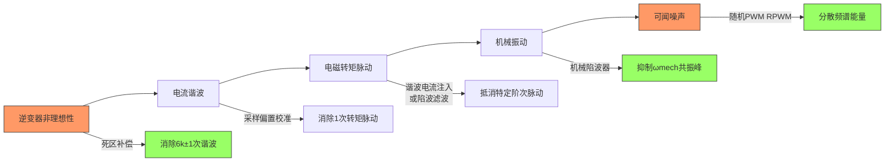
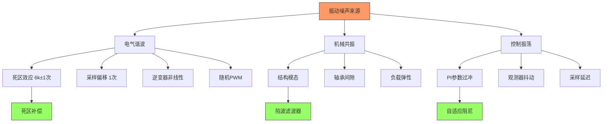

# 振动噪声分析与抑制

> **为什么学？**
> FOC系统即使电流环稳定，也可能因死区、采样偏移、机械共振等原因产生振动和噪声。如果不定位谐波来源，会误调PI参数、牺牲动态性能，甚至导致机械结构疲劳损坏。
>
> **在 FOC 中的作用**
> 本节内容位于电流环与机械负载之间，负责把电气侧的电流谐波转化为转矩脉动分析，并给出陷波滤波、死区补偿、随机PWM等抑制手段，是提升系统NVH性能的关键。

下面这张图把“电气谐波如何变成机械噪声”的因果链拆开，并在每一级标注了对应的抑制手段。调试时只要定位到哪一级的激励最大，就能选择最小侵入的补偿方式，而不是盲目降低电流环带宽。



*图：电气谐波到机械噪声的传递链与抑制手段*

本节先建立电流谐波与转矩脉动的定量关系，再分析逆变器死区、采样误差和机械弹性三类典型激励源，最后给出可落地的补偿与滤波策略。理解这些链路，才能从"电流波形→转矩脉动→机械响应"三个层面定位噪声根因。

## 1. 数学推导：电流谐波与转矩脉动

### 1.1 非理想因素导致的电流谐波

为什么要做这一步：理想正弦电流在实际逆变器中并不存在，必须先量化死区、采样偏移和过调制等非理想因素引入的谐波，才能判断哪些谐波会转成转矩脉动。

理想三相电流为：

$$
i_A = I_m \cos(\omega t), \quad i_B = I_m \cos(\omega t - 120°), \quad i_C = I_m \cos(\omega t + 120°)
$$

实际系统中，以下因素引入谐波：

**1. 逆变器死区效应**：

死区时间 $T_d$ 引起的基波电压损失：

$$
\Delta V = \frac{4 T_d V_{dc}}{T_s} \cdot f(\theta)
$$

其中 $T_s$ 为PWM周期，$f(\theta)$ 为与电流极性相关的函数。死区引入的主要谐波为5次、7次、11次、13次等 $6k \pm 1$ 次谐波。

**2. 电流采样偏移**：

三相电流之和应为零（无零序通路）：$i_A + i_B + i_C = 0$。若采样存在直流偏移 $i_{offset}$，则经Clarke变换后：

$$
i_\alpha = i_A + i_{offset} \\
i_\beta = \frac{i_A + 2i_B + 3i_{offset}}{\sqrt{3}}
$$

直流偏移在dq坐标系中表现为 $\omega_e$ 频率的交流量，产生1倍频转矩脉动。

**3. 空间矢量调制的非线性**：

在过调制区，SVPWM无法精确合成参考电压，产生低次谐波。过调制系数 $m$ 定义为：

$$
m = \frac{|V_{ref}|}{V_{dc}/\sqrt{3}}
$$

当 $m > 0.907$（六步调制边界）时，谐波含量急剧增加。

### 1.2 转矩脉动计算

为什么要做这一步：电机最终表现为机械振动，需要把q轴电流谐波映射到电磁转矩脉动，才能评估对转速和噪声的实际影响。

PMSM电磁转矩方程：

$$
T_e = \frac{3}{2} P [\psi_f i_q + (L_d - L_q) i_d i_q]
$$

若电流含谐波：$i_q = I_{q0} + \sum I_{qn} \cos(n\omega_e t + \phi_n)$，则转矩脉动为：

$$
\Delta T_e = \frac{3}{2} P \psi_f \sum I_{qn} \cos(n\omega_e t + \phi_n)
$$

对于表贴式电机（$L_d = L_q$），转矩脉动与q轴电流谐波成正比。若存在5次谐波电流 $I_{q5} = 0.05 I_{q0}$，则转矩脉动百分比为：

$$
\frac{\Delta T_{e5}}{T_{e0}} = \frac{I_{q5}}{I_{q0}} = 5\%
$$

### 1.3 机械共振

为什么要做这一步：转矩脉动是否被放大取决于机械系统模态，必须计算电机-负载的谐振频率，避免电流环或速度环带宽落在共振峰附近。

电机-负载系统可建模为二阶机械系统：

$$
J \frac{d\omega_m}{dt} + B \omega_m + T_{friction} = T_e - T_L
$$

若负载为弹性连接（如谐波减速器、皮带传动），引入弹性系数 $K_{spring}$ 和阻尼 $B_{load}$：

$$
J_m \frac{d\omega_m}{dt} = T_e - K_{spring}(\theta_m - \theta_L) - B_{load}(\omega_m - \omega_L)
$$

$$
J_L \frac{d\omega_L}{dt} = K_{spring}(\theta_m - \theta_L) + B_{load}(\omega_m - \omega_L) - T_{ext}
$$

该系统的机械谐振频率为：

$$
\omega_{mech} = \sqrt{\frac{K_{spring}(J_m + J_L)}{J_m J_L}}
$$

当电流环带宽或速度环带宽接近 $\omega_{mech}$ 时，系统可能激发机械共振。

## 2. 几何直观：谐波来源与抑制策略



**死区效应的电压波形**：

```
理想PWM输出：        实际PWM输出（含死区）：
     ┌──┐  ┌──┐         ┌┐    ┌┐
─────┘  └──┘  └──    ───┘└────┘└──
                      ↑↑
                      死区缺口（电压损失）
                      
当电流为正时，下桥臂关断后上桥臂延迟导通，
导致输出电压比指令值低ΔV。
```

**机械共振的波特图**：

```
增益(dB)
   │
   │     ┌─┐
   │    /   \        ← 机械谐振峰
   │───┘     \───────
   │
   └────────────────────→ 频率
              ω_mech
   
   若在ω_mech处有控制环路增益>0dB，
   且相位=-180°，则系统振荡。
```

## 3. 数值示例：死区补偿与谐波分析

**给定参数**：
- $V_{dc} = 24\,\text{V}$
- PWM频率 $f_{PWM} = 20\,\text{kHz}$，$T_s = 50\,\mu\text{s}$
- 死区时间 $T_d = 1\,\mu\text{s}$
- 额定相电流 $I_{rated} = 5\,\text{A}$（峰值）
- 调制比 $m = 0.7$

**计算步骤**：

1. 死区引起的电压损失：

$$
\Delta V = \frac{4 T_d V_{dc}}{T_s} = \frac{4 \times 1\times10^{-6} \times 24}{50\times10^{-6}} = 1.92\,\text{V}
$$

2. 基波电压幅值：

$$
V_1 = m \cdot \frac{V_{dc}}{2} = 0.7 \times 12 = 8.4\,\text{V}
$$

3. 死区引入的谐波电压占基波比例：

$$
\frac{\Delta V}{V_1} = \frac{1.92}{8.4} = 22.9\%
$$

注：这是最大值，实际与电流幅值和功率因数相关。典型情况下死区谐波约为2%~5%。

4. 5次谐波电流估算：

5次谐波电压幅值约 $V_5 \approx 0.05 \times V_1 = 0.42\,\text{V}$（经验值）

5次谐波阻抗：$Z_5 = \sqrt{R_s^2 + (5\omega_e L_s)^2} \approx 5\omega_e L_s$（高频时电感占主导）

若 $\omega_e = 2\pi \times 100 = 628.3\,\text{rad/s}$，$L_s = 2\,\text{mH}$：

$$
Z_5 = 5 \times 628.3 \times 2\times10^{-3} = 6.28\,\Omega
$$

$$
I_5 = \frac{V_5}{Z_5} = \frac{0.42}{6.28} = 0.067\,\text{A} = 67\,\text{mA}
$$

5. 转矩脉动：

$$
\frac{\Delta T_{e5}}{T_{e0}} = \frac{I_5}{I_1} = \frac{0.067}{5} = 1.34\%
$$

## 4. 代码实现：陷波滤波器与随机PWM

为什么要做这一步：陷波滤波器和随机PWM需要稳定、可预期的离散实现，若系数或周期抖动处理不当，反而会引入新的控制延迟和电流纹波。

```c
/* 二阶陷波滤波器（Notch Filter）
 * 用于抑制特定频率的机械谐振
 * 传递函数：H(s) = (s² + ωn²) / (s² + ωn/Q · s + ωn²)
 */
typedef struct {
    float a0, a1, a2;   /* 输出系数 */
    float b0, b1, b2;   /* 输入系数 */
    float x1, x2;       /* 输入延迟 */
    float y1, y2;       /* 输出延迟 */
} NotchFilter_t;

/* 初始化陷波滤波器（双线性变换离散化） */
void NotchFilter_Init(NotchFilter_t *nf, float fn, float Q, float Ts)
{
    float omega_n = 2.0f * PI * fn;
    float cos_w = cosf(omega_n * Ts);
    float sin_w = sinf(omega_n * Ts);
    float alpha = sin_w / (2.0f * Q);
    
    float a0 = 1.0f + alpha;
    float a1 = -2.0f * cos_w;
    float a2 = 1.0f - alpha;
    
    float b0 = 1.0f;
    float b1 = -2.0f * cos_w;
    float b2 = 1.0f;
    
    /* 归一化 */
    nf->b0 = b0 / a0; nf->b1 = b1 / a0; nf->b2 = b2 / a0;
    nf->a1 = a1 / a0; nf->a2 = a2 / a0;
    nf->x1 = nf->x2 = nf->y1 = nf->y2 = 0.0f;
}

/* 陷波滤波器单步计算 */
float NotchFilter_Process(NotchFilter_t *nf, float input)
{
    float output = nf->b0 * input + nf->b1 * nf->x1 + nf->b2 * nf->x2
                   - nf->a1 * nf->y1 - nf->a2 * nf->y2;
    
    nf->x2 = nf->x1; nf->x1 = input;
    nf->y2 = nf->y1; nf->y1 = output;
    
    return output;
}

/* 随机PWM（RPWM）频率抖动实现
 * 将固定PWM频率在一个小范围内随机变化，
 * 分散离散谱能量到连续谱，降低可闻噪声峰值
 */
#define RPWM_BASE_FREQ    20000.0f   /* 20kHz基频 */
#define RPWM_JITTER_PCT   0.10f      /* ±10%抖动 */
#define RPWM_PERIOD_NUM   16         /* 一个随机序列周期包含16个PWM周期 */

static uint16_t rpwm_sequence[RPWM_PERIOD_NUM];
static uint8_t rpwm_idx = 0;

/* 初始化随机序列（可用伪随机数或预定义序列） */
void RPWM_Init(void)
{
    /* 简单伪随机序列：±10%内均匀分布 */
    uint16_t base_arr = (uint16_t)(SystemCoreClock / RPWM_BASE_FREQ);
    for (int i = 0; i < RPWM_PERIOD_NUM; i++) {
        float jitter = ((float)(rand() % 100) - 50.0f) / 50.0f * RPWM_JITTER_PCT;
        rpwm_sequence[i] = (uint16_t)(base_arr * (1.0f + jitter));
    }
}

/* 在每个PWM中断中更新下一周期 */
void PWM_Update_Period(void)
{
    TIM_SetAutoreload(PWM_TIM, rpwm_sequence[rpwm_idx]);
    rpwm_idx = (rpwm_idx + 1) % RPWM_PERIOD_NUM;
}
```

## 5. 常见错误

### 错误1：陷波滤波器中心频率与谐振频率不匹配，导致抑制失效甚至放大

**错误表现**：在速度环中串入陷波滤波器后，某些转速下振动反而加剧，特定频率噪声增大。

**原因分析**：陷波滤波器的中心频率 $f_n$ 必须精确匹配机械谐振频率。若辨识的谐振频率存在偏差（如仅通过听觉判断），当实际谐振在210Hz而滤波器设在200Hz时，滤波器在210Hz处仍有正增益（波特图显示陷波中心左侧为相位超前、右侧为滞后）。更严重的是，若滤波器频率与谐振频率偏差大于3dB带宽，滤波器在谐振点处几乎没有衰减。

**纠正方法**：
- 使用频响分析仪或FFT精确测量：给电机注入扫频电流指令，测量速度响应，找到增益峰值频率
- 在线自适应：用Goertzel算法实时检测振动频率，动态调整 $f_n$
- 设计较宽的陷波（降低Q值，如Q=2而非Q=10），牺牲衰减深度换取频率容差
- 在速度环输出端（而非电流指令端）加陷波，避免影响电流环稳定性

### 错误2：随机PWM导致电流环采样不同步，控制性能下降

**错误表现**：启用随机PWM后，电流纹波增大，低速时电流跟踪精度下降，甚至偶尔出现电流尖峰。

**原因分析**：电流环通常假设在每个PWM周期内采样一次，且采样点固定（如中心对齐模式的周期中点）。若PWM周期随机变化，而ADC触发仍按固定延时设置，则采样点可能偏离电流波形的"中点平坦区"，采到开关瞬态附近的噪声。此外，若电流环PI的 $K_i$ 按固定 $T_s$ 离散化，实际周期变化会导致积分增益时变。

**纠正方法**：
- 使用ADC触发跟随PWM更新：每个PWM中断根据当前周期重计算ADC触发点，确保始终在周期中点采样
- 或者使用PWM周期抖动而非频率随机跳变：固定周期中点，仅改变边沿位置（不对称调制），保持周期长度不变
- 对电流环 $K_i$ 做周期补偿：$K_i^{actual} = K_i^{nominal} \cdot (T_{s,nominal} / T_{s,actual})$
- 限制随机PWM的抖动幅度在 ±5%以内，而非 ±20%，以减小对控制环路的影响

## 6. 自测习题

### 习题1：死区谐波计算

某逆变器 $V_{dc} = 48\,\text{V}$，$f_{PWM} = 25\,\text{kHz}$，死区 $T_d = 800\,\text{ns}$。计算：

(a) 死区引起的最大电压损失 $\Delta V$
(b) 若相电流基波幅值为 $3\,\text{A}$，估算5次谐波电流（设 $Z_5 \approx 5\omega_e L_s$，$\omega_e = 2\pi \times 50\,\text{Hz}$，$L_s = 3\,\text{mH}$）

**答案**：

(a) $T_s = 1/25000 = 40\,\mu\text{s}$

$\Delta V = 4 \times 800\times10^{-9} \times 48 / (40\times10^{-6}) = 3.84\,\text{V}$

(b) $V_5 \approx 0.05 \times m \times V_{dc}/2 = 0.05 \times 0.8 \times 24 = 0.96\,\text{V}$（假设m=0.8）

$Z_5 = 5 \times 2\pi \times 50 \times 3\times10^{-3} = 4.71\,\Omega$

$I_5 = 0.96 / 4.71 = 0.204\,\text{A}$（约6.8%基波）

### 习题2：机械谐振频率

电机惯量 $J_m = 0.001\,\text{kg·m}^2$，负载惯量 $J_L = 0.005\,\text{kg·m}^2$，联轴器刚度 $K_{spring} = 500\,\text{N·m/rad}$。计算：

(a) 机械谐振频率（Hz）
(b) 若速度环带宽为 $500\,\text{Hz}$，是否可能激发谐振？应如何调整？

**答案**：

(a) $\omega_{mech} = \sqrt{500 \times (0.001 + 0.005) / (0.001 \times 0.005)} = \sqrt{600000} = 774.6\,\text{rad/s}$

$f_{mech} = 774.6 / (2\pi) = 123.3\,\text{Hz}$

(b) 速度环带宽500Hz远高于谐振频率123Hz，不会直接激发。但速度环增益在123Hz处可能有非零值，若相位裕度不足，仍可能通过反馈路径激发谐振。应在速度环中串入中心频率123Hz的陷波滤波器，或将速度环带宽降至50Hz（远低于123Hz）。
