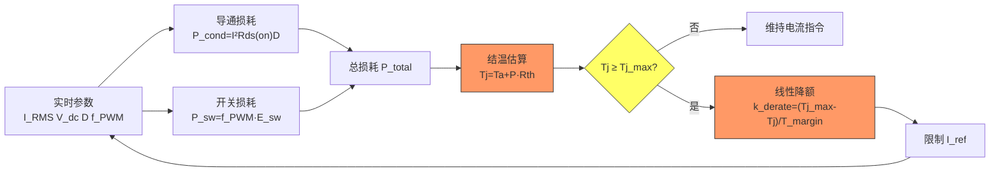
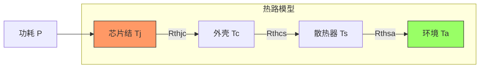

# 热管理与MOSFET保护

> **为什么学？**
> FOC驱动器的电流输出能力最终受MOSFET结温限制。如果不会估算导通损耗、开关损耗和结温，就会盲目加大电流指令，导致器件过热、寿命骤降，甚至在过载瞬间烧毁。
>
> **在 FOC 中的作用**
> 热管理为电流环和速度环提供电流限幅边界。它根据实时损耗和结温估算动态调整最大允许电流，是保障驱动器持续安全运行的最后一道防线。

下面这张图展示了在线热管理的闭环逻辑：从实时运行参数算出导通损耗与开关损耗，经热阻网络得到结温 $T_j$，再与最大允许结温比较，动态调整电流限幅。这张图能帮你理解“电流指令不是无限大，而是由结温实时反馈决定”的约束关系。



*图：MOSFET 在线结温估算与电流降额闭环*

本节从MOSFET的导通与开关损耗公式出发，建立热阻等效电路，并通过迭代计算得到真实结温。掌握这套方法，才能在选型和现场调试中把电流能力与散热设计匹配起来。

## 1. 数学推导：损耗计算与热阻模型

### 1.1 MOSFET导通损耗

为什么要做这一步：导通损耗是稳态发热的主要来源，必须根据实际电流有效值、占空比和温度下的Rds(on)计算，否则热设计会严重偏离实际。

MOSFET的导通损耗由导通电阻 $R_{DS(on)}$ 和导通电流决定：

$$
P_{cond} = I_{RMS}^2 \cdot R_{DS(on)} \cdot D
$$

对于三相逆变器中的上桥臂MOSFET，占空比 $D$ 随SVPWM调制变化。在一个基波周期内，上桥臂的平均占空比为：

$$
\bar{D} = \frac{1}{2} + \frac{m}{2} \sin(\theta)
$$

平均导通损耗需在一个基波周期内积分。对于正弦调制，相电流有效值 $I_{RMS}$ 与峰值 $I_{peak}$ 的关系为 $I_{RMS} = I_{peak}/\sqrt{2}$，则每相上桥臂平均导通损耗：

$$
P_{cond,up} = \frac{1}{2\pi} \int_0^{2\pi} I_{peak}^2 \sin^2(\theta) \cdot R_{DS(on)} \cdot \left(\frac{1}{2} + \frac{m}{2}\sin(\theta)\right) d\theta
$$

$$
= I_{RMS}^2 R_{DS(on)} \left(\frac{1}{2} + \frac{2m}{3\pi}\right)
$$

同理下桥臂：

$$
P_{cond,low} = I_{RMS}^2 R_{DS(on)} \left(\frac{1}{2} - \frac{2m}{3\pi}\right)
$$

### 1.2 MOSFET开关损耗

为什么要做这一步：高频PWM下开关损耗往往超过导通损耗，直接决定逆变器效率和MOSFET温升，是选择开关频率和栅极驱动的核心依据。

开关损耗发生在开通和关断瞬间：

$$
P_{sw} = f_{PWM} \cdot (E_{on} + E_{off}) = f_{PWM} \cdot E_{sw}
$$

其中 $E_{sw}$ 为单次开关能量，通常从数据手册的 $E_{sw}$-$I_D$ 曲线获取。若数据手册给出 $E_{sw,ref}$ 在参考电流 $I_{ref}$ 和参考电压 $V_{ref}$ 下，则实际开关能量：

$$
E_{sw} = E_{sw,ref} \cdot \frac{I_{actual}}{I_{ref}} \cdot \frac{V_{dc}}{V_{ref}}
$$

总开关损耗（6个MOSFET）：

$$
P_{sw,total} = 6 \cdot f_{PWM} \cdot E_{sw}
$$

### 1.3 热阻模型与结温估算

为什么要做这一步：损耗最终表现为结温，必须把热阻网络与瞬态热阻抗结合起来，才能判断稳态和过载两种工况下是否越限。

MOSFET的热路可用电-热类比描述：

$$
T_j = T_a + P_{total} \cdot (R_{th(jc)} + R_{th(cs)} + R_{th(sa)})
$$

其中：
- $T_j$：结温（Junction Temperature）
- $T_a$：环境温度
- $R_{th(jc)}$：结到壳热阻（数据手册）
- $R_{th(cs)}$：壳到散热器热阻（导热硅脂/垫片）
- $R_{th(sa)}$：散热器到环境热阻（散热器 datasheet）

瞬态热阻（脉冲功率）：

$$
T_j(t) = T_a + P \cdot Z_{th(jc)}(t)
$$

$Z_{th(jc)}(t)$ 为瞬态热阻抗，从数据手册的曲线读取。对于PWM开关频率远高于热时间常数的情况，可用平均功率计算稳态结温；对于启动等瞬态过程，需考虑瞬态热阻抗。

### 1.4 降额运行

为什么要做这一步：当结温接近极限时，不能简单关断电机，而应平滑降低电流指令，既保护器件又避免负载剧烈波动。

若测得或估算的结温 $T_j$ 接近最大允许值 $T_{j,max}$（通常150°C或175°C），需实施降额：

$$
I_{limit} = I_{rated} \cdot \sqrt{\frac{T_{j,max} - T_a}{T_{j,steady} - T_a}}
$$

或线性降低电流指令：

$$
I_{ref}^{new} = I_{ref} \cdot k_{derate}, \quad k_{derate} = \max\left(0, \frac{T_{j,max} - T_j}{T_{margin}}\right)
$$

其中 $T_{margin}$ 为安全裕度（如20°C）。

## 2. 几何直观：热路模型与温度分布



**热阻串并联的物理意义**：

```
       Tj (芯片结)
        │
       Rthjc ← 硅片→铜基板的热阻（由芯片封装决定）
        │
       Tc (金属外壳/散热焊盘)
        │
       Rthcs ← 导热硅脂热阻（由涂覆质量决定）
        │
       Ts (散热器表面)
        │
       Rthsa ← 散热器到空气的热阻（由散热器面积、风道决定）
        │
       Ta (环境温度)
```

若多个MOSFET共用散热器，热路为并联结构：

```
        ┌─[M1]─Rthjc─Rthcs─┐
P_total ─┼─[M2]─Rthjc─Rthcs─┼──Rthsa──Ta
        └─[M3]─Rthjc─Rthcs─┘
```

## 3. 数值示例：逆变器热设计计算

**给定参数**：
- MOSFET型号：某40V/100A N-MOSFET，$R_{DS(on)} = 2.5\,\text{mΩ}$（@ $T_j = 25°C$，温度系数 $\alpha = 0.004/°C$）
- $R_{th(jc)} = 0.5\,°C/W$
- 导热垫片 $R_{th(cs)} = 0.3\,°C/W$
- 散热器 $R_{th(sa)} = 2.0\,°C/W$（自然对流）
- 相电流峰值 $I_{peak} = 20\,\text{A}$，$I_{RMS} = 14.14\,\text{A}$
- 调制比 $m = 0.8$
- $f_{PWM} = 25\,\text{kHz}$
- $E_{sw,ref} = 100\,\mu\text{J}$ @ $I_{ref}=30\text{A}, V_{ref}=30\text{V}$
- 环境温度 $T_a = 40°C$
- 目标最大结温 $T_{j,max} = 125°C$

**计算步骤**：

1. 导通电阻在高温下的值：

先假设 $T_j = 100°C$（迭代起点）：

$$
R_{DS(on)}(T_j) = R_{DS(on)}(25°C) \cdot [1 + \alpha (T_j - 25)] = 2.5 \times [1 + 0.004 \times 75] = 3.25\,\text{mΩ}
$$

2. 上桥臂导通损耗：

$$
P_{cond,up} = 14.14^2 \times 0.00325 \times \left(\frac{1}{2} + \frac{2 \times 0.8}{3\pi}\right) = 0.649 \times (0.5 + 0.17) = 0.435\,\text{W}
$$

3. 下桥臂导通损耗：

$$
P_{cond,low} = 0.649 \times (0.5 - 0.17) = 0.214\,\text{W}
$$

4. 开关损耗（单个MOSFET）：

$$
E_{sw} = 100\,\mu\text{J} \times \frac{20}{30} \times \frac{24}{30} = 53.3\,\mu\text{J}
$$

$$
P_{sw} = 25000 \times 53.3\times10^{-6} = 1.33\,\text{W}
$$

5. 总损耗（单个MOSFET）：

上桥臂：$P_{total,up} = 0.435 + 1.33 = 1.77\,\text{W}$
下桥臂：$P_{total,low} = 0.214 + 1.33 = 1.54\,\text{W}$

6. 结温计算（上桥臂最坏情况）：

$$
T_j = 40 + 1.77 \times (0.5 + 0.3 + 2.0) = 40 + 1.77 \times 2.8 = 40 + 4.96 = 44.96°C
$$

7. 迭代验证：

$R_{DS(on)}$ 在45°C时：$2.5 \times [1 + 0.004 \times 20] = 2.7\,\text{mΩ}$，比假设值小，实际 $T_j$ 更低。结果保守，安全。

8. 电流过载能力：

若电流翻倍至 $I_{peak} = 40\,\text{A}$，$I_{RMS} = 28.28\,\text{A}$：

$P_{cond} \propto I^2$，导通损耗变为4倍；$P_{sw} \propto I$，开关损耗变为2倍。

$P_{total,up} = 4 \times 0.435 + 2 \times 1.33 = 1.74 + 2.66 = 4.4\,\text{W}$

$T_j = 40 + 4.4 \times 2.8 = 52.3°C$（仍安全，但需检查 $I^2t$ 和封装极限）

## 4. 代码实现：结温估算与过温保护

为什么要做这一步：在线结温估算需要把热模型离散化，并处理Rds(on)随温度变化的非线性，才能实时给出可靠的过温保护和降额系数。

```c
/* MOSFET热模型参数 */
typedef struct {
    float Rth_jc;       /* 结到壳热阻 (°C/W) */
    float Rth_cs;       /* 壳到散热器热阻 (°C/W) */
    float Rth_sa;       /* 散热器到环境热阻 (°C/W) */
    float Rds_on_25;    /* 25°C导通电阻 (Ω) */
    float temp_coeff;   /* 电阻温度系数 (/°C) */
    float Esw_ref;      /* 参考开关能量 (J) */
    float I_ref;        /* 参考电流 (A) */
    float V_ref;        /* 参考电压 (V) */
    float Tj_max;       /* 最大结温 (°C) */
    float Tj_est;       /* 估计结温 (°C) */
    float P_total;      /* 总损耗 (W) */
} MOSFET_ThermalModel_t;

/* 热时间常数（一阶近似） */
#define TAU_THERMAL     2.0f    /* 秒，由散热系统决定 */

/* 结温估算（在线，每1ms调用一次） */
float MOSFET_Estimate_Junction_Temp(MOSFET_ThermalModel_t *mos,
                                     float I_rms, float V_dc, float D_avg,
                                     float f_pwm, float T_ambient,
                                     float Ts_thermal)
{
    /* 1. 更新Rds_on（基于上一拍结温） */
    float Rds_on = mos->Rds_on_25 * (1.0f + mos->temp_coeff * (mos->Tj_est - 25.0f));
    
    /* 2. 导通损耗 */
    float P_cond = I_rms * I_rms * Rds_on * D_avg;
    
    /* 3. 开关损耗 */
    float Esw = mos->Esw_ref * (I_rms / mos->I_ref) * (V_dc / mos->V_ref);
    float P_sw = f_pwm * Esw;
    
    /* 4. 总损耗 */
    float P_total = P_cond + P_sw;
    mos->P_total = P_total;
    
    /* 5. 稳态结温 */
    float Tj_steady = T_ambient + P_total * (mos->Rth_jc + mos->Rth_cs + mos->Rth_sa);
    
    /* 6. 一阶热惯性滤波（瞬态响应） */
    float alpha = Ts_thermal / (TAU_THERMAL + Ts_thermal);
    mos->Tj_est += alpha * (Tj_steady - mos->Tj_est);
    
    return mos->Tj_est;
}

/* 过温保护与降额 */
float MOSFET_Derate_Current(float I_ref, float Tj_est, float Tj_max, float T_margin)
{
    float k_derate = 1.0f;
    
    if (Tj_est > (Tj_max - T_margin)) {
        /* 线性降额区 */
        k_derate = (Tj_max - Tj_est) / T_margin;
        if (k_derate < 0.0f) k_derate = 0.0f;
    }
    
    return I_ref * k_derate;
}

/* 短路保护（硬件+软件） */
#define SHORT_CIRCUIT_THRESHOLD     50.0f   /* A，通常为额定2-3倍 */
#define SHORT_CIRCUIT_BLANKING_US   2.0f    /* us，屏蔽噪声 */

void Short_Circuit_Protection(void)
{
    /* 硬件比较器：电流瞬时值超过阈值即触发PWM关断（us级） */
    /* 软件确认：在下一个中断中检查是否真过流 */
    
    if (Ia_abs > SHORT_CIRCUIT_THRESHOLD ||
        Ib_abs > SHORT_CIRCUIT_THRESHOLD ||
        Ic_abs > SHORT_CIRCUIT_THRESHOLD) {
        
        /* 立即关闭所有PWM输出 */
        PWM_Disable_All();
        
        /* 记录故障 */
        Fault_Register |= FAULT_SHORT_CIRCUIT;
        
        /* 进入安全状态 */
        System_State = STATE_FAULT;
    }
}
```

## 5. 常见错误

### 错误1：使用25°C的 $R_{DS(on)}$ 计算高温下的导通损耗，导致结温估计严重偏低

**错误表现**：热设计时计算结温仅50°C，但实际运行中MOSFET过热烧毁，红外测温显示外壳已超100°C。

**原因分析**：$R_{DS(on)}$ 具有正温度系数，典型硅MOSFET在150°C时的导通电阻可达25°C时的1.5~2倍。若按25°C数据计算，实际导通损耗 $P_{cond} = I^2 R_{DS(on)}$ 将随温升而增大，形成正反馈：温升→电阻增大→损耗增大→温升进一步增大。若不迭代计算，初始估算可能低估50%以上。

**纠正方法**：
- 迭代计算：先假设 $T_j$，计算 $R_{DS(on)}(T_j)$，再算损耗，再算新 $T_j$，直至收敛
- 保守设计：直接使用 $T_j = 100°C$ 或125°C时的 $R_{DS(on)}$ 值（数据手册通常提供高温曲线）
- 在线补偿：在控制器中实时用估算 $T_j$ 更新 $R_{DS(on)}$，用于更精确的损耗估算和电流限幅

### 错误2：忽视PCB铜箔热阻，仅依赖外部散热器

**错误表现**：MOSFET采用底部散热焊盘（DPAK/DFN封装），但PCB背面未做散热过孔阵列，仅靠小面积铜箔连接。即使外部散热器温度不高，芯片仍过热。

**原因分析**：对于底部散热型封装（如DPAK、PowerPAK），主要散热路径是：芯片→底部铜片→焊锡→PCB铜箔→散热过孔→背面铜箔→导热垫→散热器。若PCB铜箔面积不足（如仅0.5cm×0.5cm），或散热过孔数量少（如仅3个0.3mm过孔），PCB本身的热阻 $R_{th(PCB)}$ 可能高达5~10°C/W，远超外部散热器的2°C/W。

**纠正方法**：
- 增加PCB散热铜箔面积：至少1cm×1cm，优选覆铜区域直接连接散热焊盘
- 密集散热过孔阵列：0.3mm钻孔、0.6mm间距，数量至少20~30个，过孔填充焊锡降低热阻
- 使用IMS（金属基板）或铝基板，热导率远高于FR4
- 热仿真：使用热仿真软件（如FloTHERM、Ansys Icepak）验证PCB温度分布

## 6. 自测习题

### 习题1：热阻计算

某MOSFET $R_{DS(on)} = 4\,\text{mΩ}$ @25°C，温度系数 $0.0035/°C$，$R_{th(jc)} = 1.2°C/W$。使用导热硅脂 $R_{th(cs)} = 0.5°C/W$，散热器 $R_{th(sa)} = 3°C/W$。环境40°C，RMS电流15A。计算：

(a) 若假设 $T_j = 80°C$，此时的 $R_{DS(on)}$ 和导通损耗
(b) 该假设下的实际结温，验证是否自洽（迭代一次）

**答案**：

(a) $R_{DS(on)} = 4\times[1+0.0035\times(80-25)] = 4.77\,\text{mΩ}$

$P_{cond} = 15^2 \times 0.00477 = 1.07\,\text{W}$（单管，假设占空比0.5）

(b) $T_j = 40 + 1.07 \times (1.2+0.5+3) = 40 + 5.03 = 45°C$

45°C远低于假设的80°C。再迭代：

$R_{DS(on)}(45°C) = 4\times[1+0.0035\times20] = 4.28\,\text{mΩ}$

$P_{cond} = 15^2 \times 0.00428 = 0.96\,\text{W}$

$T_j = 40 + 0.96 \times 4.7 = 44.5°C$（收敛）

### 习题2：降额运行

某电机驱动器额定电流30A，$T_{j,max} = 150°C$，当前估算结温 $T_j = 135°C$，安全裕度 $T_{margin} = 20°C$。计算线性降额后的电流限幅。若此时电流指令为28A，是否会被限幅？

**答案**：

$k_{derate} = (150 - 135) / 20 = 15/20 = 0.75$

$I_{limit} = 30 \times 0.75 = 22.5\,\text{A}$

当前指令28A > 22.5A，会被限幅到22.5A。系统应同时触发过温警告。
