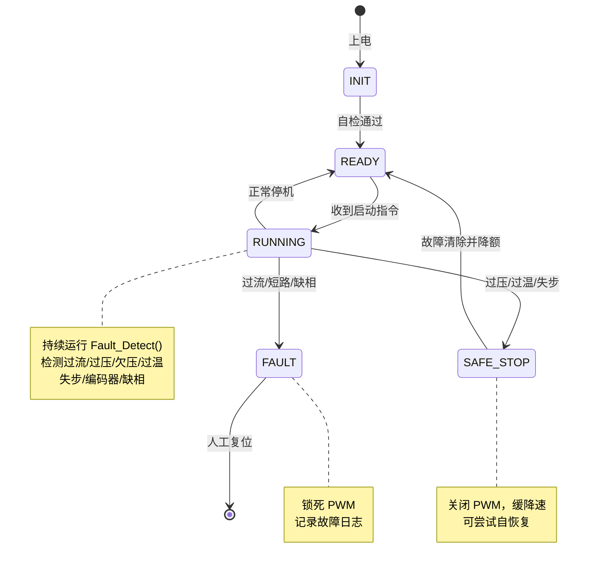
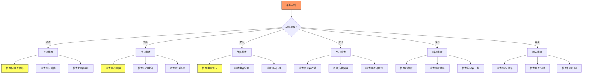

# 典型故障排查手册

> **为什么学？**
> FOC系统在现场会出现过流、过压、欠压、失步等多种故障。如果保护阈值设得不当或排查方向错误，轻则反复停机，重则损坏逆变器和电机。
>
> **在 FOC 中的作用**
> 故障保护贯穿整个控制链路，从硬件比较器到软件状态机，负责在异常发生时快速关断PWM、记录现场并分级恢复。它是把理论设计转化为可靠产品的必要保障。

下面这张图用状态机把故障后的系统行为可视化：正常运行时可在 READY 与 RUNNING 之间切换；轻微故障进入 SAFE_STOP 并允许条件恢复；严重过流/短路则锁死到 FAULT，必须人工复位。这张图能帮你把第4节代码里的 `SystemState_t` 与实际的故障处理流程对应起来。



*图：故障保护分级状态机*

本节从保护阈值设计的定量计算出发，给出过流、过压、失步等常见故障的判定条件，并通过状态机实现分级响应。理解这些阈值和逻辑，才能在现场根据故障码和波形快速定位根因。

## 1. 数学推导：故障检测阈值与保护逻辑

### 1.1 过流保护阈值设计

为什么要做这一步：过流阈值必须覆盖正常过载但又不能漏掉短路，需要根据额定电流、纹波和器件耐受时间综合设计。

硬件过流保护（OCP）通常基于母线电流或相电流采样。对于三相逆变器，母线电流 $I_{dc}$ 与相电流的关系：

$$
I_{dc} = S_a i_a + S_b i_b + S_c i_c
$$

其中 $S_x \in \{0, 1\}$ 为开关状态。瞬时母线电流峰值可达相电流峰值的 $\sqrt{3}$ 倍（在特定扇区）。

过流阈值 $I_{trip}$ 应满足：

$$
I_{trip} > I_{rated,peak} \cdot K_{overload} + I_{margin}
$$

其中 $K_{overload}$ 为允许的过载倍数（如1.5~2），$I_{margin}$ 覆盖电流纹波和采样噪声。典型的：

$$
I_{trip} = 2.5 \sim 3.0 \times I_{rated,peak}
$$

### 1.2 过压/欠压保护

为什么要做这一步：再生制动时母线电压可能飙升，欠压时逆变器又无法输出有效矢量，这两个阈值直接决定系统安全边界。

母线过压通常发生在再生制动时，电机动能回馈至电容：

$$
\frac{1}{2} C_{bus} (V_{max}^2 - V_{nom}^2) = \frac{1}{2} J_{total} \omega_m^2 \cdot \eta_{regen}
$$

电容能量吸收极限：

$$
\Delta V_{max} = \sqrt{V_{nom}^2 + \frac{J_{total} \omega_m^2}{C_{bus}}} - V_{nom}
$$

过压阈值通常设为 $V_{OV} = 1.15 \sim 1.2 \times V_{nom}$。欠压阈值 $V_{UV} = 0.8 \sim 0.9 \times V_{nom}$，低于此值时逆变器无法合成有效电压矢量。

### 1.3 失步检测

为什么要做这一步：无传感器FOC中角度估计错误会表现为d轴电流异常，通过监测d轴偏差可以在失步扩大前及时保护。

无传感器FOC中，失步可通过观测器角度与实际电流的相位一致性判断。定义d轴电流在稳态时应为零（$i_d = 0$ 控制）。若失步，反电动势与电流不同步，$i_d$ 将偏离零：

$$
|i_d| > I_{d,threshold} \quad \text{持续} \quad T_{debounce}
$$

则判定失步。阈值考虑电感参数误差：

$$
I_{d,threshold} = K_{margin} \cdot \frac{|\Delta L|}{L_{nom}} \cdot I_{q,max}
$$

典型取 $I_{d,threshold} = 0.3 \sim 0.5 \times I_{rated}$。

## 2. 几何直观：故障排查流程图



## 3. 数值示例：过压故障分析

**给定参数**：
- 母线电容 $C_{bus} = 1000\,\mu\text{F}$
- 额定母线电压 $V_{nom} = 48\,\text{V}$
- 过压阈值 $V_{OV} = 58\,\text{V}$
- 电机惯量 $J_m = 0.002\,\text{kg·m}^2$
- 负载惯量 $J_L = 0.008\,\text{kg·m}^2$
- 额定转速 $3000\,\text{rpm} = 314.16\,\text{rad/s}$
- 无制动电阻

**计算步骤**：

1. 从额定速急停时，系统总动能为：

$$
E_k = \frac{1}{2}(J_m + J_L) \omega_m^2 = \frac{1}{2} \times 0.01 \times 314.16^2 = 493.5\,\text{J}
$$

2. 若全部能量由母线电容吸收：

$$
\frac{1}{2} C (V_{peak}^2 - V_{nom}^2) = E_k
$$

$$
V_{peak} = \sqrt{V_{nom}^2 + \frac{2E_k}{C}} = \sqrt{48^2 + \frac{2 \times 493.5}{1000\times10^{-6}}} = \sqrt{2304 + 987000} = \sqrt{989304} = 994.6\,\text{V}
$$

3. **结论**：994V 远超MOSFET耐压（假设60V MOSFET），电容和MOSFET将瞬间损坏。必须配置制动电阻或再生能量处理电路。

4. 制动电阻功率计算：

若要求电压不超过 $V_{max} = 55\,\text{V}$，制动电阻需吸收的功率：

$$
P_{brake} = \frac{E_k}{t_{stop}} = \frac{493.5}{0.5} = 987\,\text{W} \quad (\text{假设0.5秒急停})
$$

制动电阻阻值：

$$
R_{brake} = \frac{V_{max}^2}{P_{brake}} = \frac{55^2}{987} = 3.06\,\Omega \rightarrow \text{取标准值 } 3.3\Omega
$$

额定功率需留裕量：选1000W连续或3000W脉冲（1秒 on / 10秒 off）。

## 4. 代码实现：故障状态机与保护逻辑

为什么要做这一步：保护逻辑必须在毫秒甚至微秒级可靠执行，并用状态机区分锁死、自恢复和安全停机三类响应，避免反复重启造成二次损坏。

```c
/* 故障类型定义 */
typedef enum {
    FAULT_NONE              = 0x0000,
    FAULT_OVER_CURRENT      = 0x0001,  /* 过流 */
    FAULT_OVER_VOLTAGE      = 0x0002,  /* 过压 */
    FAULT_UNDER_VOLTAGE     = 0x0004,  /* 欠压 */
    FAULT_OVER_TEMP         = 0x0008,  /* 过温 */
    FAULT_LOSS_OF_STEP      = 0x0010,  /* 失步 */
    FAULT_ENCODER_FAULT     = 0x0020,  /* 编码器故障 */
    FAULT_PHASE_LOSS        = 0x0040,  /* 缺相 */
    FAULT_SHORT_CIRCUIT     = 0x0080,  /* 短路 */
    FAULT_WATCHDOG          = 0x0100,  /* 看门狗 */
} FaultType_t;

/* 故障状态机 */
typedef enum {
    STATE_INIT,         /* 初始化 */
    STATE_READY,        /* 就绪 */
    STATE_RUNNING,      /* 运行 */
    STATE_FAULT,        /* 故障 */
    STATE_SAFE_STOP     /* 安全停机 */
} SystemState_t;

/* 故障检测参数 */
#define OC_THRESHOLD        30.0f       /* 过流阈值 A */
#define OC_BLANKING_US      5.0f        /* 消隐时间 us */
#define OV_THRESHOLD        58.0f       /* 过压阈值 V */
#define UV_THRESHOLD        36.0f       /* 欠压阈值 V */
#define ID_LOSS_THRESHOLD   2.0f        /* 失步Id阈值 A */
#define LOSS_DEBOUNCE_MS    50          /* 失步去抖 ms */

/* 故障检测函数（每1ms调用） */
uint16_t Fault_Detect(void)
{
    uint16_t faults = 0;
    static uint16_t loss_of_step_cnt = 0;
    
    /* 1. 过流检测（硬件+软件双重） */
    if (Hardware_OC_Triggered() || 
        (fabsf(Ia) > OC_THRESHOLD || fabsf(Ib) > OC_THRESHOLD)) {
        faults |= FAULT_OVER_CURRENT;
    }
    
    /* 2. 过压检测 */
    if (Vdc > OV_THRESHOLD) {
        faults |= FAULT_OVER_VOLTAGE;
        /* 立即开启制动电阻 */
        Brake_Resistor_ON();
    }
    
    /* 3. 欠压检测 */
    if (Vdc < UV_THRESHOLD) {
        faults |= FAULT_UNDER_VOLTAGE;
    }
    
    /* 4. 过温检测（见上一节） */
    if (MOSFET_Tj > Tj_MAX) {
        faults |= FAULT_OVER_TEMP;
    }
    
    /* 5. 失步检测（无传感器模式） */
    if (Sensorless_Mode) {
        if (fabsf(Id_est) > ID_LOSS_THRESHOLD && Speed > 100.0f) {
            loss_of_step_cnt++;
            if (loss_of_step_cnt > LOSS_DEBOUNCE_MS) {
                faults |= FAULT_LOSS_OF_STEP;
            }
        } else {
            loss_of_step_cnt = 0;
        }
    }
    
    /* 6. 编码器故障 */
    if (Encoder_Signal_Invalid()) {
        faults |= FAULT_ENCODER_FAULT;
    }
    
    /* 7. 缺相检测（三相电流矢量和） */
    float i_sum = Ia + Ib + Ic;
    if (fabsf(i_sum) > 0.5f) {  /* 正常应为0（星接无中线） */
        faults |= FAULT_PHASE_LOSS;
    }
    
    return faults;
}

/* 故障响应处理 */
void Fault_Handler(uint16_t faults)
{
    if (faults == 0) return;
    
    /* 1. 立即关闭PWM（最高优先级） */
    PWM_Disable_All();
    
    /* 2. 根据故障类型分级响应 */
    if (faults & (FAULT_OVER_CURRENT | FAULT_SHORT_CIRCUIT)) {
        /* 严重故障：锁死，需人工复位 */
        System_State = STATE_FAULT;
        Fault_Latch = faults;
    }
    else if (faults & (FAULT_OVER_VOLTAGE | FAULT_OVER_TEMP)) {
        /* 可自恢复故障：尝试降额运行 */
        if (Fault_Duration < 5000) {  /* 5秒内 */
            System_State = STATE_SAFE_STOP;
            /* 缓降速后待机 */
        } else {
            System_State = STATE_FAULT;
        }
    }
    else if (faults & (FAULT_LOSS_OF_STEP | FAULT_ENCODER_FAULT)) {
        /* 尝试重启观测器或切换到开环 */
        System_State = STATE_SAFE_STOP;
        Observer_Reset();
    }
    else if (faults & FAULT_UNDER_VOLTAGE) {
        /* 欠压：等待电压恢复 */
        System_State = STATE_READY;
    }
    
    /* 3. 记录故障日志 */
    Log_Fault(faults, Vdc, Ia, Ib, Speed, MOSFET_Tj);
}

/* 故障日志结构 */
typedef struct {
    uint32_t timestamp;     /* ms */
    uint16_t fault_code;    /* 故障类型 */
    float vdc;              /* 母线电压 */
    float ia, ib, ic;       /* 相电流 */
    float speed;            /* 转速 */
    float tj;               /* 结温 */
    float theta;            /* 电角度 */
} FaultLog_t;
```

## 5. 常见错误

### 错误1：故障消隐时间（Blanking Time）设置不当，导致误触发或保护失效

**错误表现**：设置消隐时间2μs，在PWM开关边沿附近电流尖峰（由MOSFET结电容和PCB寄生电感引起）触发误过流；或将消隐时间设为50μs，在真正短路时MOSFET已在消隐期内烧毁。

**原因分析**：消隐时间是屏蔽开关瞬态噪声的关键。过短无法屏蔽噪声（电流采样在开关瞬态有振铃）；过长则延迟真实短路保护。MOSFET的短路耐受时间（SOA）通常仅10~100μs，且随 $V_{DS}$ 升高急剧下降。

**纠正方法**：
- 消隐时间 = 采样电路建立时间 + MOSFET开关振铃衰减时间 + 安全裕量。典型值：5~10μs（对于20kHz PWM）
- 使用硬件比较器（ns级响应）+ 软件确认（消隐后检查）的两级架构
- 对于SiC MOSFET（短路耐受<5μs），必须采用专用退饱和检测（DESAT）电路，而非电流采样
- 用示波器测量实际电流采样波形，确定振铃持续时间，再加2μs裕量

### 错误2：故障恢复逻辑设计不当，导致故障振荡（频繁重启烧毁）

**错误表现**：驱动器过温保护后自动重启，但重启后负载未变，迅速再次过温，进入"保护-重启-保护"循环，最终MOSFET因热循环疲劳失效。

**原因分析**：某些故障（如过温、持续过流）是自恢复的，但前提是负载条件改变。若故障恢复逻辑采用"延时5秒后自动重启"，而系统未对故障根因做任何处理，则重启只是重复故障过程。

**纠正方法**：
- 分级故障策略：一过流/短路 → 锁死，需断电复位；一过压/过温 → 可自恢复，但需降额或改变运行模式
- 恢复条件：不仅延时，还需确认根因消除（如 $T_j < T_{j,max} - 30°C$ 且 $V_{dc} < V_{OV} - 5V$）
- 重启次数限制：连续故障3次后永久锁死，防止热循环疲劳
- 降额恢复：首次过温后重启，电流限幅降至50%；再次过温则降至25%；第三次锁死
- 所有故障必须记录到非易失存储（EEPROM/Flash），供后续分析

## 6. 自测习题

### 习题1：制动电阻设计

某系统 $V_{dc} = 72\,\text{V}$，$C_{bus} = 2200\,\mu\text{F}$，$J_{total} = 0.05\,\text{kg·m}^2$，$\omega_{max} = 1500\,\text{rpm}$。计算：

(a) 无制动电阻时从最高速急停的理论母线峰值电压
(b) 若要求过压不超过80V，制动电阻最小功率（0.5秒急停）和阻值

**答案**：

(a) $\omega_m = 1500 \times 2\pi / 60 = 157.08\,\text{rad/s}$

$E_k = 0.5 \times 0.05 \times 157.08^2 = 616.85\,\text{J}$

$V_{peak} = \sqrt{72^2 + 2\times616.85/2200\times10^{-6}} = \sqrt{5184 + 561682} = 753\,\text{V}$

(b) $P_{brake} = 616.85 / 0.5 = 1233.7\,\text{W}$

$R = 80^2 / 1233.7 = 5.19\,\Omega$（取5.1Ω标准值）

实际电阻功率需考虑持续散热，选2kW制动单元。

### 习题2：失步检测

某无传感器FOC系统，额定电流10A，电流环带宽1kHz。观测器正常时 $|i_d| < 0.2A$。若观测器角度滞后真实角度15°，$I_q = 8A$，估算 $|i_d|$ 的偏差值。此时若设置失步阈值为 $I_d > 3A$，是否会被误判？

**答案**：

角度误差 $\Delta\theta = 15° = 0.2618\,\text{rad}$

Park变换逆变换：真实dq轴电流与估计dq轴的关系：

$$
i_d^{est} = i_d \cos(\Delta\theta) + i_q \sin(\Delta\theta) \approx 0 + 8 \times 0.2588 = 2.07\,\text{A}
$$

（假设真实 $i_d = 0$）

估计 $|i_d| = 2.07A$，小于阈值3A，**不会误判**。但若角度误差达30°：$i_d^{est} = 8 \times \sin(30°) = 4A$，将超过阈值。因此无传感器系统失步阈值需与观测器精度匹配，通常取 $0.3 \sim 0.5$ 额定电流，并配合观测器收敛度指标（如滑模面误差能量）共同判断。
