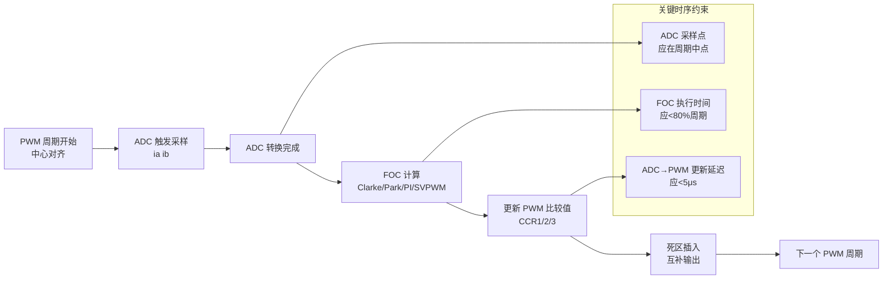
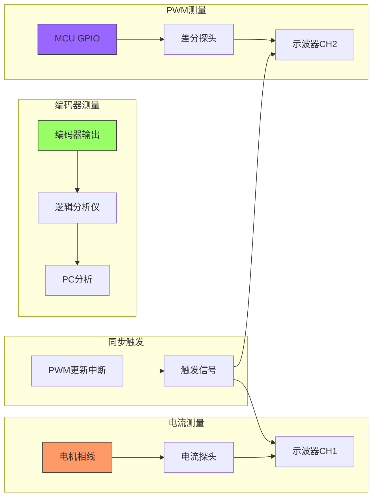

# 示波器与逻辑分析仪调试技巧

> **为什么学？**
> FOC调试中很多问题只能通过实测波形定位，例如电流采样噪声、PWM死区、ADC触发不同步等。如果测量方法或仪器选型不当，会把真实信号与测量伪象混淆，导致错误结论。
>
> **在 FOC 中的作用**
> 示波器和逻辑分析仪是验证控制链路时序与信号质量的"眼睛"。它们用于确认电流环采样点、PWM边沿、编码器脉冲和算法执行时间是否符合设计预期。

下面这张图把一个 PWM 周期内的关键事件按时序展开：PWM 更新触发 ADC 采样，采样完成后进入 FOC 算法执行，最后把新的占空比写入 PWM 寄存器。用 GPIO 标记这些事件并在逻辑分析仪上观测，就能直观判断 ADC 是否在“电流平坦区”采样、算法执行时间是否超过周期裕量。



*图：单周期 PWM→ADC→FOC→PWM 更新时序*

本节从探头带宽、采样率、量化误差等测量原理出发，讲解如何正确采集相电流、半桥电压和编码器信号，并用GPIO标记配合逻辑分析仪验证关键中断时序。掌握这些技巧，才能把"在代码里看到的"和"在硬件上发生的"对应起来。

## 1. 数学推导：采样精度与测量误差分析

### 1.1 电流探头比例与带宽

为什么要做这一步：电流探头是观测相电流质量的第一关口，带宽不足会掩盖开关纹波，比例选择不当会牺牲分辨率或超过量程。

霍尔效应电流探头的输出电压与被测电流成正比：

$$
V_{out} = K_{probe} \cdot I_{measured}
$$

典型比例：10mV/A（小信号）、100mV/A（中功率）、1V/A（大功率）。探头带宽 $BW_{probe}$ 必须满足：

$$
BW_{probe} > 5 \times f_{PWM}
$$

对于20kHz PWM，探头带宽至少100kHz。若测量电流上升沿（开关瞬态，di/dt可达1000A/μs），则要求探头带宽 > 10MHz。

探头测量误差来源：
- 直流偏移：$\delta_{DC} = \pm 0.5\% \, FS$
- 增益误差：$\delta_{gain} = \pm 1\% \, @ 25°C$
- 温度漂移：$\delta_{temp} = \pm 0.01\% / °C$
- 带宽限制：高频衰减导致幅值低估

总测量不确定度（RSS合成）：

$$
\delta_{total} = \sqrt{\delta_{DC}^2 + \delta_{gain}^2 + \delta_{temp}^2 + \delta_{BW}^2}
$$

### 1.2 示波器采样与混叠

为什么要做这一步：PWM开关频率和电流纹波远高于基波，若采样率或垂直分辨率不够，会把高频噪声误判为低频振荡。

奈奎斯特采样定理要求：

$$
f_{sample} > 2 \times f_{max}
$$

对于PWM调试，需捕获10kHz~100kHz的开关纹波，因此示波器采样率至少 $f_s \geq 2\,\text{MS/s}$。若采样率不足，高频分量混叠至低频，误判波形。

示波器垂直分辨率（8bit/12bit）影响小信号测量：

$$
\text{LSB} = \frac{V_{FS}}{2^{N}}
$$

对于8bit、±5V量程：$LSB = 10V/256 = 39\,\text{mV}$。若电流探头比例为10mV/A，则电流分辨率为3.9A/LSB——不足以分辨小电流纹波。应切换至100mV/A探头或更小量程。

### 1.3 死区时间测量精度

为什么要做这一步：死区时间只有1~3μs，却直接影响输出电压损失和桥臂直通风险，必须用足够时间分辨率的示波器精确验证。

死区时间 $T_d$ 通常为1~3μs。用示波器测量两个互补PWM信号（如TIM1_CH1和TIM1_CH1N）的边沿间隔：

$$
T_d = t_{rising,high} - t_{falling,low}
$$

测量精度受限于示波器时间分辨率：

$$
\Delta t_{min} = \frac{1}{f_{sample}}
$$

若 $f_{sample} = 1\,\text{GS/s}$，$\Delta t = 1\,\text{ns}$，足以精确测量1μs死区。对于100MS/s采样率，$\Delta t = 10\,\text{ns}$，精度约1%。

## 2. 几何直观：测量连接与信号流



**电流探头正确夹持**：

```
错误方式：                      正确方式：
┌─────────┐                   ┌─────────┐
│  电机   │←───┐              │  电机   │
└─────────┘    │              └─────────┘
    ↑         │                  ↑
  探头夹住   │                探头夹住
  正负两根线  │                单根相线
  （差模抵消）│                （测实际相电流）
              └────→ 噪声!
```

**差分探头测量半桥中点电压**：

```
Vdc+
 │
[上MOS]
 │
 ├──→ 中点（差分探头正端）
 │
[下MOS]
 │
GND ←── 差分探头负端

必须差分测量：单端探头的接地线会引入地环路，损坏设备或烧毁MOSFET驱动。
```

## 3. 数值示例：测量误差计算

**给定测量配置**：
- 电流探头：比例100mV/A，带宽10MHz，直流精度±1%
- 示波器：8bit ADC，量程±2V，采样率500MS/s
- 测量电流：峰值5A的正弦PWM电流
- 环境温度：35°C（探头标定25°C）

**计算步骤**：

1. 探头输出电压：$V_{out} = 5A \times 100mV/A = 500mV$（峰值）

2. 示波器量程适配：选±1V或±2V量程。选±2V量程时：

$$
LSB = \frac{4V}{256} = 15.6\,\text{mV}
$$

对应电流分辨率：$15.6\,\text{mV} / (100\,\text{mV/A}) = 0.156\,\text{A}$

3. 测量误差分析：

- 直流精度：$5A \times 1\% = 0.05A$
- 温度漂移：$5A \times 0.01\% / °C \times 10°C = 0.005A$
- 量化误差：$\pm 0.5 \, LSB = \pm 0.078A$

总不确定度（RSS）：

$$
\delta I = \sqrt{0.05^2 + 0.005^2 + 0.078^2} = \sqrt{0.0025 + 0.000025 + 0.0061} = \sqrt{0.0086} = 0.093A
$$

相对误差：$0.093/5 = 1.86\%$

4. 时间测量（死区时间）：

500MS/s → $\Delta t = 2\,\text{ns}$。若测得死区1.5μs，时间精度：$2\,\text{ns}/1.5\mu\text{s} = 0.13\%$，可忽略。

5. 带宽影响：

PWM频率20kHz，基波在10kHz（假设电机运行）。10MHz探头带宽在10kHz处几乎无衰减（衰减<0.001dB）。若测量开关纹波（~100ns上升沿，对应频率分量~3.5MHz），衰减：

$$
|H(f)| = \frac{1}{\sqrt{1 + (f/f_c)^2}} = \frac{1}{\sqrt{1 + (3.5/10)^2}} = 0.94
$$

即3.5MHz分量被衰减6%，上升沿测量时间将偏长约6%。

## 4. 代码实现：ADC采样与PWM触发同步验证

为什么要做这一步：在关键中断和事件点翻转GPIO，可以用逻辑分析仪直观测量算法执行时间、ADC采样窗口和PWM更新延迟，定位时序瓶颈。

```c
/* 调试用：GPIO翻转标记关键事件，配合逻辑分析仪观测时序 */

/* 在PWM中断入口翻转PA8 */
void TIM1_UP_IRQHandler(void)
{
    GPIOA->BSRR = GPIO_BSRR_BS8;  /* PA8 = 1 */
    
    /* FOC算法执行... */
    
    GPIOA->BSRR = GPIO_BSRR_BR8;  /* PA8 = 0 */
    TIM1->SR &= ~TIM_SR_UIF;      /* 清中断标志 */
}

/* 在ADC采样完成中断翻转PA9 */
void ADC_IRQHandler(void)
{
    GPIOA->BSRR = GPIO_BSRR_BS9;  /* PA9 = 1 */
    
    /* 读取ADC结果 */
    Ia_raw = ADC1->DR;
    
    GPIOA->BSRR = GPIO_BSRR_BR9;  /* PA9 = 0 */
}

/* 在SVPWM计算完成翻转PA10 */
void SVPWM_Complete(void)
{
    GPIOA->BSRR = GPIO_BSRR_BS10; /* PA10 = 1 */
    
    /* 更新PWM比较寄存器 */
    TIM1->CCR1 = duty_A;
    TIM1->CCR2 = duty_B;
    TIM1->CCR3 = duty_C;
    
    GPIOA->BSRR = GPIO_BSRR_BR10; /* PA10 = 0 */
}

/* 逻辑分析仪观测时序要求：
 * PA8: PWM中断周期（应严格50μs = 20kHz）
 * PA9: ADC采样窗口（应在PWM周期中点附近，宽度<5μs）
 * PA10: SVPWM计算耗时（应<30μs，留裕量给DMA和上下文切换）
 * 
 * 测量指标：
 * 1. PWM中断周期抖动 < 1%
 * 2. ADC采样到PWM更新延迟 < 5μs（否则引入一拍延迟）
 * 3. 总中断执行时间 < 40μs（80% CPU利用率上限）
 */

/* 编码器信号质量分析（用于逻辑分析仪捕获） */
void Encoder_Signal_Quality_Check(void)
{
    /* 逻辑分析仪捕获A/B/Z信号，检查： */
    
    /* 1. A/B相位差：应为90°±20°（正交编码器）
     *    用逻辑分析仪测量：A上升沿到B上升沿延迟 = 1/4周期
     *    若B领先A 90°：电机正转；A领先B 90°：电机反转
     */
    
    /* 2. Z信号宽度：应在1~2个A周期内，且与A/B有固定相位关系
     *    若Z信号过宽（>5周期），可能编码器脏污或光栅损坏
     */
    
    /* 3. 最小脉冲宽度：高速时A/B周期可能仅1μs（1MHz），
     *    若逻辑分析仪采样率<10MHz，可能漏脉冲导致计数不准
     */
    
    /* 4. 毛刺检测：用逻辑分析仪的毛刺滤波功能（<100ns）
     *    若毛刺数量>100/秒，检查屏蔽线和接地
     */
}
```

## 5. 常见错误

### 错误1：示波器探头接地线过长，导致开关波形振荡误判

**错误表现**：测量半桥中点电压时，波形在开关边沿出现严重振铃（振荡幅值达20V），误认为PCB布局有问题或MOSFET选型不当。

**原因分析**：示波器探头地线（鳄鱼夹引线）长度每增加1cm，引入约10~20nH电感。对于10ns级的开关边沿（di/dt大），接地电感 $L_{ground}$ 与探头输入电容 $C_{in}$ 形成LC振荡：

$$
f_{ring} = \frac{1}{2\pi\sqrt{L_{ground} \cdot C_{in}}}
$$

若接地线长10cm（~150nH），$C_{in} = 10\,\text{pF}$：$f_{ring} = 1/(2\pi\sqrt{150\times10^{-9} \times 10\times10^{-12}}) \approx 130\,\text{MHz}$，在开关边沿表现为振铃。

**纠正方法**：
- 使用接地弹簧（ground spring）或接地环（ground collar）替代长地线，接地长度<5mm
- 对于半桥测量，必须使用差分探头，且差分引线长度对称、尽量短
- 若只能用单端探头，测量下管VDS（源极接地），避免测量上管VDS（需浮地）
- 振铃频率若在100MHz以上，几乎可以肯定是测量问题而非电路问题

### 错误2：逻辑分析仪采样率不足，导致编码器脉冲计数错误

**错误表现**：电机高速运行（如3000rpm，500线编码器）时，逻辑分析仪显示的速度比实际低约5%，且低速时准确。

**原因分析**：编码器脉冲频率：$f_{pulse} = PPR \times 4 \times n / 60$（四倍频）。500线编码器在3000rpm时：$f = 500 \times 4 \times 3000/60 = 100\,\text{kHz}$。若逻辑分析仪采样率为1MS/s，每周期仅10个采样点，边沿检测误差为一个采样周期（1μs）。当编码器存在微小抖动（<1μs）时，采样位置可能跨周期，导致脉冲计数偏差。更危险的是，若编码器最高频率接近逻辑分析仪奈奎斯特频率（500kHz），高频分量混叠导致波形失真。

**纠正方法**：
- 逻辑分析仪采样率至少为编码器最高频率的10倍：$f_{LA} > 10 \times f_{encoder,max}$
- 对于100kHz编码器，逻辑分析仪至少1MS/s，推荐10MS/s以上
- 使用编码器芯片（正交解码器）的硬件计数输出，而非直接采样A/B信号
- 若必须采样A/B，开启逻辑分析仪的"过采样"模式（如4x过采样）提高边沿分辨率
- 验证：让电机匀速运行，记录1000个编码器周期的时间，标准差应<0.1%均值

## 6. 自测习题

### 习题1：测量系统配置

某电机驱动器 $f_{PWM} = 25\,\text{kHz}$，相电流峰值15A。若用10mV/A电流探头配8bit示波器（±5V量程），计算：

(a) 电流分辨率（A/LSB）
(b) 是否满足测量1%纹波（150mA峰峰值）的要求？

**答案**：

(a) $LSB = 10V/256 = 39.06\,\text{mV}$

电流分辨率 = $39.06\,\text{mV} / (10\,\text{mV/A}) = 3.91\,\text{A/LSB}$

(b) 1%纹波 = 150mA。示波器分辨率3.91A，远大于150mA，**无法分辨**。应改用100mV/A或1V/A探头，或将示波器量程降至±1V（若支持）。

### 习题2：编码器信号分析

某电机使用1000线编码器，最高转速6000rpm。计算：

(a) 四倍频后的脉冲频率
(b) 若逻辑分析仪采样率为5MS/s，每脉冲边沿的采样点数
(c) 能否可靠检测5%占空比失真？

**答案**：

(a) $f_{pulse} = 1000 \times 4 \times 6000/60 = 400\,\text{kHz}$

(b) 每周期2.5个采样点（5MS/s / 400kHz = 12.5点/周期，但四倍频后A/B各100kHz，实际每边沿5MS/s / 400kHz = 12.5点/周期）。单信号周期 = 1/100kHz = 10μs，采样间隔 = 0.2μs，每周期50点。四倍频后有效脉冲率400kHz，每脉冲间隔2.5μs，即12.5个采样点。

(c) 5%占空比失真 = 0.5μs（10μs的5%）。采样间隔0.2μs，能分辨2.5个采样点，**可以检测**但精度有限。推荐用更高采样率（20MS/s）或硬件解码器。
