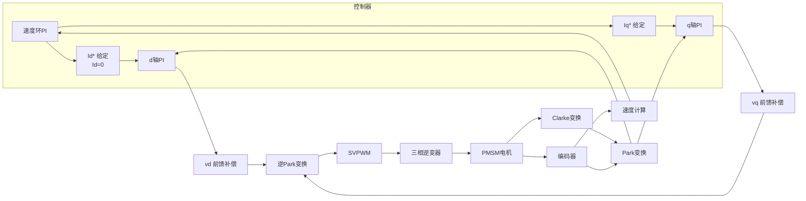

# MATLAB-Simulink 模型搭建

> **为什么学？**
> 如果不先在仿真里跑通 FOC 闭环，直接上板调试会很难判断是控制算法问题、参数问题还是硬件问题。Simulink 模型让你能单步观察 $i_d/i_q$、SVPWM 占空比、电流环响应，避免把理论误差直接带到 MCU 代码里。
>
> **在 FOC 中的作用**
> 这一节是把前面学到的坐标变换、PI 设计、SVPWM 拼成完整闭环的“集成验证平台”。它输出的是可直接移植到 MCU 的控制器结构与初始化参数，是算法和代码之间的桥梁。

下面先列出 dq 轴电压方程和电流环设计公式，它们既是仿真里电机本体的微分方程，也是实际控制器中 Park 逆变换和 PI 参数整定的依据。把这一步在 Simulink 里搭对，后续上真实电机时才能逐项对比波形、定位问题。

## 1. 数学推导

### 1.1 PMSM 在 dq 旋转坐标系下的电压方程

**为什么要做这一步**：dq 轴电压方程是 Simulink 电机本体的核心微分方程，只有把它写对，仿真电流波形才会和真实电机一致，也才能正确导出前馈补偿和解耦项。

表贴式永磁同步电机（SPMSM）假设 $L_d = L_q = L_s$，内置式（IPMSM）则 $L_d \neq L_q$。dq 坐标系下的电压方程为：

$$
\begin{cases}
u_d = R_s i_d + \dfrac{d\psi_d}{dt} - \omega_e \psi_q \\[6pt]
u_q = R_s i_q + \dfrac{d\psi_q}{dt} + \omega_e \psi_d
\end{cases}
$$

其中磁链方程：

$$
\begin{cases}
\psi_d = L_d i_d + \psi_f \\[4pt]
\psi_q = L_q i_q
\end{cases}
$$

将磁链代入电压方程，展开微分项：

$$
\begin{cases}
u_d = R_s i_d + L_d \dfrac{di_d}{dt} - \omega_e L_q i_q \\[6pt]
u_q = R_s i_q + L_q \dfrac{di_q}{dt} + \omega_e (L_d i_d + \psi_f)
\end{cases}
$$

**交叉耦合项**：$-\omega_e L_q i_q$ 和 $+\omega_e L_d i_d$ 是 d-q 轴之间的速度耦合项；$+\omega_e \psi_f$ 是反电动势项。

### 1.2 电流环 PI 控制器设计（极点配置法）

对 d 轴方程进行拉普拉斯变换（忽略交叉耦合与反电动势，通过前馈补偿）：

$$
V_d(s) = (R_s + sL_d) I_d(s) \quad \Rightarrow \quad G_p(s) = \frac{I_d(s)}{V_d(s)} = \frac{1}{R_s + sL_d} = \frac{1/L_d}{s + R_s/L_d}
$$

PI 控制器：

$$
G_{PI}(s) = K_p + \frac{K_i}{s} = K_p \frac{s + K_i/K_p}{s}
$$

开环传递函数：

$$
G_{OL}(s) = G_{PI}(s) \cdot G_p(s) = K_p \frac{s + K_i/K_p}{s} \cdot \frac{1/L_d}{s + R_s/L_d}
$$

采用**极点对消法**：令 $K_i/K_p = R_s/L_d$，即零点和电机极点重合，开环简化为：

$$
G_{OL}(s) = \frac{K_p}{sL_d}
$$

闭环传递函数：

$$
G_{CL}(s) = \frac{G_{OL}}{1+G_{OL}} = \frac{K_p/(L_d)}{s + K_p/L_d} = \frac{1}{1 + s \cdot L_d/K_p}
$$

定义电流环带宽 $\omega_{cc} = K_p / L_d$，则：

$$
\boxed{K_p = \omega_{cc} L_d, \quad K_i = \omega_{cc} R_s}
$$

### 1.3 Park 变换与逆变换

**为什么要做这一步**：Park 变换把旋转的 $\alpha\beta$ 量变成直流的 $dq$ 量，是电流环能使用 PI 控制器的前提；逆变换则把控制器输出的 $dq$ 电压还原到静止坐标系，交给 SVPWM 产生三相 PWM。

从 $\alpha\beta$ 到 $dq$ 的旋转变换：

$$
\begin{bmatrix} i_d \\ i_q \end{bmatrix}
=
\begin{bmatrix} \cos\theta & \sin\theta \\ -\sin\theta & \cos\theta \end{bmatrix}
\begin{bmatrix} i_\alpha \\ i_\beta \end{bmatrix}
$$

逆变换（$dq \to \alpha\beta$）：

$$
\begin{bmatrix} i_\alpha \\ i_\beta \end{bmatrix}
=
\begin{bmatrix} \cos\theta & -\sin\theta \\ \sin\theta & \cos\theta \end{bmatrix}
\begin{bmatrix} i_d \\ i_q \end{bmatrix}
$$

### 1.4 电磁转矩方程

**为什么要做这一步**：转矩方程把 $q$ 轴电流和输出转矩定量联系起来，是速度环设计、转矩控制以及 $I_d=0$ / 弱磁策略的物理依据；在 Simulink 里它连接了电气模型和机械运动方程。

$$
T_e = \frac{3}{2} p \left[ \psi_f i_q + (L_d - L_q) i_d i_q \right]
$$

对 SPMSM（$L_d = L_q$）：

$$
T_e = \frac{3}{2} p \psi_f i_q = K_t i_q
$$

---

## 2. 几何直观

### 2.1 完整 FOC 闭环信号流图



### 2.2 SVPWM 空间矢量六边形

```
                        V4(110)
                          /\
                         /  \
                        /    \
               V6(101) /      \ V2(010)
                      /   O    \
                     /  (000)   \
                    /   (111)    \
           V5(100) /________________\ V1(001)
                    \      |       /
                     \     |      /
                      \    |     /
                       \   |    /
                        \  |   /
                         \ |  /
                          \| /
                          V3(011)
```

6 个有效矢量（$V_1 \sim V_6$）将平面分成 6 个扇区，零矢量 $V_0(000)$ 和 $V_7(111)$ 用于调节等效电压幅值。

---

## 3. 数值示例

**给定电机参数：**

| 参数 | 符号 | 数值 |
|------|------|------|
| 极对数 | $p$ | 4 |
| 定子电阻 | $R_s$ | 0.5 Ω |
| d 轴电感 | $L_d$ | 2.0 mH |
| q 轴电感 | $L_q$ | 2.0 mH (SPMSM) |
| 永磁体磁链 | $\psi_f$ | 0.1 Wb |
| 直流母线电压 | $V_{dc}$ | 24 V |
| 额定电流 | $I_{rated}$ | 5 A |

**步骤 1：计算电流环 PI 参数**

设计电流环带宽 $f_{cc} = 1\,\text{kHz}$，即 $\omega_{cc} = 2\pi \times 1000 = 6283\,\text{rad/s}$：

$$
K_p = \omega_{cc} L_d = 6283 \times 0.002 = 12.57\,\Omega \cdot \text{H/s} \approx 12.57\,\text{V/A}
$$

$$
K_i = \omega_{cc} R_s = 6283 \times 0.5 = 3141.5\,\text{V/(A·s)}
$$

**步骤 2：计算转矩常数**

$$
K_t = \frac{3}{2} p \psi_f = \frac{3}{2} \times 4 \times 0.1 = 0.6\,\text{N·m/A}
$$

当 $i_q = 5\,\text{A}$ 时，输出转矩：

$$
T_e = K_t \cdot i_q = 0.6 \times 5 = 3.0\,\text{N·m}
$$

**步骤 3：前馈补偿电压计算**

设电机转速 $n = 3000\,\text{rpm}$，则电角速度：

$$
\omega_e = p \cdot \frac{2\pi n}{60} = 4 \times \frac{2\pi \times 3000}{60} = 1256.6\,\text{rad/s}
$$

反电动势幅值：

$$
E = \omega_e \psi_f = 1256.6 \times 0.1 = 125.66\,\text{V}
$$

注意：此值大于 $V_{dc}=24\,\text{V}$，说明 3000 rpm 时已**进入弱磁区**，需要 Id < 0 来弱磁。这验证了电流环前馈补偿的重要性。

---

## 4. 代码实现

### 4.1 MATLAB 初始化脚本（init_foc_sim.m）

```matlab
%% PMSM-FOC Simulink 仿真参数初始化
% 运行此脚本后再打开 Simulink 模型

clear; clc;

%% 电机参数
p = 4;                  % 极对数
Rs = 0.5;               % 定子电阻 [Ω]
Ld = 2.0e-3;            % d轴电感 [H]
Lq = 2.0e-3;            % q轴电感 [H] (SPMSM)
psi_f = 0.1;            % 永磁体磁链 [Wb]
J = 1.0e-4;             % 转动惯量 [kg·m²]
B = 1.0e-5;             % 粘性摩擦系数 [N·m·s/rad]

%% 逆变器参数
Vdc = 24;               % 直流母线电压 [V]
Ts_pwm = 50e-6;         % PWM周期 [s] (20kHz)

%% 电流环PI设计 (极点对消法)
fcc = 1000;             % 电流环带宽 [Hz]
wcc = 2*pi*fcc;         % 电流环带宽 [rad/s]
Kp_d = wcc * Ld;        % d轴比例增益
Ki_d = wcc * Rs;        % d轴积分增益
Kp_q = wcc * Lq;        % q轴比例增益
Ki_q = wcc * Rs;        % q轴积分增益

%% 速度环PI设计 (带宽为电流环的1/10)
fsc = fcc / 10;         % 速度环带宽 [Hz]
wsc = 2*pi*fsc;         % 速度环带宽 [rad/s]
% 简化设计: Kp_w = wsc * J / Kt, Ki_w = wsc * B / Kt
Kt = 1.5 * p * psi_f;   % 转矩常数 [N·m/A]
Kp_w = wsc * J / Kt;
Ki_w = wsc * B / Kt;

%% 前馈补偿系数
% 交叉解耦: v_d_ff = -we*Lq*iq, v_q_ff = we*Ld*id + we*psi_f

%% 仿真设置
Ts_sim = 1e-6;          % 仿真步长 [s]
Tstop = 0.5;            % 仿真总时间 [s]

%% 显示参数
fprintf('=== FOC 仿真参数 ===\n');
fprintf('电流环 Kp_d=%.3f, Ki_d=%.1f\n', Kp_d, Ki_d);
fprintf('电流环 Kp_q=%.3f, Ki_q=%.1f\n', Kp_q, Ki_q);
fprintf('速度环 Kp_w=%.6f, Ki_w=%.6f\n', Kp_w, Ki_w);
fprintf('转矩常数 Kt=%.4f N·m/A\n', Kt);
```

### 4.2 S-function 电机本体（C 代码框架）

**为什么要做这一步**：这个 S-function 用 dq 轴电压方程和机械方程描述真实电机的连续动态，是 Simulink 闭环里“被控对象”的数学替身；把它和控制器模型连起来，才能验证整个 FOC 环路的稳定性。

```c
/* PMSM_DQ_Model.c - Simulink S-function 电机本体 */
#define S_FUNCTION_NAME  PMSM_DQ_Model
#define S_FUNCTION_LEVEL 2

#include "simstruc.h"

/* 参数索引 */
#define Rs_IDX  0
#define Ld_IDX  1
#define Lq_IDX  2
#define PSI_F   3
#define P_IDX   4
#define J_IDX   5
#define B_IDX   6

static void mdlInitializeSizes(SimStruct *S) {
    ssSetNumSFcnParams(S, 7);      /* 7个参数: Rs,Ld,Lq,Psi_f,p,J,B */
    ssSetNumContStates(S, 4);      /* 4个状态: id, iq, omega, theta */
    ssSetNumDiscStates(S, 0);
    ssSetNumInputPorts(S, 2);      /* 输入: vd, vq */
    ssSetNumOutputPorts(S, 4);     /* 输出: id, iq, omega, theta */
}

static void mdlInitializeConditions(SimStruct *S) {
    real_T *x0 = ssGetContStates(S);
    x0[0] = 0.0;   /* id */
    x0[1] = 0.0;   /* iq */
    x0[2] = 0.0;   /* omega_m */
    x0[3] = 0.0;   /* theta_e */
}

static void mdlDerivatives(SimStruct *S) {
    real_T *x = ssGetContStates(S);
    InputRealPtrsType u = ssGetInputPortRealSignalPtrs(S);
    real_T *dx = ssGetdX(S);
    
    real_T Rs = mxGetPr(ssGetSFcnParam(S, Rs_IDX))[0];
    real_T Ld = mxGetPr(ssGetSFcnParam(S, Ld_IDX))[0];
    real_T Lq = mxGetPr(ssGetSFcnParam(S, Lq_IDX))[0];
    real_T psi_f = mxGetPr(ssGetSFcnParam(S, PSI_F))[0];
    real_T p = mxGetPr(ssGetSFcnParam(S, P_IDX))[0];
    real_T J = mxGetPr(ssGetSFcnParam(S, J_IDX))[0];
    real_T B = mxGetPr(ssGetSFcnParam(S, B_IDX))[0];
    
    real_T id = x[0], iq = x[1], omega_m = x[2], theta_e = x[3];
    real_T vd = u[0][0], vq = u[1][0];
    real_T omega_e = p * omega_m;
    
    /* dq轴电压方程 */
    dx[0] = (vd - Rs*id + omega_e*Lq*iq) / Ld;   /* did/dt */
    dx[1] = (vq - Rs*iq - omega_e*(Ld*id + psi_f)) / Lq; /* diq/dt */
    
    /* 机械方程: Te - Tl = J*domega/dt + B*omega */
    real_T Te = 1.5 * p * (psi_f*iq + (Ld - Lq)*id*iq);
    real_T Tl = 0.0;  /* 负载转矩,可从额外输入端口获取 */
    dx[2] = (Te - Tl - B*omega_m) / J;           /* domega_m/dt */
    dx[3] = omega_e;                              /* dtheta_e/dt */
}

static void mdlOutputs(SimStruct *S) {
    real_T *x = ssGetContStates(S);
    real_T *y = ssGetOutputPortRealSignal(S);
    y[0] = x[0];   /* id */
    y[1] = x[1];   /* iq */
    y[2] = x[2];   /* omega_m */
    y[3] = x[3];   /* theta_e */
}

static void mdlTerminate(SimStruct *S) {}

#ifdef MATLAB_MEX_FILE
#include "simulink.c"
#else
#include "cg_sfun.h"
#endif
```

### 4.3 SVPWM 作用时间计算（MATLAB 函数）

**为什么要做这一步**：SVPWM 把逆 Park 变换得到的 $\alpha\beta$ 电压矢量分解成相邻基本矢量与零矢量的作用时间，最终生成三相桥臂的占空比，是控制器输出到逆变器之间的最后一道转换。

```matlab
function [T1, T2, T0, sector] = svpwm_times(Valpha, Vbeta, Vdc, Ts)
%SVPWM_TIMES 计算基本矢量和零矢量作用时间
% 输入: Valpha, Vbeta [V], Vdc [V], Ts [s]
% 输出: T1, T2 [s], T0 [s], sector [1-6]

Vmax = Vdc / sqrt(3);  % 最大线性调制电压
m = sqrt(Valpha^2 + Vbeta^2) / Vmax;  % 调制比

% 判断扇区
X = Vbeta;
Y = 0.5*sqrt(3)*Valpha - 0.5*Vbeta;
Z = -0.5*sqrt(3)*Valpha - 0.5*Vbeta;

% 扇区判断逻辑
if (X >= 0 && Y >= 0 && Z < 0)
    sector = 1;  % 扇区I
elseif (X >= 0 && Y < 0 && Z >= 0)
    sector = 2;  % 扇区II
elseif (X < 0 && Y < 0 && Z >= 0)
    sector = 3;  % 扇区III
elseif (X < 0 && Y >= 0 && Z < 0)
    sector = 4;  % 扇区IV
elseif (X >= 0 && Y < 0 && Z < 0)
    sector = 5;  % 扇区V
else
    sector = 6;  % 扇区VI
end

% 计算相邻矢量作用时间 (归一化到Ts)
T1 = 0; T2 = 0;
switch sector
    case 1, T1 = Z; T2 = Y;
    case 2, T1 = Y; T2 = -X;
    case 3, T1 = -X; T2 = Z;
    case 4, T1 = -Z; T2 = -Y;
    case 5, T1 = -Y; T2 = X;
    case 6, T1 = X; T2 = -Z;
end

% 过调制限制
if (T1 + T2) > 1
    scale = 1/(T1 + T2);
    T1 = T1 * scale;
    T2 = T2 * scale;
end

T0 = 1 - T1 - T2;  % 零矢量时间

% 转换为实际时间
T1 = T1 * Ts; T2 = T2 * Ts; T0 = T0 * Ts;
end
```

---

## 5. 常见错误

### 错误 1：采样时间与仿真步长不匹配导致仿真发散

**现象**：Simulink 报 "algebraic loop" 或结果发散，电流波形出现高频振荡。

**原因**：FOC 控制是离散系统（PWM 周期 50 μs），但电机本体是连续模型。如果仿真步长 $T_{sim} = 1\,\mu\text{s}$ 而控制器采样时间设为 $T_s = 0$（连续），则离散 PI 的积分会在一个步长内累积过大。

**纠正**：
- 控制器模块（PI、Park 变换、SVPWM）必须显式设置**采样时间** = `Ts_pwm`
- 电机本体使用变步长求解器（如 `ode45`），最大步长 < Ts_pwm/10
- 在 MATLAB 命令行执行：`set_param('model', 'Solver', 'ode45', 'MaxStep', '5e-6')`

### 错误 2：Park 变换角度单位错误（角度 vs 弧度）

**现象**：Park 变换后 $i_d$、$i_q$ 呈正弦波动，解耦失败，电流环震荡。

**原因**：MATLAB 的 `sin()` / `cos()` 函数输入必须是**弧度**，但编码器输出可能为度（°）。例如编码器输出 30°，直接送入 sin/cos 会得到 sin(30) ≈ -0.988，而正确应为 sin(30°) = 0.5。

**纠正**：
```matlab
theta_rad = theta_deg * pi / 180;  % 必须转换为弧度
id =  ialpha * cos(theta_rad) + ibeta * sin(theta_rad);
iq = -ialpha * sin(theta_rad) + ibeta * cos(theta_rad);
```

---

## 6. 自测习题

### 习题 1：电流环带宽设计

已知 SPMSM 参数：$R_s = 1.2\,\Omega$，$L_s = 5\,\text{mH}$。要求电流环带宽 $f_{cc} = 500\,\text{Hz}$。用极点对消法计算 $K_p$ 和 $K_i$。

**答案**：

$$
\omega_{cc} = 2\pi \times 500 = 3141.6\,\text{rad/s}
$$

$$
K_p = \omega_{cc} L_s = 3141.6 \times 0.005 = 15.71\,\text{V/A}
$$

$$
K_i = \omega_{cc} R_s = 3141.6 \times 1.2 = 3769.9\,\text{V/(A·s)}
$$

### 习题 2：SVPWM 过调制判断

$V_{dc} = 48\,\text{V}$，给定 $V_\alpha = 20\,\text{V}$，$V_\beta = 15\,\text{V}$。判断此电压矢量是否在线性调制区内？若过调制，归一化后的 $T_1$、$T_2$ 应如何处理？

**答案**：

线性调制区最大电压：$V_{max} = V_{dc}/\sqrt{3} = 48/1.732 = 27.71\,\text{V}$。

给定矢量幅值：$|V_s| = \sqrt{20^2 + 15^2} = 25\,\text{V} < 27.71\,\text{V}$，**在线性调制区内**。

调制比 $m = 25/27.71 = 0.902$，$T_1 + T_2 = m < 1$，无需过调制处理。若过调制（$T_1 + T_2 > 1$），需按比例缩放：$T_1' = T_1/(T_1+T_2)$，$T_2' = T_2/(T_1+T_2)$。

---