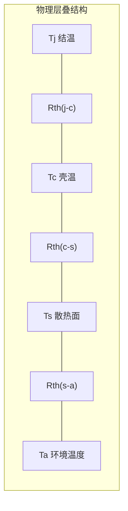
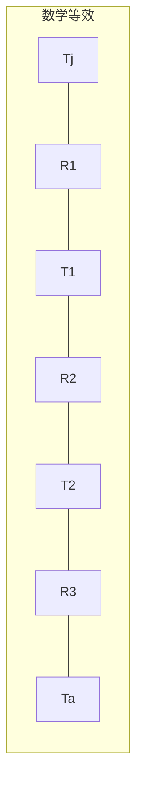

# PLECS 热仿真与损耗分析

> **为什么学？**
> FOC 控制只保证电流和转速稳定，但逆变器的 MOSFET/IGBT 损耗和温升决定了驱动能不能长时间可靠运行。如果不做热仿真，很可能电流环调得很好，一跑满载管子就过热炸机，或者散热器严重 oversized。
>
> **在 FOC 中的作用**
> 本节位于功率级设计环节，把 SVPWM 输出的开关波形、相电流峰值转化为器件损耗与结温，为散热器和功率器件选型提供定量依据。

下面的公式先把导通损耗、开关损耗和结温模型算清楚，最终目标是在满足 FOC 输出电流能力的前提下，确保逆变器在热极限内安全运行。

## 1. 数学推导

### 1.1 MOSFET 导通损耗

**为什么要做这一步**：导通损耗是逆变器稳态发热的主要来源，只有算出它与电流峰值、占空比的关系，才能判断连续运行时管子会不会过热。

MOSFET 在导通状态下的漏源电阻 $R_{DS(on)}$ 随结温 $T_j$ 变化：

$$
R_{DS(on)}(T_j) = R_{DS(on),25\degree\text{C}} \cdot \left[ 1 + \alpha_{T} (T_j - 25\degree\text{C}) \right]
$$

其中 $\alpha_T \approx 0.004 \sim 0.007 /\degree\text{C}$（正温度系数）。

导通损耗（单管）：

$$
P_{cond} = I_{RMS}^2 \cdot R_{DS(on)}(T_j)
$$

对于三相逆变器的桥臂上管，在 SVPWM 调制下，占空比 $D(t) = \frac{1 + m\sin(\omega t)}{2}$，其 RMS 电流：

$$
I_{RMS}^2 = D_{avg} \cdot I_{phase}^2 = \frac{1}{2} I_{peak}^2 \cdot \frac{1}{2} = \frac{I_{peak}^2}{4}
$$

若三相平衡，单管导通损耗：

$$
\boxed{P_{cond} = \frac{I_{peak}^2}{4} \cdot R_{DS(on)}(T_j) \cdot D_{avg}}
$$

### 1.2 MOSFET 开关损耗

**为什么要做这一步**：开关损耗随 PWM 频率线性增加，是高频 FOC 设计中效率与温升的关键限制因素；只有把它按实际电压、电流线性缩放，才能评估不同工况下的总发热。

开关损耗由开通损耗 $E_{on}$ 和关断损耗 $E_{off}$ 组成， datasheet 通常给出在特定 $V_{DS}$、$I_D$ 下的能量值。实际工作中按线性缩放：

$$
P_{sw} = f_{sw} \cdot \left( E_{on} \frac{V_{DC}}{V_{test}} \frac{I_D}{I_{test}} + E_{off} \frac{V_{DC}}{V_{test}} \frac{I_D}{I_{test}} \right)
$$

若只给出一个总开关能量 $E_{sw}$：

$$
P_{sw} = f_{sw} \cdot E_{sw} \cdot \frac{V_{DC}}{V_{test}} \cdot \frac{I_D}{I_{test}}
$$

其中 $f_{sw}$ 为 PWM 开关频率，$V_{test}$ 和 $I_{test}$ 是 datasheet 测试条件。

### 1.3 体二极管反向恢复损耗

**为什么要做这一步**：同步整流下体二极管的反向恢复会在对管开通瞬间产生额外损耗和电流尖峰，影响 EMI 与器件选型；该损耗虽然比开关损耗小，但在高频或硬开关条件下不可忽略。

同步整流中，下管体二极管导通后，上管开通时产生反向恢复电荷 $Q_{rr}$：

$$
P_{rr} = f_{sw} \cdot Q_{rr} \cdot V_{DC} \cdot \frac{I_{test}}{I_{test}} = f_{sw} \cdot Q_{rr} \cdot V_{DC}
$$

（实际中 $Q_{rr}$ 也随 $di/dt$ 和温度变化，需查阅详细曲线。）

### 1.4 总损耗与结温计算

**为什么要做这一步**：把前面分项损耗汇总后，用热阻网络换算成结温，才能判断所选 MOSFET 和散热器是否留够裕量，避免热击穿或过度设计。

单管总损耗：

$$
P_{total} = P_{cond} + P_{sw} + P_{rr}
$$

热等效网络（Cauer 模型）结温：

$$
T_j = T_a + P_{total} \cdot (R_{th(j-c)} + R_{th(c-s)} + R_{th(s-a)})
$$

其中：
- $R_{th(j-c)}$：结到壳热阻（datasheet 给出）
- $R_{th(c-s)}$：壳到散热器热阻（由导热硅脂/垫决定，约 $0.1 \sim 0.5\,\text{K/W}$）
- $R_{th(s-a)}$：散热器到环境热阻（由散热器选型决定）

---

## 2. 几何直观

### 2.1 MOSFET 开关瞬态波形

```
Vgs
  |      ___________
  |     /           \
  |    /             \
  |___/               \___________
  |   |<-td(on)->|<-tr->|       |<-tf->|
  |                                 
  |      Vds                       Ids
  |______|                        __|__
  |      |\                      /     \
  |      | \____________________/       \
  |      |                              |
  |      |<----ton---->|                |
  |                                    |<--toff-->
  +------------------------------------+----------------> t
```

- $t_{d(on)}$：开通延迟
- $t_r$：上升时间（Vds 下降）
- $t_{d(off)}$：关断延迟
- $t_f$：下降时间（Vds 上升）
- 交叉区域（Vds 高 × Ids 高）产生开关损耗

### 2.2 热等效网络（Cauer vs Foster）





**关键区别**：
- **Cauer 模型**：每个节点对应物理位置（结→壳→散热器→环境），便于定位热点
- **Foster 模型**：通过曲线拟合得到，无物理层对应，但适合瞬态仿真

PLECS 通常使用 Cauer 模型，因为用户需要知道壳温和散热器温度。

### 2.3 逆变器损耗分布饼图示意

```
        +---------------------+
       /   导通损耗 55%        \
      /   +----------------+   \
     |    |  开关损耗 30%   |    |
      \   +----------------+   /
       \   反向恢复 10%      /
        +---------------------+
         驱动/其他 5%
```

---

## 3. 数值示例

**给定 MOSFET 参数（以某 60V 管为例）：**

| 参数 | 符号 | 数值 |
|------|------|------|
| 最大漏源电压 | $V_{DS,max}$ | 60 V |
| 导通电阻 | $R_{DS(on),25°C}$ | 2.5 mΩ |
| 温度系数 | $\alpha_T$ | 0.005 /°C |
| 开关能量 | $E_{on}$ / $E_{off}$ | 45 μJ / 35 μJ (@30A, 30V) |
| 反向恢复电荷 | $Q_{rr}$ | 50 nC |
| 结到壳热阻 | $R_{th(j-c)}$ | 1.5 K/W |
| 壳到散热器热阻 | $R_{th(c-s)}$ | 0.3 K/W |

**工况条件：**

| 参数 | 数值 |
|------|------|
| 直流母线电压 | $V_{DC} = 24\,\text{V}$ |
| 相电流峰值 | $I_{peak} = 10\,\text{A}$ |
| PWM 频率 | $f_{sw} = 20\,\text{kHz}$ |
| 环境温度 | $T_a = 40\,\text{°C}$ |
| 调制比 | $m = 0.8$ |

**步骤 1：计算导通损耗**

假设结温 $T_j = 80\degree\text{C}$（先假设，后续迭代）：

$$
R_{DS(on)}(80\degree\text{C}) = 2.5\,\text{m}\Omega \times [1 + 0.005 \times (80-25)] = 2.5 \times 1.275 = 3.19\,\text{m}\Omega
$$

单管平均占空比：

$$
D_{avg} = \frac{1 + m \cdot \frac{2}{\pi}}{2} \approx \frac{1 + 0.8 \times 0.637}{2} = 0.755
$$

导通损耗：

$$
P_{cond} = \frac{10^2}{4} \times 0.00319 \times 0.755 = 25 \times 0.00241 = 0.060\,\text{W} = 60\,\text{mW}
$$

**步骤 2：计算开关损耗**

线性缩放（测试条件 $V_{test}=30\,\text{V}$, $I_{test}=30\,\text{A}$）：

$$
P_{sw} = 20000 \times \left( 45 + 35 \right) \times 10^{-6} \times \frac{24}{30} \times \frac{10}{30}
$$

$$
P_{sw} = 20000 \times 80\times10^{-6} \times 0.8 \times 0.333 = 1.6 \times 0.267 = 0.427\,\text{W}
$$

**步骤 3：反向恢复损耗**

$$
P_{rr} = 20000 \times 50\times10^{-9} \times 24 = 0.024\,\text{W}
$$

**步骤 4：总损耗与结温**

$$
P_{total} = 0.060 + 0.427 + 0.024 = 0.511\,\text{W}
$$

所需散热器热阻（设目标 $T_j = 100\degree\text{C}$）：

$$
R_{th(s-a)} = \frac{T_j - T_a}{P_{total}} - R_{th(j-c)} - R_{th(c-s)} = \frac{100-40}{0.511} - 1.5 - 0.3 = 117.4 - 1.8 = 115.6\,\text{K/W}
$$

等等，这结果异常大！说明该工况下单管损耗极低，自然对流散热器即可。实际工程中 6 管总损耗约 $3\,\text{W}$，则：

$$
R_{th(s-a)} = \frac{100-40}{3.06} - 1.8 = 19.6 - 1.8 = 17.8\,\text{K/W}
$$

一个小型铝散热器即可满足。

**迭代验证**：重新计算 $T_j = 40 + 3.06 \times (1.5+0.3+17.8) = 40 + 58.7 = 98.7\degree\text{C}$，接近假设。$R_{DS(on)}$ 在 $100\degree\text{C}$ 下为 $3.375\,\text{m}\Omega$，导通损耗约 $63\,\text{mW}$，影响很小，收敛。

---

## 4. 代码实现

### 4.1 PLECS 热仿真 MATLAB 脚本（参数初始化）

```matlab
%% PLECS_Thermal_Setup.m
% PLECS 热仿真参数初始化脚本

clear; clc;

%% MOSFET 参数
Vds_max = 60;               % [V]
Rdson_25 = 2.5e-3;          % [Ω] 25°C导通电阻
alpha_T = 0.005;            % [/°C] 温度系数
E_on = 45e-6;               % [J] @ Vtest, Itest
E_off = 35e-6;              % [J]
Q_rr = 50e-9;               % [C]
V_test = 30;                % [V] datasheet测试电压
I_test = 30;                % [A] datasheet测试电流

%% 热阻参数
Rth_jc = 1.5;               % [K/W] 结到壳
Rth_cs = 0.3;               % [K/W] 壳到散热器

%% 工作条件
Vdc = 24;                   % [V]
I_peak = 10;                % [A] 相电流峰值
fsw = 20e3;                 % [Hz] 开关频率
Ta = 40;                    % [°C] 环境温度
m = 0.8;                    % 调制比

%% 迭代计算结温
Tj = 100;                   % 初始假设 [°C]
for iter = 1:5
    Rdson = Rdson_25 * (1 + alpha_T*(Tj - 25));
    D_avg = (1 + m * 2/pi) / 2;
    P_cond = (I_peak^2 / 4) * Rdson * D_avg;
    
    P_sw = fsw * (E_on + E_off) * (Vdc/V_test) * (I_peak/I_test);
    P_rr = fsw * Q_rr * Vdc;
    
    P_total = P_cond + P_sw + P_rr;
    
    % 6管逆变器总损耗
    P_inv = 6 * P_total;
    
    % 所需散热器热阻 (目标Tj = 100°C)
    Rth_sa = (100 - Ta)/P_total - Rth_jc - Rth_cs;  % 单管
    
    % 更新Tj估算
    Tj_new = Ta + P_total * (Rth_jc + Rth_cs + max(Rth_sa, 0));
    
    fprintf('迭代 %d: Tj=%.1f°C, Pcond=%.3fW, Psw=%.3fW, Prr=%.3fW, Rth_sa=%.1f K/W\n', ...
        iter, Tj, P_cond, P_sw, P_rr, Rth_sa);
    
    if abs(Tj_new - Tj) < 0.5, break; end
    Tj = Tj_new;
end

fprintf('\n=== 最终结果 ===\n');
fprintf('单管总损耗: %.3f W\n', P_total);
fprintf('逆变器总损耗: %.3f W\n', P_inv);
fprintf('效率: %.2f%%\n', (1 - P_inv/(Vdc*I_peak*sqrt(3)/2))*100);
```

### 4.2 PLECS 热电路描述（Thermal Description）

```c
/* PLECS 热网络描述文件 (.ctm) 结构 */

component MOSFET_Thermal {
    /* 电气端口 */
    nodeset Electrical = [Drain, Source, Gate];
    /* 热端口 */
    nodeset Thermal = [Tj];
    
    /* 热阻链 (Cauer 模型) */
    thermal_resistor Rjc = 1.5;      /* 结到壳 [K/W] */
    thermal_resistor Rcs = 0.3;      /* 壳到散热器 [K/W] */
    thermal_resistor Rsa = 10;       /* 散热器到环境 [K/W] (可调) */
    
    /* 热容 (决定瞬态响应) */
    thermal_capacitor Cj = 0.01;     /* 结热容 [J/K] */
    thermal_capacitor Cc = 0.1;      /* 壳热容 [J/K] */
    thermal_capacitor Cs = 1.0;      /* 散热器热容 [J/K] */
    
    /* 连接 */
    Tj -- Rjc -- Tc -- Rcs -- Ts -- Rsa -- Ta(ambient);
    Tj -- Cj -- ground_thermal;
    Tc -- Cc -- ground_thermal;
    Ts -- Cs -- ground_thermal;
}
```

### 4.3 瞬态结温计算函数（Python）

```python
import numpy as np
import matplotlib.pyplot as plt

def thermal_transient(P_pulse, t_on, t_period, Rth, Cth, t_sim, dt):
    """
    计算周期性功率脉冲下的瞬态结温
    P_pulse: 脉冲功率 [W]
    t_on: 导通时间 [s]
    t_period: 周期 [s]
    Rth: 热阻 [K/W]
    Cth: 热容 [J/K]
    """
    tau = Rth * Cth
    n_steps = int(t_sim / dt)
    t = np.linspace(0, t_sim, n_steps)
    T = np.zeros(n_steps)
    T[0] = 25  # 初始结温
    
    for k in range(1, n_steps):
        t_in_cycle = (k*dt) % t_period
        P = P_pulse if t_in_cycle < t_on else 0
        dT = (P - T[k-1]/Rth) / Cth * dt  # dT/dt = (P - T/Rth)/Cth
        T[k] = T[k-1] + dT
    
    return t, T

# 示例: 10W脉冲, 1ms on, 10ms周期, Rth=10K/W, Cth=0.1J/K
t, T = thermal_transient(10, 1e-3, 10e-3, 10, 0.1, 0.5, 1e-5)
plt.plot(t*1000, T)
plt.xlabel('Time [ms]'); plt.ylabel('Tj [°C]')
plt.title('Transient Junction Temperature'); plt.grid()
plt.savefig('thermal_transient.png', dpi=150)
```

---

## 5. 常见错误

### 错误 1：将 Foster 热阻网络直接当作 Cauer 网络使用

**现象**：PLECS 或 Simulink 热仿真中，壳温计算为负值或超过结温，物理上不合理。

**原因**：Foster 网络（从 datasheet 瞬态热阻曲线 $Z_{th}(t)$ 拟合得到）的节点是**数学节点**，不代表物理温度。Foster 网络的第一个节点 $T_1$ 不是壳温，而是等效中间温度。若强行将 Foster 的 $R_1$ 解释为 $R_{th(j-c)}$，则壳温计算错误。

**纠正**：
- 在 PLECS 中使用 **Cauer 模型**（有物理层对应），需要手动从 datasheet 的 $R_{th(j-c)}$ 和 $R_{th(c-s)}$ 构建
- 若只有 Foster 参数，需用网络转换算法将其转换为 Cauer 网络（使用 Foster→Cauer 梯形变换，需保证所有 $R_i, C_i > 0$）
- PLECS 的 `MOSFET with Thermal Model` 组件通常内置 Cauer 模型，直接使用即可

### 错误 2：忽略 $R_{DS(on)}$ 的正温度系数，按 25°C 值计算导致结温低估

**现象**：理论计算结温 70°C，实际测量 110°C，散热器选型不足。

**原因**：$R_{DS(on)}$ 在 $100\degree\text{C}$ 时可能比 $25\degree\text{C}$ 增加 50% 以上。若按 25°C 值 $2.5\,\text{m}\Omega$ 计算，导通损耗被严重低估。

**纠正**：
- 必须进行**迭代热计算**：假设 $T_j \to$ 计算 $R_{DS(on)}(T_j) \to$ 计算损耗 $\to$ 计算新 $T_j \to$ 直到收敛
- 工程上可简化为：直接使用 $T_j = 100\degree\text{C}$ 或 $125\degree\text{C}$ 下的 $R_{DS(on)}$ 值进行保守设计
- 在 PLECS 中，设置 $R_{DS(on)}$ 为温度依赖表达式：`Rdson = 2.5e-3 * (1 + 0.005*(Tj - 25))`

---

## 6. 自测习题

### 习题 1：散热器选型

某三相逆变器使用 6 个 MOSFET，每个 MOSFET 在 $100\degree\text{C}$ 下的 $R_{DS(on)} = 4\,\text{m}\Omega$，$f_{sw} = 40\,\text{kHz}$，单管开关损耗 $P_{sw} = 2\,\text{W}$，无反向恢复。相电流有效值 $I_{RMS} = 15\,\text{A}$。环境温度 $T_a = 50\degree\text{C}$，要求最大结温 $T_j \leq 125\degree\text{C}$。已知 $R_{th(j-c)} = 1.2\,\text{K/W}$，$R_{th(c-s)} = 0.4\,\text{K/W}$。求所需散热器热阻 $R_{th(s-a)}$。

**答案**：

单管导通损耗：

$$
P_{cond} = I_{RMS}^2 \cdot R_{DS(on)} = 15^2 \times 0.004 = 0.9\,\text{W}
$$

单管总损耗：

$$
P_{total} = 0.9 + 2.0 = 2.9\,\text{W}
$$

允许总热阻：

$$
R_{th(total)} = \frac{125 - 50}{2.9} = 25.86\,\text{K/W}
$$

所需散热器热阻：

$$
R_{th(s-a)} = 25.86 - 1.2 - 0.4 = \boxed{24.26\,\text{K/W}}
$$

### 习题 2：开关频率对效率的影响

已知 $P_{cond} = 1\,\text{W}$（与 $f_{sw}$ 无关），$P_{sw} = k \cdot f_{sw}$，其中 $k = 50\,\mu\text{J}$。$P_{rr} = 0.2\,\text{W}$（固定）。输出功率 $P_{out} = 100\,\text{W}$。分别计算 $f_{sw} = 10\,\text{kHz}$、$20\,\text{kHz}$、$50\,\text{kHz}$ 时的逆变器效率。

**答案**：

| $f_{sw}$ | $P_{sw}$ | $P_{total}$ (6管) | $\eta$ |
|----------|----------|-------------------|--------|
| 10 kHz | $0.5\,\text{W}$ | $6 \times (1+0.5+0.2) = 10.2\,\text{W}$ | $100/(100+10.2) = 90.7\%$ |
| 20 kHz | $1.0\,\text{W}$ | $6 \times 2.2 = 13.2\,\text{W}$ | $100/113.2 = 88.3\%$ |
| 50 kHz | $2.5\,\text{W}$ | $6 \times 3.7 = 22.2\,\text{W}$ | $100/122.2 = 81.8\%$ |

结论：开关频率提高 5 倍，效率从 90.7% 降至 81.8%，说明高频化必须配合低 $Q_{rr}$、低 $E_{sw}$ 的器件。

---