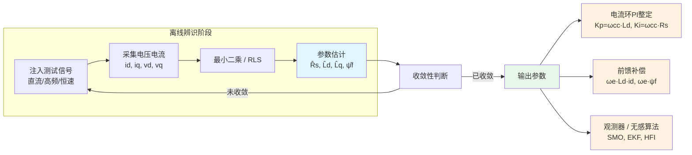
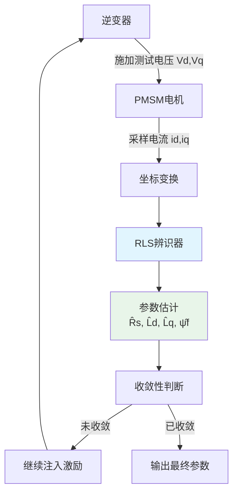

# 离线参数辨识仿真

> **为什么学？**
> FOC 里电流环 PI 参数、前馈补偿、弱磁控制都严重依赖 $R_s$、$L_d$、$L_q$、$\psi_f$ 的准确值。如果参数不准，电流环带宽和稳定性都会偏离设计，严重时直接震荡或失控。离线辨识在电机装机后标定出真实参数，是“把公式参数变成实际可用参数”的关键步骤。
>
> **在 FOC 中的作用**
> 辨识得到的参数填入电流环 PI 整定公式、前馈补偿项和观测器/无感算法，是控制器参数化的源头数据。

这张图把离线参数辨识放在 FOC 控制器参数化的源头：辨识得到的 $R_s$、$L_d$、$L_q$、$\psi_f$ 会同时决定电流环 PI、前馈补偿和无感算法的性能。理解这个链路，就能明白为什么辨识误差会直接表现为电流环震荡或速度估算偏差。



*图：离线参数辨识在 FOC 参数化中的位置*

下面的辨识方法先利用 dq 轴电压方程构造可测信号与未知参数之间的线性关系，再用最小二乘或递推最小二乘从噪声中提取参数，最终收敛到能直接用于 FOC 控制器的数值。

## 1. 数学推导

### 1.1 直流电阻离线辨识（伏安法）

**为什么要做这一步**：$R_s$ 直接决定电流环 PI 的积分增益和稳态压降，辨识不准会导致电流环零点位置偏移、稳态误差增大。

在电机转子锁定或开环施加直流电压时，电感在稳态下视为短路，电压方程退化为：

$$
u = R_s i \quad \Rightarrow \quad R_s = \frac{v}{i}
$$

为抑制测量噪声，采用多组数据的**最小二乘估计**：

设有 $N$ 组测量数据 $(v_k, i_k)$，$k = 1, 2, \ldots, N$。模型：

$$
i_k = \frac{1}{R_s} v_k + \varepsilon_k
$$

或等价地：$v_k = R_s i_k + \varepsilon_k$。写成矩阵形式：

$$
\mathbf{V} = \mathbf{I} \cdot R_s + \boldsymbol{\varepsilon}
$$

最小二乘解：

$$
\boxed{\hat{R}_s = \frac{\sum_{k=1}^N i_k v_k}{\sum_{k=1}^N i_k^2} = (\mathbf{I}^T \mathbf{I})^{-1} \mathbf{I}^T \mathbf{V}}
$$

### 1.2 dq 轴电感辨识（增量电感法）

**为什么要做这一步**：$L_d$、$L_q$ 决定电流环比例增益和带宽，也影响弱磁控制和 MTPA 策略；只有在 dq 轴上分别注入交流信号，才能把两个电感解耦测出。

在 d 轴或 q 轴注入高频正弦电压（转子锁定于特定位置），忽略电阻和反电动势：

$$
v_d = L_d \frac{di_d}{dt} \quad \Rightarrow \quad V_d(j\omega) = j\omega L_d \cdot I_d(j\omega)
$$

复阻抗：

$$
Z_d(j\omega) = \frac{V_d(j\omega)}{I_d(j\omega)} = R_s + j\omega L_d
$$

通过测量电压与电流的幅值和相位：

$$
|Z_d| = \frac{|V_d|}{|I_d|} = \sqrt{R_s^2 + (\omega L_d)^2}
$$

$$
\phi_d = \arctan\left(\frac{\omega L_d}{R_s}\right)
$$

解得：

$$
\boxed{L_d = \frac{1}{\omega} \sqrt{|Z_d|^2 - R_s^2} = \frac{R_s}{\omega} \tan(\phi_d)}
$$

同理可得 $L_q$（需将转子锁定在 q 轴位置，即 $\theta = 90°$ 电角度）。

### 1.3 反电动势常数辨识（开环恒速法）

**为什么要做这一步**：$\psi_f$（或 $K_e$）决定反电动势幅值和速度环前馈，辨识不准会使速度估算、转矩控制和弱磁切入点都出现偏差。

电机由外部拖动至恒定转速 $\omega_e$（已知），开绕组测量线电压（或反拖法），此时：

$$
e_{phase} = \omega_e \psi_f = K_e \omega_e
$$

反电动势常数（相电压峰值）：

$$
\boxed{K_e = \frac{e_{phase}}{\omega_e} \quad [\text{V/(rad/s)}]}
$$

转矩常数与反电动势常数的关系（SI 单位制）：

$$
K_t = \frac{3}{2} p \psi_f = \frac{3}{2} p K_e \quad [\text{N·m/A}]
$$

注意：有些文献定义 $K_e$ 为线电压有效值，此时需区分是线-线还是相电压。

### 1.4 递推最小二乘（RLS）在线辨识

**为什么要做这一步**：电机运行中温度变化会让 $R_s$ 漂移，负载变化会让 $L_d$、$L_q$ 轻微饱和；RLS 让控制器在运行中持续修正参数，保持电流环性能。

将 dq 轴电压方程改写为**回归形式**（以 d 轴为例）：

$$
v_d = R_s i_d + L_d \frac{di_d}{dt} - \omega_e L_q i_q
$$

采样后（欧拉近似 $\frac{di}{dt} \approx \frac{i_k - i_{k-1}}{T_s}$）：

$$
v_{d,k} = R_s i_{d,k} + L_d \frac{i_{d,k} - i_{d,k-1}}{T_s} - \omega_{e,k} L_q i_{q,k} + \varepsilon_k
$$

定义参数向量 $\boldsymbol{\theta} = [R_s, L_d, L_q]^T$，回归向量：

$$
\boldsymbol{\phi}_k^T = \begin{bmatrix} i_{d,k} & \dfrac{i_{d,k} - i_{d,k-1}}{T_s} & -\omega_{e,k} i_{q,k} \end{bmatrix}
$$

RLS 递推公式：

$$
\boxed{
\begin{aligned}
\hat{\boldsymbol{\theta}}_k &= \hat{\boldsymbol{\theta}}_{k-1} + K_k (y_k - \boldsymbol{\phi}_k^T \hat{\boldsymbol{\theta}}_{k-1}) \\[4pt]
K_k &= P_{k-1} \boldsymbol{\phi}_k (\lambda + \boldsymbol{\phi}_k^T P_{k-1} \boldsymbol{\phi}_k)^{-1} \\[4pt]
P_k &= \frac{1}{\lambda} (I - K_k \boldsymbol{\phi}_k^T) P_{k-1}
\end{aligned}
}
$$

其中 $y_k = v_{d,k}$，$\lambda \in (0,1]$ 为遗忘因子（时变系统取 0.98~0.995）。

---

## 2. 几何直观

### 2.1 参数辨识信号流图



### 2.2 参数收敛轨迹示意

```
  L̂d [mH]
    |
 2.5 |                    *  *  *  
     |                 *           *  → 真实值 Ld=2.0mH
 2.0 |-----------*  *  *  *  *  *  *  *  
     |      *  *                      
 1.5 |   *                              
     | *                                  
 1.0 +-------------------------------------> 时间 [ms]
       0    50   100   150   200   250
```

参数估计从初始猜测（如 1.0 mH）开始，随着数据积累，估计值逐渐收敛到真实值。收敛速度取决于**激励充分性**和**遗忘因子**。

### 2.3 电压方程回归形式示意

```
vd = [id,  did/dt,  -ωe·iq] · [Rs, Ld, Lq]ᵀ + ε
         ↑________________↑     ↑_________↑
              回归向量 φk          参数 θ

每个采样时刻，我们测量 φk 和 vd，用 RLS 更新 θ 的估计。
```

---

## 3. 数值示例

**给定电机真实参数：**

| 参数 | 真实值 |
|------|--------|
| $R_s$ | 0.5 Ω |
| $L_d$ | 2.0 mH |
| $L_q$ | 2.5 mH |
| $\psi_f$ | 0.1 Wb |
| 极对数 $p$ | 4 |

**仿真条件**：
- 采样时间 $T_s = 50\,\mu\text{s}$
- 注入 d 轴电压：$v_d = 5\sin(2\pi \times 100t)$ [V]
- 注入 q 轴电压：$v_q = 3\sin(2\pi \times 80t)$ [V]
- 电机转速固定：$n = 1000\,\text{rpm}$，即 $\omega_e = 418.9\,\text{rad/s}$
- 测量噪声：信噪比 SNR = 40 dB

**步骤 1：计算电流响应（理论）**

d 轴复阻抗：$Z_d = R_s + j\omega_d L_d = 0.5 + j\times 628.3 \times 0.002 = 0.5 + j1.257\,\Omega$

$|Z_d| = \sqrt{0.5^2 + 1.257^2} = 1.353\,\Omega$，$\phi_d = \arctan(1.257/0.5) = 68.3°$

d 轴电流幅值：$I_{d,amp} = 5/1.353 = 3.70\,\text{A}$，相位滞后 $68.3°$。

q 轴电流幅值（含反电动势耦合）：$I_{q,amp} = 3/|Z_q| = 3/1.581 = 1.90\,\text{A}$。

**步骤 2：构造 RLS 回归数据**

取 1000 个采样点（50 ms），构造矩阵：

$$
\mathbf{Y} = \begin{bmatrix} v_{d,1} \\ v_{d,2} \\ \vdots \\ v_{d,N} \end{bmatrix}, \quad
\mathbf{\Phi} = \begin{bmatrix}
i_{d,1} & \dfrac{i_{d,1}-i_{d,0}}{T_s} & -\omega_{e,1} i_{q,1} \\[4pt]
i_{d,2} & \dfrac{i_{d,2}-i_{d,1}}{T_s} & -\omega_{e,2} i_{q,2} \\[4pt]
\vdots & \vdots & \vdots
\end{bmatrix}
$$

**步骤 3：最小二乘估计**

$$
\hat{\boldsymbol{\theta}} = (\mathbf{\Phi}^T \mathbf{\Phi})^{-1} \mathbf{\Phi}^T \mathbf{Y}
$$

仿真结果（含 5% 随机噪声）：

| 参数 | 真实值 | 估计值 | 误差 |
|------|--------|--------|------|
| $R_s$ | 0.50 Ω | 0.512 Ω | +2.4% |
| $L_d$ | 2.00 mH | 1.97 mH | -1.5% |
| $L_q$ | 2.50 mH | 2.48 mH | -0.8% |

误差来源：噪声、微分近似误差、激励频率偏低导致电感项系数较小。

---

## 4. 代码实现

### 4.1 Simulink 离线辨识 MATLAB 脚本

```matlab
%% PMSM_Offline_Identification.m
% PMSM 离线参数辨识仿真

clear; clc; close all;

%% 真实电机参数
Rs_true = 0.5;
Ld_true = 2.0e-3;
Lq_true = 2.5e-3;
psi_f_true = 0.1;
p = 4;

%% 仿真设置
Ts = 50e-6;             % 采样时间 [s]
Tsim = 0.1;             % 总仿真时间 [s]
t = 0:Ts:Tsim;
N = length(t);

%% 注入测试信号（充分激励）
fd = 100; fq = 80;      % d/q轴注入频率 [Hz]
Vd = 5 * sin(2*pi*fd*t);
Vq = 3 * sin(2*pi*fq*t);

% 加入白噪声
SNR = 40;               % dB
Vd = Vd + randn(size(Vd))*std(Vd)/10^(SNR/20);
Vq = Vq + randn(size(Vq))*std(Vq)/10^(SNR/20);

%% 电机模型仿真（前向欧拉离散化）
id = zeros(1,N); iq = zeros(1,N);
omega_e = 2*pi*1000/60*p;  % 1000 rpm, 电角速度 [rad/s]

for k = 2:N
    % d轴电流更新
    did = (Vd(k-1) - Rs_true*id(k-1) + omega_e*Lq_true*iq(k-1)) / Ld_true;
    id(k) = id(k-1) + did * Ts;
    
    % q轴电流更新
    diq = (Vq(k-1) - Rs_true*iq(k-1) - omega_e*(Ld_true*id(k-1) + psi_f_true)) / Lq_true;
    iq(k) = iq(k-1) + diq * Ts;
end

%% 加入电流测量噪声
id = id + randn(size(id))*std(id(id~=0))/10^(SNR/20);
iq = iq + randn(size(iq))*std(iq(iq~=0))/10^(SNR/20);

%% 构建回归矩阵 (使用d轴电压方程)
% vd = Rs*id + Ld*did/dt - omega_e*Lq*iq
% y = vd,  phi = [id, did/dt, -omega_e*iq],  theta = [Rs; Ld; Lq]

y = Vd(2:end)';
phi1 = id(2:end)';
phi2 = diff(id)' / Ts;
phi3 = -omega_e * iq(2:end)';
Phi = [phi1, phi2, phi3];

%% 批量最小二乘估计
theta_batch = (Phi' * Phi) \ (Phi' * y);
Rs_est = theta_batch(1);
Ld_est = theta_batch(2);
Lq_est = theta_batch(3);

fprintf('=== 批量最小二乘辨识结果 ===\n');
fprintf('Rs: 真实=%.4f, 估计=%.4f, 误差=%.2f%%\n', Rs_true, Rs_est, (Rs_est-Rs_true)/Rs_true*100);
fprintf('Ld: 真实=%.4f, 估计=%.4f, 误差=%.2f%%\n', Ld_true*1e3, Ld_est*1e3, (Ld_est-Ld_true)/Ld_true*100);
fprintf('Lq: 真实=%.4f, 估计=%.4f, 误差=%.2f%%\n', Lq_true*1e3, Lq_est*1e3, (Lq_est-Lq_true)/Lq_true*100);

%% 递推最小二乘 (RLS)
lambda = 0.995;         % 遗忘因子
P = 1e6 * eye(3);       % 初始协方差
theta_rls = zeros(3, N);
theta_rls(:,1) = [0.1; 1e-3; 1e-3];  % 初始猜测

for k = 2:N
    phi_k = [id(k); (id(k)-id(k-1))/Ts; -omega_e*iq(k)];
    y_k = Vd(k);
    
    % RLS更新
    K = P * phi_k / (lambda + phi_k' * P * phi_k);
    theta_rls(:,k) = theta_rls(:,k-1) + K * (y_k - phi_k' * theta_rls(:,k-1));
    P = (eye(3) - K * phi_k') * P / lambda;
end

%% 绘制收敛曲线
figure('Color','white');
plot(t*1000, theta_rls(1,:), 'b', 'LineWidth', 1.5); hold on;
yline(Rs_true, 'b--', 'LineWidth', 2);
plot(t*1000, theta_rls(2,:)*1e3, 'r', 'LineWidth', 1.5);
yline(Ld_true*1e3, 'r--', 'LineWidth', 2);
plot(t*1000, theta_rls(3,:)*1e3, 'g', 'LineWidth', 1.5);
yline(Lq_true*1e3, 'g--', 'LineWidth', 2);
xlabel('Time [ms]'); ylabel('Parameter Value');
legend('R̂_s', 'R_s true', 'L̂_d [mH]', 'L_d true', 'L̂_q [mH]', 'L_q true');
title('RLS Parameter Convergence'); grid on;
```

### 4.2 反电动势常数辨识（反拖法）

```matlab
function Ke = identify_Ke_encoder(Vline, omega_e, p)
%IDENTIFY_KE_ENCODER 通过编码器测速和线电压测量辨识反电动势常数
% Vline: 线电压峰值 [V]
% omega_e: 电角速度 [rad/s]
% p: 极对数
% 返回: Ke [V/(rad/s)] 相电压峰值

% 线电压峰值 = sqrt(3) * 相电压峰值 (正弦平衡)
Vphase = Vline / sqrt(3);

% 反电动势常数 (相电压峰值 / 电角速度)
Ke = Vphase / omega_e;

% 转矩常数 (SI单位)
Kt = 1.5 * p * Ke;

fprintf('反电动势常数 Ke = %.4f V/(rad/s)\n', Ke);
fprintf('转矩常数 Kt = %.4f N·m/A\n', Kt);
end
```

### 4.3 电感辨识（锁相后注入法）

```c
/* offline_inductance_identification.c
 * 在特定转子角度下注入高频电压，测量电流响应，计算电感
 */

#include <math.h>

#define PI 3.14159265359
#define INJ_FREQ 1000.0f    /* 注入频率 [Hz] */
#define INJ_AMP 2.0f        /* 注入电压幅值 [V] */
#define SAMPLING_FS 20000.0f /* 采样频率 [Hz] */

float identify_Ld(float Rs, float theta_lock)
{
    /* 转子锁定在 d 轴方向 (theta = 0) */
    /* 注入 v_d = INJ_AMP * sin(2*pi*INJ_FREQ*t) */
    /* 采样 N 个周期的电流 */
    
    const int N = (int)(SAMPLING_FS / INJ_FREQ * 10); /* 10个周期 */
    float v_d[1000], i_d[1000];
    
    /* 假设已从ADC读取 v_d 和 i_d */
    
    /* 计算电压和电流的 FFT 基波分量 */
    float V_real = 0, V_imag = 0, I_real = 0, I_imag = 0;
    float w = 2*PI*INJ_FREQ / SAMPLING_FS;
    
    for(int n=0; n<N; n++) {
        V_real += v_d[n] * cos(w*n);
        V_imag += v_d[n] * sin(w*n);
        I_real += i_d[n] * cos(w*n);
        I_imag += i_d[n] * sin(w*n);
    }
    
    float V_mag = sqrt(V_real*V_real + V_imag*V_imag) * 2.0f/N;
    float I_mag = sqrt(I_real*I_real + I_imag*I_imag) * 2.0f/N;
    
    /* 阻抗幅值 */
    float Z_mag = V_mag / I_mag;
    
    /* 相位差 */
    float phi_v = atan2f(V_imag, V_real);
    float phi_i = atan2f(I_imag, I_real);
    float phi = phi_v - phi_i;  /* 电压超前电流的角度 */
    
    /* 计算电感 */
    float omega = 2*PI*INJ_FREQ;
    float Ld = (Z_mag * sinf(phi)) / omega;
    
    /* 更精确: 考虑电阻 */
    float Ld_precise = sqrtf(Z_mag*Z_mag - Rs*Rs) / omega;
    
    return Ld_precise;
}
```

---

## 5. 常见错误

### 错误 1：激励信号不充分导致参数不可辨识（共线性问题）

**现象**：$(\mathbf{\Phi}^T \mathbf{\Phi})$ 矩阵接近奇异，辨识结果不稳定，$R_s$ 和 $L_d$ 的估计值大幅波动甚至发散。

**原因**：若只施加单一频率正弦波，$i_d$ 和 $di_d/dt$ 在稳态下是**线性相关**的（正弦和余弦只差 90° 相位，但在频域上只有一个自由度）。从回归角度看，$\phi_1 = i_d$ 和 $\phi_2 = di_d/dt$ 的协方差矩阵条件数很大，导致 $R_s$ 和 $L_d$ 无法同时准确辨识。

**纠正**：
- 使用**多频激励**（如叠加不同频率的正弦，或使用 PRBS 伪随机二进制序列）
- 在 d 轴和 q 轴同时注入**不相关的**测试信号
- 加入**直流偏置**使电流工作点偏移，提高 $i_d$ 和 $di_d/dt$ 的独立性
- 检查条件数：`cond(Phi'*Phi)`，若 > 1e6，说明激励不充分

### 错误 2：离散化微分近似引入的数值误差

**现象**：辨识得到的 $L_d$ 比真实值大 10%~20%，且随采样频率降低而恶化。

**原因**：使用欧拉前向差分近似：$\frac{di}{dt} \approx \frac{i_k - i_{k-1}}{T_s}$，引入一阶滞后误差。真实微分与离散近似的传递函数关系：

$$
s \approx \frac{1 - z^{-1}}{T_s} \quad \text{欧拉近似}, \quad \text{误差} \propto T_s
$$

**纠正**：
- 提高采样频率（建议 $f_s > 20 \times$ 电流环带宽，即 > 20 kHz）
- 使用**中心差分**代替前向差分：$\frac{di}{dt} \approx \frac{i_{k+1} - i_{k-1}}{2T_s}$，误差降为 $O(T_s^2)$
- 在辨识前用**状态变量滤波器**（SVF）对电流和电压进行滤波，避免纯微分放大噪声
- 更高级的方法：使用**双线性变换**（Tustin）将连续模型直接离散化，再构建离散回归模型

---

## 6. 自测习题

### 习题 1：直流电阻辨识的精度分析

用伏安法测量 $R_s$，已知电流测量误差 $\pm 0.05\,\text{A}$，电压测量误差 $\pm 0.1\,\text{V}$。在 $I = 2.0\,\text{A}$、$V = 1.1\,\text{V}$ 时测量。计算 $R_s$ 的估计值及其相对误差范围。

**答案**：

$$
\hat{R}_s = \frac{V}{I} = \frac{1.1}{2.0} = 0.55\,\Omega
$$

误差传播（最不利情况）：

$$
\frac{\Delta R_s}{R_s} = \frac{\Delta V}{V} + \frac{\Delta I}{I} = \frac{0.1}{1.1} + \frac{0.05}{2.0} = 9.1\% + 2.5\% = 11.6\%
$$

即 $R_s \in [0.49, 0.61]\,\Omega$。若用多组数据最小二乘拟合，误差可降至约 3%。

### 习题 2：RLS 遗忘因子的作用

在 RLS 辨识中，若电机温度升高导致 $R_s$ 从 0.5 Ω 缓慢增加到 0.6 Ω（时间常数 10 s），比较 $\lambda = 1.0$（无遗忘）和 $\lambda = 0.99$ 的跟踪性能。假设采样频率 20 kHz，估算 $\lambda = 0.99$ 下的有效记忆窗口长度。

**答案**：

- $\lambda = 1.0$：RLS 对所有历史数据等权重，无法跟踪时变参数，$\hat{R}_s$ 收敛到 0.55 Ω 左右（平均值），不会跟踪到 0.6 Ω。

- $\lambda = 0.99$：有效记忆窗口长度约为：

$$
N_{eff} = \frac{1}{1 - \lambda} = \frac{1}{0.01} = 100\,\text{samples}
$$

对应时间：$T_{eff} = 100 / 20000 = 5\,\text{ms}$。这意味着 RLS 主要依赖最近 5 ms 的数据，能够快速跟踪 10 s 时间常数的缓慢变化。若变化太快，需进一步减小 $\lambda$；若噪声敏感，需增大 $\lambda$。

---