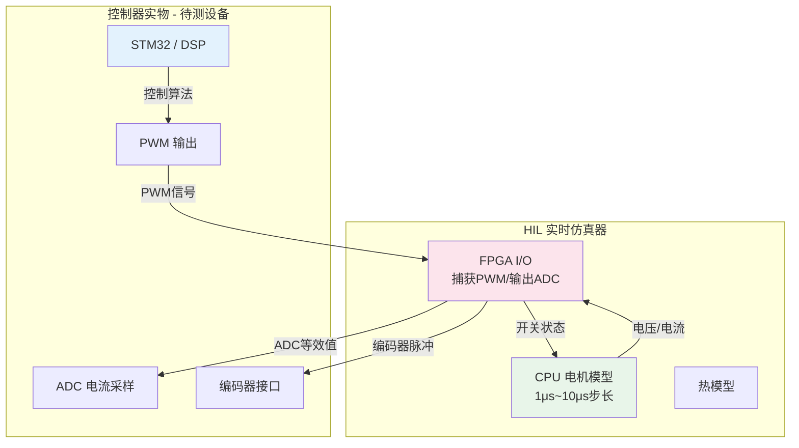
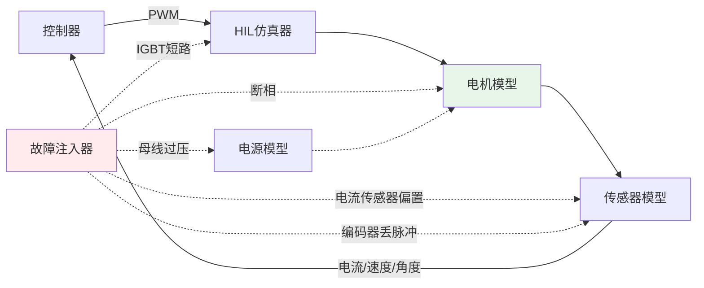

# 硬件在环 HIL 测试

> **为什么学？**
> 真实电机和功率板做极限测试成本高、风险大，失控可能烧毁硬件。HIL 用实时仿真器代替真实电机和逆变器，让控制器在接近真实电流、转速、故障场景下跑通保护逻辑，是算法上真实系统前的最后一道安全验证。
>
> **在 FOC 中的作用**
> HIL 位于控制算法和实物调试之间，验证电流环、速度环、故障保护在真实时序和接口延迟下的表现，是“仿真→样机”过渡的关键关卡。

下面先分析实时仿真的离散化稳定性和步长约束，再讨论 PWM 捕获、接口延迟与死区建模，这些都是把理想 FOC 模型搬进实时硬件时必须跨越的工程门槛。

## 1. 数学推导

### 1.1 实时仿真的离散化稳定性约束

**为什么要做这一步**：HIL 仿真器必须在固定步长内实时求解电机模型，离散化稳定性约束决定了最小仿真步长，步长太大不仅仿真发散，还会让 PWM 边沿和死区彻底失真。

HIL 仿真中，电机模型必须在固定步长 $T_{step}$ 内完成一次求解。对连续电机模型进行离散化，常用**前向欧拉法**：

$$
x_{k+1} = x_k + T_{step} \cdot f(x_k, u_k)
$$

对于一阶 RL 电路（电机定子绕组的简化模型）：

$$
L \frac{di}{dt} + Ri = v \quad \Rightarrow \quad \frac{di}{dt} = -\frac{R}{L} i + \frac{1}{L} v
$$

离散化后：

$$
i_{k+1} = i_k + T_{step} \left( -\frac{R}{L} i_k + \frac{1}{L} v_k \right) = \left(1 - \frac{R T_{step}}{L} \right) i_k + \frac{T_{step}}{L} v_k
$$

稳定性要求特征根在单位圆内：

$$
\left| 1 - \frac{R T_{step}}{L} \right| < 1 \quad \Rightarrow \quad T_{step} < \frac{2L}{R}
$$

**物理意义**：对于 $R_s = 0.5\,\Omega$、$L_s = 2\,\text{mH}$ 的电机，最大稳定步长：

$$
T_{step,max} = \frac{2 \times 0.002}{0.5} = 8\,\text{ms}
$$

但实际 HIL 需要远小于此值的步长（通常 $1\,\mu\text{s} \sim 10\,\mu\text{s}$），因为：
1. 需要准确捕获 PWM 边沿（开关频率 20 kHz 对应 50 μs 周期）
2. 需仿真逆变器死区（通常 1~3 μs）
3. 保证数值精度，而非仅稳定性

### 1.2 实时仿真步长与 PWM 分辨率的关系

**为什么要做这一步**：HIL 的步长直接决定 PWM 占空比的量化精度，步长过大会让控制器看到的电流和真实系统对不上，从而误判控制性能。

PWM 周期 $T_{PWM} = 50\,\mu\text{s}$（20 kHz）。若 HIL 步长 $T_{step} = 1\,\mu\text{s}$，则每 PWM 周期有 50 个仿真步。若控制器发送占空比 $D = 0.37$，则 PWM 高电平持续 $18.5\,\mu\text{s}$。由于 HIL 是离散采样，实际捕获的占空比取决于采样时刻与 PWM 边沿的相对关系。

**时间量化误差**：

$$
\Delta D_{quant} = \frac{T_{step}}{T_{PWM}} = \frac{1\,\mu\text{s}}{50\,\mu\text{s}} = 0.02\,\text{(2%)}
$$

对于高精度电流控制，2% 的占空比量化误差可能不可接受。因此高端 HIL 平台（如 Typhoon HIL 604）采用 **FPGA 亚步长** 技术，在 $T_{step} = 1\,\mu\text{s}$ 内用 FPGA 以 ns 级分辨率捕获 PWM 边沿，将量化误差降至 < 0.1%。

### 1.3 接口延迟与相位裕度损失

**为什么要做这一步**：HIL 中 FPGA 捕获、CPU 计算、DAC 输出都会引入额外延迟，这些延迟会吃掉电流环相位裕度，若不加校核，可能在真实硬件上稳定的控制器在 HIL 里反而震荡。

HIL 系统中存在多处延迟：

| 延迟源 | 典型值 | 影响 |
|--------|--------|------|
| 仿真步长 $T_{step}$ | 1~10 μs | 平均半拍延迟 $T_{step}/2$ |
| ADC 采样 | 1~5 μs | 电流采样保持时间 |
| DAC 输出 | 1~3 μs | 电压输出建立时间 |
| 通信接口 | 0.1~1 μs | 光纤/以太网传输 |

总延迟 $T_d$ 通常在 $5\,\mu\text{s} \sim 20\,\mu\text{s}$。对于带宽 $f_{cc} = 1\,\text{kHz}$ 的电流环，相位裕度损失：

$$
\Delta\phi = \omega_{cc} \cdot T_d = 2\pi \times 1000 \times 10\times10^{-6} = 0.0628\,\text{rad} = 3.6°
$$

$3.6°$ 的相位损失通常可接受。但若电流环带宽设计为 5 kHz，则：

$$
\Delta\phi = 2\pi \times 5000 \times 10\times10^{-6} = 0.314\,\text{rad} = 18°
$$

18° 的相位裕度损失可能使系统趋于不稳定，必须在 HIL 测试前确认延迟补偿。

### 1.4 死区效应在 HIL 中的建模

**为什么要做这一步**：逆变器死区会在输出电压上引入与电流方向相关的误差，HIL 步长必须足够小才能分辨死区，否则死区补偿算法无法被正确验证。

逆变器死区 $T_{dead}$ 导致输出电压误差：

$$
\Delta V = \frac{T_{dead}}{T_{PWM}} \cdot V_{DC} \cdot \text{sgn}(i)
$$

在 HIL 中，若步长 $T_{step} > T_{dead}$，则无法分辨死区，导致输出电压与实际不符。因此 HIL 步长必须满足：

$$
\boxed{T_{step} \ll T_{dead} \quad \text{通常} \quad T_{step} \leq \frac{T_{dead}}{10}}
$$

对于 $T_{dead} = 2\,\mu\text{s}$，要求 $T_{step} \leq 0.2\,\mu\text{s}$，这只有 FPGA 级实时仿真才能达到。

---

## 2. 几何直观

### 2.1 HIL 系统架构图



### 2.2 实时调度时序图

```
时间轴 →

PWM周期开始 (0 μs)
|----[FPGA捕获PWM边沿]----|----[CPU计算电机模型]----|----[FPGA输出ADC值]----|
                          |<- T_calc ->|              |<- T_out ->|
                          |            |              |           |
                          | 1~5 μs     |              | 0.5 μs    |

PWM周期结束 (50 μs)
|<---------------------------- T_PWM ---------------------------->|
|<- T_step (1μs) ->|<- T_step ->|<- T_step ->|...|...|...|...|

FPGA在亚步长(ns级)捕获PWM, CPU在μs级更新状态。
```

### 2.3 故障注入点示意图



---

## 3. 数值示例

**目标**：为一款 24V / 10A 的 PMSM 驱动器设计 HIL 测试，估算所需实时仿真资源。

**电机参数**：$R_s = 0.5\,\Omega$，$L_d = L_q = 2\,\text{mH}$，$\psi_f = 0.1\,\text{Wb}$，$p = 4$，$J = 10^{-4}\,\text{kg·m}^2$。

**控制器参数**：PWM 频率 $f_{PWM} = 20\,\text{kHz}$，死区 $T_{dead} = 2\,\mu\text{s}$，电流环带宽 $f_{cc} = 1\,\text{kHz}$。

**步骤 1：确定 HIL 步长**

根据死区分辨率要求：$T_{step} \leq T_{dead}/10 = 0.2\,\mu\text{s}$。这需要 FPGA 级亚步长仿真。

若放宽到只验证控制算法（不验证死区补偿），则 CPU 步长可取 $T_{step} = 1\,\mu\text{s}$，FPGA 负责 PWM 边沿捕获。

**步骤 2：计算每步浮点运算量（FLOPs）**

电机模型（dq 坐标系，4 状态：$i_d, i_q, \omega, \theta$）：

- 状态方程计算：~50 次浮点运算
- 积分更新（RK4 需 4 次计算）：~200 次 FLOPs
- 逆变器模型（3 相）：~30 次 FLOPs
- 传感器模型（编码器、ADC）：~20 次 FLOPs

总计每步约 250 次 FLOPs。在 $T_{step} = 1\,\mu\text{s}$ 下，需要：

$$
250 \,\text{FLOPs} / 1\,\mu\text{s} = 250 \,\text{MFLOPS}
$$

现代 CPU 可轻松达到此算力（> 10 GFLOPS），但需考虑实时操作系统（RT-Linux / QNX）的调度开销。

**步骤 3：相位裕度损失校核**

假设总接口延迟 $T_d = 8\,\mu\text{s}$（FPGA 捕获 + CPU 计算 + DAC 输出）：

电流环相位损失：

$$
\Delta\phi = 2\pi \times 1000 \times 8\times10^{-6} = 0.0503\,\text{rad} = 2.88°
$$

速度环带宽 $f_{sc} = 100\,\text{Hz}$：

$$
\Delta\phi_{speed} = 2\pi \times 100 \times 8\times10^{-6} = 0.005\,\text{rad} = 0.29°
$$

速度环几乎不受影响。电流环 2.88° 的相位损失在工程可接受范围内（通常要求 < 5°）。

**步骤 4：故障注入场景设计**

| 故障类型 | 注入参数 | 期望控制器响应 |
|----------|----------|--------------|
| 单相断路 | A相电阻 → 1 MΩ | 过流保护触发 |
| 电流传感器偏置 | $i_a$ 加 2A 偏置 | 三相和校验失败 |
| 编码器丢脉冲 | 每 1000 个脉冲丢 1 个 | 速度跳变，位置误差累积 |
| IGBT 短路 | 下管 $R_{DS(on)}$ → 0.1 mΩ | 桥臂直通保护 |
| 母线过压 | $V_{DC}$ 从 24V → 32V | 过压保护触发 |

---

## 4. 代码实现

### 4.1 Typhoon HIL 模型配置（Python API）

```python
# typhoon_hil_foc_setup.py
# Typhoon HIL 602/604 自动化配置脚本

import typhoon.api.hil as hil
from typhoon.api.schematic_editor import SchematicAPI

# 连接到 HIL 设备
hil.load_model('PMSM_FOC_HIL.cpd')
hil.set_source_sine_waveform(name='Vdc', rms=0, freq=0, dc=24.0)

# 配置电机模型参数
motor_params = {
    'Rs': 0.5,          # 定子电阻 [Ω]
    'Ld': 2.0e-3,       # d轴电感 [H]
    'Lq': 2.0e-3,       # q轴电感 [H]
    'Psi_f': 0.1,       # 永磁体磁链 [Wb]
    'PolePairs': 4,     # 极对数
    'J': 1.0e-4,        # 转动惯量 [kg·m²]
    'B': 1.0e-5,        # 摩擦系数
}

hil.set_model_variable('PMSM1', 'stator_resistance', motor_params['Rs'])
hil.set_model_variable('PMSM1', 'd_axis_inductance', motor_params['Ld'])
hil.set_model_variable('PMSM1', 'q_axis_inductance', motor_params['Lq'])
hil.set_model_variable('PMSM1', 'permanent_magnet_flux', motor_params['Psi_f'])
hil.set_model_variable('PMSM1', 'pole_pairs', motor_params['PolePairs'])

# 配置逆变器
inv_params = {
    'Vdc': 24.0,
    'Fsw': 20000.0,     # PWM频率 [Hz]
    'Tdead': 2.0e-6,    # 死区时间 [s]
    'Rds_on': 2.5e-3,   # MOSFET导通电阻 [Ω]
}

hil.set_model_variable('Inverter1', 'dc_voltage', inv_params['Vdc'])
hil.set_model_variable('Inverter1', 'switching_frequency', inv_params['Fsw'])
hil.set_model_variable('Inverter1', 'dead_time', inv_params['Tdead'])

# 配置编码器接口
hil.set_model_variable('Encoder1', 'ppr', 1000)      # 每转脉冲数
hil.set_model_variable('Encoder1', 'index_pulse', 1)  # Z信号使能

# 配置 ADC 模型
hil.set_model_variable('ADC1', 'resolution', 12)      # 12位ADC
hil.set_model_variable('ADC1', 'vref', 3.3)           # 参考电压
hil.set_model_variable('ADC1', 'sampling_time', 1.0e-6)  # 采样时间

# 配置故障注入器
fault_manager = hil.fault_manager
fault_manager.add_fault('phase_a_open', 'resistance', 'PMSM1.phase_a', 1e6)
fault_manager.add_fault('current_sensor_offset', 'offset', 'ADC1.Ia', 2.0)
fault_manager.add_fault('encoder_skip', 'pulse_skip', 'Encoder1', ratio=0.001)

# 启动仿真
hil.start_simulation()
print("HIL 仿真已启动，等待控制器连接...")

# 监控循环
import time
for t in range(100):  # 运行100秒
    ia = hil.read_analog_signal('ADC1.Ia')
    ib = hil.read_analog_signal('ADC1.Ib')
    speed = hil.read_analog_signal('Encoder1.speed')
    print(f"t={t}s: Ia={ia:.2f}A, Ib={ib:.2f}A, Speed={speed:.0f}rpm")
    
    # 在第30秒注入断相故障
    if t == 30:
        fault_manager.activate('phase_a_open')
        print("!!! 注入故障: A相断路")
    
    # 在第60秒清除故障
    if t == 60:
        fault_manager.deactivate('phase_a_open')
        print("--- 清除故障")
    
    time.sleep(1)

hil.stop_simulation()
```

### 4.2 dSPACE HIL 电流模型 S-function

```c
/* dSPACE_PMSM_Current_Model.c
 * 用于 dSPACE DS1007 / SCALEXIO 的 PMSM 电流模型
 * 编译为 RTLinux 实时任务
 */

#include <brtenv.h>
#include <dstypes.h>

#define SAMPLING_TIME   1.0e-6   /* 1 us */

/* 电机参数 */
static Float64 Rs = 0.5;
static Float64 Ld = 2.0e-3;
static Float64 Lq = 2.0e-3;
static Float64 psi_f = 0.1;
static Int32   p = 4;

/* 状态变量 */
static Float64 id = 0.0;
static Float64 iq = 0.0;
static Float64 omega_m = 0.0;
static Float64 theta_e = 0.0;

/* 输入: vd, vq, Tl (负载转矩) */
/* 输出: id, iq, omega_m, theta_e, ia, ib, ic */

void PMSM_Model_Init(void) {
    id = 0.0; iq = 0.0; omega_m = 0.0; theta_e = 0.0;
}

void PMSM_Model_Step(Float64 vd, Float64 vq, Float64 Tl,
                     Float64* id_out, Float64* iq_out, Float64* omega_out,
                     Float64* theta_out, Float64* ia, Float64* ib, Float64* ic) {
    
    Float64 omega_e = p * omega_m;
    Float64 dt = SAMPLING_TIME;
    
    /* 电流状态更新 (前向欧拉) */
    Float64 did = (vd - Rs*id + omega_e*Lq*iq) / Ld;
    Float64 diq = (vq - Rs*iq - omega_e*(Ld*id + psi_f)) / Lq;
    
    id += did * dt;
    iq += diq * dt;
    
    /* 机械状态更新 */
    Float64 Te = 1.5 * p * (psi_f*iq + (Ld - Lq)*id*iq);
    Float64 J = 1.0e-4;
    Float64 B = 1.0e-5;
    
    Float64 domega = (Te - Tl - B*omega_m) / J;
    omega_m += domega * dt;
    theta_e += omega_e * dt;
    
    /* 归一化角度 */
    while (theta_e > 2*M_PI) theta_e -= 2*M_PI;
    while (theta_e < 0) theta_e += 2*M_PI;
    
    /* 逆Park变换 -> 三相电流 */
    Float64 ialpha = id * cos(theta_e) - iq * sin(theta_e);
    Float64 ibeta  = id * sin(theta_e) + iq * cos(theta_e);
    
    /* 逆Clarke变换 (等幅值) */
    *ia = ialpha;
    *ib = -0.5*ialpha + 0.8660254*ibeta;
    *ic = -0.5*ialpha - 0.8660254*ibeta;
    
    /* 输出状态 */
    *id_out = id;
    *iq_out = iq;
    *omega_out = omega_m;
    *theta_out = theta_e;
}
```

### 4.3 HIL 接口延迟测量脚本

```matlab
%% HIL_Latency_Measurement.m
% 测量 HIL 系统的端到端延迟

hil = typhoon_hil_api();  % 伪代码，具体API取决于平台

% 方法: 在 HIL 中生成一个阶跃信号，控制器收到后立即反转输出
% 测量从阶跃到响应的时间

hil.set_digital_out('test_pin', 1);  % HIL 输出测试信号
tic;
while hil.read_digital_in('response_pin') == 0
    % 等待控制器响应
end
latency = toc;

fprintf('HIL 端到端延迟: %.2f μs\n', latency * 1e6);

% 多次测量取平均
N = 100;
latencies = zeros(1,N);
for i=1:N
    hil.set_digital_out('test_pin', 1);
    t0 = tic;
    while hil.read_digital_in('response_pin') == 0, end
    latencies(i) = toc(t0);
    hil.set_digital_out('test_pin', 0);
    pause(0.001);
end

fprintf('平均延迟: %.2f ± %.2f μs\n', mean(latencies)*1e6, std(latencies)*1e6);
```

---

## 5. 常见错误

### 错误 1：HIL 步长过大导致 PWM 捕获失真

**现象**：HIL 中电流波形出现奇怪的锯齿或台阶，控制器在 HIL 中运行正常，但在实际电机上电流震荡。

**原因**：HIL 步长 $T_{step} = 10\,\mu\text{s}$，而控制器 PWM 频率 20 kHz（周期 50 μs）。HIL 每个 PWM 周期只采样 5 次，若 PWM 边沿发生在两次采样之间，则 HIL 错误地将占空比量化到最近的采样点。例如真实占空比 0.37，可能被量化为 0.40（4/10）或 0.20（2/10），导致输出电压误差达 20%。

**纠正**：
- 使用 FPGA 亚步长 PWM 捕获（Typhoon HIL 的 `FPGA-based PWM capture`）
- 或降低 HIL 步长至 $T_{step} \leq 1\,\mu\text{s}$
- 在控制器中开启 **PWM 同步采样**（中心对齐模式），使 HIL 采样时刻与 PWM 更新对齐
- 验证：在 HIL 中测量 PWM 占空比，与控制器给定值比较，误差应 < 0.5%

### 错误 2：HIL 中未建模寄生参数导致控制器裕量不足

**现象**：控制器在 HIL 中运行稳定，但上真实电机后电流震荡或超速保护触发。

**原因**：HIL 电机模型是理想化的，忽略了：
- 定子绕组间的**互感耦合**
- 铁芯**饱和非线性**（$L_d, L_q$ 随电流变化）
- 逆变器**非线性**（$V_{CE(sat)}$ 或 $R_{DS(on)}$ 压降、体二极管导通压降）
- 电机**齿槽转矩**和**摩擦非线性**
- 电缆和连接器的**寄生电感/电阻**

**纠正**：
- 在 HIL 模型中加入**逆变器非线性模型**：$v_{out} = D \cdot V_{DC} - V_{drop} \cdot \text{sgn}(i)$，其中 $V_{drop}$ 包含死区压降和导通压降
- 加入**电流相关的电感模型**：$L_d(i_d) = L_{d0} / (1 + k_{sat} |i_d|)$
- 在 HIL 测试通过后，先在**真实电机轻载**下验证，再逐步增加负载
- 设计控制器时保留**20% 以上的稳定裕量**，以应对未建模动态

---

## 6. 自测习题

### 习题 1：实时仿真步长选择

某电机 $L_d = 1\,\text{mH}$，$R_s = 0.8\,\Omega$，PWM 频率 $f_{PWM} = 40\,\text{kHz}$，死区 $T_{dead} = 1\,\mu\text{s}$。电流环带宽 $f_{cc} = 2\,\text{kHz}$。请从以下选项中选择最合适的 HIL 步长，并说明理由：

A. $T_{step} = 50\,\mu\text{s}$  
B. $T_{step} = 10\,\mu\text{s}$  
C. $T_{step} = 1\,\mu\text{s}$  
D. $T_{step} = 0.1\,\mu\text{s}$

**答案**：

- 稳定性上限：$T_{step} < 2L/R = 2\times 0.001/0.8 = 2.5\,\text{ms}$，所有选项都满足。
- 死区分辨率要求：$T_{step} \leq T_{dead}/10 = 0.1\,\mu\text{s}$。只有 D 满足。
- 但选项 D 需要 FPGA 级仿真，普通 CPU HIL 难以达到。
- 若放宽死区验证需求（只验证控制算法），则 C ($1\,\mu\text{s}$) 是合理选择：每 PWM 周期 25 个步长，占空比分辨率 4%，可接受。
- 选项 A ($50\,\mu\text{s}$) 等于 PWM 周期，完全无法分辨占空比；选项 B ($10\,\mu\text{s}$) 每周期 2.5 步，仍太粗糙。

**结论**：若需验证死区补偿，选 **D**（需 FPGA HIL）；若仅验证控制算法，选 **C**。

### 习题 2：延迟补偿计算

HIL 系统总延迟 $T_d = 12\,\mu\text{s}$。电流环 PI 设计带宽 $f_{cc} = 1.5\,\text{kHz}$，相位裕度目标 $\phi_m = 45°$。问：此延迟会使相位裕度降低多少？若要保持 45° 裕度，电流环带宽应降低至多少？

**答案**：

延迟引起的相位损失：

$$
\Delta\phi = 2\pi f_{cc} T_d = 2\pi \times 1500 \times 12\times10^{-6} = 0.113\,\text{rad} = 6.48°
$$

原设计相位裕度从 45° 降至 $45° - 6.48° = 38.5°$，可能不足。

若要保持 45° 裕度，设新带宽为 $f_{cc}'$：

$$
\Delta\phi' = 2\pi f_{cc}' T_d \leq 5° \text{(预留裕量)} \times \frac{\pi}{180}
$$

$$
f_{cc}' \leq \frac{5° \times \pi/180}{2\pi \times 12\times10^{-6}} = \frac{5}{360 \times 12\times10^{-6}} = 1157\,\text{Hz}
$$

即电流环带宽应降低至约 **1.1 kHz** 以下，或采用** Smith 预估器** / **延迟补偿** 算法来抵消 $T_d$ 的影响。

---