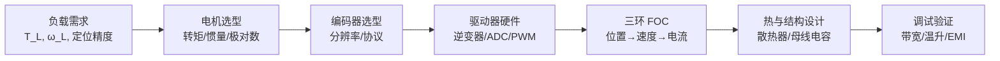
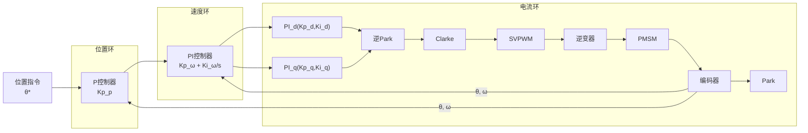

# 伺服驱动器设计

> **为什么学？**
> 伺服驱动器是 FOC 在工业自动化中最常见的落地方案。如果不理解带宽级联、编码器分辨率、惯量匹配和热设计，FOC 算法即便再正确，也会因选型或热裕量不足导致振荡、定位不准或功率器件过热损坏。
>
> **在 FOC 中的作用**
> 这一节把 FOC 电流环、速度环、位置环放到真实伺服产品中，说明规格如何分解为器件选型、控制参数与结构热设计，是算法到量产的桥梁。

FOC 的最终目标不是算出漂亮的 dq 轴电流，而是在给定负载、精度和散热条件下稳定输出期望转矩与位置。伺服驱动器设计正是把这些目标翻译成工程约束的过程。
---

下面这张图把伺服驱动器设计的完整链路串起来，帮助你在读公式前先建立“从负载需求到器件选型、控制参数、热设计”的系统视角。



*图：伺服驱动器设计链路——从负载需求到量产验证*

## 1. 规格定义：带宽 / 精度 / 过载

为什么要做这一步：先把伺服驱动器的性能指标量化成带宽、精度和过载能力，才能向下分配电流环、速度环、位置环的设计目标。

### 1.1 带宽定义与闭环传递函数

为什么要做这一步：通过闭环传递函数估算速度环带宽，确保外环带宽低于内环 10 倍以上，避免级联系统振荡。

伺服系统的带宽通常指**速度环带宽** $f_{bw}$，定义为闭环速度传递函数幅值衰减到 $-3\ \text{dB}$（约 $0.707$）时的频率。对于典型 PI 速度环，设电流环等效为一阶惯性环节：

$$G_i(s)=\frac{1}{T_i s+1}$$

速度环 PI 控制器：

$$G_v(s)=K_{p\omega}+\frac{K_{i\omega}}{s}$$

电机机械方程（忽略粘性摩擦）：

$$J\frac{d\omega}{dt}=T_e-T_L$$

其中电磁转矩 $T_e=K_t i_q$，$K_t$ 为转矩常数。开环传递函数为：

$$L(s)=G_v(s)\cdot G_i(s)\cdot\frac{K_t}{Js}$$

若采用**对称最优**（Symmetrical Optimum）整定，令积分时间 $T_i=4T_{\Sigma}$，$T_{\Sigma}$ 为电流环等效时间常数，可得速度环穿越频率：

$$\omega_{cv}=\frac{1}{2T_{\Sigma}}$$

近似速度环带宽：

$$f_{bw}\approx\frac{\omega_{cv}}{2\pi}=\frac{1}{4\pi T_{\Sigma}}$$

**数值示例**：若电流环带宽为 $1\ \text{kHz}$（$T_{\Sigma}\approx 1\ \text{ms}$），则速度环带宽设计为 $100\ \text{Hz}$（即 $10:1$ 级联关系），满足：

$$f_{bw}\approx\frac{1}{4\pi\times 0.001}\approx 79.6\ \text{Hz}$$

实际工程常取 $f_{bw}=50\sim 100\ \text{Hz}$，避免机械共振。

### 1.2 位置精度与分辨率

为什么要做这一步：编码器分辨率直接决定电角度估算和位置环稳态误差，必须在选型阶段就量化到机械/电角度。

位置环精度受编码器分辨率与机械传动误差双重制约。设编码器分辨率为 $N_{ppr}$（脉冲/转），电机极对数为 $p$，则电角度分辨率：

$$\Delta\theta_e=\frac{2\pi}{p\cdot N_{ppr}\cdot 4}$$

（注：正交解码 $4$ 倍频）。若采用 $17$ 位绝对值编码器（$N=131072$ 脉冲/转），$p=4$：

$$\Delta\theta_e=\frac{2\pi}{4\times 131072}\approx 11.9\ \mu\text{rad}$$

对应机械角度：

$$\Delta\theta_m=\frac{2\pi}{131072}\approx 47.9\ \mu\text{rad}$$

### 1.3 过载能力与热设计裕量

为什么要做这一步：短时过载是伺服常态，热模型校验确保峰值电流不会突破功率器件结温限制。

伺服驱动器通常要求 $3\times$ 过载 $1\ \text{s}$、$2\times$ 过载 $3\ \text{s}$。过载电流 $I_{ov}$ 与额定电流 $I_{rated}$ 的关系受 IGBT/MOSFET 结温限制：

$$T_j=T_a+(R_{th\_jc}+R_{th\_ch}+R_{th\_ha})\cdot P_{loss}$$

其中 $P_{loss}=P_{on}+P_{sw}$。过载期间允许瞬时结温 $T_{j\_max}=150\,^\circ\text{C}$，但 RMS 电流必须满足：

$$I_{rms}=\sqrt{\frac{I_{ov}^2\cdot t_{ov}+I_{rated}^2\cdot(T-t_{ov})}{T}}\leq I_{rated}$$

---

## 2. 几何直观：伺服系统级联结构



上图展示了**三环级联**（位置环→速度环→电流环）的典型架构。外环带宽必须远低于内环，以避免相位裕量恶化。工程经验：

- 电流环带宽：$f_{i\_bw} = 500\sim 2000\ \text{Hz}$
- 速度环带宽：$f_{\omega\_bw} = f_{i\_bw}/10 \sim 100\ \text{Hz}$
- 位置环带宽：$f_{\theta\_bw} = f_{\omega\_bw}/10 \sim 10\ \text{Hz}$

---

## 3. 选型：电机 / 驱动器 / 编码器

为什么要做这一步：FOC 算法再优秀，也需要电机、驱动器和编码器在功率、电压和分辨率上匹配，否则闭环性能受硬件瓶颈限制。

### 3.1 电机选型公式

为什么要做这一步：按负载转矩和惯量匹配电机，防止因惯量比过大导致速度环不稳定或定位超调。

负载转矩 $T_L$ 与转速 $\omega_L$ 确定后，电机额定转矩需满足：

$$T_{motor}\geq \frac{T_L}{\eta\cdot i_{gear}}$$

其中 $i_{gear}$ 为减速比，$\eta$ 为传动效率。若负载惯量 $J_L$，电机惯量 $J_m$，则惯量比：

$$R_J=\frac{J_L}{i_{gear}^2\cdot J_m}$$

**推荐惯量比**：$R_J \leq 5$（高精度应用 $R_J \leq 1$）。

### 3.2 驱动器功率选型

为什么要做这一步：母线电压必须覆盖高速反电动势并留 SVPWM 线性调制裕量，否则电流环饱和、电机达不到最高转速。

驱动器输出电压 $V_{dc}$ 与电机反电动势常数 $K_e$ 的关系：

$$V_{dc}\geq \sqrt{3}\cdot K_e\cdot \omega_{max}\cdot \frac{\sqrt{2}}{\sqrt{3}} + \text{裕量}$$

即：

$$V_{dc}\geq \sqrt{2}\cdot K_e\cdot \omega_{max}$$

### 3.3 编码器选型

| 应用类型 | 推荐分辨率 | 类型 | 协议 |
|---------|---------|------|------|
| 通用伺服 | $17\sim 20$ 位 | 增量/绝对 | BiSS-C / Tamagawa |
| 高精度 CNC | $23\sim 26$ 位 | 绝对光学 | EnDat 2.2 / HIPERFACE |
| 低成本 | $10\sim 12$ 位 | 增量 | 正交 A/B/Z |

---

## 4. 代码实现：三环级联 FOC 框架（C 语言）

```c
#include <stdint.h>
#include <math.h>

#define PI  3.14159265359f
#define SQRT3  1.73205080757f

/* PI 控制器结构体 */
typedef struct {
    float Kp, Ki;
    float integral, out_max, out_min;
} PI_Controller_t;

float PI_Update(PI_Controller_t *pi, float err, float dt) {
    pi->integral += err * dt;
    /* 抗饱和 */
    if (pi->integral > pi->out_max)  pi->integral = pi->out_max;
    if (pi->integral < pi->out_min)  pi->integral = pi->out_min;
    float out = pi->Kp * err + pi->Ki * pi->integral;
    if (out > pi->out_max)  out = pi->out_max;
    if (out < pi->out_min)  out = pi->out_min;
    return out;
}

/* 伺服 FOC 主中断（50 μs） */
void Servo_FOC_ISR(float theta, float omega, float I_a, float I_b, float V_dc) {
    static PI_Controller_t pi_pos = {100.0f, 0.0f, 20.0f, -20.0f};
    static PI_Controller_t pi_vel = {0.5f, 10.0f, 10.0f, -10.0f};
    static PI_Controller_t pi_id  = {20.0f, 200.0f, 0.9f*V_dc/SQRT3, -0.9f*V_dc/SQRT3};
    static PI_Controller_t pi_iq  = {20.0f, 200.0f, 0.9f*V_dc/SQRT3, -0.9f*V_dc/SQRT3};

    float dt = 50e-6f;
    float theta_ref = get_position_command();   /* 位置指令 */

    /* 位置环 */
    float err_pos = theta_ref - theta;
    float omega_ref = PI_Update(&pi_pos, err_pos, dt);

    /* 速度环 */
    float err_vel = omega_ref - omega;
    float Iq_ref = PI_Update(&pi_vel, err_vel, dt);
    float Id_ref = 0.0f;  /* Id=0 控制 */

    /* Clarke 变换 */
    float I_alpha = I_a;
    float I_beta  = (I_a + 2.0f*I_b) / SQRT3;  /* 等幅值变换 */

    /* Park 变换 */
    float cos_t = cosf(theta); float sin_t = sinf(theta);
    float I_d =  I_alpha * cos_t + I_beta * sin_t;
    float I_q = -I_alpha * sin_t + I_beta * cos_t;

    /* 电流环 */
    float V_d = PI_Update(&pi_id, Id_ref - I_d, dt);
    float V_q = PI_Update(&pi_iq, Iq_ref - I_q, dt);

    /* 逆 Park → SVPWM（简化输出） */
    float V_alpha = V_d * cos_t - V_q * sin_t;
    float V_beta  = V_d * sin_t + V_q * cos_t;

    SVPWM_Update(V_alpha, V_beta, V_dc);
}
```

---

## 5. 结构设计要点

### 5.1 功率板与驱动板分离

高功率伺服驱动器通常采用**功率板+控制板+接口板**三层结构：

- **功率板**：IGBT/MOSFET 模块、三相桥臂、直流母线电容、电流采样电阻、预充电/放电电路
- **控制板**：MCU/FPGA、ADC、编码器接口、通讯接口（EtherCAT/CanOpen）
- **接口板**：端子排、隔离、EMI 滤波、制动电阻接口

### 5.2 母线电容设计

为什么要做这一步：母线电容抑制逆变器开关纹波，容量不足会导致母线电压跌落、过流误动作和 EMI 恶化。

直流母线电容 $C_{dc}$ 用于抑制逆变器开关引起的电压纹波。经验公式：

$$C_{dc}\geq \frac{I_{ripple}}{8\cdot f_{sw}\cdot \Delta V_{dc}}$$

其中 $I_{ripple}$ 为纹波电流有效值，$\Delta V_{dc}$ 为允许电压波动（通常 $2\%\sim 5\%$）。例如 $I_{ripple}=10\ \text{A}$，$f_{sw}=10\ \text{kHz}$，$\Delta V_{dc}=5\ \text{V}$：

$$C_{dc}\geq\frac{10}{8\times 10000\times 5}=25\ \mu\text{F}$$

实际选型需加 $3\sim 5$ 倍裕量，并考虑薄膜电容的纹波电流能力。

---

## 6. 散热设计

### 6.1 热阻模型

为什么要做这一步：功率器件结温是可靠性瓶颈，热阻模型决定散热器尺寸、风冷/水冷方案及允许过载时间。

功率器件结温估算：

$$T_j=T_a+P_{loss}\cdot R_{th\_ja}$$

其中 $R_{th\_ja}=R_{th\_jc}+R_{th\_ch}+R_{th\_ha}$，典型值：

- $R_{th\_jc}$（结到壳）：$0.5\sim 2\ \text{K/W}$（IGBT模块）
- $R_{th\_ch}$（壳到散热器）：$0.2\sim 1\ \text{K/W}$（硅脂+垫片）
- $R_{th\_ha}$（散热器到环境）：$0.5\sim 5\ \text{K/W}$（取决于散热面积与风速）

**数值示例**：某 IGBT 模块 $P_{loss}=50\ \text{W}$，$T_a=40\,^\circ\text{C}$，$R_{th\_jc}=0.8\ \text{K/W}$，$R_{th\_ch}=0.5\ \text{K/W}$，$R_{th\_ha}=1.2\ \text{K/W}$：

$$T_j=40+50\times(0.8+0.5+1.2)=40+125=165\,^\circ\text{C}$$

超过 $150\,^\circ\text{C}$ 限制，需降低热阻或增大散热面积。

### 6.2 强制风冷与自然对流

- **自然对流**：$R_{th\_ha}\approx 5\sim 10\ \text{K/W}$，适用于 $<200\ \text{W}$
- **强制风冷**：$R_{th\_ha}\approx 0.5\sim 2\ \text{K/W}$，需配合风扇，考虑风道设计
- **水冷**：$R_{th\_ha}<0.2\ \text{K/W}$，适用于 $>5\ \text{kW}$ 伺服驱动器或电动汽车电驱

---

## 7. 常见错误与纠正

### 错误 1：惯量比过大导致速度环振荡

**现象**：速度阶跃响应出现持续振荡，超调 $>50\%$。
**原因**：负载惯量折算到电机轴后远大于电机惯量，速度环 PI 参数按小惯量设计，相位裕量不足。
**纠正**：
- 增加减速比以降低折算负载惯量
- 降低速度环带宽（降低 $K_{p\omega}$）
- 加入速度前馈或加速度前馈补偿
- 在速度环输出增加低通滤波器

### 错误 2：编码器分辨率不足导致低速爬行（cogging）

**现象**：电机低速运行时有明显抖动，位置环无法稳定。
**原因**：编码器分辨率低，导致速度估算量化误差大，在低速时速度环输入噪声等效为阶跃扰动。
**纠正**：
- 提高编码器分辨率（至少 $17$ 位）
- 采用 M/T 法或锁相环（PLL）进行速度估算，降低量化噪声
- 在速度环输入增加滤波器，但需补偿相位延迟
- 考虑使用 $23$ 位以上绝对值编码器用于直驱平台

---

## 8. 自测习题

**习题 1**：某伺服系统电机极对数 $p=4$，采用 $17$ 位增量编码器（正交 $4$ 倍频），电流环带宽 $1\ \text{kHz}$。按 $10:1$ 级联设计速度环带宽，求：

(1) 电角度最小分辨率 $\Delta\theta_e$（弧度）；
(2) 速度环带宽 $f_{\omega\_bw}$（Hz）；
(3) 若减速比 $i=10$，负载惯量 $J_L=0.1\ \text{kg}\cdot\text{m}^2$，电机惯量 $J_m=0.002\ \text{kg}\cdot\text{m}^2$，判断惯量比是否合适。

**答案**：
(1) $N_{ppr}=131072$，$4$ 倍频后每转 $524288$ 脉冲。电角度分辨率：
$$\Delta\theta_e=\frac{2\pi}{4\times 524288}=\frac{2\pi}{2097152}\approx 2.98\ \mu\text{rad}$$

(2) $f_{\omega\_bw}=f_{i\_bw}/10=100\ \text{Hz}$

(3) 折算负载惯量：
$$J_{L\_eq}=\frac{J_L}{i^2}=\frac{0.1}{100}=0.001\ \text{kg}\cdot\text{m}^2$$
惯量比：
$$R_J=\frac{J_{L\_eq}}{J_m}=\frac{0.001}{0.002}=0.5$$
$R_J<1$，惯量比合适，适合高精度定位。

**习题 2**：某 IGBT 模块总损耗 $P_{loss}=80\ \text{W}$，环境 $T_a=45\,^\circ\text{C}$，结温限制 $T_{j\_max}=150\,^\circ\text{C}$。若 $R_{th\_jc}=0.6\ \text{K/W}$，$R_{th\_ch}=0.4\ \text{K/W}$，求散热器最大允许热阻 $R_{th\_ha}$。

**答案**：
$$R_{th\_ja}=\frac{T_{j\_max}-T_a}{P_{loss}}=\frac{150-45}{80}=1.3125\ \text{K/W}$$
$$R_{th\_ha}=R_{th\_ja}-R_{th\_jc}-R_{th\_ch}=1.3125-0.6-0.4=0.3125\ \text{K/W}$$
需选用水冷或高性能强制风冷散热器。

---

## 9. 小结

伺服驱动器设计是 FOC 控制走向工程化的关键一步。其核心设计链路为：**负载分析 → 电机/编码器/驱动器选型 → 三环级联控制设计 → 热与结构设计 → 调试与验证**。带宽级联、惯量匹配和热阻约束是三条不可违背的物理红线，任何一步的妥协都将在最终动态性能或可靠性上付出代价。