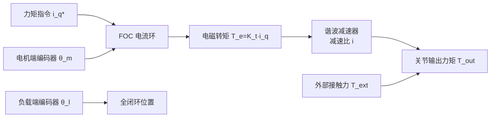
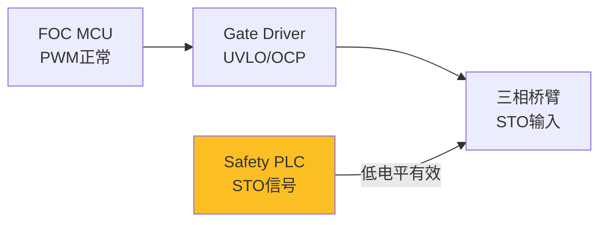

# 机器人关节模组

> **为什么学？**
> 机器人关节是 FOC 与精密传动、安全机制深度耦合的场景。如果不理解减速比折算、柔性关节共振、力矩估算与碰撞检测，FOC 电流环只能盲目输出转矩，无法保证末端精度，也无法在人机协作中安全停机。
>
> **在 FOC 中的作用**
> 这一节说明 FOC 输出的电磁转矩如何经过减速器变为关节力矩，以及如何用电流传感器/观测器实现力控和安全保护，是协作机器人执行层的核心。

机器人关节模组把 FOC 的“电机级”控制扩展到“关节级”力控与安全控制。理解它，才能知道 FOC 的转矩和电流指令在机械末端到底产生了什么效果。
---

这张图把 FOC 输出的电磁转矩如何经过谐波减速器变成关节力矩、以及电机端/负载端双编码器如何分别服务 FOC 和全闭环位置表达出来，帮助理解后续柔性模型与碰撞检测公式。



*图：机器人关节模组的力流与双编码器反馈*

## 1. 谐波减速器 + 电机一体化结构

为什么要做这一步：减速器把电机端的高速低转矩转换为关节端的低速高转矩，理解传动关系才能正确设置 FOC 的力矩和位置指令。

### 1.1 谐波减速器传动原理

为什么要做这一步：减速比决定电机与负载端的力矩、转速和惯量折算，是 FOC 指令映射到关节输出的基础。

谐波减速器（Harmonic Drive）由**波发生器（Wave Generator）**、**柔轮（Flexspline）**和**刚轮（Circular Spline）**组成。其传动比为：

$$i=\frac{\omega_{in}}{\omega_{out}}=\frac{N_{rigid}}{N_{rigid}-N_{flex}}$$

其中 $N_{rigid}$ 为刚轮齿数，$N_{flex}$ 为柔轮齿数。对于标准谐波减速器，齿差通常为 $2$，即：

$$i=\frac{N_{rigid}}{2}$$

常见型号：$N_{rigid}=100$、$120$、$160$ 等，对应减速比 $i=50$、$60$、$80$。

**几何直观**：

```
        刚轮（内齿，固定）
       ╭─────────────────╮
       │    ╭───────╮    │
       │   ╱ 柔轮   ╲   │
       │  │  (椭圆)  │  │
       │   ╲_______╱   │
       │      ↑ 波发生器  │
       ╰─────────────────╯

波发生器旋转 → 柔轮弹性变形 → 柔轮与刚轮啮合点移动 → 输出低速高转矩
```

### 1.2 无框力矩电机（Frameless Torque Motor）

关节模组常采用**无框力矩电机**，其定子与转子无外壳，直接嵌套于关节机械结构中：

- 转子：直接安装在谐波减速器输入轴（波发生器）上
- 定子：固定在关节外壳
- 气隙：$0.3\sim 0.5\ \text{mm}$，需高精度装配保证同心度

这种结构消除了联轴器、轴承和外壳，显著降低惯量与重量。典型关节模组密度可达 $30\sim 50\ \text{N}\cdot\text{m}/\text{kg}$。

### 1.3 双编码器配置

为什么要做这一步：电机端编码器用于 FOC 矢量控制，负载端编码器用于全闭环位置，双编码器关系决定传动误差补偿策略。

机器人关节通常配置**双编码器**：

- **电机端编码器**（输入端）：高分辨率（$20\sim 23$ 位），用于 FOC 矢量控制
- **负载端编码器**（输出端）：中等分辨率（$17\sim 20$ 位），用于全闭环位置控制

两者关系：

$$\theta_{load}=\frac{\theta_{motor}}{i}$$

若存在减速器柔性或摩擦，两端角度差反映传动误差：

$$\Delta\theta=\theta_{load}-\frac{\theta_{motor}}{i}$$

---

## 2. 力矩控制与刚度模型

为什么要做这一步：机器人关节不是刚性轴，建立柔性模型才能解释机械谐振，并正确限制力矩/速度环带宽。

### 2.1 柔性关节动力学模型

为什么要做这一步：柔性关节存在电机侧和负载侧两个惯量，动力学方程把电磁转矩、刚度与外部接触力联系起来。

考虑谐波减速器柔轮弹性，建立**柔性关节动力学方程**：

$$J_m\ddot{\theta}_m+b_m\dot{\theta}_m+K_s\left(\theta_m-\frac{\theta_l}{i}\right)=T_m$$

$$J_l\ddot{\theta}_l+b_l\dot{\theta}_l+T_{ext}=\frac{K_s}{i}\left(\theta_m-\frac{\theta_l}{i}\right)$$

其中：
- $J_m$、$J_l$：电机侧与负载侧惯量
- $K_s$：谐波减速器扭转刚度（$10^4\sim 10^6\ \text{N}\cdot\text{m}/\text{rad}$）
- $T_m$：电机电磁转矩
- $T_{ext}$：外部负载/接触力矩

### 2.2 转矩控制带宽

为什么要做这一步：力矩环带宽必须避开反共振/共振频率，否则会把机械谐振激发出来，导致抖动和噪声。

柔性关节的**固有频率**（反共振/共振对）为：

$$\omega_{ar}=\sqrt{\frac{K_s}{J_m}}\quad\text{（反共振频率）}$$

$$\omega_{r}=\sqrt{K_s\left(\frac{1}{J_m}+\frac{1}{i^2J_l}\right)}\quad\text{（共振频率）}$$

力矩控制带宽必须远低于 $\omega_{ar}$，否则激发机械共振。

**数值示例**：设 $K_s=5\times 10^4\ \text{N}\cdot\text{m}/\text{rad}$，$J_m=0.001\ \text{kg}\cdot\text{m}^2$，$i=80$，$J_l=1.0\ \text{kg}\cdot\text{m}^2$：

$$\omega_{ar}=\sqrt{\frac{5\times 10^4}{0.001}}=\sqrt{5\times 10^7}\approx 7071\ \text{rad/s}\approx 1125\ \text{Hz}$$

$$\omega_{r}=\sqrt{5\times 10^4\left(\frac{1}{0.001}+\frac{1}{6400\times 1.0}\right)}\approx\sqrt{5\times 10^7}\approx 7071\ \text{rad/s}$$

由于 $i^2J_l\gg J_m$，共振频率与反共振频率接近。实际力矩环带宽设计为 $50\sim 200\ \text{Hz}$，留 $5\sim 10$ 倍裕量。

### 2.3 转矩传感器 vs 电流估算

为什么要做这一步：选择力矩测量方式决定了 FOC 力控精度、成本和带宽，协作机器人常在电流估算与应变片之间权衡。

机器人关节力矩控制有两种技术路线：

| 方案 | 原理 | 精度 | 成本 | 带宽 |
|------|------|------|------|------|
| 电流估算 | $T_e=K_t\cdot i_q$（经减速比折算） | 中（$\pm 5\%$） | 低 | 高（电流环带宽） |
| 应变片转矩传感器 | 柔轮输出轴贴应变片 | 高（$\pm 0.5\%$） | 高 | 中（$1\sim 2\ \text{kHz}$） |

协作机器人普遍采用**电流估算**以降低成本，但需精确标定 $K_t$ 与摩擦补偿。

---

## 3. 碰撞检测

为什么要做这一步：协作机器人必须实时检测与环境的意外接触，并把检测结果反馈给 FOC 的安全关断逻辑。

### 3.1 基于动量观测器的碰撞检测

为什么要做这一步：动量观测器把碰撞力等效为扰动残差，无需额外力矩传感器即可实现毫秒级碰撞检测。

定义电机侧**广义动量**：

$$p=J_m\omega_m$$

其变化率应等于电机转矩与摩擦转矩之差。构建**动量观测器**：

$$\hat{r}=K_{obs}\left(p-\hat{p}\right)$$

$$\frac{d\hat{p}}{dt}=T_m-\hat{T}_{fric}-\hat{r}$$

其中 $\hat{r}$ 为扰动观测残差，$K_{obs}$ 为观测器增益。当机器人与环境碰撞时，$\hat{r}$ 突变：

$$|\hat{r}|>r_{threshold}\Rightarrow\text{触发碰撞保护}$$

### 3.2 基于转矩偏差的检测

为什么要做这一步：通过比较实际转矩与动力学估算转矩，可在低成本方案中实现碰撞检测，但阈值必须随速度自适应。

更简洁的方法：比较电机输出转矩与运动学估算转矩：

$$\Delta T=T_m-\left(J_m\ddot{\theta}_m+T_{fric}+T_{gravity}+T_{Coriolis}\right)$$

若 $|\Delta T|>T_{threshold}$，判定为碰撞。阈值需根据关节速度自适应：

$$T_{threshold}=T_{base}+k_v\cdot|\dot{\theta}_m|$$

以补偿速度相关的摩擦与建模误差。

---

## 4. 协作机器人安全

为什么要做这一步：FOC 输出的功率和力必须限制在安全标准以内，才能满足人机协作的法规要求。

### 4.1 功率与力限制（PFL）标准

为什么要做这一步：ISO/TS 15066 把人机接触力/功率限制在生物力学阈值内，是 FOC 转矩指令上限的安全来源。

ISO/TS 15066 规定人机协作时的**生物力学极限**：

| 身体部位 | 最大允许力（N） | 最大允许压强（N/cm²） |
|---------|---------------|----------------------|
| 头/颈 | $150$ | $150$ |
| 手 | $140$ | $210$ |
| 腿 | $260$ | $200$ |

机器人需通过**功率与力限制（PFL）**或**速度监控**确保满足上述极限。功率限制：

$$P=T\cdot\omega\leq P_{limit}$$

典型值：$P_{limit}=80\ \text{W}$（ISO/TS 15066 推荐值）。

### 4.2 安全扭矩关闭（STO）

STO（Safe Torque Off）是 IEC 61800-5-2 定义的安全关断功能：



当 STO 触发时，Gate Driver 的 PWM 输入被硬件切断，电机自由减速停止。STO 响应时间 $<1\ \text{ms}$，达到 SIL3 / PLe 等级。

---

## 5. 代码实现：关节力矩控制 + 碰撞检测（C 语言）

```c
#include <math.h>
#include <stdint.h>

#define J_MOTOR    0.001f   /* kg·m² */
#define K_T        0.2f    /* N·m/A */
#define I_GEAR     80.0f   /* 减速比 */
#define K_OBS      500.0f  /* 动量观测器增益 */
#define T_THRESH_BASE  0.5f /* N·m */
#define T_THRESH_VEL   0.02f /* N·m/(rad/s) */

typedef struct {
    float p_hat;       /* 估计动量 */
    float r_hat;       /* 扰动残差 */
    float omega_prev;  /* 上一次速度 */
} DisturbObserver_t;

void DisturbObserver_Init(DisturbObserver_t *obs) {
    obs->p_hat = 0.0f;
    obs->r_hat = 0.0f;
    obs->omega_prev = 0.0f;
}

float DisturbObserver_Update(DisturbObserver_t *obs, float T_m, float omega, float dt) {
    float p = J_MOTOR * omega;
    /* 简化摩擦模型（库仑+粘性） */
    float T_fric = 0.05f * copysignf(1.0f, omega) + 0.001f * omega;
    /* 观测器更新 */
    float dp_hat = T_m - T_fric - obs->r_hat;
    obs->p_hat += dp_hat * dt;
    obs->r_hat += K_OBS * (p - obs->p_hat) * dt;
    obs->omega_prev = omega;
    return obs->r_hat;
}

/* 关节力矩控制 + 碰撞检测 */
void Joint_Control_ISR(float theta_m, float omega_m, float I_q, float dt) {
    static DisturbObserver_t obs;
    static float integral = 0.0f;
    float T_m = K_T * I_q;               /* 电机电磁转矩 */
    float r = DisturbObserver_Update(&obs, T_m, omega_m, dt);

    /* 碰撞检测 */
    float T_thresh = T_THRESH_BASE + T_THRESH_VEL * fabsf(omega_m);
    if (fabsf(r) > T_thresh) {
        trigger_STO();                     /* 触发安全关断 */
        return;
    }

    /* 力矩控制：力矩指令 → Iq_ref */
    float T_cmd = get_torque_command();    /* 来自上层轨迹规划 */
    float Iq_ref = T_cmd / K_T;
    /* 低速力矩补偿：Iq_ref += T_fric_comp / K_T */
    /* 此后进入标准 FOC 电流环... */
}

void trigger_STO(void) {
    /* 硬件切断 PWM，置 STO 引脚低电平 */
    __disable_irq();
    PWM_Disable_All();
    GPIO_Set(STO_PIN, 0);
    __enable_irq();
}
```

---

## 6. 常见错误与纠正

### 错误 1：忽略减速器背隙导致定位误差

**现象**：换向时（正转→反转）出现 $2\sim 5$ 角分的空程误差，重复定位精度不达标。
**原因**：谐波减速器虽为**零背隙**设计，但柔轮弹性变形、轴承游隙和装配偏心仍会引入等效背隙。若仅用电机端编码器做全闭环，负载端真实位置存在滞后。
**纠正**：
- 在负载端加装编码器，实现**全闭环位置控制**
- 在控制器中增加**背隙补偿表**：根据方向和速度预先补偿固定角度偏移
- 采用双编码器差值监控减速器健康状态（磨损检测）

### 错误 2：碰撞检测阈值固定，导致高速误报或低速漏报

**现象**：机器人高速运动时频繁误触发碰撞保护；低速接触时却不触发。
**原因**：未考虑速度相关的摩擦和惯性力。固定阈值在低速时过于保守，高速时过于宽松。
**纠正**：
- 采用自适应阈值：$T_{threshold}=T_{base}+k_v|\dot{\theta}|+k_a|\ddot{\theta}|$
- 在关节学习模式（手拖示教）中记录摩擦力矩曲线，建立动态基线
- 设置多级阈值：预警级（减速）→ 保护级（STO）→ 紧急级（抱闸）

---

## 7. 自测习题

**习题 1**：某协作机器人关节采用谐波减速器，$N_{rigid}=100$，$N_{flex}=98$。无框电机极对数 $p=5$，额定转矩 $5\ \text{N}\cdot\text{m}$，关节输出额定转矩 $200\ \text{N}\cdot\text{m}$。求：

(1) 减速比 $i$；
(2) 若电机端编码器为 $23$ 位，负载端角度分辨率（角秒）；
(3) 若 $K_s=2\times 10^5\ \text{N}\cdot\text{m}/\text{rad}$，$J_m=0.0005\ \text{kg}\cdot\text{m}^2$，求反共振频率 $f_{ar}$（Hz）。

**答案**：
(1) $i=\frac{100}{100-98}=50$

(2) 电机端每转 $2^{23}=8388608$ 脉冲。负载端每转脉冲：
$$N_{load}=\frac{8388608}{50}=167772.16\ \text{脉冲/转}$$
负载端分辨率：
$$\Delta\theta_{load}=\frac{360\times 3600}{167772}\approx 7.7\ \text{角秒}$$

(3) $$f_{ar}=\frac{1}{2\pi}\sqrt{\frac{K_s}{J_m}}=\frac{1}{2\pi}\sqrt{\frac{2\times 10^5}{0.0005}}=\frac{1}{2\pi}\sqrt{4\times 10^8}\approx 3183\ \text{Hz}$$
力矩控制带宽应设计在 $300\sim 500\ \text{Hz}$ 以下。

**习题 2**：某关节模组采用电流估算力矩控制，$K_t=0.18\ \text{N}\cdot\text{m}/\text{A}$，实测 $I_q=3.0\ \text{A}$，电机端速度 $1000\ \text{rpm}$。已知减速比 $i=50$，机械传动效率 $\eta=0.85$。求负载端输出力矩 $T_{out}$。

**答案**：
电机电磁转矩：
$$T_e=K_t\cdot I_q=0.18\times 3.0=0.54\ \text{N}\cdot\text{m}$$
负载端输出力矩：
$$T_{out}=T_e\cdot i\cdot \eta=0.54\times 50\times 0.85=22.95\ \text{N}\cdot\text{m}$$

---

## 8. 小结

机器人关节模组是 FOC 控制技术的“集大成者”：

1. **机械集成**：无框电机 + 谐波减速器 + 双编码器，追求极致的转矩密度与精度
2. **力矩控制**：电流估算或转矩传感器，需在带宽、精度与成本间权衡
3. **碰撞检测**：动量观测器或转矩偏差法，阈值自适应是工程难点
4. **协作安全**：ISO/TS 15066 力/功率限制 + STO 硬件安全关断，缺一不可

关节模组的设计经验可直接迁移到任何需要“小而强”的执行器场景，如外骨骼、医疗机器人、精密云台等。