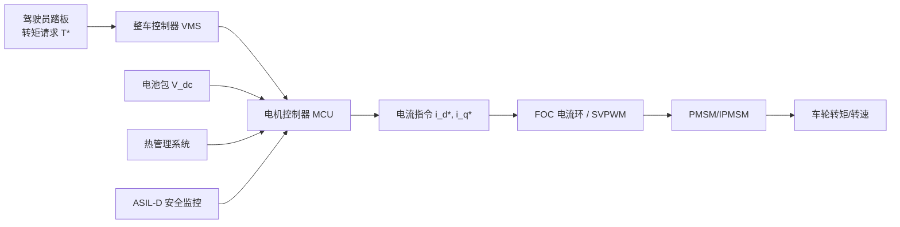
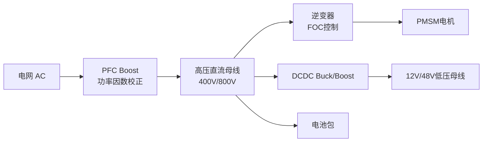

# 电动车电驱系统

> **为什么学？**
> 电动车电驱是大功率 FOC 最具挑战的工程场景之一。如果不理解电压平台、弱磁边界、峰值电流与热管理的关系，控制器会在高速区失控、器件过热或触发 ASIL 安全故障，甚至影响整车安全。
>
> **在 FOC 中的作用**
> 这一节把 FOC 电流环放到整车电驱系统中，说明母线电压、弱磁策略、转矩监控和热降额如何共同决定车辆的动力性、效率与功能安全。

FOC 在电驱里既要输出驾驶员请求的转矩，又必须在电池电压、电机温度和功能安全约束内运行。本节从系统层面把这些约束与 FOC 控制目标串起来。
---

这张图把驾驶员转矩请求到车轮动力之间的约束链画出来，帮助理解后续母线电压、弱磁、热管理和功能安全公式为什么必须同时满足。



*图：电动车电驱系统的多约束边界*

## 1. 功率等级与电池电压平台

为什么要做这一步：电压平台和峰值功率决定电机最高转速、弱磁深度和逆变器电流等级，是电驱 FOC 设计的顶层输入。

### 1.1 电压平台选择

为什么要做这一步：电池电压决定 SVPWM 线性调制区边界，进而限定基速和弱磁区最高转速。

| 车型 | 典型电压平台 | 峰值功率 | 电机类型 | 冷却方式 |
|------|-----------|---------|---------|---------|
| A00 微型车 | $200\sim 300\ \text{V}$ | $30\sim 50\ \text{kW}$ | 表贴式 PMSM | 液冷 |
| A/B 级轿车 | $350\sim 450\ \text{V}$ | $100\sim 200\ \text{kW}$ | 内置式 IPMSM | 液冷 |
| 800V 高端平台 | $600\sim 900\ \text{V}$ | $300\sim 500\ \text{kW}$ | 内置式 IPMSM | 油冷+水冷 |

母线电压 $V_{dc}$ 决定电机最高转速下的弱磁深度。对于 IPMSM，最大可用电压：

$$V_{max}=\frac{V_{dc}}{\sqrt{3}}$$

（SVPWM 线性调制区边界）。电机反电动势：

$$E_{ph,pk}=K_{e,m}\,\omega_m=\psi_f p\omega_m$$

这里 $K_{e,m}=p\psi_f$ 按“相反电动势峰值/机械角速度”定义。若使用线电压 RMS、V/krpm 等数据手册定义，必须先完成线/相、RMS/峰值和转速单位换算。

弱磁区上限转速满足：

$$\omega_{max}\approx\frac{V_{max}}{\sqrt{(L_d I_d+\psi_f)^2+(L_q I_q)^2}}$$

该式假设稳态、忽略定子电阻压降和逆变器非理想，并把 $I_d$、$I_q$ 视为给定工作点值。精确电压约束应使用 $u_d=R_s i_d-\omega_eL_qi_q$、$u_q=R_s i_q+\omega_e(L_di_d+\psi_f)$ 联立求解。

### 1.2 功率与电流设计

为什么要做这一步：峰值功率和基速决定电机峰值电流，是逆变器功率器件选型和电流环限幅的依据。

峰值功率 $P_{peak}$ 对应的电机峰值电流：

$$I_{q,peak}=\frac{P_{peak}}{K_t\,\omega_{base}}$$

其中 $K_t=\frac{3}{2}p\psi_f$ 是按本知识库等幅值 $q$ 轴峰值电流定义的 SPMSM 转矩常数，$\omega_{base}$ 为机械角速度。原公式不能在 $K_t$ 外再次乘 $3/2$；若 $K_t$ 按 RMS 电流定义，需先换算。

**数值示例**：某 $400\ \text{V}$ 平台轿车，$P_{peak}=150\ \text{kW}$，$\omega_{base}=3000\ \text{rpm}=314.16\ \text{rad/s}$，$K_t=1.2\ \text{N}\cdot\text{m}/\text{A}$：

$$I_{peak}=\frac{150000}{1.2\times 314.16}\approx 398\ \text{A}$$

这里的 $398\ \text{A}$ 只是理想化 $q$ 轴峰值电流估算，不能直接当成功率器件额定电流。器件选型还要换算相电流 RMS/峰值，评估调制工况、并联均流、结温、冷却条件、安全工作区、短路能力和开关损耗；裕量应由热设计与任务剖面验证，而不是固定取 1.5 倍。

---

## 2. 水冷系统与热管理

为什么要做这一步：大功率持续运行受绕组与逆变器温升限制，热管理决定电驱能否输出额定功率而不退磁或老化。

### 2.1 电机热模型

为什么要做这一步：一阶热模型把铜损、铁损与冷却条件联系起来，用于预测绕组温升并设计降额策略。

电机绕组温升可用一阶热模型描述：

$$C_{th}\frac{dT_w}{dt}=P_{Cu}-\frac{T_w-T_c}{R_{th\_wc}}$$

$$C_{th\_case}\frac{dT_c}{dt}=\frac{T_w-T_c}{R_{th\_wc}}+P_{Fe}-\frac{T_c-T_{cool}}{R_{th\_ca}}$$

其中：
- $P_{Cu}=3I^2R$：铜损
- $P_{Fe}$：铁损（涡流+磁滞）
- $R_{th\_wc}$：绕组到机壳热阻
- $R_{th\_ca}$：机壳到冷却液热阻
- $T_{cool}$：冷却液温度（通常 $40\sim 60\,^\circ\text{C}$）

### 2.2 冷却液流量计算

为什么要做这一步：根据损耗和允许温升计算最小冷却流量，防止过热导致永磁体退磁或绝缘失效。

带走热量所需的冷却液流量：

$$\dot{m}=\frac{P_{loss}}{c_p\cdot \Delta T}$$

其中 $c_p=4186\ \text{J}/(\text{kg}\cdot\text{K})$（水），$\Delta T=10\sim 15\,^\circ\text{C}$（进出口温差）。

**数值示例**：若电机与逆变器总损耗 $P_{loss}=8\ \text{kW}$，$\Delta T=10\,^\circ\text{C}$：

$$\dot{m}=\frac{8000}{4186\times 10}\approx 0.191\ \text{kg/s}=11.5\ \text{L/min}$$

---

## 3. 功能安全 ISO 26262

为什么要做这一步：电驱系统要求 ASIL C/D，必须把 FOC 的转矩输出置于独立监控和安全关断机制之下。

### 3.1 ASIL 等级与电机控制

电动汽车电驱系统通常要求 **ASIL C/D**，关键安全机制：

| 安全目标 | 功能 | ASIL | 实现方式 |
|---------|------|------|---------|
| 防止转矩意外增加 | 转矩监控 | D | 冗余转矩计算 + 硬件看门狗 |
| 防止非预期运动 | 转矩关闭 | D | STO + 冗余关断路径 |
| 防止过流损坏 | 过流保护 | C | 硬件比较器 + 软件校验 |
| 防止过热 | 温度监控 | B | NTC 多点 + 降额策略 |

### 3.2 转矩安全监控（Torque Security Monitor）

为什么要做这一步：监控单元独立校验 FOC 实际输出转矩与指令是否一致，偏差超限立即进入安全状态。

电机控制器 MCU 与监控芯片（如英飞凌 Aurix TC3xx 的 GTM+SCU）并行计算转矩指令：

$$T_{cmd}=K_t\cdot I_{q\_ref}$$

监控单元独立采样电流、独立计算实际转矩：

$$T_{actual}=K_t\cdot I_{q\_meas}$$

若偏差：

$$|T_{cmd}-T_{actual}|>T_{tol}$$

则触发安全状态（STO + 故障码）。容差 $T_{tol}$ 通常为 $5\%\sim 10\%$ 额定转矩。

---

## 4. OBC / DCDC 集成

为什么要做这一步：电驱系统不是孤立的，OBC/DCDC 与逆变器共用母线，理解集成关系才能设计整车能量流。

### 4.1 车载充电机（OBC）

OBC 将电网交流电转换为直流电为电池充电。与电驱系统共用母线，拓扑通常为：



### 4.2 DCDC 变换器

为什么要做这一步：双向 DCDC 把高压母线转换为低压蓄电池电压，其占空比与变压器匝比决定低压侧控制设计。

$400\ \text{V}/800\ \text{V}$ 母线经双向 DCDC 为 $12\ \text{V}$ 蓄电池和低压负载供电。拓扑常用**双有源桥（DAB）**：

$$V_{LV}=V_{HV}\cdot\frac{n\cdot D}{1-D}$$

其中 $n$ 为变压器匝比，$D$ 为移相占空比。效率目标 $>95\%$。

---

## 5. 代码实现：转矩安全监控 + 热降额（C 语言）

```c
#include <math.h>
#include <stdint.h>

#define K_T         1.5f     /* N·m/A */
#define T_RATED     200.0f   /* N·m */
#define T_NOMINAL   150.0f   /* N·m */
#define T_TOL       15.0f    /* N·m = 10% 额定 */
#define T_W_MAX     120.0f   /* 绕组温度限制 °C */
#define T_W_DERATE  100.0f   /* 开始降额 °C */
#define T_COOL      50.0f    /* 冷却液温度 °C */

/* 一阶热模型 */
typedef struct {
    float T_w;         /* 绕组温度 */
    float T_c;         /* 机壳温度 */
    float R_th_wc;     /* 绕组到机壳热阻 */
    float R_th_ca;     /* 机壳到冷却液热阻 */
    float C_th_w;      /* 绕组热容 */
    float C_th_c;      /* 机壳热容 */
} ThermalModel_t;

void ThermalModel_Update(ThermalModel_t *tm, float I_rms, float P_Fe, float dt) {
    float P_Cu = 3.0f * I_rms * I_rms * 0.01f;  /* 假设 R=10mΩ/相 */
    float dTw = (P_Cu - (tm->T_w - tm->T_c)/tm->R_th_wc) / tm->C_th_w;
    float dTc = ((tm->T_w - tm->T_c)/tm->R_th_wc + P_Fe - (tm->T_c - T_COOL)/tm->R_th_ca) / tm->C_th_c;
    tm->T_w += dTw * dt;
    tm->T_c += dTc * dt;
}

/* 转矩安全监控 */
float Torque_Safety_Monitor(float Iq_ref, float Iq_meas, float T_w) {
    float T_cmd = K_T * Iq_ref;
    float T_act = K_T * Iq_meas;
    if (fabsf(T_cmd - T_act) > T_TOL) {
        enter_safe_state();
        return 0.0f;
    }
    /* 热降额 */
    if (T_w > T_W_DERATE) {
        float derate = fmaxf(0.0f, 1.0f - (T_w - T_W_DERATE)/(T_W_MAX - T_W_DERATE));
        T_cmd *= derate;
    }
    if (T_w > T_W_MAX) {
        enter_safe_state();
        return 0.0f;
    }
    return T_cmd;
}

void enter_safe_state(void) {
    PWM_Disable_All();
    STO_Activate();
    Set_Fault_Code(FAULT_TORQUE_MISMATCH);
}
```

---

## 6. 常见错误与纠正

### 错误 1：弱磁切换点设计不当导致高速失控

**现象**：电机转速超过基速后，电流环饱和，电压指令超出 $V_{max}$，电流波形畸变，转速失控上升。
**原因**：弱磁控制切换点（$\omega_{base}$）计算未考虑温度引起的磁链衰减和电感饱和。高温下 $\psi_f$ 下降，实际基速降低，若按常温标定值切换，高速区 $I_d$ 注入不足。
**纠正**：
- 实时在线辨识 $\psi_f$ 与 $L_d$、$L_q$，动态修正弱磁切换点
- 采用电压反馈弱磁（Voltage Feedback Flux Weakening）：当 $V_{d}^2+V_{q}^2$ 接近 $V_{max}^2$ 时自动注入 $I_d$
- 在高温工况下预留 $10\%\sim 15\%$ 的弱磁电流裕量

### 错误 2：IGBT 死区导致低速转矩脉动

**现象**：车辆起步或低速爬行时，电机有明显抖动和异响，电流 THD 高。
**原因**：IGBT 死区时间（$2\sim 5\ \mu\text{s}$）在低压占空比时占比较大，导致输出电压严重畸变。低速时基波电压低，死区引起的谐波相对占比大。
**纠正**：
- 在线死区补偿：检测相电流极性，补偿丢失的电压脉冲
- 采用 SiC MOSFET，降低死区至 $0.5\sim 1\ \mu\text{s}$，从根本上减少死区影响
- 低速区采用 $5$ 段式 SVPWM 降低开关次数，或提高载波频率至 $10\sim 15\ \text{kHz}$

---

## 7. 自测习题

**习题 1**：某 $400\ \text{V}$ 平台电动车，电池包 $V_{dc}=400\ \text{V}$，电机极对数 $p=4$，永磁磁链 $\psi_f=0.08\ \text{Wb}$，$L_d=0.2\ \text{mH}$，$L_q=0.4\ \text{mH}$。SVPWM 线性调制区最大相电压：

$$V_{ph\_max}=\frac{V_{dc}}{\sqrt{3}}$$

求：

(1) 基速 $\omega_{base}$（rad/s），满足 $V_{ph\_max}=\omega_{base}\cdot\psi_f$；
(2) 若弱磁后 $I_d=-200\ \text{A}$，$I_q=300\ \text{A}$，求最高转速 $\omega_{max}$。

**答案**：
(1) $V_{ph\_max}=400/\sqrt{3}=230.9\ \text{V}$
$$\omega_{base}=\frac{230.9}{0.08}=2887\ \text{rad/s}\approx 27559\ \text{rpm}$$
（注：实际电机不会这么高，此处为简化参数示例）

(2) $$\omega_{max}=\frac{V_{ph\_max}}{\sqrt{(L_d I_d+\psi_f)^2+(L_q I_q)^2}}$$
代入：$L_d I_d=0.0002\times(-200)=-0.04\ \text{Wb}$，$L_d I_d+\psi_f=0.04\ \text{Wb}$；$L_q I_q=0.0004\times 300=0.12\ \text{Wb}$
$$\omega_{max}=\frac{230.9}{\sqrt{0.04^2+0.12^2}}=\frac{230.9}{0.1265}=1827\ \text{rad/s}$$

**习题 2**：某电驱系统逆变器总损耗 $P_{loss}=5\ \text{kW}$，冷却液比热容 $c_p=3500\ \text{J}/(\text{kg}\cdot\text{K})$（乙二醇水溶液），允许温升 $\Delta T=15\,^\circ\text{C}$。求冷却液最小质量流量（L/min）。水密度 $\rho=1000\ \text{kg}/\text{m}^3$。

**答案**：
$$\dot{m}=\frac{5000}{3500\times 15}=0.0952\ \text{kg/s}$$
体积流量：
$$Q=\frac{0.0952}{1000}\times 60\times 1000=5.71\ \text{L/min}$$

---

## 8. 小结

电动车电驱系统是 FOC 控制的“终极考场”：

1. **功率与电压**：$400\text{V}\to 800\text{V}$ 平台升级，SiC 器件支撑高效率与高频化
2. **热管理**：水冷系统必须同时覆盖电机绕组、逆变器模块与减速器轴承
3. **功能安全**：ASIL D 要求转矩安全监控、冗余关断、故障诊断三位一体
4. **系统集成**：OBC/DCDC/逆变器多合一趋势，降低重量与成本

电驱系统的工程经验（热模型、安全监控、弱磁策略）可直接迁移到任何大功率 FOC 应用，如电动船舶、轨道交通与航空电推进。
