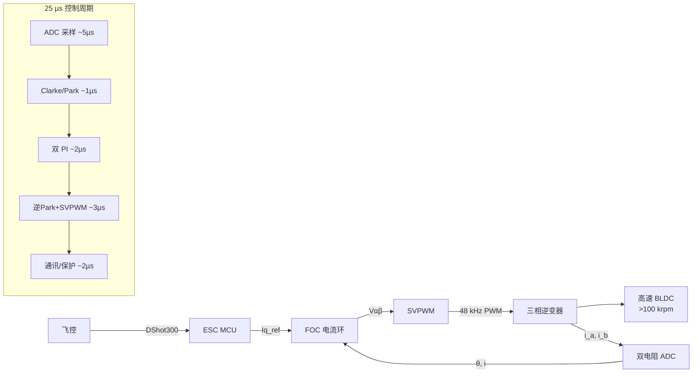
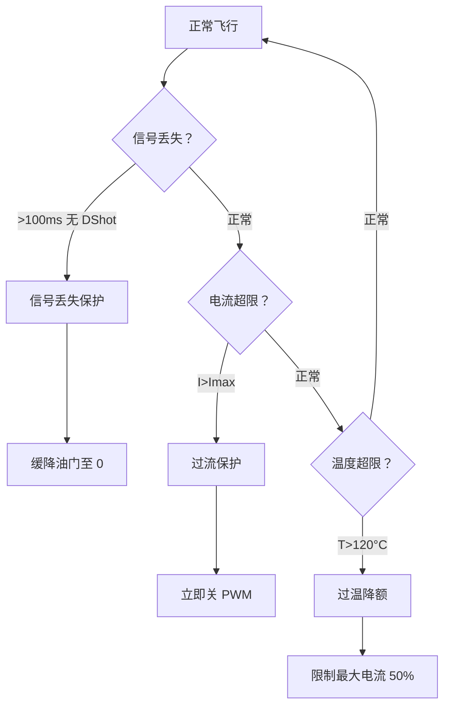

# 无人机电调 ESC

> **为什么学？**
> 无人机 ESC 是 FOC 在超高速、小电感、轻量化约束下的极限实现。如果不理解高转速对电流环带宽的要求、陶瓷电容直流偏置衰减、DShot 通讯与失效保护，FOC 算法会因采样失真或信号丢失导致电机失控炸机。
>
> **在 FOC 中的作用**
> 这一节说明 FOC 如何在极小体积和极短控制周期内驱动高速无刷电机，并把飞控油门指令安全、快速地转换为三相电流。

无人机 ESC 把 FOC 的“控制精度”压缩到克级重量和微秒级周期里。只有理解这些极限约束，才能明白 FOC 参数和采样设计为何如此激进。
---

这张图把飞控 DShot 指令如何变成电机相电流、以及控制周期里必须完成的关键步骤串起来，帮助理解高转速、小电感对 FOC 的极限要求。



*图：无人机 ESC 的高速 FOC 信号链与控制周期*

## 1. 轻量化设计

为什么要做这一步：无人机对重量极度敏感，ESC 的电容、MOSFET 和 PCB 设计必须在满足 FOC 性能的前提下尽量减重。

### 1.1 功率密度与减重策略

| 指标 | 消费级 ESC | 竞速/FPV ESC | 工业级 ESC |
|------|-----------|-------------|-----------|
| 功率密度 | $3\sim 5\ \text{kW/kg}$ | $8\sim 15\ \text{kW/kg}$ | $2\sim 4\ \text{kW/kg}$ |
| 持续电流 | $30\sim 60\ \text{A}$ | $50\sim 120\ \text{A}$ | $100\sim 400\ \text{A}$ |
| 重量 | $5\sim 15\ \text{g}$ | $3\sim 8\ \text{g}$ | $50\sim 200\ \text{g}$ |
| 控制算法 | 六步换向 / 简单 FOC | 高速 FOC | 全功能 FOC |

减重手段：
- **PCB 铜厚优化**：$2\sim 4\ \text{oz}$ 厚铜，直接作为功率走线与散热器
- **MOSFET 选型**：$R_{ds(on)}<1\ \text{m}\Omega$（如 Toshiba TPHR9003NL），$3\times 3\ \text{mm}$ 封装
- **去电解电容**：采用低 ESR 陶瓷电容阵列（$100\ \mu\text{F}\times 10$）替代大体积铝电解电容
- **集成 MCU+MOSFET 驱动**：如 TI MSPM0 + 集成预驱动器（DRV8313）

### 1.2 无电解电容母线设计

为什么要做这一步：陶瓷电容容量随直流偏置大幅衰减，必须按实际母线电压下的有效容量设计，否则母线纹波失控。

传统大容量电解电容（$100\sim 1000\ \mu\text{F}$）被陶瓷电容阵列取代：

$$C_{total}=n\cdot C_{unit}$$

例如 $10$ 颗 $22\ \mu\text{F}/50\text{V}$ X7R 陶瓷电容并联：$C_{total}=220\ \mu\text{F}$。但陶瓷电容的直流偏置特性导致实际容量衰减 $50\%\sim 70\%$，设计时必须按 $V_{dc}$ 下的有效容量计算：

$$C_{eff}=C_{nominal}\cdot (1-k_{derate})$$

---

## 2. 高转速（>100 krpm）控制

为什么要做这一步：超高速电机的电频率极高，FOC 电流环、采样和 PWM 频率必须同步提升才能稳定控制。

### 2.1 电角度频率与电流环约束

为什么要做这一步：高电频会压缩每个电周期内可用的 PWM 更新次数，并放大角度与计算延迟的相位误差。需要分别核算“每电周期更新次数”和“$dq$ 电流闭环带宽”，不能把二者混成固定的十倍关系。

电机转速 $n$（rpm）对应的电角度频率：

$$f_e=\frac{n\cdot p}{60}$$

对于 $p=1$（2 极）电机，$n=100000\ \text{rpm}$：

$$f_e=\frac{100000\times 1}{60}\approx 1667\ \text{Hz}$$

若希望每个电周期至少有 $N_{pwm}$ 次电压更新，则应满足：

$$f_{sw}\geq N_{pwm}f_e$$

例如取 $N_{pwm}=20$，需要 $f_{sw}\geq33.3\ \text{kHz}$。$N_{pwm}$ 的选择取决于允许电流纹波、调制误差、位置估计和损耗。同步 $dq$ 电流在稳态是近似直流量，其闭环带宽按转矩动态和延迟裕量选择，通常应显著低于采样/PWM 频率，而不是高于电频十倍。

### 2.2 超高速下的采样与更新

为什么要做这一步：控制周期由 PWM 频率决定，必须核算 ADC、Clarke/Park、PI、SVPWM 全部耗时，确保中断不超时。

若选用 $40\sim60\ \text{kHz}$ PWM，则在上述 $1667\ \text{Hz}$ 电频下每电周期约有：

$$N_{pwm}=\frac{f_{sw}}{f_e}\approx24\sim36$$

控制周期：

$$T_s=\frac{1}{f_{sw}}=16.7\sim 25\ \mu\text{s}$$

在一个控制周期内要完成采样、变换、控制、调制和占空比提交，但不能用脱离 ADC 配置、编译优化和 MCU 架构的固定微秒数或 MIPS 门槛。应通过定时器捕获或 GPIO 打点测量最坏执行时间，并把 ADC 建立时间、抢占、DMA 竞争、缓存抖动和 PWM 影子寄存器更新点纳入端到端延迟。

### 2.3 小电感电机的电流环挑战

为什么要做这一步：小电感使电流纹波增大，电气时间常数可能接近控制周期。PI 增益要按目标带宽和离散延迟设计，不能直接把 $1/T_s$ 当作闭环带宽。

无人机电机（$3\sim 6$ 寸）相电感极低：

$$L\approx 1\sim 10\ \mu\text{H}$$

电流环时间常数：

$$\tau_L=\frac{L}{R}\approx\frac{5\ \mu\text{H}}{0.05\ \Omega}=100\ \mu\text{s}$$

若控制周期 $T_s=25\ \mu\text{s}$，$\tau_L$ 仅为 $4T_s$，连续域近似需要谨慎。仍可使用经过离散验证的 PI，也可评估预测电流控制；选择取决于计算资源、参数敏感性和约束处理需求。带宽法初值为：

$$K_p=L\omega_c,\qquad K_i=R\omega_c$$

**数值示例**：$L=5\ \mu\text{H}$，$R=0.05\ \Omega$，$T_s=25\ \mu\text{s}$。若暂取 $f_c=2\ \text{kHz}$（$\omega_c=12566\ \text{rad/s}$）作为初值：

$$K_p=5\times10^{-6}\times12566\approx0.0628\ \Omega$$
$$K_i=0.05\times12566\approx628\ \Omega/\text{s}$$

该初值还必须放入含零阶保持、采样—更新延迟和电压限幅的离散模型检查；不能仅凭 $f_c/f_s=0.05$ 就宣称稳定。

---

## 3. DShot 协议

为什么要做这一步：DShot 是飞控与 ESC 的高速数字通讯标准，决定 FOC 的转矩指令刷新率和安全失效响应速度。

### 3.1 协议帧格式

为什么要做这一步：理解帧长度和波特率才能确定飞控更新率下是否能完整传输控制指令。

DShot 是无人机 ESC 的标准数字通讯协议，替代传统 PWM（$1\sim 2\ \text{ms}$）。DShot300 比特率：

$$R_{DShot300}=300\ \text{kbit/s}$$

每帧 $16$ 位，持续时间：

$$T_{frame}=\frac{16}{300\times 10^3}\approx 53.3\ \mu\text{s}$$

帧结构：

```
Bit 15-12:  Telemetry request (1 bit) + 3 reserved
Bit 11-0:   Throttle value (0 - 2047)
Bit 15-0:   CRC (4-bit XOR)
```

### 3.2 零位与壹位时序

| 位类型 | 高电平时间 | 低电平时间 | 总周期 |
|--------|----------|----------|--------|
| 0 | $T_0=\frac{5}{4}\cdot T_{bit}=4.17\ \mu\text{s}$ | $T_{bit}-T_0$ | $T_{bit}=3.33\ \mu\text{s}$ |
| 1 | $T_1=\frac{7}{4}\cdot T_{bit}=5.83\ \mu\text{s}$ | $T_{bit}-T_1$ | $T_{bit}=3.33\ \mu\text{s}$ |

（注：DShot300 中 $T_{bit}=1/300\text{k}=3.33\ \mu\text{s}$）

MCU 通过输入捕获（IC）或 SPI 从机模式接收 DShot 指令。

---

## 4. 失效保护

为什么要做这一步：无人机失控后果严重，ESC 必须在信号丢失、过流或过温时迅速安全地关闭或降功率。

### 4.1 多级保护策略



### 4.2 信号丢失保护（Signal Loss Protection）

为什么要做这一步：通讯中断后必须在 100~300 ms 内进入安全模式，防止电机保持高速旋转导致坠机。

当飞控与 ESC 通讯中断（如断线、干扰），ESC 必须在 $100\sim 300\ \text{ms}$ 内进入安全模式：

- **缓降（Soft Drop）**：油门在 $1\sim 2\ \text{s}$ 内线性降至 $0$，防止坠机姿态突变
- **即时关断（Cutoff）**：立即关闭 PWM，电机自由停转（竞速无人机常用，避免失控旋转）
- **续转（Keep Spinning）**：维持当前转速，适合固定翼（滑翔迫降）

---

## 5. 代码实现：极简高速 FOC + DShot 接收（C 语言）

```c
#include <stdint.h>
#include <math.h>

#define PWM_FREQ    48000     /* 48 kHz */
#define T_S         (1.0f/48000.0f)
#define L_PHASE     5.0e-6f   /* 5 μH */
#define R_PHASE     0.05f     /* 50 mΩ */
#define K_T         0.005f    /* N·m/A */
#define POLE_PAIRS  1

/* 极简 PI */
typedef struct { float Kp, Ki, sum, max; } PI_t;
float PI_run(PI_t *pi, float err) {
    pi->sum += err * T_S;
    if (pi->sum > pi->max) pi->sum = pi->max;
    if (pi->sum < -pi->max) pi->sum = -pi->max;
    float out = pi->Kp*err + pi->Ki*pi->sum;
    if (out > pi->max) out = pi->max;
    if (out < -pi->max) out = -pi->max;
    return out;
}

/* DShot 解码状态机 */
volatile uint16_t dshot_value = 0;
volatile uint8_t  dshot_valid = 0;

void DShot_Decode(uint16_t *timing_buf) {
    uint16_t frame = 0;
    for (int i=0; i<16; i++) {
        uint16_t t = timing_buf[i];
        frame <<= 1;
        if (t > 70) frame |= 1;  /* 1-bit: > 70 timer ticks @ 48MHz */
    }
    uint8_t crc = (frame ^ (frame>>4) ^ (frame>>8)) & 0x0F;
    if (crc == (frame & 0x0F)) {
        dshot_value = (frame >> 5) & 0x7FF;  /* 11-bit throttle */
        dshot_valid = 1;
    }
}

/* 50 μs 中断: 极简 FOC */
void ESC_FOC_ISR(float I_a, float I_b, float theta, float V_dc) {
    static PI_t pi_d = {L_PHASE/T_S, R_PHASE/T_S, 0.0f, 0.9f*V_dc/SQRT3};
    static PI_t pi_q = {L_PHASE/T_S, R_PHASE/T_S, 0.0f, 0.9f*V_dc/SQRT3};

    /* Clarke */
    float I_alpha = I_a;
    float I_beta  = (I_a + 2.0f*I_b)/SQRT3;

    /* Park */
    float c = cosf(theta), s = sinf(theta);
    float I_d =  I_alpha*c + I_beta*s;
    float I_q = -I_alpha*s + I_beta*c;

    /* 电流指令：DShot 油门 → Iq_ref */
    float throttle = (dshot_valid) ? (dshot_value / 2047.0f) : 0.0f;
    float Iq_ref = throttle * 50.0f;  /* 最大 50 A */
    float Id_ref = 0.0f;

    /* PI */
    float V_d = PI_run(&pi_d, Id_ref - I_d);
    float V_q = PI_run(&pi_q, Iq_ref - I_q);

    /* 逆 Park */
    float V_alpha = V_d*c - V_q*s;
    float V_beta  = V_d*s + V_q*c;

    /* 简化 SVPWM（或六步换向高速模式） */
    SVPWM_Fast(V_alpha, V_beta, V_dc);
}
```

---

## 6. 常见错误与纠正

### 错误 1：小电感电机高速时电流采样失真

**现象**：转速 $>60000\ \text{rpm}$ 后电流波形出现严重尖峰，FOC 失控，电机异响。
**原因**：相电感极小（$<5\ \mu\text{H}$），PWM 纹波电流大，ADC 采样时刻未对准电流中点，采样到开关噪声尖峰。
**纠正**：
- **三电阻采样**：每相独立采样，在 PWM 矢量零矢量中心点触发 ADC（中心对齐模式）
- **采样窗口偏移**：根据当前占空比动态调整 ADC 触发点，避开 MOSFET 开关瞬态
- **硬件 RC 滤波**：在采样电阻后加 $100\ \text{ns}$ 级 RC 低通（截止 $>1\ \text{MHz}$），滤除开关尖峰但保留基波

### 错误 2：DShot 信号丢失后电机不停止导致炸机

**现象**：飞控重启或通讯线松脱后，电机保持最后油门高速旋转，无人机不可控坠毁。
**原因**：ESC 未实现信号丢失超时检测，或超时时间过长（$>1\ \text{s}$）。
**纠正**：
- 按飞控更新率和整机安全分析设置丢帧计数与超时状态机；响应可以是立即关断、受控降推力或保持短时最后指令，不能固定套用 100 ms
- 只有飞控、ESC 和协议模式都支持双向遥测时，telemetry 请求/响应才能作为额外链路诊断；不能把单个 telemetry bit 等同于完整心跳机制
- 上电默认禁止驱动，经过有效零油门/解锁序列、传感器自检和故障清除后才允许输出；持续时间由飞控协议和安全需求定义，不固定为 300 ms

---

## 7. 自测习题

**习题 1**：某竞速无人机电机极对数 $p=1$，最高转速 $120000\ \text{rpm}$，相电感 $L=3\ \mu\text{H}$，电阻 $R=0.03\ \Omega$。采用 FOC 控制，PWM 频率 $48\ \text{kHz}$。求：

(1) 电角度频率 $f_e$（Hz）；
(2) 计算每电周期的 PWM 更新次数；若暂取电流环带宽 $f_c=2\ \text{kHz}$，按 $K_p=L\omega_c$、$K_i=R\omega_c$ 计算连续域 PI 初值，并给出 $f_c/f_{sw}$；
(3) 若电池 $V_{dc}=16.8\ \text{V}$（4S），SVPWM 线性区最大相电压 $V_{ph\_max}$，若 $\psi_f=0.001\ \text{Wb}$，求基速 $\omega_{base}$（rad/s）。

**答案**：
(1) $f_e=\frac{120000\times 1}{60}=2000\ \text{Hz}$

(2) 每电周期更新次数 $N_{pwm}=48000/2000=24$。取 $\omega_c=2\pi\times2000=12566\ \text{rad/s}$：
$$K_p=3\times10^{-6}\times12566\approx0.0377\ \Omega$$
$$K_i=0.03\times12566\approx377\ \Omega/\text{s}$$
且 $f_c/f_{sw}=2000/48000\approx0.0417$。这些只是连续域初值，仍需用实际延迟和离散模型验证。

(3) $V_{ph\_max}=16.8/\sqrt{3}=9.69\ \text{V}$
$$\omega_{base}=\frac{9.69}{0.001}=9690\ \text{rad/s}\approx 92470\ \text{rpm}$$

**习题 2**：DShot300 一帧含 $16$ 位，传输速率 $300\ \text{kbit/s}$。求单帧持续时间，并计算飞控在 $4\ \text{kHz}$ 控制频率下每帧间隔能否容纳完整 DShot 帧。

**答案**：
$$T_{frame}=\frac{16}{300000}=53.3\ \mu\text{s}$$
飞控 $4\ \text{kHz}$ 对应周期：
$$T_{fc}=\frac{1}{4000}=250\ \mu\text{s}$$
$250\ \mu\text{s}>53.3\ \mu\text{s}$，单看线速可以容纳。实际实现还要计入帧间隔、定时器资源和 DMA/中断调度；DShot 可由定时器、SPI 编码或其他外设配合 DMA 生成，不能假设所有平台都“不占用 CPU”。

---

## 8. 小结

无人机 ESC 是 FOC 控制的“极限运动”：

1. **轻量化**：陶瓷电容替代电解、厚铜 PCB 兼做散热器、$3\times 3\ \text{mm}$ MOSFET
2. **超高速**：$100\ \text{krpm}$ 要求 $>40\ \text{kHz}$ PWM 与 $>20\ \text{kHz}$ 电流环带宽
3. **小电感**：$1\sim 10\ \mu\text{H}$ 相电感对采样时刻、PI 参数和预测控制提出挑战
4. **数字协议**：DShot 替代 PWM，提供双向 telemetry 与毫秒级失效保护
5. **安全至上**：上电解锁、信号丢失缓降、过温过流多级保护，缺一不可

ESC 的设计经验是理解“约束驱动工程”的最佳案例：每一项性能提升（更高转速、更轻重量）都在压缩设计余量，唯有精确计算与极限优化才能兼得。
