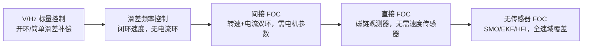

# 工业变频器

> **为什么学？**
> 工业变频器是 FOC 走向大规模应用的传统入口。如果不理解 V/Hz 的局限、低频 IR 补偿、能量回馈与谐波抑制，就无法判断何时该用简单标量控制、何时必须升级到 FOC，也难以通过 AFE 满足电网标准。
>
> **在 FOC 中的作用**
> 这一节把 FOC 与电网侧、负载侧和能量流联系起来，说明矢量控制如何替代 V/Hz 提升转矩性能，以及再生能量与谐波如何管理系统级设计。

工业变频器面对的是风机、泵、提升机等通用负载，FOC 的引入不是为了炫技，而是在成本、能效和电网合规之间找到最佳控制策略。
---

## 1. V/Hz 控制到矢量控制升级

为什么要做这一步：工业变频器往往从 V/Hz 起步，明确升级路径才能在成本与性能之间选择最合适的控制策略。

### 1.1 V/Hz 控制原理与局限

为什么要做这一步：V/Hz 是最简单的变频器控制方式，搞清它的电压频率关系才能理解 FOC 升级解决了什么问题。

传统 V/Hz 控制保持电压与频率比值恒定：

$$\frac{V}{f}=\frac{V_{rated}}{f_{rated}}=\text{const}$$

基频以下恒转矩区，基频以上恒功率区（弱磁）。其电压方程：

$$V_s\approx\sqrt{(R_sI_s)^2+(\omega_e\psi_s)^2}$$

忽略 $R_s$（大功率电机 $R_s$ 小）：

$$V_s\approx\omega_e\psi_s\propto f$$

**局限**：
- 低频时 $R_s$ 压降占比增大，需转矩提升（Torque Boost）补偿
- 无转矩闭环，动态响应慢（$>100\ \text{ms}$）
- 无法独立控制励磁与转矩，低速带载能力差

### 1.2 矢量控制升级路径

从 V/Hz 升级到 FOC 的技术路径：



![[14-FOC-电机控制/assets/mathworks_acim_foc_arch.png|1500]]
*图：感应电机（ACIM）FOC 典型架构——速度环、电流环、磁链观测器与逆变器协同工作（来源：MathWorks）*

### 1.3 升级的经济性考量

| 控制方式 | 硬件成本增加 | 性能提升 | 适用场景 |
|---------|-----------|---------|---------|
| V/Hz | 基准 | 低速 $1:10$ | 风机、泵 |
| 滑差频率 | +$10\%$ | 低速 $1:20$ | 传送带 |
| 间接 FOC | +$30\%$ | 低速 $1:100$，动态快 | 提升机 |
| 直接 FOC | +$50\%$ | 零速满转矩，$1:1000$ | 轧机、卷绕 |

对于 $>75\ \text{kW}$ 的泵/风机，变频本身已节能 $30\%\sim 50\%$，升级到 FOC 的增量成本回收期 $<1$ 年。

---

## 2. 数学推导：V/Hz 到 FOC 的转矩提升

为什么要做这一步：通过定量对比 V/Hz 与 FOC 的转矩控制精度，才能评估升级带来的性能收益。

### 2.1 V/Hz 低频补偿

为什么要做这一步：低频时定子电阻压降不可忽略，若不补偿会导致气隙磁通减弱、启动转矩不足。

定子电压方程：

$$\vec{V}_s=R_s\vec{I}_s+\frac{d\vec{\psi}_s}{dt}$$

稳态时，$\frac{d\vec{\psi}_s}{dt}=j\omega_e\vec{\psi}_s$，且 $\psi_s\approx L_m I_m$（$I_m$ 为励磁电流）。则：

$$V_s=\sqrt{(R_sI_s)^2+(\omega_eL_mI_m)^2}$$

若按严格 V/Hz，$\omega_eL_mI_m=k\cdot f$。当 $f\to 0$ 时，$V_s\to 0$，但为维持 $I_m$ 需：

$$V_{boost}=R_sI_s$$

即**IR 补偿**：

$$V_{cmd}=k\cdot f+R_sI_s$$

**数值示例**：$R_s=0.5\ \Omega$，$I_{rated}=10\ \text{A}$，$f=5\ \text{Hz}$（额定 $50\ \text{Hz}$）：

严格 V/Hz：$V_{cmd}=\frac{380}{50}\times 5=38\ \text{V}$
IR 补偿后：$V_{cmd}=38+0.5\times 10=43\ \text{V}$

补偿 $5\ \text{V}$（$13\%$），否则励磁不足导致转矩下降。

### 2.2 矢量控制的转矩精度提升

为什么要做这一步：FOC 把励磁与转矩电流解耦后，转矩只由 i_q 决定，控制精度从 V/Hz 的 10%~20% 提升到 ±1%。

FOC 下电磁转矩：

$$T_e=\frac{3}{2}p\left(\psi_d i_q-\psi_q i_d\right)=\frac{3}{2}p\frac{L_m}{L_r}\psi_r i_q$$

（转子磁链定向）。转矩与 $i_q$ 成正比，控制精度由电流环决定，可达 $\pm 1\%$，远超 V/Hz 的 $\pm 10\%\sim 20\%$。

---

## 3. 能量回馈与再生制动

为什么要做这一步：电机减速或提升重物时进入发电状态，必须决定把再生能量消耗掉还是回馈电网。

### 3.1 传统制动方式：能耗制动

为什么要做这一步：能耗制动是最简单的能量处理方式，计算制动能量和功率才能正确选型制动电阻。

当电机进入发电模式（$|\omega|>|\omega_{synch}|$ 或减速时），动能转化为电能回馈至直流母线，导致 $V_{dc}$ 上升。传统方案通过**制动电阻**耗散：

$$P_{brake}=\frac{V_{dc}^2}{R_{brake}}$$

制动电阻功率：

$$P_{rated}=\frac{E_{kin}}{t_{brake}}=\frac{\frac{1}{2}J\omega^2}{t_{brake}}$$

**数值示例**：$J=5\ \text{kg}\cdot\text{m}^2$，$\omega=1500\ \text{rpm}=157\ \text{rad/s}$，$t_{brake}=2\ \text{s}$：

$$E_{kin}=\frac{1}{2}\times 5\times 157^2=61622\ \text{J}$$
$$P_{rated}=\frac{61622}{2}=30811\ \text{W}\approx 31\ \text{kW}$$

需 $31\ \text{kW}$ 制动电阻，体积大、发热严重。

### 3.2 能量回馈：有源前端（AFE）

为什么要做这一步：AFE 把再生电能回馈电网，需要建立电网侧 d/q 电流模型以实现单位功率因数和稳定母线。

有源前端（Active Front End, AFE）将逆变器桥臂替换为 IGBT 双向桥，发电时能量回馈电网：

```
电网 AC → AFE (IGBT整流+PWM) → DC母线 → 逆变器 → 电机
                              ↓
                         再生时反向
```

AFE 控制目标：
- 直流母线电压稳定：$V_{dc}=V_{dc\_ref}$
- 电网侧功率因数 $=1$：$i_d\_grid=0$（无功为零），$i_q\_grid$ 控制有功

电网侧电流环（d 轴定向于电网电压）：

$$v_d=R_gi_d+L_g\frac{di_d}{dt}-\omega_gL_gi_q+e_d$$
$$v_q=R_gi_q+L_g\frac{di_q}{dt}+\omega_gL_gi_d+e_q$$

其中 $e_d=E_{grid}$，$e_q=0$。通过 PI 控制 $i_d=0$、$i_q=P_{regen}/E_{grid}$，实现单位功率因数回馈。

---

## 4. 电网谐波抑制

为什么要做这一步：变频器并网必须满足谐波标准，否则会影响电网质量并导致认证失败。

### 4.1 谐波来源

为什么要做这一步：二极管整流产生大量低次谐波，先估算 THD 才能确定是否需要 AFE 或额外滤波器。

传统二极管整流前端产生谐波电流：

$$I_h=\frac{I_1}{h}\quad(h=5,7,11,13,\dots)$$

THD 典型值 $30\%\sim 40\%$，不满足 IEEE 519 / GB/T 14549 标准（THD $<5\%$）。

### 4.2 AFE 谐波抑制

AFE 通过 PWM 整流，网侧电流近似正弦：

$$THD_{AFE}<3\%\sim 5\%$$

其谐波频谱集中在开关频率附近（$f_{sw}\pm f_{grid}$），通过小容量 LCL 滤波器即可滤除。

### 4.3 LCL 滤波器设计

为什么要做这一步：LCL 滤波器抑制 AFE 开关谐波，其谐振频率必须避开基波和开关频率，否则并网振荡。

LCL 滤波器传递函数：

$$G_{LCL}(s)=\frac{1}{L_1L_2C_fs^2+(L_1+L_2)s}$$

谐振频率：

$$f_{res}=\frac{1}{2\pi}\sqrt{\frac{L_1+L_2}{L_1L_2C_f}}$$

设计约束：

$$10\cdot f_{grid}<f_{res}<\frac{1}{2}f_{sw}$$

例如 $f_{grid}=50\ \text{Hz}$，$f_{sw}=10\ \text{kHz}$：

$$500\ \text{Hz}<f_{res}<5000\ \text{Hz}$$

取 $f_{res}=1500\ \text{Hz}$，选 $L_1=1\ \text{mH}$，$L_2=0.5\ \text{mH}$，则：

$$C_f=\frac{L_1+L_2}{(2\pi f_{res})^2L_1L_2}=\frac{0.0015}{(2\pi\times 1500)^2\times 0.001\times 0.0005}\approx 33.8\ \mu\text{F}$$

---

## 5. 代码实现：V/Hz + IR 补偿 + AFE 电流控制（MATLAB/C 伪代码）

```matlab
%% V/Hz + IR 补偿控制
function V_cmd = VHz_Control(f_cmd, I_s, R_s, V_rated, f_rated)
    V_base = V_rated * (f_cmd / f_rated);      % 基础 V/Hz
    V_boost = R_s * abs(I_s);                  % IR 补偿
    V_cmd = V_base + V_boost;
    if V_cmd > V_rated * 1.1
        V_cmd = V_rated * 1.1;                 % 限制过压
    end
end

%% AFE 电网侧电流控制（C 伪代码）
void AFE_Current_Control(float V_d, float V_q, float I_d, float I_q, float E_grid, float omega_g) {
    static float int_d=0, int_q=0;
    float Kp = 2.0f, Ki = 200.0f;
    float L_g = 0.002f;   /* 电网电感 2 mH */
    float R_g = 0.01f;    /* 线路电阻 */

    /* 解耦 + PI */
    float err_d = 0.0f - I_d;   /* 目标 Id=0 (单位功率因数) */
    float err_q = I_q_ref - I_q;  /* Iq_ref 由直流母线电压环给出 */
    int_d += err_d * T_s;
    int_q += err_q * T_s;

    float V_d_cmd = E_grid - omega_g*L_g*I_q + Kp*err_d + Ki*int_d;
    float V_q_cmd =          omega_g*L_g*I_d + Kp*err_q + Ki*int_q;

    /* SPWM 调制输出 */
    SPWM_Update(V_d_cmd, V_q_cmd, V_dc);
}
```

---

## 6. 常见错误与纠正

### 错误 1：V/Hz 转矩提升过度导致低频过流

**现象**：电机启动或低频运行时变频器报过流，电流波形峰值远超额定值。
**原因**：IR 补偿电压 $V_{boost}=R_sI_s$ 中 $I_s$ 为估算值或固定值，实际电机温度变化导致 $R_s$ 增大（铜电阻温度系数 $+0.393\%/\text{K}$）。低温启动时 $R_s$ 小，补偿不足；高温运行时 $R_s$ 大，补偿过度导致磁饱和过流。
**纠正**：
- 在线测量 $R_s$ 并实时修正 IR 补偿
- 采用 V/Hz 曲线自适应：根据电流反馈自动修正 $V_{cmd}$ 以维持 $I_m$ 恒定
- 升级到 FOC，从根本上通过电流闭环消除 IR 补偿问题

### 错误 2：AFE 并网时谐振导致过流跳闸

**现象**：AFE 变频器并网瞬间 LCL 滤波器谐振，网侧电流剧烈振荡，过流保护动作。
**原因**：LCL 滤波器存在谐振峰，若电网阻抗与滤波器参数匹配，阻尼不足时谐振放大。
**纠正**：
- 在 LCL 电容支路串联阻尼电阻 $R_d$（$0.5\sim 2\ \Omega$），牺牲少量效率换取稳定性
- 采用有源阻尼控制：在电流环中引入 $R_d$ 的虚拟阻抗，无需物理电阻
- 精确计算谐振频率，确保 $f_{res}$ 远离电网谐波频率（$250\ \text{Hz}$、$350\ \text{Hz}$ 等）

---

## 7. 自测习题

**习题 1**：某 $380\text{V}/50\text{Hz}$ 三相感应电机，$R_s=0.8\ \Omega$，$I_{rated}=15\ \text{A}$。采用 V/Hz 控制，运行频率 $f=10\ \text{Hz}$。求：

(1) 严格 V/Hz 时的电压指令；
(2) 考虑 IR 补偿后的电压指令；
(3) 若温度升高 $60\,^\circ\text{C}$，$R_s$ 变为多少？此时 IR 补偿电压。

**答案**：
(1) $V_{cmd}=380\times\frac{10}{50}=76\ \text{V}$

(2) $V_{boost}=0.8\times 15=12\ \text{V}$，$V_{cmd}=76+12=88\ \text{V}$

(3) $R_s(T)=R_s(25)\cdot(1+0.00393\times 60)=0.8\times 1.236=0.989\ \Omega$
$V_{boost}=0.989\times 15=14.8\ \text{V}$，$V_{cmd}=90.8\ \text{V}$。若仍按原 $12\ \text{V}$ 补偿，励磁不足，转矩下降约 $12\%$。

**习题 2**：某 AFE 变频器，$f_{grid}=50\ \text{Hz}$，$f_{sw}=8\ \text{kHz}$，$L_1=2\ \text{mH}$，$L_2=1\ \text{mH}$。设计 LCL 谐振频率 $f_{res}=2\ \text{kHz}$，求滤波电容 $C_f$。

**答案**：
$$C_f=\frac{L_1+L_2}{(2\pi f_{res})^2L_1L_2}=\frac{0.003}{(2\pi\times 2000)^2\times 0.002\times 0.001}$$
$$C_f=\frac{0.003}{1.579\times 10^8\times 2\times 10^{-6}}=\frac{0.003}{315.8}=9.5\ \mu\text{F}$$
取标准值 $10\ \mu\text{F}$。

---

## 8. 小结

工业变频器是 FOC 控制技术“最接地气”的工程应用：

1. **控制升级**：V/Hz → FOC 的升级路径需权衡成本与性能，$>75\ \text{kW}$ 场景 FOC 回报显著
2. **能量回馈**：AFE 技术将再生能量回馈电网，替代能耗制动，节能 $>30\%$
3. **谐波抑制**：LCL 滤波器 + AFE 单位功率因数控制，满足电网接入标准
4. **可靠性优先**：工业场景对 MTBF（$>50000$ 小时）要求极高，热设计、器件选型与保护逻辑是核心

变频器的设计经验是理解“电力电子系统级思维”的必修课：它同时涉及电机控制、电网接口、热管理与 EMC，是 FOC 工程师从“算法开发者”向“系统工程师”进阶的关键桥梁。