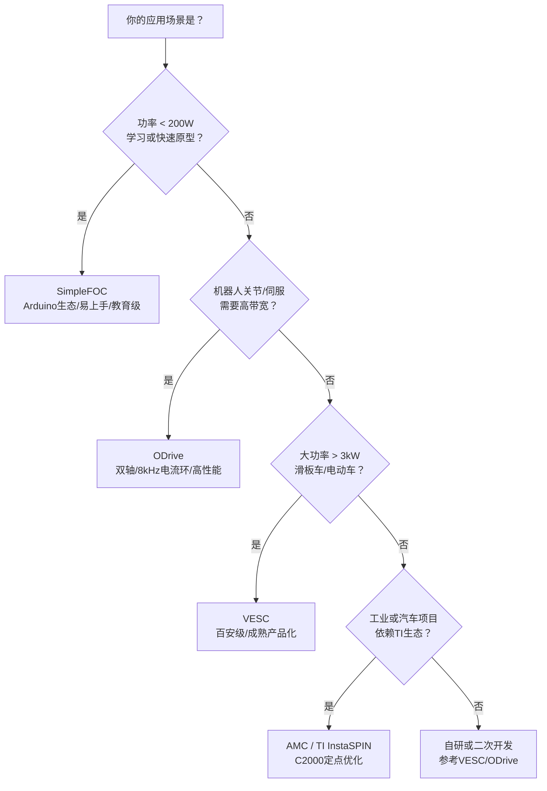

# 开源项目对比

> **为什么学？**
> 自己从零写 FOC 很容易在坐标变换、SVPWM、电流采样、保护逻辑上走弯路。如果不了解主流开源项目的架构取舍和适用场景，就会选错参考实现，导致代码移植困难、性能不达标或硬件不兼容。
>
> **在 FOC 中的作用**
> 本节是整个专题的“参考实现库”。它把 SimpleFOC、ODrive、VESC 等项目的定位、性能、硬件支持讲清楚，帮助你在学习原型和工程落地之间做出选择，并为阅读源码提供入口。

下面先建立一个量化评估模型，把代码可维护性、实时性能、硬件支持等维度统一打分；随后结合典型开源项目的架构与代码片段，说明不同场景下该选哪个项目作为学习或移植对象。

这张决策树按功率、性能需求和生态依赖，把五个主流开源项目映射到典型应用场景，避免“Star 最多就最好”的选型误区。



*图：FOC 开源项目选型决策树。从功率和场景出发，快速锁定 SimpleFOC、ODrive、VESC 或 AMC 等参考实现。*

## 1. 概述

FOC（磁场定向控制）的开源实现极大降低了电机控制的学习门槛。本章对比五个主流开源项目：**SimpleFOC**、**ODrive**、**VESC**、**MMC（Motor Model Control）**、**AMC（Advanced Motor Control）**，从架构、硬件支持、性能指标、社区活跃度四个维度进行量化评估。

---

## 2. 数学推导：加权综合评分模型

为什么要做这一步：开源项目数量多、定位差异大，仅凭 Star 数或口碑容易选错。用加权评分模型把“能否满足你的 FOC 目标”拆成可比较指标，才能避免把教育级代码用在大功率工业场景，或把工业级项目用在学习板子上。

为客观对比多个开源项目，建立**加权综合评分模型**。设评估维度为 $j \in \{1,2,\dots,m\}$，项目 $i$ 在维度 $j$ 的得分为 $s_{ij}$，权重为 $w_j$，则综合评分：

$$
S_i = \sum_{j=1}^{m} w_j \cdot s_{ij}
$$

维度权重由 AHP（层次分析法）确定。构造判断矩阵 $A$，元素 $a_{jk}$ 表示维度 $j$ 相对于维度 $k$ 的重要性。一致性检验：

$$
CI = \frac{\lambda_{\max} - m}{m - 1}, \quad CR = \frac{CI}{RI}
$$

当 $CR < 0.1$ 时通过一致性检验。对于 5 个维度，$RI = 1.12$。

**维度定义与权重**（经 AHP 计算）：

| 维度 | 权重 $w_j$ | 说明 |
|------|------------|------|
| 代码可维护性 | 0.25 | 模块化、文档、API 稳定性 |
| 硬件支持广度 | 0.20 | 支持的平台、驱动器、编码器种类 |
| 实时性能 | 0.20 | 控制周期、CPU 占用、PWM 分辨率 |
| 功能完整性 | 0.20 | FOC/无传感器/参数辨识/上位机支持 |
| 社区活跃度 | 0.15 | GitHub Stars、贡献者、Issue 响应 |

---

## 3. 几何直观：雷达图对比

```
                    代码可维护性 (0.25)
                           |
                     5 ----|---- 5
                    /  \   |   /  \
                   /    \  |  /    \
            硬件支持 4    \ | /    4 实时性能
            (0.20)        \|/        (0.20)
                         / \
                        /   \
            社区活跃度 3 ----- 3 功能完整性
              (0.15)         (0.20)

            SimpleFOC 雷达图示意（5维评分）
```

使用 Python matplotlib 可绘制更精确的雷达图：

```python
import numpy as np
import matplotlib.pyplot as plt

# 五维评分（满分5分）
categories = ['代码可维护性', '硬件支持', '实时性能', '功能完整性', '社区活跃度']
N = len(categories)

projects = {
    'SimpleFOC': [4.5, 4.0, 3.0, 3.5, 4.5],
    'ODrive':    [3.5, 3.5, 4.5, 4.5, 3.5],
    'VESC':      [3.0, 4.5, 4.5, 4.0, 4.0],
    'MMC':       [2.5, 2.0, 3.5, 3.0, 2.0],
    'AMC':       [3.0, 2.5, 4.0, 3.5, 2.5]
}

angles = np.linspace(0, 2*np.pi, N, endpoint=False).tolist()
angles += angles[:1]

fig, ax = plt.subplots(figsize=(8,8), subplot_kw=dict(polar=True))
for name, scores in projects.items():
    scores += scores[:1]
    ax.plot(angles, scores, 'o-', linewidth=2, label=name)
    ax.fill(angles, scores, alpha=0.1)

ax.set_xticks(angles[:-1])
ax.set_xticklabels(categories)
ax.set_ylim(0, 5)
ax.legend(loc='upper right', bbox_to_anchor=(1.3, 1.1))
plt.title('FOC 开源项目五维对比')
plt.savefig('foc_radar.png', dpi=150, bbox_inches='tight')
plt.show()
```

---

## 4. 数值示例：综合评分计算

为什么要做这一步：评分模型只有落实到具体数字才有指导意义。下面以 SimpleFOC 为例计算综合得分，再横向对比所有项目，帮助你根据“学习/伺服/大功率/工业”场景快速锁定参考对象。

以 SimpleFOC 为例，给定五维原始得分 $s_{1j} = [4.5, 4.0, 3.0, 3.5, 4.5]$，计算综合评分：

$$
S_{SimpleFOC} = 0.25 \times 4.5 + 0.20 \times 4.0 + 0.20 \times 3.0 + 0.20 \times 3.5 + 0.15 \times 4.5
$$
$$
= 1.125 + 0.800 + 0.600 + 0.700 + 0.675 = 3.900
$$

同理计算所有项目：

| 项目 | 代码可维护性 | 硬件支持 | 实时性能 | 功能完整性 | 社区活跃度 | 综合评分 $S_i$ |
|------|-------------|---------|---------|-----------|-----------|---------------|
| SimpleFOC | 4.5 | 4.0 | 3.0 | 3.5 | 4.5 | **3.900** |
| ODrive | 3.5 | 3.5 | 4.5 | 4.5 | 3.5 | **3.900** |
| VESC | 3.0 | 4.5 | 4.5 | 4.0 | 4.0 | **3.950** |
| MMC | 2.5 | 2.0 | 3.5 | 3.0 | 2.0 | **2.625** |
| AMC | 3.0 | 2.5 | 4.0 | 3.5 | 2.5 | **3.175** |

**结论**：VESC 综合评分最高（3.95），但在不同场景下各有优势：
- **学习/快速原型** → SimpleFOC（Arduino 生态、文档丰富）
- **高性能伺服** → ODrive（双轴、高带宽）
- **大功率/滑板车** → VESC（百安级电流、成熟产品化）

---

## 5. 各项目详细分析

### 5.1 SimpleFOC

**定位**：面向爱好者和教育场景的轻量级 FOC 库。

**架构特点**：
- 基于 C++ 的面向对象设计，支持 Arduino、ESP32、STM32
- 核心类：`BLDCMotor`（电机模型）、`FOCDriver`（驱动器）、`Sensor`（编码器/霍尔）
- 模块化：Clarke/Park/SVPWM 作为独立函数

**代码片段**（核心 FOC 循环）：

```c
// SimpleFOC 核心 FOC 循环（简化版）
void BLDCMotor::loopFOC() {
    // 1. 获取电角度
    float electrical_angle = shaft_angle * pole_pairs;
    
    // 2. Clarke 变换 (abc -> αβ)
    float i_alpha = i_a;
    float i_beta = (i_a + 2.0f * i_b) / _SQRT3;  // 等幅值变换
    
    // 3. Park 变换 (αβ -> dq)
    float cos_t = cos(electrical_angle);
    float sin_t = sin(electrical_angle);
    float i_d = i_alpha * cos_t + i_beta * sin_t;
    float i_q = -i_alpha * sin_t + i_beta * cos_t;
    
    // 4. PI 控制器
    float v_d = pid_d(i_d_target - i_d);
    float v_q = pid_q(i_q_target - i_q);
    
    // 5. 逆 Park 变换 (dq -> αβ)
    float v_alpha = v_d * cos_t - v_q * sin_t;
    float v_beta = v_d * sin_t + v_q * cos_t;
    
    // 6. SVPWM 调制
    svpwm(v_alpha, v_beta, dc_a, dc_b, dc_c);
    driver.setPWM(dc_a, dc_b, dc_c);
}
```

**优势**：跨平台、易上手、社区活跃（GitHub 8k+ Stars）。
**劣势**：实时性能有限（Arduino 上周期 >100μs），不支持高级功能（MTPA、弱磁）。

### 5.2 ODrive

**定位**：高性能双轴伺服驱动器，面向机器人关节。

**架构特点**：
- 基于 STM32F4/F7，双电机并行控制
- 控制周期：8kHz（电流环）/ 1kHz（速度环）
- 支持编码器（ABI / SPI）和霍尔传感器
- 上位机：Python `odrive` 工具 + GUI

**核心参数**：
- 电流环带宽：可达 1kHz
- 支持无传感器（编码器less）模式
- 24V 版本峰值电流 120A，48V 版本 100A

**适用场景**：机械臂、外骨骼、AGV 轮组。

### 5.3 VESC (Vedder Electronic Speed Controller)

**定位**：大功率无刷电机驱动，由 Benjamin Vedder 创立。

**架构特点**：
- 从硬件到固件全开源（STM32F4/G4）
- 支持多种控制模式：DC/FOC/BLDC/无传感器
- 电流观测器 + HFI 无传感器启动
- 上位机：VESC Tool（跨平台 Qt 应用）

**性能亮点**：
- 单轴功率可达 10kW+
- 支持同步整流（降低开关损耗）
- 内置保护：过流/过压/欠压/过温
- 通信协议：CAN、UART、PPM、PWM、USB

**代码结构**：
```
VESC/
├── motor/              # 电机控制核心
│   ├── mcpwm_foc.c     # FOC 实现
│   ├── mcpwm.c         # BLDC 六步控制
│   └── mc_interface.c  # 控制接口
├── hwconf/             # 硬件配置（不同版本）
├── applications/       # 应用层（平衡车、无人机等）
└── lispBM/             # 嵌入式 Lisp 脚本引擎
```

### 5.4 MMC (Motor Model Control)

**定位**：学术驱动的模型参考自适应控制框架。

**特点**：
- 强调参数辨识和自适应控制
- 包含完整的 MATLAB/Simulink 模型
- 支持 MPC 和滑模控制实验
- 社区较小，主要面向研究人员

**适用场景**：高校实验室、论文复现、算法验证。

### 5.5 AMC (Advanced Motor Control)

**定位**：TI C2000 系列 DSP 的参考实现。

**特点**：
- 基于 TI C2000 DSP（TMS320F28379D）
- 高度优化的定点运算（IQmath 库）
- 与 TI 工具链深度集成（Code Composer Studio）
- 支持 InstaSPIN 无传感器技术

**适用场景**：工业变频器、汽车电驱、对 TI 生态有依赖的项目。

---

## 6. 常见错误

### 错误1：盲目选择 Stars 最多的项目

**表现**：因为 SimpleFOC 在 GitHub 上 Star 最多，就将其用于大功率工业驱动。

**根源**：SimpleFOC 的 Arduino 实现默认使用浮点运算，在 16MHz 的 AVR 上控制周期只能做到 1kHz，远不能满足伺服驱动的带宽要求。

**纠正**：根据应用场景选择：
- 教育/原型 (<200W) → SimpleFOC
- 伺服机器人 (<2kW) → ODrive
- 电动滑板/大功率 (>3kW) → VESC
- 工业/汽车 → AMC (TI) 或自研

### 错误2：忽略硬件层兼容性

**表现**：下载了 ODrive 固件，试图刷写到 STM32F103C8T6（Blue Pill）上。

**根源**：ODrive 依赖高分辨率定时器（HRTIM）和双 ADC 同步采样，这些外设在 F103 上不存在。

**纠正**：开源项目的硬件依赖必须仔细核对。VESC 的硬件设计文件开源，可直接打板；SimpleFOC 对硬件要求最低，从 Arduino UNO 到 STM32 均可。

---

## 7. 自测习题

### 习题1：加权评分计算

某项目在五维评分中得分为：代码可维护性 3.0，硬件支持 5.0，实时性能 4.0，功能完整性 4.0，社区活跃度 2.0。按前述权重计算综合评分，并判断它最接近哪个项目。

**答案**：
$$
S = 0.25 \times 3.0 + 0.20 \times 5.0 + 0.20 \times 4.0 + 0.20 \times 4.0 + 0.15 \times 2.0
$$
$$
= 0.75 + 1.00 + 0.80 + 0.80 + 0.30 = 3.65
$$

该评分介于 AMC（3.175）和 SimpleFOC（3.900）之间，更接近 **ODrive**（3.900）但硬件支持得分异常高（可能是 VESC 的变体）。

### 习题2：控制周期计算

某 MCU 主频 168MHz（STM32F4），FOC 中断中执行以下运算：
- Clarke 变换：6 次浮点乘加
- Park 变换：8 次乘加 + 2 次三角函数（查表近似，各 20 周期）
- PI 控制器：4 次乘加
- SVPWM：20 次整数运算 + 6 次浮点除法
- 逆 Park：8 次乘加
- 写 PWM 寄存器：3 次存储

假设浮点运算 10 周期/次，整数运算 1 周期/次，存储 2 周期/次。计算单次 FOC 中断所需 CPU 周期，并判断 20kHz 控制频率是否可行（需预留 60% 余量）。

**答案**：
- 浮点运算次数：6 + 8 + 4 + 6 + 8 = 32 次，耗时 $32 \times 10 = 320$ 周期
- 三角函数：$2 \times 20 = 40$ 周期
- 整数运算：20 次，耗时 20 周期
- 存储：3 次，耗时 6 周期
- 总计：$320 + 40 + 20 + 6 = 386$ 周期

20kHz 中断周期：$168\text{MHz}/20\text{kHz} = 8400$ 周期。  
占用率：$386 / 8400 = 4.6\%$，远小于 40%（预留 60% 余量）。**完全可行**。

---

> **实践建议**：从 SimpleFOC 入手理解 FOC 的软件架构，再迁移到 ODrive 或 VESC 进行高性能应用开发。阅读源码时，重点关注 `motor.c` 或 `mcpwm_foc.c` 中的中断服务函数，这是理解实时控制时序的最佳入口。
