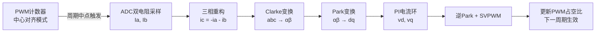
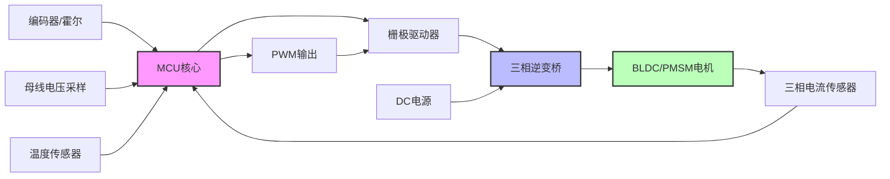

# 开发板与硬件平台选型

> **为什么学？**
> FOC 算法再优秀，也依赖电流采样、功率驱动、编码器接口等硬件正确工作。如果 ADC 精度不够、采样电阻选型错误、编码器频率超限，电流环会出现噪声、零点漂移甚至失控，调试阶段会浪费大量时间排查硬件问题。
>
> **在 FOC 中的作用**
> 本节是“从算法到电路”的桥梁。它把 MCU、栅极驱动、MOSFET、传感器、编码器的选型量化成约束条件，确保你搭出的硬件平台能给后续 SVPWM、电流环、速度环提供干净可靠的输入。

下面先从电流采样链路的精度约束出发，推导 ADC、采样电阻和运放增益的匹配关系；随后通过一个完整伺服驱动器案例，说明主控、功率级、编码器该如何协同选型。

这张图展示了一个 PWM 周期内“采样 → 变换 → 控制 → 调制 → 更新”的完整时序，说明为什么 ADC 必须在 PWM 中点触发、为什么 FOC 计算要在下个周期前完成。



*图：单 PWM 周期内的 FOC 采样与计算流水线。ADC 在 PWM 中点避开开关噪声，随后完成坐标变换、PI 控制和 SVPWM，确保新占空比在下个周期生效。*

## 1. 概述

FOC 控制的硬件平台由**主控 MCU**、**栅极驱动器**、**功率级（MOSFET）**、**电流传感器**和**编码器接口**五大部分组成。本章从工程选型角度，推导各组件的量化约束条件，给出具体参数的计算方法，并附常见错误分析。

---

## 2. 数学推导：ADC 采样精度与信噪比约束

为什么要做这一步：电流采样是 FOC 的“眼睛”，采样精度不够会直接让 PI 控制器误判。下面推导的精度与量程约束，是选择采样电阻、运放增益、ADC 位数的直接依据，避免后续出现电流抖动或满量程削顶。

电流采样是 FOC 的输入环节，其精度直接决定控制性能。设 ADC 分辨率为 $N$ 位，参考电压为 $V_{ref}$，电流采样电阻为 $R_s$，运放增益为 $G_{amp}$，则 ADC 最小分辨电压：

$$
\Delta V_{LSB} = \frac{V_{ref}}{2^N}
$$

对应最小可分辨电流：

$$
\Delta I_{min} = \frac{\Delta V_{LSB}}{R_s \cdot G_{amp}} = \frac{V_{ref}}{2^N \cdot R_s \cdot G_{amp}}
$$

设电机额定电流为 $I_{rated}$，峰值电流为 $I_{peak}$，要求：

$$
\Delta I_{min} \leq \frac{I_{rated}}{100} \quad \text{(1% 精度要求)}
$$

同时，运放输出必须在 ADC 输入范围内：

$$
|I_{peak}| \cdot R_s \cdot G_{amp} \leq V_{ref}
$$

**联立求解**：给定 $V_{ref} = 3.3V$，$N = 12$（STM32 内置 ADC），$I_{rated} = 5A$，$I_{peak} = 15A$，求 $R_s$ 和 $G_{amp}$。

由精度约束：

$$
\frac{3.3}{4096 \cdot R_s \cdot G_{amp}} \leq \frac{5}{100} \Rightarrow R_s \cdot G_{amp} \geq \frac{3.3 \times 100}{4096 \times 5} = 0.0161 \, \Omega
$$

由量程约束：

$$
R_s \cdot G_{amp} \leq \frac{3.3}{15} = 0.22 \, \Omega
$$

取中间值 $R_s \cdot G_{amp} = 0.066 \, \Omega$。若 $R_s = 0.01\Omega$（1% 精度），则 $G_{amp} = 6.6$，可取标准值 $G_{amp} = 6.5$ 或 $G_{amp} = 8$（配合增益微调）。

---

## 3. 几何直观：系统架构框图



上图展示了 FOC 系统的信号流。MCU 核心（粉色）是信息汇聚点，所有传感器信号经调理后进入 ADC，经 FOC 算法计算后输出 PWM 至栅极驱动器，最终驱动功率桥。

---

## 4. 数值示例：完整硬件选型计算

为什么要做这一步：孤立地看每个器件参数容易顾此失彼。下面以 48V/500W 伺服驱动器为例，把功率、电流、电压、编码器频率串成完整选型流程，确保 MCU、驱动器、MOSFET、编码器在目标工况下都能可靠工作。

### 4.1 场景定义

设计一款 48V 直流母线、额定功率 500W、峰值功率 1.5kW 的伺服驱动器，控制 4 对极 PMSM。

### 4.2 关键参数计算

**电流计算**：
$$
I_{rated} = \frac{P_{rated}}{V_{dc} \cdot \eta \cdot \sqrt{3}} = \frac{500}{48 \times 0.95 \times 1.732} \approx 6.3A \text{ (相电流有效值)}
$$
$$
I_{peak} = 3 \times I_{rated} \approx 19A \text{ (峰值，过载 3 倍)}
$$

**功率 MOSFET 选型**：
- 电压应力：$V_{DS,max} \geq 1.5 \times V_{dc} = 72V$，取 80V 或 100V MOSFET
- 电流应力：$I_{D,max} \geq 2 \times I_{peak} = 38A$，取 50A 或更高
- 导通电阻：$R_{DS(on)} < 5m\Omega$（降低导通损耗）

**推荐型号**：
- 低成本：IRFS7530-7PPbF ($100V/240A, R_{DS(on)}=0.9m\Omega$)
- 高集成：CSD88584Q5DC（双 N 通道半桥，40V 系列用于低电压）
- 智能功率模块：DRV8301/DRV8323 内置的 MOSFET 适用于小功率 (<500W)

**栅极驱动器选型**：
- DRV8301（TI）：集成 3 个半桥驱动 + 3 路电流放大器，支持 60V 母线
- DRV8323（TI）：DRV8301 的升级版，支持 1A 栅极驱动电流
- L6398（ST）：成本敏感方案，需外置电流采样运放

### 4.3 编码器接口选型

| 编码器类型 | 分辨率 | 接口方式 | 适用 MCU | 备注 |
|-----------|--------|---------|---------|------|
| 增量式 ABI | 1000-5000 PPR | 定时器正交解码 | 所有 STM32 | 最常用 |
| SPI 绝对式 | 12-19 bit | SPI 总线 | 带 SPI 的 MCU | 无累积误差 |
| 霍尔 | 6 步/转 | GPIO 中断 | 所有 MCU | 仅用于 BLDC |
| 无传感器 | — | 反电动势/观测器 | 高性能 MCU | 需额外算法 |

**编码器信号频率计算**：
$$
f_{encoder} = \frac{N_{PPR} \cdot n_{rpm} \cdot p_{pole}}{60}
$$

对于 5000 PPR 编码器、6000 rpm、4 对极电机：
$$
f_{encoder} = \frac{5000 \times 6000 \times 4}{60} = 2 \times 10^6 \text{ counts/s} = 2 MHz
$$

STM32 定时器最高捕获频率通常为 72MHz（输入捕获模式），完全满足要求。

---

## 5. 代码实现：ADC 采样配置与三相重构

以下代码展示 STM32G4 的 ADC 配置（双电阻采样 + 三相重构）：

```c
// ADC 配置：双电阻采样（A相和B相），C相通过基尔霍夫重构
// 硬件：STM32G474 + DRV8323RS

#include "stm32g4xx_hal.h"

#define ADC_VREF        3.3f
#define ADC_RESOLUTION  4096.0f
#define RS_SHUNT        0.010f      // 10mΩ 采样电阻
#define GAIN_AMP        8.0f        // DRV8323 增益 = 8x
#define ADC_TO_CURRENT(v) (((v) / ADC_RESOLUTION * ADC_VREF) / (RS_SHUNT * GAIN_AMP))

ADC_HandleTypeDef hadc1;
ADC_HandleTypeDef hadc2;
DMA_HandleTypeDef hdma_adc1;

uint16_t adc_raw[3];  // [Ia, Ib, Vbus]
float ia, ib, ic;
float vbus;

void ADC_Init(void) {
    // ADC1 配置：采样 Ia + Vbus (多通道扫描模式)
    hadc1.Instance = ADC1;
    hadc1.Init.ClockPrescaler = ADC_CLOCK_SYNC_PCLK_DIV4;
    hadc1.Init.Resolution = ADC_RESOLUTION_12B;
    hadc1.Init.DataAlign = ADC_DATAALIGN_RIGHT;
    hadc1.Init.ScanConvMode = ADC_SCAN_ENABLE;
    hadc1.Init.ContinuousConvMode = DISABLE;
    hadc1.Init.DMAContinuousRequests = DISABLE;
    hadc1.Init.NbrOfConversion = 2;
    hadc1.Init.ExternalTrigConv = ADC_EXTERNALTRIG_T1_TRGO;  // PWM 触发
    HAL_ADC_Init(&hadc1);
    
    // ADC1_CH1 -> Ia (PA0)
    ADC_ChannelConfTypeDef sConfig = {0};
    sConfig.Channel = ADC_CHANNEL_1;
    sConfig.Rank = ADC_REGULAR_RANK_1;
    sConfig.SamplingTime = ADC_SAMPLETIME_2CYCLES_5;  // 2.5 ADC clock
    HAL_ADC_ConfigChannel(&hadc1, &sConfig);
    
    // ADC1_CH2 -> Vbus (PA1)
    sConfig.Channel = ADC_CHANNEL_2;
    sConfig.Rank = ADC_REGULAR_RANK_2;
    HAL_ADC_ConfigChannel(&hadc1, &sConfig);
    
    // ADC2 配置：采样 Ib (单通道)
    hadc2.Instance = ADC2;
    hadc2.Init.ClockPrescaler = ADC_CLOCK_SYNC_PCLK_DIV4;
    hadc2.Init.Resolution = ADC_RESOLUTION_12B;
    hadc2.Init.ExternalTrigConv = ADC_EXTERNALTRIG_T1_TRGO;
    HAL_ADC_Init(&hadc2);
    
    sConfig.Channel = ADC_CHANNEL_12;  // Ib -> PB2
    sConfig.Rank = ADC_REGULAR_RANK_1;
    HAL_ADC_ConfigChannel(&hadc2, &sConfig);
    
    // DMA 配置：ADC1 双通道 DMA 传输
    HAL_ADCEx_Calibration_Start(&hadc1, ADC_SINGLE_ENDED);
    HAL_ADCEx_Calibration_Start(&hadc2, ADC_SINGLE_ENDED);
    HAL_ADC_Start_DMA(&hadc1, (uint32_t*)adc_raw, 2);
    HAL_ADC_Start_IT(&hadc2);  // ADC2 用中断或轮询
}

// FOC 中断中调用
void FOC_SampleCurrent(void) {
    // 读取 ADC 原始值
    uint16_t adc_ia = adc_raw[0];
    uint16_t adc_vbus = adc_raw[1];
    uint16_t adc_ib = HAL_ADC_GetValue(&hadc2);  // 或从中断缓存读取
    
    // 转换为物理量
    ia = ADC_TO_CURRENT((float)adc_ia);
    ib = ADC_TO_CURRENT((float)adc_ib);
    vbus = (float)adc_vbus / ADC_RESOLUTION * ADC_VREF * 11.0f;  // 分压比 1:11
    
    // 三相重构：ia + ib + ic = 0
    ic = -ia - ib;
    
    // 零偏校准（开机时采样多组取平均）
    // ia -= ia_offset; ib -= ib_offset; ic -= ic_offset;
}
```

---

## 6. 常见错误

### 错误1：ADC 采样时刻未对齐 PWM 中点

**表现**：电流采样包含开关噪声，SVPWM 输出波形畸变，电机发出高频啸叫。

**根源**：MOSFET 开关瞬间产生电流尖峰（dV/dt 耦合），若在开关边沿采样，会引入噪声。

**纠正**：采用**中心对齐 PWM**（Center-Aligned），在 PWM 周期的中点（即计数器归零/向上溢出时）触发 ADC 采样。此时上下桥臂均处于稳定导通/关断状态，电流最平稳。STM32 可通过 TIM1_TRGO 事件同步 ADC 触发。

```
PWM波形:      ___         ___         ___
            |   |       |   |       |   |
High _______|   |_______|   |_______|   |______
              ^           ^           ^
             ADC采样点    ADC采样点    ADC采样点
            (中点，噪声最小)
```

### 错误2：编码器 Z 信号（Index Pulse）未使用

**表现**：每次上电电角度初始位置不确定，导致第一次启动时电流冲击或反转。

**根源**：绝对式编码器价格昂贵，多数系统使用增量式编码器。增量编码器上电后无法确定绝对位置，只有相对增量。

**纠正**：
1. 上电后电机执行一次**寻 Z 操作**（缓慢旋转直到检测到 Z 脉冲），记录 Z 位置与电角度 0° 的偏移
2. 或使用带绝对位置的 SPI 编码器（如 AS5048A）
3. 无传感器方案启动时执行开环 I-F 对齐

### 错误3：忽略电流采样电阻的寄生电感

**表现**：高频电流采样出现振铃，电流环振荡。

**根源**：低阻值采样电阻（$<10m\Omega$）通常为金属条或合金电阻，其封装寄生电感 $L_s$ 可达 nH 级。在 20kHz 开关频率下，$Z_{Ls} = 2\pi f L_s$ 可能达到与 $R_s$ 相当的阻抗。

**纠正**：
- 选用四端子（Kelvin）采样电阻，分离电流路径和采样路径
- 在运放输入端加 RC 低通滤波（$f_c = 50\text{--}100\text{kHz}$）
- 采样电阻功率裕量 $\geq 2$ 倍实际功耗：$P_{Rs} = I_{rms}^2 \cdot R_s \times 2$（余量）

---

## 7. 自测习题

### 习题1：ADC 采样参数设计

设计一个 12V 直流母线、额定电流 20A 的电机驱动器，使用 STM32G4（12-bit ADC，$V_{ref}=3.3V$）。要求电流采样精度 $\leq 0.5\%$（相对额定电流），峰值电流 60A 不饱和。求采样电阻 $R_s$ 和运放增益 $G_{amp}$ 的允许范围。

**答案**：

精度约束：
$$
\Delta I_{min} = \frac{3.3}{4096 \cdot R_s \cdot G_{amp}} \leq \frac{20 \times 0.5}{100} = 0.1A
$$
$$
R_s \cdot G_{amp} \geq \frac{3.3}{4096 \times 0.1} = 0.00806 \, \Omega
$$

量程约束：
$$
R_s \cdot G_{amp} \leq \frac{3.3}{60} = 0.055 \, \Omega
$$

若选 $R_s = 0.005\Omega$（1W 功率，$P = 20^2 \times 0.005 = 2W$，需 5W 电阻），则 $G_{amp}$ 范围：

$$
\frac{0.00806}{0.005} \leq G_{amp} \leq \frac{0.055}{0.005} \Rightarrow 1.61 \leq G_{amp} \leq 11.0
$$

取 $G_{amp} = 5$ 或 8（常用 DRV8323 增益档位）。

### 习题2：编码器分辨率与速度测量精度

使用 1000 PPR 的增量编码器，MCU 定时器时钟 72MHz。采用 M 法（测频法）测量转速，测量周期 $T_m = 1\text{ms}$。计算在 100 rpm 和 10000 rpm 时的速度测量分辨率（rpm/计数）。

**答案**：

M 法：转速 $n = \frac{60 \cdot M}{P \cdot T_m}$，其中 $M$ 为 $T_m$ 内编码器脉冲数。

分辨率由 $M$ 变化 1 个计数引起：$\Delta n = \frac{60}{P \cdot T_m} = \frac{60}{1000 \times 0.001} = 60 \text{ rpm}$。

- 100 rpm 时：$M = \frac{100 \times 1000 \times 0.001}{60} = 1.67$，四舍五入为 2 个脉冲，误差 20%。**M 法不适用低速**。
- 10000 rpm 时：$M = \frac{10000 \times 1000 \times 0.001}{60} = 167$ 个脉冲，误差 $1/167 = 0.6\%$。**M 法适用高速**。

低速应采用 T 法（测周期法）：测量相邻脉冲的时间间隔 $T$，$n = \frac{60}{P \cdot T}$。

---

> **选型建议**：初学者推荐 **STM32G474 Nucleo + DRV8323RS + AS5048A** 组合。Nucleo 板载 ST-Link，DRV8323RS 集成栅极驱动和电流放大，AS5048A 提供 14-bit 绝对角度，三者配合可在一天内搭建完整 FOC 验证平台。成本约 300 元。
