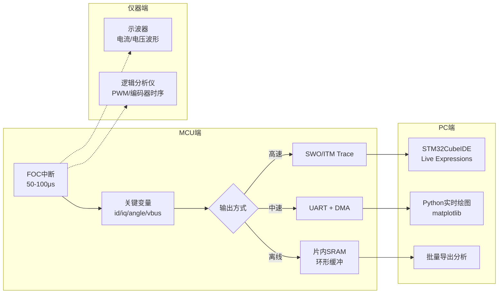
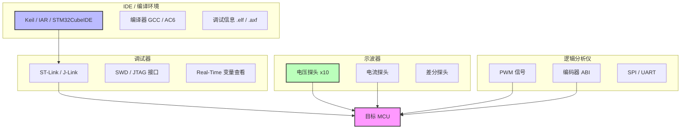

# 工具链与调试环境

> **为什么学？**
> FOC 的电流环周期通常只有 50–100 μs，printf 和单步调试都会破坏实时性。如果不懂得示波器、SWO/ITM、逻辑分析仪、上位机的使用，就无法在硬件上验证电流/电压/角度是否正确，问题会长期停留在“代码能跑但电机不转”。
>
> **在 FOC 中的作用**
> 本节是“从仿真到实物”的调试入口。它说明如何根据 PWM 频率、电流带宽、编码器速率选择仪器和调试通道，让你能安全高效地观测 FOC 运行时的真实波形。

下面先从示波器带宽和采样率的量化约束出发，解释为什么普通万用表或低速串口无法调试 FOC；随后通过工具链拓扑、代码示例和典型错误，建立一套适合电机控制的调试流程。

这张图把 MCU 端的变量输出通道、PC 端的可视化手段和仪器端的直接观测串起来，说明不同调试目标该选哪种工具、它们的带宽上限在哪里。



*图：FOC 实时调试数据流。MCU 通过 SWO/ITM、UART 或片内缓冲把变量送到 PC；同时用示波器和逻辑分析仪直接观测模拟与数字信号，三者互补才能高效定位问题。*

## 1. 概述

FOC 电机控制的调试涉及**代码开发**、**实时调试**、**信号观测**和**性能分析**四个环节。本章系统介绍各环节的常用工具，推导关键仪器参数（带宽、采样率、分辨率）的量化约束，并给出典型调试场景的操作流程。

---

## 2. 数学推导：示波器带宽与采样率约束

为什么要做这一步：FOC 中既有 20 kHz 的 PWM 方波，又有纳秒级开关瞬态，仪器的带宽和采样率选错会直接漏掉故障特征。下面推导的奈奎斯特条件与 ENOB 估算，是选购和设置示波器、电流探头的依据。

### 2.1 奈奎斯特采样定理

PWM 开关频率通常为 $f_{sw} = 10\text{--}50\text{kHz}$。为观测电流纹波和开关瞬态，示波器采样率 $f_s$ 必须满足：

$$
f_s \geq 2 \cdot f_{max}
$$

其中 $f_{max}$ 为被测信号最高频率分量。MOSFET 开关瞬态的上升时间 $t_r \approx 50\text{--}100\text{ns}$，对应等效带宽：

$$
f_{bw} \approx \frac{0.35}{t_r} = \frac{0.35}{50\text{ns}} = 7\text{MHz}
$$

因此，观测开关瞬态需要至少 **50MHz 带宽** 的示波器。

### 2.2 电流探头灵敏度与信噪比

电流探头（如 Tektronix TCP202A）的灵敏度 $S$（mV/A）与测量范围 $I_{max}$ 的关系：

$$
V_{out,max} = S \cdot I_{max} \leq V_{scope,max}
$$

若探头灵敏度 $S = 10\text{mV/A}$，示波器量程 $V_{scope,max} = 1V$，则：

$$
I_{max} = \frac{1}{0.01} = 100A
$$

对于 10A 量程测量，示波器仅占满量程的 10%，有效分辨率下降约 $\log_2(10) \approx 3.3$ 位。8 位示波器实际有效分辨率仅剩约 4.7 位。

**结论**：小电流测量应选用更高灵敏度探头（如 $S = 100\text{mV/A}$），或使用示波器高分辨率模式（如 12-bit 模式）。

### 2.3 量化误差与 ENOB

示波器的有效位数（ENOB）反映实际测量精度：

$$
ENOB = \frac{SINAD - 1.76}{6.02}
$$

其中 SINAD（信号与噪声+失真比）与带宽 $BW$ 和采样率 $f_s$ 相关。对于理想 ADC：

$$
SINAD = 6.02 \cdot N + 1.76 - 10\log_{10}\left(\frac{BW}{f_s/2}\right) - d_{jitter}
$$

当 $f_s = 2\text{GSa/s}$，$BW = 100\text{MHz}$ 时，带宽引起的噪声贡献很小，ENOB 接近理想值。

---

## 3. 几何直观：调试信号流与工具链拓扑



上图展示了 FOC 调试的完整工具链。IDE 负责编译和下载；调试器（ST-Link/J-Link）提供断点、单步、变量查看；示波器用于模拟信号观测；逻辑分析仪用于数字信号时序分析。

---

## 4. 数值示例：示波器参数选择

为什么要做这一步：不同观测对象（PWM、电流纹波、开关瞬态、编码器脉冲）对带宽和采样率要求差别很大。下面通过一个 20 kHz PWM、15 A 峰值电流的驱动器案例，列出具体设备选型，避免买错探头或设置错量程。

### 场景：调试 20kHz PWM、峰值电流 15A 的 FOC 驱动器

**需求分析**：

| 观测对象 | 信号特征 | 所需带宽 | 所需采样率 |
|---------|---------|---------|-----------|
| PWM 波形 | 方波, 20kHz | $5 \times 20\text{kHz} = 100\text{kHz}$ | 1MSa/s |
| 电流纹波 | 正弦+三角波, 20kHz | 100kHz | 1MSa/s |
| 开关瞬态 | 上升沿 50ns | $0.35/50\text{ns} = 7\text{MHz}$ | 50MSa/s |
| 死区时间 | 数百ns 脉冲 | 10MHz | 50MSa/s |
| 编码器信号 | 方波, 1MHz | 10MHz | 25MSa/s |

**设备选择**：

示波器最低要求：100MHz 带宽，1GSa/s 采样率（4 通道）。推荐：
- **入门级**：Rigol DS1054Z（50MHz 可解锁 100MHz，4ch，1GSa/s）
- **专业级**：Keysight DSOX1204G（200MHz，4ch，2GSa/s）
- **高端**：Tektronix MSO46（4ch + 16ch 数字，6GSa/s，12-bit）

电流探头选择：
- 小电流（<10A）：Tektronix TCP202A（DC-50MHz，$\pm 15A$）
- 大电流（<100A）：Fluke i400s（交流钳形，1000A）
- 高频小电流：Pearson 宽带电流互感器（需外接电阻转换为电压）

---

## 5. 代码实现：调试辅助代码与自动化脚本

### 5.1 MCU 端：实时变量输出（SWO / UART）

```c
// SWO 调试输出（ITM Trace）
// 在 Keil / STM32CubeIDE 中启用 ITM 端口 0

#include "core_cm4.h"

// 发送浮点变量到调试器
void ITM_SendFloat(float value) {
    union { float f; uint32_t u; } converter;
    converter.f = value;
    ITM_SendChar((converter.u >> 0) & 0xFF);
    ITM_SendChar((converter.u >> 8) & 0xFF);
    ITM_SendChar((converter.u >> 16) & 0xFF);
    ITM_SendChar((converter.u >> 24) & 0xFF);
}

// FOC 中断中输出关键变量
void FOC_DebugOutput(void) {
    static uint32_t debug_counter = 0;
    if (debug_counter++ % 10 == 0) {  // 每 10 个中断输出一次
        ITM_SendFloat(id_ref);
        ITM_SendFloat(id_meas);
        ITM_SendFloat(iq_ref);
        ITM_SendFloat(iq_meas);
        ITM_SendFloat(vbus);
        ITM_SendFloat(electrical_angle);
    }
}
```

### 5.2 PC 端：Python 实时数据解析与绘图

```python
#!/usr/bin/env python3
"""
foc_debug_plot.py - 实时解析 ITM / UART 调试数据
"""

import serial
import struct
import matplotlib.pyplot as plt
import numpy as np
from collections import deque

class FOCDebugPlotter:
    def __init__(self, port='COM3', baud=2000000):
        self.ser = serial.Serial(port, baud, timeout=0.1)
        self.fig, self.axes = plt.subplots(3, 1, figsize=(10, 8))
        
        # 环形缓冲区
        self.buffer_size = 1000
        self.id_ref = deque(maxlen=self.buffer_size)
        self.id_meas = deque(maxlen=self.buffer_size)
        self.iq_ref = deque(maxlen=self.buffer_size)
        self.iq_meas = deque(maxlen=self.buffer_size)
        self.vbus = deque(maxlen=self.buffer_size)
        self.angle = deque(maxlen=self.buffer_size)
        
    def parse_frame(self, data):
        """解析 6-float 数据帧 (24 bytes)"""
        if len(data) < 24:
            return None
        floats = struct.unpack('<6f', data[:24])
        return {
            'id_ref': floats[0], 'id_meas': floats[1],
            'iq_ref': floats[2], 'iq_meas': floats[3],
            'vbus': floats[4], 'angle': floats[5]
        }
    
    def update(self):
        """读取串口并更新图表"""
        while self.ser.in_waiting >= 24:
            raw = self.ser.read(24)
            frame = self.parse_frame(raw)
            if frame:
                self.id_ref.append(frame['id_ref'])
                self.id_meas.append(frame['id_meas'])
                self.iq_ref.append(frame['iq_ref'])
                self.iq_meas.append(frame['iq_meas'])
                self.vbus.append(frame['vbus'])
                self.angle.append(frame['angle'])
        
        # 更新绘图
        self.axes[0].clear()
        self.axes[0].plot(self.id_ref, label='id_ref')
        self.axes[0].plot(self.id_meas, label='id_meas')
        self.axes[0].legend()
        self.axes[0].set_ylabel('Id (A)')
        
        self.axes[1].clear()
        self.axes[1].plot(self.iq_ref, label='iq_ref')
        self.axes[1].plot(self.iq_meas, label='iq_meas')
        self.axes[1].legend()
        self.axes[1].set_ylabel('Iq (A)')
        
        self.axes[2].clear()
        self.axes[2].plot(self.angle, label='angle')
        self.axes[2].set_ylabel('Angle (rad)')
        self.axes[2].set_xlabel('Sample')
        
        plt.pause(0.01)
    
    def run(self):
        plt.ion()
        while True:
            self.update()

if __name__ == '__main__':
    plotter = FOCDebugPlotter(port='COM3', baud=2000000)
    plotter.run()
```

### 5.3 自动化测试脚本：扫频响应测试

```python
"""
foc_sweep_test.py - 自动化电流环扫频测试
通过 UART 发送速度指令，记录电流响应
"""

import serial
import numpy as np
import time

def current_loop_sweep(port, freq_range, amplitude):
    """
    对电流环进行正弦扫频，测量幅频响应
    
    Args:
        port: 串口对象
        freq_range: 频率列表 [Hz]
        amplitude: 注入 iq_ref 的正弦幅值 [A]
    """
    responses = []
    
    for freq in freq_range:
        period = 1.0 / freq
        samples = int(10 * freq)  # 采集 10 个周期
        
        iq_meas_list = []
        t_start = time.time()
        
        while time.time() - t_start < 10 * period:
            t = time.time() - t_start
            iq_ref = amplitude * np.sin(2 * np.pi * freq * t)
            port.write(f"IQ:{iq_ref:.3f}\n".encode())
            
            # 读取返回的 iq_meas
            line = port.readline().decode().strip()
            if line.startswith('IQ_MEAS:'):
                iq_meas = float(line.split(':')[1])
                iq_meas_list.append(iq_meas)
            
            time.sleep(0.0001)  # 1kHz 更新率
        
        # 计算该频率下的增益
        iq_meas_arr = np.array(iq_meas_list)
        gain = np.std(iq_meas_arr) / amplitude
        responses.append((freq, gain))
        
    return responses

# 使用示例
# ser = serial.Serial('COM3', 115200)
# result = current_loop_sweep(ser, [10, 50, 100, 200, 500, 1000], 1.0)
# 绘制 Bode 图
```

---

## 6. 常见错误

### 错误1：示波器探头接地线过长导致开关噪声

**表现**：观测 PWM 波形时，出现幅度达数十伏的高频振铃，怀疑 MOSFET 损坏或驱动异常。

**根源**：探头接地线（鳄鱼夹线）形成接地环，面积 $A \approx 10\text{cm} \times 1\text{cm} = 10^{-3}\text{m}^2$。开关电流变化率 $dI/dt \approx 1A/50ns = 2\times 10^7 A/s$，产生的感应电压：

$$
V_{noise} = L_{loop} \cdot \frac{dI}{dt} \approx (200\text{nH}) \times (2\times 10^7) = 4V
$$

**纠正**：使用**弹簧接地**（最短接地路径）或**差分探头**（如 Tektronix P5200A）。正确接地方式如下：

```
错误方式：            正确方式：
┌─────┐             ┌─────┐
│探头 │──长接地线──┐│探头 │──弹簧接地──┐
│尖端 │            ││尖端 │            │
└──┬──┘            │└──┬──┘            │
   │  大环路        │   │   最小环路    │
   └──────────────┘   └──────────────┘
```

### 错误2：J-Link 调试时未禁用看门狗

**表现**：单步调试时 MCU 频繁复位，无法观察变量。

**根源**：IWDG（独立看门狗）由独立低速时钟驱动，即使 CPU 在断点处停止，看门狗仍在计数。默认超时 1 秒，单步调试极易触发复位。

**纠正**：在 `main()` 开头或调试配置中禁用看门狗：

```c
// 调试时禁用 IWDG
#ifdef DEBUG
    __HAL_DBGMCU_FREEZE_IWDG();  // 冻结 IWDG 计数器
    __HAL_DBGMCU_FREEZE_WWDG();  // 冻结 WWDG 计数器
#endif
```

或在 Keil 的 Debug → Settings 中勾选 "Disable Watchdog during Debug"。

### 错误3：逻辑分析仪采样率不足导致编码器信号误判

**表现**：逻辑分析仪显示编码器 A/B 信号有毛刺，判定为噪声干扰，加装滤波电容后反而更糟。

**根源**：逻辑分析仪采样率 $f_s = 10\text{MSa/s}$，对于 1MHz 编码器信号，每周期仅采样 10 点。若信号边沿有振铃（正常反射），低采样率可能捕获到错误电平。

**纠正**：
- 提高采样率至信号频率的 50 倍以上（$f_s \geq 50 \times 1\text{MHz} = 50\text{MSa/s}$）
- 或使用示波器（带协议解码）替代逻辑分析仪观测高速编码器信号
- 不要仅凭逻辑分析仪结果判断模拟信号质量

---

## 7. 自测习题

### 习题1：示波器参数计算

需要观测一个 MOSFET 开关波形，上升时间 $t_r = 40\text{ns}$。示波器标称带宽为 100MHz，采样率 1GSa/s，8-bit 分辨率。

(1) 计算示波器能准确还原的上升时间（按 0.35/BW 估算）。  
(2) 若被测信号上升时间为 40ns，示波器测量值会是多少？  
(3) 测量 2A 峰值电流，使用灵敏度 10mV/A 的电流探头，示波器应设置多大垂直量程？若使用 8-bit ADC，量化误差对应的电流误差是多少？

**答案**：

(1) 示波器上升时间：$t_{scope} = \frac{0.35}{100\text{MHz}} = 3.5\text{ns}$。

(2) 测量上升时间叠加公式：
$$
t_{measured} = \sqrt{t_r^2 + t_{scope}^2} = \sqrt{40^2 + 3.5^2} = \sqrt{1600 + 12.25} = 40.15\text{ns}
$$

误差仅 0.4%，100MHz 带宽足够。

(3) 探头输出：$V_{out} = 10\text{mV/A} \times 2A = 20\text{mV}$。  
建议量程：50mV/div 或 100mV/div（共 8 div，量程 400mV 或 800mV）。  

取量程 400mV（8-bit，LSB = $400/256 = 1.56\text{mV}$）：

量化误差对应电流：$\Delta I = \frac{1.56\text{mV}}{10\text{mV/A}} = 0.156A$。

即电流测量分辨率约 0.16A，对于 2A 峰值信号，相对误差 7.8%。

**改进**：使用高分辨率模式（12-bit），LSB = $400/4096 = 0.098\text{mV}$，电流分辨率 0.0098A，相对误差降至 0.49%。

### 习题2：调试带宽匹配

某 FOC 系统电流环带宽设计为 1kHz，速度环带宽为 100Hz。请问：

(1) 示波器观测电流环阶跃响应时，最小采样率应设为多少？  
(2) 若用串口（115200 baud）输出调试数据，每帧 6 个 float（24 bytes），理论最大输出频率是多少？能否满足电流环观测需求？  
(3) 应使用什么替代方案实现高带宽调试？

**答案**：

(1) 电流环阶跃响应的上升时间 $t_r \approx \frac{0.35}{BW} = \frac{0.35}{1000} = 0.35\text{ms}$。按采样定理，每个上升沿至少采样 10 点：$f_s \geq \frac{10}{0.35\text{ms}} = 28.6\text{kSa/s}$。保守取 $f_s = 50\text{kSa/s}$。

(2) 115200 baud = 11520 bytes/s（约 10 位/字节，含起始/停止位）。每帧 24 bytes，最大帧率：$11520 / 24 = 480$ 帧/秒。远小于 50kHz 需求。

(3) 替代方案：
- **SWO / ITM Trace**：SWO 时钟可达 50MHz，远超串口
- **ST-Link 虚拟 COM**：仅用于低速变量监视
- **片内 DMA + 环形缓冲区**：在 SRAM 中高速记录，批量上传
- **示波器直接测量**：最可靠的方式，不依赖通信带宽

---

## 8. 工具推荐清单

| 工具类型 | 推荐型号 | 核心参数 | 价格区间 | 适用场景 |
|---------|---------|---------|---------|---------|
| IDE | STM32CubeIDE | GCC + ST-Link 集成 | 免费 | 日常开发 |
| IDE | Keil MDK-ARM | ARM Compiler 6 | ￥3000+ | 商业项目 |
| 调试器 | ST-Link V3 | SWD + 虚拟串口 | ￥100 | 入门调试 |
| 调试器 | J-Link Plus | 4MHz SWD, RTT | ￥1500 | 专业调试 |
| 示波器 | Rigol DS1054Z | 100MHz, 4ch, 1GSa/s | ￥3000 | 入门/教学 |
| 示波器 | Siglent SDS2104X | 100MHz, 12-bit | ￥5000 | 中等精度 |
| 电流探头 | Tek TCP202A | DC-50MHz, 15A | ￥3000 | 通用电流测量 |
| 逻辑分析仪 | Saleae Logic Pro | 8ch, 100MSa/s | ￥2000 | 协议分析 |
| 电流钳 | Hantek CC65 | AC/DC 65A | ￥300 | 大电流粗测 |

---

> **调试箴言**：FOC 调试的 80% 问题可通过**三通道示波器**（A相电流、B相电流、PWM-A）+ **J-Link RTT 实时变量**定位。不要试图用 printf 调试 50μs 中断——串口波特率本身就是最大的瓶颈。
