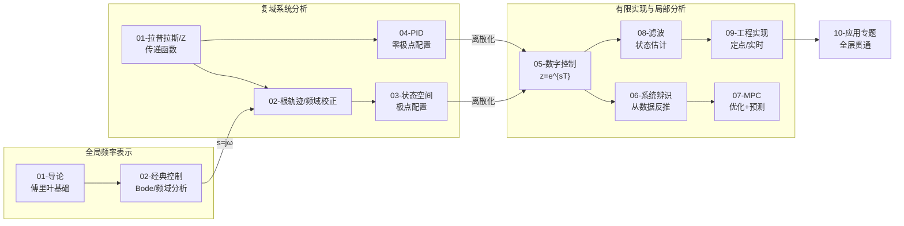

# 双控：控制理论与控制工程（微专业）

> 从直觉出发，用图文建立控制系统的宏观理解，再逐步深入到数学推导和工程实现。适合非科班出身、希望系统掌握控制学科的工程师。
>
> **核心认知**：傅里叶、拉普拉斯、Z 不是三套独立工具，而是同一条分析链上的不同层级。真正把它们串起来的不是公式记忆，而是 **ROC 与采样映射**。

## 先修要求

- [[01-Foundations/01-数学与物理基础/000-README|01-数学与物理基础]]（微积分、复数、矩阵）
- [[01-Foundations/02-电路基础理论/000-README|02-电路基础理论]]（RLC频域分析）
- [[01-Foundations/05-信号与系统/000-信号与系统|05-信号与系统]]（系统响应、采样定理）

## 认知框架：从全局频率到工程实现的三层跃迁

控制理论不是一堆孤立公式的集合，而是**同一套认知工具在不同抽象层级的表现**。

| 认知层级 | 核心问题 | 变换工具 | 控制理论的对应 | 输出形态 |
|---------|---------|---------|--------------|---------|
| **全局频率表示** | 信号有哪些频率成分？ | 傅里叶（CTFT/DTFT） | 频域分析、Bode 图、滤波器设计 | 频谱、带宽、相位裕度 |
| **复域系统分析** | 系统是否稳定？如何设计？ | 拉普拉斯/Z（含 ROC） | 传递函数、根轨迹、极点配置、状态空间 | 极点、零点、稳定区域 |
| **有限实现与局部分析** | 如何在有限数据/算力下实现？ | DFT/FFT、状态估计、优化 | 数字控制、系统辨识、MPC、卡尔曼滤波、工程实现 | 代码、实时算法、嵌入式系统 |

三条最关键的连接线（必须吃透）：
- **$s = j\omega$**：拉普拉斯在虚轴上的切片 = 傅里叶变换
- **$z = e^{j\Omega}$**：Z 变换在单位圆上的切片 = DTFT
- **$z = e^{sT}$**：采样把连续模态映射到离散模态，连续稳定（左半平面）→ 离散稳定（单位圆内）

> 这个框架的详细展开见 [[deep-research-report]]。

## 学习路径（10阶段，约24-30周）

DR_CAN 的推荐顺序提供了与本专题对应的另一条视频主线：

![[DR_CAN推荐学习路径.excalidraw|1500]]

视频合集、嵌入播放器与每个合集对应的知识库章节见 [[DR_CAN视频合集索引]]。图中的内容用于确定先后依赖，不替代本专题的 10 阶段工程学习计划。

| 阶段 | 模块 | 认知层级 | 周数 | 核心产出 |
|------|------|---------|------|----------|
| 1 | 01-导论与数学基础 | 复域系统分析（基础） | 2-3 | 能画框图、写传递函数、理解 $s$ 域和 $z$ 域 |
| 2 | 02-经典控制理论 | 复域系统分析（核心） | 4-5 | 手绘根轨迹/Bode、判稳定裕度、理解 $s=j\omega$ |
| 3 | 04-PID与工业控制器 | 复域 → 有限实现的桥梁 | 3-4 | 选整定方法、写PID代码、理解 $s$ 域设计到频域验证 |
| 4 | 05-数字控制与离散系统 | 复域系统分析（离散） | 3 | 连续→离散、选采样周期、理解 $z=e^{sT}$ |
| 5 | 03-现代控制理论 | 复域系统分析（矩阵化） | 4-5 | 建状态空间、设计观测器、理解状态 = 复域的内化 |
| 6 | 06-系统辨识与模型估计 | 有限实现（逆向） | 2-3 | PRBS+最小二乘获取模型、从数据反推 $H(z)$ |
| 7 | 08-滤波与信号处理 | 有限实现（状态估计） | 2 | 设计KF/互补滤波器、理解时频分析层次 |
| 8 | 07-MPC模型预测控制 | 有限实现（优化） | 3-4 | MATLAB/CasADI实现带约束MPC、理解优化+预测+约束 |
| 9 | 09-控制系统的工程实现 | 有限实现（落地） | 2 | 算法部署到STM32/PLC、理解定点/浮点/实时约束 |
| 10 | 10-应用专题与案例分析 | 全层贯通 | 3-4 | 完成一个完整案例、从频域到复域到代码的全链打通 |

## 三条知识主线

**主线一：变换与稳定性**（为什么）
01-导论（拉普拉斯/Z）→ 02-经典控制（频域/复域设计）→ 03-现代控制（状态空间/极点配置）→ 10-应用（全层验证）

**主线二：设计与实现**（怎么做）
02-经典控制（频域设计）→ 04-PID（低阶控制器）→ 05-数字控制（离散化）→ 09-工程实现（代码部署）

**主线三：数据与优化**（从数据到决策）
06-系统辨识（从数据建模）→ 07-MPC（优化决策）→ 08-滤波（状态估计）→ 10-应用（闭环验证）

## 与现有知识库的关联

- **[[14-FOC-电机控制/00-README|14-FOC-电机控制]]** — FOC 的 PI、观测器、MTPA、弱磁都需要控制理论支撑。本微专业是 FOC 的"理论底座"，FOC 是控制理论的"最直接应用"。建议：学完 02 + 04 + 05 后，再深入 FOC 会有质的飞跃。
- **[[04-Microcontrollers/00-README|04-Microcontrollers]]** — 数字控制的硬件载体
- **[[01-Foundations/08-嵌入式C编程/000-嵌入式C编程|08-嵌入式C编程]]** — 控制算法的代码实现

## 变换统一视角：每个模块在"分析链"中的位置

## 模块索引

### 01-控制系统导论与数学基础

- [[000-图解入门：控制系统到底是什么]]
- [[001-控制系统的基本框图与分类]]
- [[002-拉普拉斯变换与Z变换]]
- [[003-线性代数工具]]
- [[004-常微分方程与稳定性初步]]
- [[005-从物理系统到数学模型]]

### 02-经典控制理论

- [[000-图解入门：从根轨迹到Bode图]]
- [[001-传递函数与方框图化简]]
- [[15-双控（控制理论与控制工程）/02-经典控制理论/002-时域分析|002-时域分析]]
- [[003-根轨迹法]]
- [[004-频域分析]]
- [[005-频率法校正]]
- [[006-从经典到现代的过渡]]

### 03-现代控制理论

- [[000-图解入门：状态空间为什么更强大]]
- [[001-状态空间描述与能控能观性]]
- [[002-状态反馈与极点配置]]
- [[003-状态观测器与分离原理]]
- [[004-LQR最优控制]]
- [[005-LQG与卡尔曼滤波]]
- [[006-非线性系统基础]]
- [[007-鲁棒控制初步]]

### 04-PID与工业控制器设计

- [[000-图解入门：PID的物理直觉]]
- [[001-PID的物理直觉与频域解释]]
- [[002-参数整定方法论]]
- [[003-抗积分饱和与微分先行]]
- [[004-前馈控制与串级控制]]
- [[005-增益调度与自适应PID]]
- [[006-工业PID实现]]

### 05-数字控制与离散系统

- [[000-图解入门：数字控制与模拟控制的区别]]
- [[001-采样与保持的数学效应]]
- [[002-离散传递函数与差分方程]]
- [[003-离散PID实现]]
- [[004-数字滤波器设计]]
- [[005-超前-滞后离散化]]
- [[006-采样周期选择]]

### 06-系统辨识与模型估计

- [[000-图解入门：如何用数据反推模型]]
- [[001-白箱灰箱黑箱建模范式]]
- [[002-最小二乘辨识]]
- [[003-频域辨识]]
- [[004-MATLAB系统辨识工具箱]]
- [[005-模型验证与阶次选择]]
- [[006-嵌入式在线辨识]]

### 07-MPC模型预测控制

- [[000-图解入门：MPC就像下棋想三步]]
- [[001-MPC的滚动时域优化思想]]
- [[002-预测模型与代价函数]]
- [[003-约束处理与QP求解器]]
- [[004-显式MPC与实时性]]
- [[005-MPC应用案例]]
- [[006-CasADI与acados实现]]

### 08-滤波与信号处理在控制中的应用

- [[000-图解入门：滤波器是控制系统的感官]]
- [[001-卡尔曼滤波]]
- [[002-互补滤波]]
- [[003-状态观测器作为滤波器]]
- [[004-低延迟滤波设计]]
- [[005-传感器融合]]

### 09-控制系统的工程实现

- [[000-图解入门：从算法到代码的距离]]
- [[001-控制算法到C代码的映射]]
- [[002-定点与浮点运算]]
- [[003-实时调度与任务周期]]
- [[004-通信延迟与分布式控制]]
- [[005-安全关键系统的容错]]
- [[006-调参工具链]]

### 10-应用专题与案例分析

- [[10-应用专题与案例分析/000-图解入门：控制理论如何落地|控制理论如何落地]]
- [[10-应用专题与案例分析/001-伺服系统控制|伺服系统控制]]
- [[10-应用专题与案例分析/002-过程控制|过程控制]]
- [[10-应用专题与案例分析/003-机器人运动控制|机器人运动控制]]
- [[10-应用专题与案例分析/004-无人机姿态与位置控制|无人机姿态与位置控制]]
- [[10-应用专题与案例分析/005-电力电子变换器控制|电力电子变换器控制]]
- [[10-应用专题与案例分析/006-汽车动力学控制|汽车动力学控制]]

## 推荐资源

> 以下资源按相关性和学习阶段推荐，与 [[12-Resources/00-README|12-resources]] 中的完整资源列表互为补充。

### 推荐书籍

| 书籍 | 作者 | 级别 | 适用内容 | 获取方式 |
|------|------|------|----------|----------|
| 《Feedback Systems》 | Karl J. Åström & Richard M. Murray | 中级 | 控制理论核心：反馈系统、稳定性、状态空间、鲁棒控制 | [免费在线](https://www.cds.caltech.edu/~murray/amwiki/index.php/Main_Page) |
| 《The Art of Control Engineering》 | Dutton, Thompson, Barraclough | 入门 | 控制系统友好入门：建模、时域/频域分析、PID | 纸质书 |
| 《Engineering Mathematics》 | K.A. Stroud | 入门 | 工程师数学手册：微积分、复数、矩阵、微分方程 | 纸质书 |
| 《Control Loop Cookbook》 | TI | 中级 | 控制环路设计：Buck 补偿网络、波特图分析、环路稳定性 | [TI 免费 PDF](https://www.ti.com) |
| 《Op Amps for Everyone》 | Ron Mancini (TI) | 入门 | 运放设计：信号调理、滤波、传感器接口（控制系统前端） | [TI 免费 PDF](https://www.ti.com) |
| 《Making Embedded Systems》 | Elecia White | 中级 | 嵌入式系统设计：需求→架构→实现→测试，适合控制算法落地 | 纸质书 |
| 《Mastering STM32》 | Carmine Noviello | 中级 | STM32 最全面教程：数字控制实现、定时器、ADC、中断 | [免费在线](https://github.com/cnovak/mstm32) |
| 《Digital Design and Computer Architecture》 | David Harris & Sarah Harris | 入门-中级 | 数字逻辑到计算机架构：Verilog 示例，数字控制器硬件基础 | 纸质书 |

### 推荐视频与课程

| 资源 | 平台 | 特点 | 适用内容 |
|------|------|------|----------|
| **3Blue1Brown** | YouTube | 数学可视化，傅里叶变换、线性代数、微积分 | 01-导论数学基础、03-状态空间矩阵工具 |
| **Phil's Lab** | YouTube | 模拟/数字电路、PCB、FPGA、控制、电源设计 | 02-经典控制频域设计、04-PID、09-工程实现 |
| **FastBit Embedded Brain Academy** | YouTube | STM32 嵌入式最系统课程，寄存器→HAL→RTOS | 05-数字控制、09-工程实现（STM32 平台） |
| **速比特电子** | Bilibili | FOC 电机控制、Clark/Park 变换、控制理论可视化 | 02-经典控制、03-状态空间、04-PID（中文） |
| **DR_CAN** | Bilibili | 控制理论中文 No.1：经典控制→现代控制→MPC→卡尔曼→最优控制，合集完整、推导清晰 | 全模块（见[[DR_CAN视频合集索引\|合集索引]]） |
| **江协科技** | Bilibili | STM32 标准库+HAL 最系统的中文教程 | 05-数字控制、09-工程实现（中文） |
| **爱上半导体** | Bilibili/YouTube | 硬件原理可视化极好，CAN、I2C、LCD、MOS 管 | 09-工程实现中的通信与硬件接口（中文） |
| **MIT OCW: 6.002 Circuits and Electronics** | MIT OpenCourseWare | 经典 MIT 电路课程，频域分析、反馈系统 | 01-导论、02-经典控制理论基础 |
| **TI Precision Labs** | TI 官网 | 运放、ADC、电源、传感器（免费视频） | 01-信号调理、08-滤波与信号处理 |

### 推荐博客与网站

| 网站 | 语言 | 特点 | 适用内容 |
|------|------|------|----------|
| **AllAboutCircuits** | 英文 | 最全面的免费电路教程，从欧姆定律到射频 | 全模块基础概念补充、电路仿真验证 |
| **DeepBlue Embedded** | 英文 | 嵌入式教程质量极高，STM32/ESP32 项目导向 | 09-工程实现、控制算法到代码的映射 |
| **EEWorld（电子工程世界）** | 中文 | 国内最大 EE 社区，技术文章、论坛讨论 | 全模块工程经验、中文资料补充 |
| **MathWorks Documentation** | 英文 | MATLAB/Simulink 官方文档，控制工具箱示例 | 06-系统辨识、07-MPC、仿真验证 |
| **Python Control Systems Library** | 英文 | Python 控制库文档，状态空间、频域、仿真 | 全模块 Python 实现替代方案 |

---

> **资源使用建议**：
> - **入门阶段**（01-04）：优先使用《The Art of Control Engineering》+ 3Blue1Brown + MIT 6.002 + TI Precision Labs
> - **进阶阶段**（05-07）：结合《Feedback Systems》+ Phil's Lab + FastBit Embedded + 速比特电子
> - **实现阶段**（08-10）：以《Mastering STM32》+ 《Making Embedded Systems》+ 江协科技 + DeepBlue Embedded 为主
> - **工具链**：MATLAB（Control System Toolbox、System Identification Toolbox）是控制理论学习的行业标准；Python（`control`、`scipy`）是免费替代方案
