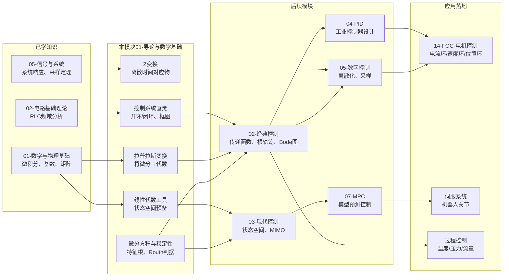
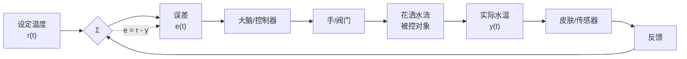
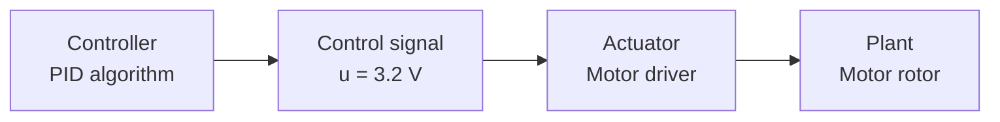

# 图解入门：控制系统到底是什么

> **核心认知锚点**：本模块是**统一变换链的起点**——从「为什么需要数学工具描述动态」出发，建立「物理系统 → 微分方程 → 拉普拉斯域 → 传递函数 → 框图语言」的完整认知通路，为后续经典控制、现代控制、数字控制打下共同的语言基础。

## 先问三个问题：为什么学？学来做什么？和后面什么关系？

### 为什么学？——从洗澡水温到十亿美元火箭

控制理论之所以成为工程学的核心支柱，不是因为它让花洒水温舒适，而是因为它提供了一套**统一处理"动态系统如何响应输入、如何抵抗扰动、如何跟踪目标"的数学语言**。

从 [[14-FOC-电机控制/00-README|14-FOC-电机控制]] 中你已经体验过：控制三相永磁同步电机，本质上就是**连续调节电流环、速度环、位置环**，让转子精确地跟踪目标位置。FOC 中的 PI 控制器、电流采样、坐标变换、PWM 输出——这些全都是控制系统的具体化身。没有控制理论的语言，你只能描述"调大了点，电机转快了"；有了这套语言，你能精确地说：

> 这个二阶系统的阻尼比 $\zeta = 0.7$，自然频率 $\omega_n = 500$ rad/s，超调量 4.6%，调节时间 8 ms。

这就是控制理论的威力：**把直觉变成可计算、可设计、可优化的工程语言**。

### 与前后模块的关系——知识流向全景图



**关键流向说明**：

| 起点 | 终点 | 流向含义 |
|------|------|----------|
| 微积分/复数 | 拉普拉斯变换 | 需要复积分和指数函数基础才能理解 $s = \sigma + j\omega$ |
| RLC频域分析 | 控制系统直觉 | 电路中的阻抗、滤波概念直接对应框图中的 $G(s)$ |
| 信号与系统 | Z变换 | 采样定理是理解 $z = e^{sT}$ 映射的前提 |
| 本模块（拉普拉斯） | 经典控制 | 传递函数 $G(s)$ 是经典控制的唯一语言 |
| 本模块（Z变换） | 数字控制 | 离散传递函数 $G(z)$ 是数字控制器的基础 |
| 本模块（线性代数） | 现代控制 | 状态空间描述就是矩阵向量语言 |
| PID/数字控制 | FOC电机控制 | FOC的三环架构（电流→速度→位置）是PID+状态观测器的直接应用 |

### 与 FOC 的关联——你已有的知识如何延伸

你在 [[14-FOC-电机控制/00-README|14-FOC-电机控制]] 中已经接触过的控制理论元素：

| FOC 中的元素 | 控制理论中的对应概念 | 本模块的预备作用 |
|-------------|-------------------|---------------|
| 电流环 PI 控制器 | 比例-积分（P-I）控制律 | 本模块讲解 P/I/D 的物理直觉 |
| 速度环/位置环 | 串级控制（Cascade Control） | 本模块的框图语言就是描述串级系统的工具 |
| 编码器/霍尔反馈 | 传感器 $H(s)$ | 本模块的反馈框图概念 |
| 电流采样 + 坐标变换 | 信号采样与变换 | 本模块的 Z 变换与采样定理 |
| SVPWM 输出 | 执行器（Actuator） | 本模块区分控制器与执行器 |

> **FOC 是控制理论的直接应用场景**：本模块建立的框图语言和变换工具，正是后续理解 FOC 中"为什么电流环带宽要比速度环快 5-10 倍""为什么编码器分辨率影响系统稳定性"等工程问题的数学基础。

---

## 先从一个生活场景说起

想象你正在洗澡，调节花洒的水温。你会这样操作：

1. 手伸向阀门，拧到一个你觉得合适的刻度（比如热水占 60%）。
2. 等待几秒，感受水流温度。
3. 如果太烫，你会往冷水方向拧；如果太凉，往热水方向拧。
4. 重复步骤 2-3，直到水温舒适。

这个看似简单的动作，实际上就是一个**闭环控制系统**（Closed-Loop Control System）：

- **目标**：你希望的水温（比如 40°C），在控制理论中叫**参考输入**（Reference Input）或**设定值**（Setpoint）。
- **执行器**：你手上的阀门，改变冷热水的混合比例，叫**控制器**（Controller）+**执行机构**（Actuator）。
- **被控对象**：花洒出来的水流，叫**被控对象**（Plant）。
- **传感器**：你的皮肤感知到的实际水温，叫**测量输出**（Measured Output）。
- **比较**：你的大脑把"希望水温"和"实际水温"做比较，得到"有点烫"或"有点凉"，叫**误差**（Error）。
- **决策**：大脑根据误差的大小和方向，决定拧阀门的角度和方向，叫**控制律**（Control Law）。



## 开环 vs 闭环：一把伞的直觉

为了理解闭环控制为什么重要，我们先看看**开环控制**（Open-Loop Control）：

| 控制方式 | 生活类比 | 关键特征 | 优点 | 缺点 |
|----------|----------|----------|------|------|
| 开环 | 伞 | 撑开就完事，不感知雨大风大 | 简单、响应快、无稳定性问题 | 对干扰无抵抗、精度依赖模型 |
| 闭环 | 自动驾驶 | 持续看路、持续修正 | 抗干扰、精度高、适应变化 | 可能震荡、设计复杂 |

开环控制就是你设定一个固定的操作，然后不再回头检查。比如你设定闹钟在 7:00 响，不管那天是不是周末——闹钟不会"感知"你今天是否需要早起。

闭环控制的核心哲学是：**感知 → 比较 → 修正 → 再感知**。这个循环让系统能够自动适应不确定性和外部干扰。

## 控制系统的核心元件

用更工程化的语言，一个典型的闭环控制系统包含以下元件：

```
      Reference r(t)         +-------------------+
           |                 |                   |
           v                 v                   |
      +---------+      +---------+          +---------+
      |  Σ (减法)|      |Controller|          |  Plant  |
      |  e=r-y  |----->|   Gc(s)  |--------->|   G(s)  |
      +----+----+      +---------+          +----+----+
           ^                                      |
           |                +---------+            |
           |                | Sensor  |<-----------+
           +----------------|   H(s)  |
                            +---------+
                                 y(t)
```

各元件的物理意义：

| 符号 | 名称 | 工程实例 |
|------|------|----------|
| $r(t)$ | 参考输入 / 设定值 | 期望转速 3000 RPM |
| $y(t)$ | 输出 / 被控量 | 电机实际转速 |
| $e(t)$ | 误差 | $e(t) = r(t) - y(t)$ |
| $G_c(s)$ | 控制器传递函数 | PID 控制器、超前-滞后补偿器 |
| $G(s)$ | 被控对象传递函数 | 电机、加热器、机械臂 |
| $H(s)$ | 传感器传递函数 | 编码器、热电偶、IMU |
| $u(t)$ | 控制量 | 电压、电流、阀门开度 |

**为什么是 $G_c(s)$ 而不是 $G_c(t)$？** 这里的 $s$ 就是拉普拉斯变换的复变量。把时域的微分方程变成 $s$ 域的代数方程后，整个系统变成了一组"方框"的代数连接。这正是本模块 [[002-拉普拉斯变换与Z变换]] 要教你的核心技能。

## 一个简单的数值示例：房间温度控制

假设你在冬天使用电暖气给房间加热，设定目标温度为 22°C。我们用一组简化的参数来模拟这个系统：

- 房间热容 $C = 5000$ J/°C（房间温度升高 1°C 需要 5000 J 热量）
- 散热系数 $R = 0.01$ °C/W（温差每 1°C，房间向外界散热 0.01 W）
- 加热器功率 $P = 1000$ W（满功率时）
- 室外温度 $T_{out} = 5$ °C
- 目标温度 $T_{set} = 22$ °C

房间温度的动态可以用一阶微分方程近似：

$$
C \frac{dT}{dt} = P_{heater} - \frac{T - T_{out}}{R}
$$

即：

$$
5000 \frac{dT}{dt} = P_{heater} - \frac{T - 5}{0.01} = P_{heater} - 100(T - 5)
$$

**开环控制**：假设你凭经验把加热器固定在 600 W，稳态时 $dT/dt = 0$：

$$
0 = 600 - 100(T - 5) \Rightarrow T = 5 + 6 = 11 \text{ °C}
$$

结果：房间只有 11°C，远低于目标 22°C。因为室外温度变化（比如突然降到 -5°C）时，开环控制不会调整。

**闭环控制**：使用一个简单的比例控制 $P_{heater} = K_p (T_{set} - T)$，设 $K_p = 50$ W/°C：

稳态时 $P_{heater} = K_p (22 - T_{ss})$，代入方程：

$$
0 = K_p(22 - T_{ss}) - 100(T_{ss} - 5)
$$

$$
0 = 50(22 - T_{ss}) - 100(T_{ss} - 5) = 1100 - 50T_{ss} - 100T_{ss} + 500 = 1600 - 150T_{ss}
$$

$$
T_{ss} = \frac{1600}{150} = 10.67 \text{ °C}
$$

嗯？还是不够 22°C。这是因为纯比例控制存在**稳态误差**（Steady-State Error）。增大 $K_p$ 可以减小误差，但太大会导致系统震荡。这正是控制理论要解决的问题——如何设计控制器使得系统既快速响应、又没有稳态误差、还不震荡。

> **与变换链的关系**：上面的微分方程 $C \frac{dT}{dt} + \frac{T}{R} = P_{heater} + \frac{T_{out}}{R}$ 在拉普拉斯域变成 $(Cs + 1/R) T(s) = P(s) + T_{out}(s)/R$，微分变成了乘以 $s$。传递函数 $G(s) = \frac{1}{Cs + 1/R}$ 就是本模块与 [[15-双控（控制理论与控制工程）/02-经典控制理论/000-图解入门：从根轨迹到Bode图|02-经典控制理论]] 的核心桥梁。

```python
# Simple simulation of room temperature control
import numpy as np
import matplotlib.pyplot as plt

def simulate_room_temp(Kp, dt=0.1, t_end=1200):
    # Physical parameters
    C = 5000.0          # thermal capacity [J/degC]
    R = 0.01            # thermal resistance [degC/W]
    T_out = 5.0         # outdoor temperature [degC]
    T_set = 22.0        # setpoint [degC]
    P_max = 1000.0      # max heater power [W]
    
    t = np.arange(0, t_end, dt)
    T = np.zeros_like(t)
    T[0] = 5.0          # initial room temperature
    
    for i in range(1, len(t)):
        error = T_set - T[i-1]
        P_heater = np.clip(Kp * error, 0.0, P_max)  # saturate at 0..P_max
        dTdt = (P_heater - (T[i-1] - T_out) / R) / C
        T[i] = T[i-1] + dTdt * dt
    
    return t, T

# Compare Kp = 50 vs Kp = 200
t1, T1 = simulate_room_temp(50)
t2, T2 = simulate_room_temp(200)

# Plotting code omitted for brevity
# plt.plot(t1, T1, label='Kp=50')
# plt.plot(t2, T2, label='Kp=200')
# plt.axhline(22, color='r', linestyle='--', label='Setpoint')
```

## 控制系统的性能指标

工程上评价一个控制系统的好坏，通常看以下指标：

| 指标 | 符号 | 含义 | 期望 |
|------|------|------|------|
| 上升时间 | $t_r$ | 从 10% 到 90% 终值的时间 | 短（响应快） |
| 峰值时间 | $t_p$ | 达到第一个峰值的时间 | 短 |
| 超调量 | $M_p$ | 最大超出终值的百分比 | 小（一般 < 20%） |
| 调节时间 | $t_s$ | 进入并保持在终值 ±2% 或 ±5% 以内的时间 | 短 |
| 稳态误差 | $e_{ss}$ | $t \to \infty$ 时的误差 | 接近零 |

## 常见错误与纠正

### 错误 1：混淆"控制器"与"执行器"

**错误理解**："控制器就是电机驱动器。"

**纠正**：控制器（Controller）是计算控制律的算法或电路；执行器（Actuator）是将控制信号转化为物理动作的装置。例如：
- 控制器：PID 算法计算出需要输出 3.2 V 电压
- 执行器：电机驱动器（H 桥）把这个电压信号变成电机的实际电流
- 被控对象：电机转子

> **与 FOC 的关联**：在 FOC 中，电流环 PI 算法是"控制器"，SVPWM 模块是"执行器"（把电压指令变成实际的三相电压），电机是"被控对象"。这种区分对调试非常重要——如果你把控制器和执行器混为一谈，就可能试图在 PI 算法里解决驱动器死区补偿的问题。



### 错误 2：认为闭环系统一定比开环好

**错误理解**："所有情况都应该用闭环控制。"

**纠正**：闭环控制需要传感器、计算资源，且存在稳定性风险。在以下场景，开环控制更优：
- 对成本极度敏感的消费电子产品（如简易风扇，不需要精确调速）
- 系统响应极快，传感器延迟反而引入不稳定（如某些高速开关电源）
- 被控对象特性非常稳定，模型足够精确（如某些精密数控的步进电机开环定位）

工程师的决策框架：先问"精度要求是多少？""干扰有多大？""成本上限是多少？"，再决定开环还是闭环。

### 错误 3：把"控制"和"变换"割裂看待

**错误理解**："先学控制概念，再学拉普拉斯，两者没关系。"

**纠正**：本模块之所以把"控制系统直觉"和"拉普拉斯/Z变换"放在同一模块，正是因为**它们是同一条认知链上的相邻环节**。没有拉普拉斯变换，你只能用微分方程描述闭环系统；有了拉普拉斯变换，$s$ 域的框图语言让分析、设计、仿真都变得简洁。后续 [[15-双控（控制理论与控制工程）/02-经典控制理论/000-图解入门：从根轨迹到Bode图|02-经典控制理论]] 中的一切工具（根轨迹、Bode图、Nyquist判据）都建立在传递函数 $G(s)$ 的基础上——而传递函数正是拉普拉斯变换的直接产物。

> **统一框架视角**：傅里叶变换回答"系统有哪些频率响应"；拉普拉斯变换在此基础上增加"增长/衰减"信息，把稳定性也纳入同一幅图；Z变换是离散时间的对应物。三者不是竞争工具，而是同一条分析链上的不同层级。详见 [[002-拉普拉斯变换与Z变换]]。

## 自测习题

**Q1**. 在温控系统中，如果把皮肤感知水温换成温度计自动读取，属于以下哪项变化？

A. 开环变闭环  
B. 人工控制变自动控制  
C. 传感器精度提高  
D. 控制器类型改变

> **答案：B**。核心变化是人（控制器）换成了自动算法；传感器从"皮肤"变成"温度计"只是传感器的改变。如果之前是手动调阀门、现在用温控器自动调，则 A 和 B 都成立。但本题仅替换传感器，不改变闭环结构，所以最佳答案是 B。

**Q2**. 一个纯比例控制（P 控制）的闭环系统，为什么通常无法消除稳态误差？

> **答案**：因为比例控制输出 $u = K_p e$，稳态时若 $e = 0$，则 $u = 0$，无法提供持续的控制作用来抵消外部扰动（如散热）。只有存在非零误差，才能产生非零控制量。消除稳态误差需要积分环节（I），让控制器"记住"累积误差并持续输出。

**Q3**. 给定房间温度系统参数 $C = 5000$, $R = 0.01$, $T_{out} = 5°C$, $T_{set} = 22°C$，使用比例控制 $P_{heater} = K_p (22 - T)$，求稳态温度 $T_{ss}$ 的表达式，并说明为什么 $T_{ss} < 22°C$。

> **答案**：
> 
> 稳态时 $dT/dt = 0$：
> $$
> 0 = K_p(22 - T_{ss}) - \frac{T_{ss} - 5}{0.01}
> $$
> $$
> 0 = K_p(22 - T_{ss}) - 100(T_{ss} - 5)
> $$
> $$
> K_p(22 - T_{ss}) = 100(T_{ss} - 5)
> $$
> $$
> 22K_p - K_p T_{ss} = 100T_{ss} - 500
> $$
> $$
> T_{ss} = \frac{22K_p + 500}{K_p + 100}
> $$
> 
> 当 $K_p \to \infty$ 时，$T_{ss} \to 22°C$；对有限 $K_p$，$T_{ss} < 22°C$。
> 因为当 $T_{ss} = 22°C$ 时误差为零，$P_{heater} = 0$，但散热项 $100(T_{ss} - 5) = 1700$ W 仍然存在，导致温度下降。所以必须存在一个非零误差来产生足够的加热功率抵消散热。

**Q4**. 画出开环控制和闭环控制在面临外部扰动（如室外温度从 5°C 突降到 -5°C）时的响应差异的示意图，并说明原因。

> **答案**：
> - 开环：固定加热功率，室外温度降低导致散热增加，房间温度下降，且系统不会自动补偿。
> - 闭环：传感器检测到温度下降，误差增大，控制器增加加热功率，最终把温度拉回到设定值附近。
> 根本原因是闭环有反馈通路，能够"感知"并"响应"变化。

**Q5**. 你在 [[14-FOC-电机控制/00-README|14-FOC-电机控制]] 中已经使用过的控制元素，对应到本模块的哪些概念？请至少列出三个对应关系。

> **答案**：
> 1. FOC 中的电流环 PI → 本模块的闭环反馈 + 比例/积分控制律
> 2. FOC 中的编码器反馈 → 本模块的传感器 $H(s)$ 和反馈通路
> 3. FOC 中的 SVPWM 输出 → 本模块的执行器（Actuator），将控制信号变成物理动作
> 4. FOC 中的电流采样 → 本模块的 Z 变换与采样定理（离散信号处理）
> 5. FOC 中的 dq 坐标变换 → 本模块的线性变换（状态/坐标变换的简化版）
