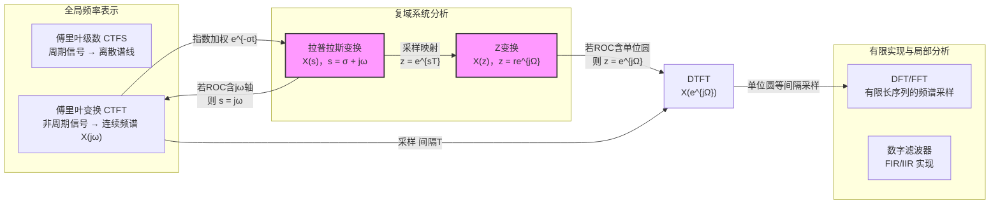

# 拉普拉斯变换与Z变换

> **核心认知锚点**：傅里叶、拉普拉斯、Z 不是三套独立的工具，而是**同一条分析链上的不同层级**——从"频率表示"到"复域系统分析"再到"离散实现"。本模块的关键任务不是背公式，而是吃透三条映射线：$s = j\omega$、$z = e^{j\Omega}$、$z = e^{sT}$。它们决定了你能否在后续模块中真正理解"连续系统稳定看左半平面、离散系统稳定看单位圆内"，以及 [[14-FOC-电机控制/00-README|14-FOC-电机控制]] 中"为什么电流环设计在 $s$ 域、数字实现时却要跑到 $z$ 域"。

## 先建立直觉：为什么需要这么多变换？

在控制工程中，我们用微分方程描述动态系统：

$$
m \frac{d^2 x}{dt^2} + c \frac{dx}{dt} + k x = f(t)
$$

求解这类方程的经典方法在以下场景变得困难：
- 输入信号 $f(t)$ 是分段函数或脉冲信号
- 需要同时处理多个微分方程的耦合系统
- 需要快速分析系统对不同频率输入的响应

但比"解方程更难"的是"理解系统"。给你一个五阶微分方程，你很难一眼看出"这个系统稳定吗？它的谐振频率是多少？加入反馈后会震荡吗？"

**变换的核心思想不是"解方程"，而是"换一副眼镜观察系统"**。

| 眼镜 | 看到什么 | 适合回答的问题 |
|------|---------|-------------|
| 时域 | 波形 $x(t)$ | 初始响应、瞬态行为 |
| 频域（傅里叶）| 频率成分 $X(j\omega)$ | 有哪些频率、谐振在哪 |
| 复频域（拉普拉斯）| $X(s)$ + 极点零点 | 稳定吗？响应速度多快？衰减还是增长？ |
| $z$ 域 | $X(z)$ + 离散极点 | 数字控制器稳定吗？采样周期怎么选？ |

这就是 **deep-research-report** 提出的"统一框架"：

> **全局频率表示（傅里叶） → 复域系统分析（拉普拉斯/Z） → 有限实现与局部分析（DFT/FFT/数字滤波）**

本模块聚焦中间两层——拉普拉斯和 Z。它们是后续 [[15-双控（控制理论与控制工程）/02-经典控制理论/000-图解入门：从根轨迹到Bode图|02-经典控制理论]]（根轨迹、Bode图）、[[15-双控（控制理论与控制工程）/05-数字控制与离散系统/000-图解入门：数字控制与模拟控制的区别|05-数字控制与离散系统]]（离散化、采样）的共同语言。



> **图中高亮的粉色节点**就是本模块的核心内容。注意三条最关键的映射线：
> 1. $s = j\omega$：拉普拉斯在虚轴上的切片 = 傅里叶变换
> 2. $z = e^{j\Omega}$：Z 变换在单位圆上的切片 = DTFT
> 3. $z = e^{sT}$：采样把连续域映射到离散域

## 拉普拉斯变换：从"频率表示"到"系统分析"的关键一跃

### 为什么是"一跃"？——从傅里叶到拉普拉斯

傅里叶变换的定义是：

$$
X(j\omega) = \int_{-\infty}^{\infty} x(t) e^{-j\omega t} dt
$$

这个积分要求信号"绝对可积"（$\int |x(t)| dt < \infty$），否则积分不收敛。但工程中大量信号不满足这个条件：
- 单位阶跃 $u(t)$：$\int_0^\infty 1 dt = \infty$，不绝对可积
- 增长指数 $e^{2t}$：显然不收敛
- 正弦信号 $\cos(\omega t)$：在整个时间轴上也不收敛

**拉普拉斯变换的做法**：给信号乘一个指数衰减因子 $e^{-\sigma t}$，让不收敛的信号变收敛，再做傅里叶变换：

$$
X(s) = \int_{0^-}^{\infty} x(t) e^{-st} dt = \int_{0^-}^{\infty} \underbrace{\left[ x(t) e^{-\sigma t} \right]}_{\text{衰减后的信号}} e^{-j\omega t} dt
$$

其中 $s = \sigma + j\omega$。

> **与变换链的关系**：拉普拉斯变换 = **指数加权后的傅里叶变换**。$\sigma$（$s$ 的实部）负责"让不收敛的信号变收敛"；$j\omega$（$s$ 的虚部）负责"频率分析"。当 $\sigma = 0$（即 $s = j\omega$）且 ROC 包含虚轴时，拉普拉斯在虚轴上的切片就是傅里叶变换：$X(j\omega) = X(s)|_{s=j\omega}$。这是**第一条关键映射线**。

### 定义

对于函数 $f(t)$，$t \geq 0$，其拉普拉斯变换定义为：

$$
F(s) = \mathcal{L}\{f(t)\} = \int_{0^-}^{\infty} f(t) e^{-st} dt
$$

其中 $s = \sigma + j\omega$ 是一个复数变量。积分下限取 $0^-$ 是为了包含 $t=0$ 时刻可能存在的冲激函数。

### 存在条件（ROC）

拉普拉斯变换存在的充分条件是 $f(t)$ 是**指数阶**函数：存在常数 $M$ 和 $\sigma_0$，使得 $|f(t)| \leq M e^{\sigma_0 t}$ 对所有 $t \geq 0$ 成立。工程中遇到的信号（阶跃、指数、正弦）都满足此条件。

> **与变换链的关系**：ROC（Region of Convergence）是拉普拉斯变换的"灵魂"。同一个 $X(s)$ 表达式，不同的 ROC，对应不同的时域信号。ROC 是否包含虚轴，决定了傅里叶变换是否存在；ROC 是否在最右极点的右侧，决定了系统是否因果。这是把"稳定性、因果性、频率响应"纳入同一张图的关键。

### 常用拉普拉斯变换对

| 时域 $f(t)$ | $s$ 域 $F(s)$ | ROC | 与变换链的关系 |
|-------------|---------------|-----|-------------|
| $\delta(t)$（单位冲激） | $1$ | 全平面 | 所有变换域都是"1"——全频平坦的基准 |
| $u(t)$（单位阶跃） | $\frac{1}{s}$ | $\text{Re}(s) > 0$ | 不满足傅里叶收敛条件，但拉普拉斯在 $\sigma > 0$ 时收敛 |
| $e^{-at}$ | $\frac{1}{s+a}$ | $\text{Re}(s) > -a$ | 若 $a > 0$，ROC 包含虚轴，则 $s = j\omega$ 给出傅里叶变换 $1/(a+j\omega)$ |
| $\sin(\omega t)$ | $\frac{\omega}{s^2 + \omega^2}$ | $\text{Re}(s) > 0$ | 极点在 $s = \pm j\omega$，恰好位于虚轴上——这是正弦"纯振荡不衰减"的复域表达 |
| $e^{-at} \sin(\omega t)$ | $\frac{\omega}{(s+a)^2 + \omega^2}$ | $\text{Re}(s) > -a$ | 极点在 $s = -a \pm j\omega$：左半平面 $a>0$ 时稳定，实部 $-a$ 决定衰减速度，虚部 $\omega$ 决定振荡频率 |

> **与变换链的关系**：特别注意 $e^{-at} \sin(\omega t)$ 的极点位置。极点 $s = -a \pm j\omega$ 在 $s$ 平面上的位置直接告诉你：
> - 实部 $-a$：系统的衰减速度（$a > 0$ 则在左半平面，系统稳定）
> - 虚部 $\omega$：系统的振荡频率
> 这是**拉普拉斯比傅里叶更强大的地方**——傅里叶只能看到频率，拉普拉斯同时看到"频率 + 稳定性"。

## 关键性质

### 线性性质

$$
\mathcal{L}\{a f_1(t) + b f_2(t)\} = a F_1(s) + b F_2(s)
$$

### 微分性质（最重要）

$$
\mathcal{L}\left\{\frac{df}{dt}\right\} = s F(s) - f(0^-)
$$

$$
\mathcal{L}\left\{\frac{d^2 f}{dt^2}\right\} = s^2 F(s) - s f(0^-) - f'(0^-)
$$

> **与变换链的关系**：微分运算在 $s$ 域变成了**乘以 $s$**（减去初始条件项）。这意味着：
> - 时域的微分方程 → $s$ 域的代数方程
> - 时域的卷积 → $s$ 域的乘法
> - 系统的动态特性 → $s$ 的多项式比值（传递函数）
> 
> 这就是拉普拉斯变换成为控制理论语言的根本原因。

### 积分性质

$$
\mathcal{L}\left\{\int_0^t f(\tau) d\tau\right\} = \frac{F(s)}{s}
$$

> **与变换链的关系**：积分是微分的逆运算，在 $s$ 域中 $1/s$ 也是 $s$ 的逆运算。这构成了控制系统中"I（积分）控制器"的数学基础：积分在 $s$ 域就是除以 $s$，即低频增益极高——这正是积分能消除稳态误差的数学解释。

### 时移性质

$$
\mathcal{L}\{f(t - T) u(t - T)\} = e^{-sT} F(s)
$$

> **与变换链的关系**：时域延迟 $T$ 对应 $s$ 域乘以 $e^{-sT}$。这是分析数字控制中采样延迟、通信延迟的基础。在 [[15-双控（控制理论与控制工程）/05-数字控制与离散系统/000-图解入门：数字控制与模拟控制的区别|05-数字控制与离散系统]] 中，$e^{-sT}$ 的近似处理（如 Pade 近似）是理解"采样延迟如何影响稳定性"的关键。

### 终值定理（Final Value Theorem）

$$
\lim_{t \to \infty} f(t) = \lim_{s \to 0} s F(s)
$$

> **前提**：$s F(s)$ 的所有极点必须位于 $s$ 平面的左半平面（不含虚轴）。这是求稳态误差的有力工具。
> 
> **与变换链的关系**：终值定理把"时域的无穷远行为"变成了"$s$ 域在 $s=0$ 处的行为"。$s=0$ 对应直流（零频率），所以稳态值就是系统的直流增益。在 [[15-双控（控制理论与控制工程）/02-经典控制理论/000-图解入门：从根轨迹到Bode图|02-经典控制理论]] 中，这会延伸为"位置误差系数"$K_p$ 和"速度误差系数"$K_v$ 的概念。

### 初值定理（Initial Value Theorem）

$$
\lim_{t \to 0^+} f(t) = \lim_{s \to \infty} s F(s)
$$

## 数值示例：用拉普拉斯变换解微分方程

求解如下二阶系统的阶跃响应：

$$
\frac{d^2 y}{dt^2} + 5 \frac{dy}{dt} + 6 y = 6 u(t), \quad y(0) = 0, \quad y'(0) = 0
$$

**步骤 1**：对两边取拉普拉斯变换：

$$
s^2 Y(s) + 5s Y(s) + 6 Y(s) = \frac{6}{s}
$$

> **与变换链的关系**：左边每一项的微分都被替换成了 $s$ 的幂次。$d^2y/dt^2 \to s^2 Y(s)$，$dy/dt \to s Y(s)$。整个微分方程变成了一个**代数方程**。

**步骤 2**：解出 $Y(s)$：

$$
Y(s) = \frac{6}{s(s^2 + 5s + 6)} = \frac{6}{s(s+2)(s+3)}
$$

**步骤 3**：部分分式展开（Partial Fraction Expansion）：

$$
Y(s) = \frac{A}{s} + \frac{B}{s+2} + \frac{C}{s+3}
$$

求系数：

$$
A = \lim_{s \to 0} s Y(s) = \frac{6}{(2)(3)} = 1
$$

$$
B = \lim_{s \to -2} (s+2) Y(s) = \frac{6}{(-2)(1)} = -3
$$

$$
C = \lim_{s \to -3} (s+3) Y(s) = \frac{6}{(-3)(-1)} = 2
$$

所以：

$$
Y(s) = \frac{1}{s} - \frac{3}{s+2} + \frac{2}{s+3}
$$

**步骤 4**：逆变换：

$$
y(t) = 1 - 3 e^{-2t} + 2 e^{-3t}, \quad t \geq 0
$$

**验证**：
- $t = 0$：$y(0) = 1 - 3 + 2 = 0$ ✓
- $t \to \infty$：$y(\infty) = 1$（稳态值=1，与输入幅值一致）✓

> **与变换链的关系**：从极点位置可以直接读出时域特性——极点 $s = -2$ 和 $s = -3$ 都在左半平面，所以系统稳定。极点离虚轴越远（|-3| > |-2|），对应的指数衰减越快，所以 $e^{-3t}$ 项比 $e^{-2t}$ 衰减更快。这就是"极点位置决定响应形态"的直觉基础，后续 [[15-双控（控制理论与控制工程）/02-经典控制理论/000-图解入门：从根轨迹到Bode图|02-经典控制理论]] 的时域分析会系统展开。

```python
import numpy as np
import matplotlib.pyplot as plt

def step_response(t):
    return 1.0 - 3.0*np.exp(-2.0*t) + 2.0*np.exp(-3.0*t)

t = np.linspace(0, 5, 200)
y = step_response(t)

# plt.plot(t, y)
# plt.axhline(1, color='r', linestyle='--')
# plt.xlabel('t [s]'); plt.ylabel('y(t)')
```

## 传递函数的引入

在零初始条件下，对线性微分方程取拉普拉斯变换后，输出与输入之比就是**传递函数**（Transfer Function）：

$$
G(s) = \frac{Y(s)}{U(s)} = \frac{b_m s^m + b_{m-1} s^{m-1} + \dots + b_0}{a_n s^n + a_{n-1} s^{n-1} + \dots + a_0}
$$

传递函数完全刻画了线性时不变系统的动态特性。其分母多项式的根称为**极点**（Poles），分子多项式的根称为**零点**（Zeros）。

> **与变换链的关系**：传递函数是拉普拉斯变换的直接产物，也是经典控制理论的唯一语言。有了 $G(s)$，你可以：
> 1. 看极点位置判断稳定性（全在左半平面 → 稳定）
> 2. 令 $s = j\omega$ 得到频率响应 $G(j\omega)$
> 3. 通过框图化简求闭环传递函数
> 4. 在根轨迹图上分析参数变化的影响
> 
> 这些工具将在 [[15-双控（控制理论与控制工程）/02-经典控制理论/000-图解入门：从根轨迹到Bode图|02-经典控制理论]] 中系统展开。
> 
> **与 FOC 的关联**：在 [[14-FOC-电机控制/00-README|14-FOC-电机控制]] 中，电机电流环的传递函数就是 $G(s) = \frac{I(s)}{V(s)} = \frac{1}{Ls + R}$（忽略反电动势）。$s = -R/L$ 处的极点决定了电流响应的速度。电流控制器 $G_c(s)$ 的设计就是选择合适的极点配置，使闭环带宽满足要求。

## Z变换：离散时间的对应物

当控制系统用数字计算机实现时，信号是采样得到的序列 $x[k]$，此时需要**Z变换**。

### 定义

$$
X(z) = \mathcal{Z}\{x[k]\} = \sum_{k=0}^{\infty} x[k] z^{-k}
$$

> **与变换链的关系**：Z 变换的推导思路与拉普拉斯完全平行：
> - 拉普拉斯：给连续信号乘 $e^{-\sigma t}$，再做傅里叶变换 → $s = \sigma + j\omega$
> - Z 变换：给离散序列乘 $r^{-k}$，再做 DTFT → $z = r e^{j\Omega}$
> 
> $r$（$z$ 的模）对应"衰减/增长速度"，$\Omega$（$z$ 的幅角）对应"数字频率"。当 $r = 1$（即 $z = e^{j\Omega}$）且 ROC 包含单位圆时，Z 在单位圆上的切片就是 DTFT：$X(e^{j\Omega}) = X(z)|_{z=e^{j\Omega}}$。这是**第二条关键映射线**。

### Z变换与拉普拉斯变换的关系——第三条关键映射线

如果连续信号 $x(t)$ 以周期 $T_s$ 采样得到 $x[k] = x(kT_s)$，则：

$$
z = e^{sT_s}
$$

> **与变换链的关系**：这是**第三条、也是最关键的一条映射线**。它有三层工程含义：
> 1. **极点映射**：连续极点 $s_p$ 映射到离散极点 $z_p = e^{s_p T_s}$。因此 $\text{Re}(s_p) < 0$（左半平面稳定）必然映射为 $|z_p| < 1$（单位圆内稳定）。这就是"连续稳定看左半平面、离散稳定看单位圆内"的数学来源。
> 2. **虚轴映射**：$s = j\omega$ 映射到 $z = e^{j\omega T_s}$，即单位圆。连续频率轴被"折叠"到单位圆上，且是多对一的（周期性），这正是混叠的复平面版本。
> 3. **采样效应**：$z = e^{sT}$ 不是简单的坐标变换，而是有信息损失的过程——高于奈奎斯特频率的成分会混叠。这是 [[15-双控（控制理论与控制工程）/05-数字控制与离散系统/000-图解入门：数字控制与模拟控制的区别|05-数字控制与离散系统]] 的核心内容。
> 
> **与 FOC 的关联**：在 [[14-FOC-电机控制/00-README|14-FOC-电机控制]] 中，电流环通常先在连续域设计（$s$ 域），然后用零阶保持法或双线性变换法离散化为数字控制器（$z$ 域）。$z = e^{sT}$ 的映射关系决定了离散化后的极点位置和系统稳定性。采样周期 $T_s$ 越小，$z = e^{sT_s}$ 越接近 $z = 1 + sT_s$（即单位圆附近），离散系统越接近连续系统。

### 常用Z变换对

| 时域序列 $x[k]$ | $z$ 域 $X(z)$ | ROC | 与变换链的关系 |
|-----------------|---------------|-----|-------------|
| $\delta[k]$ | $1$ | 所有 $z$ | 与连续冲激相同，所有域都是"1" |
| $u[k]$（单位阶跃） | $\frac{z}{z-1} = \frac{1}{1-z^{-1}}$ | $\vertz\vert > 1$ | ROC 在单位圆外，对应因果序列；$z=1$ 处的极点对应直流分量 |
| $a^k$ | $\frac{z}{z-a}$ | $\vertz\vert > \verta\vert$ | 极点在 $z = a$：$\verta\vert < 1$ 稳定，$\verta\vert$ 越接近 0 衰减越快 |
| $\cos(\Omega k)$ | $\frac{z(z-\cos\Omega)}{z^2 - 2z\cos\Omega + 1}$ | $\vertz\vert > 1$ | 极点在 $z = e^{\pm j\Omega}$（单位圆上），对应无阻尼振荡 |

### Z变换的延迟性质

$$
\mathcal{Z}\{x[k-1]\} = z^{-1} X(z)
$$

> **$z^{-1}$ 表示一个采样周期的延迟**。这是数字控制器实现中的基本操作。
> 
> **与变换链的关系**：$z^{-1}$ 是数字系统的"记忆单元"——它保存上一个采样时刻的值。在 FPGA 或 MCU 中实现数字控制器时，$z^{-1}$ 对应一个寄存器。所有数字滤波器（FIR/IIR）本质上都是 $z^{-1}$ 的加权组合。

## 数值示例：从差分方程到Z域

数字控制器常用差分方程描述：

$$
y[k] + a_1 y[k-1] + a_2 y[k-2] = b_0 u[k] + b_1 u[k-1]
$$

对两边取Z变换（零初始条件）：

$$
Y(z) + a_1 z^{-1} Y(z) + a_2 z^{-2} Y(z) = b_0 U(z) + b_1 z^{-1} U(z)
$$

$$
Y(z) (1 + a_1 z^{-1} + a_2 z^{-2}) = U(z) (b_0 + b_1 z^{-1})
$$

离散传递函数：

$$
G(z) = \frac{Y(z)}{U(z)} = \frac{b_0 + b_1 z^{-1}}{1 + a_1 z^{-1} + a_2 z^{-2}} = \frac{b_0 z + b_1}{z^2 + a_1 z + a_2} \cdot z
$$

例如，$a_1 = -1.5, a_2 = 0.7, b_0 = 0.2, b_1 = 0.1$：

$$
G(z) = \frac{0.2 + 0.1 z^{-1}}{1 - 1.5 z^{-1} + 0.7 z^{-2}} = \frac{0.2 z^2 + 0.1 z}{z^2 - 1.5 z + 0.7}
$$

极点：$z^2 - 1.5z + 0.7 = 0$ 的根为 $z = 0.75 \pm j0.487$。模 $|z| = \sqrt{0.75^2 + 0.487^2} = \sqrt{0.5625 + 0.237} = \sqrt{0.7995} \approx 0.894 < 1$，系统稳定。

> **与变换链的关系**：从极点位置可以直接读出稳定性——$|z| < 1$ 稳定。此外，极点角度 $\theta = \arctan(0.487/0.75) \approx 0.576$ rad，对应数字频率 $\Omega \approx 0.576$ rad/sample。若采样频率 $f_s = 10$ kHz，则对应的实际频率 $f = \Omega f_s / (2\pi) \approx 917$ Hz。这就是"$z$ 域极点 → 实际频率与阻尼"的直觉路径。

```c
// Discrete controller implementation (Direct Form II)
// y[k] = -a1*y[k-1] - a2*y[k-2] + b0*u[k] + b1*u[k-1]

typedef struct {
    float a1, a2;    // denominator coefficients
    float b0, b1;    // numerator coefficients
    float w[2];      // state variables (w1, w2)
} DiscreteController;

float controller_update(DiscreteController* ctrl, float input) {
    // w[k] = input - a1*w[k-1] - a2*w[k-2]
    float w = input - ctrl->a1 * ctrl->w[0] - ctrl->a2 * ctrl->w[1];
    
    // output = b0*w[k] + b1*w[k-1]
    float output = ctrl->b0 * w + ctrl->b1 * ctrl->w[0];
    
    // shift state
    ctrl->w[1] = ctrl->w[0];
    ctrl->w[0] = w;
    
    return output;
}
```

> **与 FOC 的关联**：上面的代码就是 [[14-FOC-电机控制/00-README|14-FOC-电机控制]] 中数字 PI 控制器的实现骨架。在 FOC 的电流环中，$u[k]$ 是电流误差，$y[k]$ 是输出电压指令。系数 $a_1, a_2, b_0, b_1$ 由连续域 PI 参数和离散化方法（如双线性变换）决定。理解 $z$ 域传递函数，就能理解为什么不同的离散化方法会导致不同的相位特性，以及为什么采样频率必须远高于电流环带宽。

## 常见错误与纠正

### 错误 1：逆变换时忽略收敛域导致结果错误

**错误**：看到 $F(s) = \frac{1}{s-a}$ 就逆变换为 $e^{at}$，不考虑收敛域。

**纠正**：$\mathcal{L}^{-1}\{\frac{1}{s-a}\} = e^{at}$ 仅在收敛域 $\text{Re}(s) > a$ 时成立。在控制工程中，因为我们只关心因果信号（$t<0$ 时为零），所以默认使用右侧收敛域。但在更一般的信号处理中，如果收敛域是 $\text{Re}(s) < a$，逆变换结果不同。

> **与变换链的关系**：ROC 决定时域信号的"方向"。右边序列（因果信号）ROC 在最右极点右侧；左边序列（反因果信号）ROC 在最左极点左侧。控制系统中的传递函数总是对应因果系统，因此 ROC 默认在最右极点右侧。

**工程实践**：控制系统中的传递函数总是对应因果系统，因此逆变换结果默认是因果信号。如果极点在右半平面（$a > 0$），系统不稳定，但逆变换仍然是 $e^{at} u(t)$。

### 错误 2：使用终值定理时未检查条件

**错误**：对 $F(s) = \frac{1}{s^2 + 1}$（对应 $f(t) = \sin t$）应用终值定理：

$$
\lim_{s \to 0} s \cdot \frac{1}{s^2 + 1} = 0
$$

然后得出结论：$\lim_{t \to \infty} \sin t = 0$。

**纠正**：终值定理要求 $sF(s)$ 的所有极点在左半平面（不含虚轴）。$F(s) = \frac{1}{s^2+1}$ 的极点在 $s = \pm j$，位于虚轴上，不满足条件。实际上 $\sin t$ 没有极限，终值定理不适用。这是初学者最常犯的错误之一。

> **与变换链的关系**：终值定理的适用条件本质上与傅里叶变换的存在条件相通——如果 $sF(s)$ 在虚轴上有极点，说明时域信号中存在不衰减的振荡成分，傅里叶变换不收敛（或需要广义函数），终值定理当然也不适用。

**检查方法**：在使用终值定理前，先检查 $sF(s)$ 的分母是否有虚轴或右半平面极点。如果有，终值定理不可用。

### 错误 3：把 $s$ 域和 $z$ 域的稳定性判据混淆

**错误**：在离散系统中使用"左半平面稳定"的判据，或者在连续系统中使用"单位圆内稳定"的判据。

**纠正**：这是 $z = e^{sT}$ 映射最容易被忽略的一点。左半平面 $s$ 映射到 $z$ 平面时，不是左半平面，而是**单位圆内部**。

> **与变换链的关系**：
> - $s = \sigma + j\omega$，$\sigma < 0$（左半平面）
> - $z = e^{sT} = e^{\sigma T} e^{j\omega T}$
> - $|z| = e^{\sigma T} < e^0 = 1$（单位圆内）
> 
> 这个映射是指数型的，不是线性的。虚轴 $s = j\omega$ 映射到单位圆 $z = e^{j\omega T}$，但频率轴被压缩和折叠了。

## 自测习题

**Q1**. 求 $f(t) = 3 e^{-2t} + 4t$ 的拉普拉斯变换。

> **答案**：
> $$
> F(s) = \frac{3}{s+2} + \frac{4}{s^2}
> $$
> 第一项 ROC：$\text{Re}(s) > -2$；第二项 ROC：$\text{Re}(s) > 0$。整体 ROC 是两者的交集：$\text{Re}(s) > 0$。

**Q2**. 已知 $F(s) = \frac{2s+5}{s^2+3s+2}$，求 $f(t)$ 并计算 $f(0^+)$ 和 $f(\infty)$。

> **答案**：
> 
> 因式分解：$F(s) = \frac{2s+5}{(s+1)(s+2)} = \frac{A}{s+1} + \frac{B}{s+2}$
> 
> $A = \frac{2(-1)+5}{-1+2} = 3$，$B = \frac{2(-2)+5}{-2+1} = -1$
> 
> $F(s) = \frac{3}{s+1} - \frac{1}{s+2}$
> 
> $f(t) = 3 e^{-t} - e^{-2t}$
> 
> $f(0^+) = 3 - 1 = 2$（或用初值定理：$\lim_{s\to\infty} sF(s) = \lim_{s\to\infty} \frac{2s^2+5s}{s^2+3s+2} = 2$）
> 
> $f(\infty) = 0$（用终值定理：$\lim_{s\to 0} sF(s) = 0$，验证 $sF(s)$ 极点 $-1,-2$ 都在左半平面）
> 
> **与变换链的关系**：极点 $s = -1$ 和 $s = -2$ 都在左半平面，系统稳定，终值定理适用。$s = -1$ 离虚轴更近，所以 $e^{-t}$ 项比 $e^{-2t}$ 衰减慢，主导了瞬态响应。

**Q3**. 某数字系统的脉冲传递函数为 $G(z) = \frac{0.5 z^{-1}}{1 - 0.8 z^{-1}}$，求其对应的差分方程，并判断稳定性。

> **答案**：
> 
> 改写为 $G(z) = \frac{Y(z)}{U(z)} = \frac{0.5 z^{-1}}{1 - 0.8 z^{-1}}$
> 
> $Y(z) (1 - 0.8 z^{-1}) = 0.5 z^{-1} U(z)$
> 
> 差分方程：$y[k] - 0.8 y[k-1] = 0.5 u[k-1]$，即 $y[k] = 0.8 y[k-1] + 0.5 u[k-1]$
> 
> 极点：$1 - 0.8 z^{-1} = 0 \Rightarrow z = 0.8$
> 
> $|z| = 0.8 < 1$，系统稳定。
> 
> 阶跃响应的稳态值：$G(1) = \frac{0.5}{1-0.8} = 2.5$
> 
> **与变换链的关系**：极点 $z = 0.8$ 在单位圆内，对应稳定的指数衰减。注意 $z = 0.8$ 在 $s$ 域对应的极点是 $s = \ln(0.8)/T \approx -0.223/T$，即在左半平面。若采样周期 $T = 1$ ms，则对应时间常数 $\tau \approx 1/0.223 \approx 4.5$ ms。

**Q4**. 解释为什么积分 $\int f(t) dt$ 在拉普拉斯域对应除以 $s$，而微分 $df/dt$ 对应乘以 $s$（忽略初始条件）。从物理上理解这个"对偶性"。

> **答案**：
> 
> 从定义出发：$\mathcal{L}\{f(t)\} = \int_0^\infty f(t) e^{-st} dt = F(s)$。
> 
> 对 $F(s)$ 关于 $s$ 求导：$\frac{dF}{ds} = \int_0^\infty f(t) (-t) e^{-st} dt = -\mathcal{L}\{t f(t)\}$。这说明乘以 $t$ 在时域对应对 $s$ 求导。
> 
> 更直观的理解：微分是"看变化率"，变化率大的信号含有高频成分；在 $s$ 域中，高频对应 $s$ 的大值，乘以 $s$ 放大了高频分量。积分是"累积"，累积会平滑高频，除以 $s$ 衰减了高频分量。
> 
> 从算子角度：微分算子 $d/dt$ 和积分算子 $\int dt$ 互为逆运算。$s$ 和 $1/s$ 也互为逆运算，因此这种对应对偶关系是自然的。
> 
> **与变换链的关系**：这个对偶性是整个控制理论的数学基石。PID 控制器中的 P（比例）对应增益，I（积分）对应 $1/s$（低频增益大），D（微分）对应 $s$（高频增益大）。在 [[15-双控（控制理论与控制工程）/04-PID与工业控制器设计/000-图解入门：PID的物理直觉|04-PID与工业控制器设计]] 中，你会看到 PID 的频域设计就是基于 $s$ 和 $1/s$ 的物理意义。

**Q5**. 在 [[14-FOC-电机控制/00-README|14-FOC-电机控制]] 中，你已经在连续域设计了 PI 电流控制器。现在需要把它离散化到数字控制器中。已知连续域 PI 控制器为 $G_c(s) = K_p + \frac{K_i}{s}$，采样周期为 $T_s$。请用 $z = e^{sT_s}$ 的映射关系，解释为什么积分项 $1/s$ 在离散域中会变成类似 $\frac{T_s}{2} \frac{z+1}{z-1}$ 的形式（提示：考虑双线性变换）。

> **答案**：
> 
> 双线性变换（Tustin 方法）用梯形法则近似积分：$s = \frac{2}{T_s} \frac{z-1}{z+1}$。
> 
> 因此 $1/s$ 变为：
> $$
> \frac{1}{s} = \frac{T_s}{2} \frac{z+1}{z-1}
> $$
> 
> **与变换链的关系**：
> - 当 $s = j\omega$（虚轴）时，$z = e^{j\omega T_s}$（单位圆）。
> - 双线性变换把 $s$ 平面的虚轴映射到 $z$ 平面的单位圆——这是它相比其他离散化方法（如零阶保持）更受欢迎的原因：至少保留了频率响应的"边界对应"。
> - 当 $z \to 1$（即 $s \to 0$）时，$\frac{T_s}{2} \frac{z+1}{z-1} \approx \frac{T_s}{2} \frac{2}{z-1} = \frac{T_s}{z-1}$，而 $z-1 \approx sT_s$（对于小 $s$），所以 $\frac{T_s}{z-1} \approx \frac{1}{s}$，恢复了连续域的积分特性。
> 
> 这正是 [[15-双控（控制理论与控制工程）/05-数字控制与离散系统/000-图解入门：数字控制与模拟控制的区别|05-数字控制与离散系统]] 中"连续→离散化"的核心思想。
