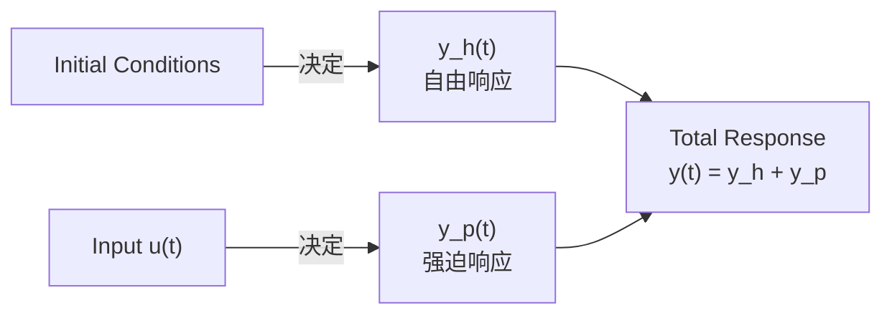

# 常微分方程与稳定性初步

> 微分方程是控制系统的"母语"。理解自由响应与强迫响应、掌握稳定性概念，是从数学分析走向工程判断的桥梁。

## 为什么控制系统用微分方程描述

物理世界的动态本质上是连续的。牛顿第二定律、能量守恒、电路的基尔霍夫定律，最终都归结为微分方程。控制系统的任务就是：**通过输入信号 $u(t)$ 影响这些微分方程的解 $y(t)$，使其按期望的方式演化**。

一个通用的 $n$ 阶线性常微分方程（ODE）：

$$
a_n \frac{d^n y}{dt^n} + a_{n-1} \frac{d^{n-1} y}{dt^{n-1}} + \dots + a_1 \frac{dy}{dt} + a_0 y = b_m \frac{d^m u}{dt^m} + \dots + b_0 u
$$

## 解的结构：自由响应 + 强迫响应

线性 ODE 的解总可以分解为两部分：

$$
y(t) = y_h(t) + y_p(t)
$$

| 分量 | 名称 | 来源 | 特点 |
|------|------|------|------|
| $y_h(t)$ | 齐次解 / 自由响应 / 暂态响应 | 令输入 $u(t) = 0$，解齐次方程 | 由初始条件和系统极点决定，通常随时间衰减 |
| $y_p(t)$ | 特解 / 强迫响应 / 稳态响应 | 由输入 $u(t)$ 的形式假设 | 与输入同"频率"，持续存在 |



## 自由响应：齐次方程的解

令输入为零，考虑齐次方程：

$$
a_n \frac{d^n y}{dt^n} + \dots + a_0 y = 0
$$

假设解的形式为 $y = e^{st}$，代入得：

$$
(a_n s^n + a_{n-1} s^{n-1} + \dots + a_0) e^{st} = 0
$$

因为 $e^{st} \neq 0$，所以必须满足**特征方程**：

$$
a_n s^n + a_{n-1} s^{n-1} + \dots + a_0 = 0
$$

这个方程的根 $s_1, s_2, \dots, s_n$ 就是系统的**极点**，决定了自由响应的模态。

### 一阶系统

$$
T \frac{dy}{dt} + y = 0, \quad y(0) = y_0
$$

特征方程：$Ts + 1 = 0 \Rightarrow s = -1/T$

解：

$$
y(t) = y_0 e^{-t/T}
$$

$T$ 称为**时间常数**（Time Constant）。$t = T$ 时，$y(T) = y_0 e^{-1} \approx 0.368 y_0$（衰减到初始值的 36.8%）。$t = 3T$ 时约衰减到 5%，$t = 5T$ 时约 0.7%，通常认为系统已到达稳态。

### 二阶系统（最重要的模型）

$$
\frac{d^2 y}{dt^2} + 2\zeta\omega_n \frac{dy}{dt} + \omega_n^2 y = 0
$$

特征方程：$s^2 + 2\zeta\omega_n s + \omega_n^2 = 0$

根：

$$
s_{1,2} = -\zeta\omega_n \pm \omega_n \sqrt{\zeta^2 - 1}
$$

| 阻尼比 $\zeta$ | 根的位置 | 响应类型 | 特点 |
|----------------|----------|----------|------|
| $\zeta > 1$ | 两个不等负实根 | 过阻尼 | 缓慢单调收敛，无振荡 |
| $\zeta = 1$ | 两个相等负实根 | 临界阻尼 | 最快无振荡收敛 |
| $0 < \zeta < 1$ | 共轭复根，实部为负 | 欠阻尼 | 衰减振荡，超调量存在 |
| $\zeta = 0$ | 纯虚根 $\pm j\omega_n$ | 无阻尼 | 等幅振荡 |
| $\zeta < 0$ | 实部为正 | 不稳定 | 发散振荡或单调发散 |

### 欠阻尼二阶系统的响应参数

对于 $0 < \zeta < 1$：

$$
s_{1,2} = -\zeta\omega_n \pm j\omega_n\sqrt{1-\zeta^2} = -\zeta\omega_n \pm j\omega_d
$$

其中 $\omega_d = \omega_n\sqrt{1-\zeta^2}$ 是**阻尼自然频率**（Damped Natural Frequency）。

响应：

$$
y(t) = 1 - \frac{e^{-\zeta\omega_n t}}{\sqrt{1-\zeta^2}} \sin(\omega_d t + \phi)
$$

关键指标：

| 指标 | 公式 | 含义 |
|------|------|------|
| 超调量 | $M_p = e^{-\pi\zeta / \sqrt{1-\zeta^2}}$ | 最大超出终值的百分比 |
| 峰值时间 | $t_p = \pi / \omega_d$ | 达到第一个峰值的时间 |
| 调节时间（2%准则） | $t_s \approx 4 / (\zeta\omega_n)$ | 进入±2%误差带的时间 |
| 调节时间（5%准则） | $t_s \approx 3 / (\zeta\omega_n)$ | 进入±5%误差带的时间 |

### 数值示例

系统：$\ddot{y} + 6\dot{y} + 25y = 25u(t)$，$y(0) = 0, \dot{y}(0) = 0$

对比标准形式：$\omega_n^2 = 25 \Rightarrow \omega_n = 5$ rad/s

$2\zeta\omega_n = 6 \Rightarrow \zeta = 6/(2 \times 5) = 0.6$

$\omega_d = 5\sqrt{1-0.36} = 5 \times 0.8 = 4$ rad/s

超调量：$M_p = e^{-\pi \times 0.6 / 0.8} = e^{-0.75\pi} = e^{-2.356} \approx 0.095 = 9.5\%$

峰值时间：$t_p = \pi / 4 = 0.785$ s

调节时间（2%）：$t_s \approx 4 / (0.6 \times 5) = 4/3 = 1.33$ s

```python
import numpy as np
import matplotlib.pyplot as plt

omega_n = 5.0
zeta = 0.6
omega_d = omega_n * np.sqrt(1 - zeta**2)
t = np.linspace(0, 3, 300)

# Step response of standard second-order system
# y(t) = 1 - exp(-zeta*omega_n*t) * sin(omega_d*t + phi) / sqrt(1-zeta^2)
phi = np.arccos(zeta)
y = 1.0 - np.exp(-zeta*omega_n*t) * np.sin(omega_d*t + phi) / np.sqrt(1-zeta**2)

Mp = np.exp(-np.pi * zeta / np.sqrt(1-zeta**2))
tp = np.pi / omega_d
ts = 4.0 / (zeta * omega_n)

# plt.plot(t, y, label=f'zeta={zeta}, wn={omega_n}')
# plt.axhline(1+Mp, color='r', linestyle='--', label=f'Mp={Mp:.2%}')
# plt.axvline(tp, color='g', linestyle='--', label=f'tp={tp:.3f}s')
# plt.axvline(ts, color='m', linestyle='--', label=f'ts={ts:.3f}s')
```

## 稳定性：BIBO 稳定与渐近稳定

### BIBO 稳定（Bounded-Input Bounded-Output）

**定义**：若任意有界输入产生有界输出，则系统 BIBO 稳定。

**判据**：线性时不变系统 BIBO 稳定的充要条件是其脉冲响应绝对可积：

$$
\int_{-\infty}^{\infty} |g(t)| dt < \infty
$$

等价地，在 $s$ 域中：

$$
\text{BIBO 稳定} \Leftrightarrow \text{所有极点位于左半平面（不含虚轴）}
$$

### 渐近稳定（Asymptotic Stability）

**定义**：若零输入条件下，任意初始状态最终收敛到原点，则系统渐近稳定。

**判据**：状态矩阵 $A$ 的所有特征值严格位于左半平面。

**关系**：

```
渐近稳定  =>  BIBO 稳定
BIBO 稳定  =/=>  渐近稳定（如果存在隐藏的不稳定模态）
```

只有在系统完全能控且完全能观时，两者等价。

## Routh-Hurwitz 判据（初步）

对于高阶系统（$n > 2$），直接求极点可能很困难。Routh-Hurwitz 判据提供了一种**不需求解特征方程**就能判断稳定性的方法。

### 二阶系统的简单判据

对于 $a_2 s^2 + a_1 s + a_0 = 0$，稳定的充要条件：

$$
a_2 > 0, \quad a_1 > 0, \quad a_0 > 0
$$

即**所有系数同号且非零**。

### 三阶系统

对于 $a_3 s^3 + a_2 s^2 + a_1 s + a_0 = 0$，稳定的必要条件：

$$
a_3 > 0, a_2 > 0, a_1 > 0, a_0 > 0
$$

并且需要满足附加条件：$a_2 a_1 > a_3 a_0$

### 数值示例

判断 $s^3 + 4s^2 + 5s + 2 = 0$ 的稳定性。

必要条件：$a_3=1>0, a_2=4>0, a_1=5>0, a_0=2>0$ ✓

附加条件：$a_2 a_1 = 4 \times 5 = 20 > a_3 a_0 = 1 \times 2 = 2$ ✓

系统稳定。实际上可以因式分解：$(s+1)^2(s+2) = 0$，极点 $-1, -1, -2$，都在左半平面。

## 常见错误与纠正

### 错误 1：混淆"稳定"与"收敛"的概念，认为临界稳定也是稳定

**错误**：看到 $s = \pm j$ 的极点就说"系统是稳定的，因为响应不发散"。

**纠正**：在控制工程中，**稳定通常指渐近稳定或 BIBO 稳定**。临界稳定（极点在虚轴上，如纯积分器 $1/s$ 或无阻尼振荡器 $1/(s^2+\omega^2)$）在严格定义下是不稳定的：

- 对于 BIBO 稳定：虚轴极点不满足绝对可积条件。例如 $\mathcal{L}^{-1}\{1/s\} = u(t)$，$\int_0^\infty |u(t)| dt = \infty$。
- 对于渐近稳定：临界稳定不收敛到原点。

**工程实践**：有些教材将临界稳定归入"稳定"范畴（称为"Lyapunov 稳定"），但在工程设计中，临界稳定通常不可接受，因为任何小的参数扰动都可能使其变为不稳定。工程师应将"渐近稳定"作为设计目标。

### 错误 2：计算二阶系统参数时符号错误

**错误**：将标准形式写成 $\ddot{y} + 2\zeta\omega_n \dot{y} + \omega_n^2 y = \omega_n^2 u$ 时，误认为 $2\zeta\omega_n$ 是系数 $a_1$，但实际方程是 $a_2 \ddot{y} + a_1 \dot{y} + a_0 y = b_0 u$，标准化后 $a_2 = 1$ 时才是 $2\zeta\omega_n = a_1$。

**纠正**：在标准化时，必须将最高阶导数的系数化为 1：

$$
\ddot{y} + \frac{a_1}{a_2} \dot{y} + \frac{a_0}{a_2} y = \frac{b_0}{a_2} u
$$

然后对比：

$$
\omega_n = \sqrt{\frac{a_0}{a_2}}, \quad \zeta = \frac{a_1}{2\sqrt{a_0 a_2}}
$$

**常见错误示例**：方程 $2\ddot{y} + 8\dot{y} + 18y = 18u$。错误做法：$\omega_n = \sqrt{18} = 4.24$，$\zeta = 8/(2 \times 4.24) = 0.943$。正确做法：先标准化为 $\ddot{y} + 4\dot{y} + 9y = 9u$，然后 $\omega_n = 3$，$\zeta = 4/(2 \times 3) = 0.667$。

## 自测习题

**Q1**. 求解微分方程 $\dot{y} + 4y = 8u(t)$，$y(0) = 2$，其中 $u(t)$ 是单位阶跃函数。求自由响应、强迫响应和总响应。

> **答案**：
> 
> **齐次方程**：$\dot{y} + 4y = 0 \Rightarrow y_h = C e^{-4t}$
> 
> **特解**：设 $y_p = K$（常数），代入：$0 + 4K = 8 \Rightarrow K = 2$
> 
> **总解**：$y(t) = C e^{-4t} + 2$
> 
> **初始条件**：$y(0) = C + 2 = 2 \Rightarrow C = 0$
> 
> **结果**：$y(t) = 2$（常数！）。这说明初始状态恰好等于稳态值，没有暂态过程。
> 
> 如果初始条件改为 $y(0) = 0$：$C + 2 = 0 \Rightarrow C = -2$，$y(t) = 2(1 - e^{-4t})$。
> 
> 自由响应：$y_h = -2e^{-4t}$（衰减到零）
> 强迫响应：$y_p = 2$（阶跃的稳态响应）
> 总响应：$y(t) = 2 - 2e^{-4t}$

**Q2**. 某二阶系统的单位阶跃响应显示超调量约为 16.3%，峰值时间约为 0.785 s。求其阻尼比 $\zeta$ 和自然频率 $\omega_n$。

> **答案**：
> 
> 超调量公式：$M_p = e^{-\pi\zeta / \sqrt{1-\zeta^2}} = 0.163$
> 
> 取对数：$-\frac{\pi\zeta}{\sqrt{1-\zeta^2}} = \ln(0.163) = -1.81$
> 
> $\frac{\zeta}{\sqrt{1-\zeta^2}} = \frac{1.81}{\pi} = 0.576$
> 
> $\zeta^2 = 0.576^2 (1-\zeta^2) = 0.332(1-\zeta^2)$
> 
> $\zeta^2(1+0.332) = 0.332 \Rightarrow \zeta^2 = 0.332/1.332 = 0.249 \Rightarrow \zeta = 0.5$
> 
> 峰值时间：$t_p = \pi / \omega_d = \pi / (\omega_n\sqrt{1-0.25}) = 0.785$
> 
> $\omega_n = \pi / (0.785 \times 0.866) = 3.14 / 0.68 = 4.62$ rad/s
> 
> 或者更精确：$\omega_d = \pi / 0.785 = 4.0$，$\omega_n = 4.0 / 0.866 = 4.62$ rad/s。
> 
> 实际上如果 $t_p = 0.785 = \pi/4$，则 $\omega_d = 4$，$\omega_n = 4/\sqrt{1-0.25} = 4/0.866 = 4.62$。若取 $\omega_n = 5$ 则 $t_p = \pi/4.33 = 0.726$，不一致。所以 $\omega_n \approx 4.62$ 或 $4.0$（如果 $t_p$ 恰好取 $\pi/4$ 且 $\omega_n = 4$ 但 $\zeta = 0$ 时不符）。这里 $M_p = 16.3\%$ 对应 $\zeta = 0.5$ 是精确的。

**Q3**. 用 Routh-Hurwitz 判据判断 $s^4 + 2s^3 + 3s^2 + 4s + 5 = 0$ 的稳定性。如果不稳定，说明有几个右半平面极点。

> **答案**：
> 
> Routh 表：
> 
> | $s^4$ | 1 | 3 | 5 |
> | $s^3$ | 2 | 4 | 0 |
> | $s^2$ | $(2\times3-1\times4)/2 = 1$ | $(2\times5-1\times0)/2 = 5$ | |
> | $s^1$ | $(1\times4-2\times5)/1 = -6$ | 0 | |
> | $s^0$ | $(-6\times5-1\times0)/(-6) = 5$ | | |
> 
> 第一列：1, 2, 1, -6, 5。符号变化两次（从 1 到 -6，从 -6 到 5），因此有 **2 个右半平面极点**，系统不稳定。

**Q4**. 解释为什么过阻尼系统（$\zeta > 1$）的响应没有超调，但通常比临界阻尼系统（$\zeta = 1$）更慢。在什么工程场景下，工程师可能故意选择过阻尼设计？

> **答案**：
> 
> 过阻尼时，特征方程有两个不等负实根：$s_{1,2} = -\zeta\omega_n \pm \omega_n\sqrt{\zeta^2-1}$。解是两个指数衰减项的叠加：$y(t) = c_1 e^{s_1 t} + c_2 e^{s_2 t}$。指数函数单调衰减，因此没有振荡和超调。
> 
> 但过阻尼的慢速来源于：其中一个根非常接近原点（$s_1 \approx -\omega_n/(2\zeta)$ 当 $\zeta \gg 1$），对应非常大的时间常数。系统收敛受这个"慢模态"主导。
> 
> 临界阻尼时，两个根重合在 $s = -\omega_n$，是"最快无振荡响应"的极限。
> 
> **故意选择过阻尼的场景**：
> - 机械定位系统：不允许任何位置超调（如精密定位台，超调可能导致碰撞）
> - 液位/压力控制：超调可能导致溢流或超压
> - 热过程：温度过冲可能损坏产品
> - 安全关键系统：宁可慢一些，也绝对不能有振荡
