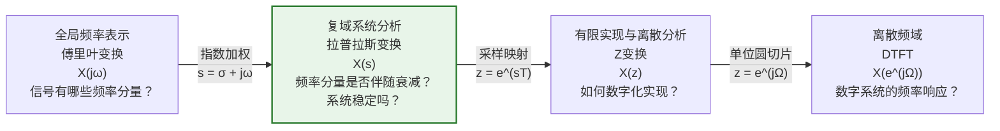
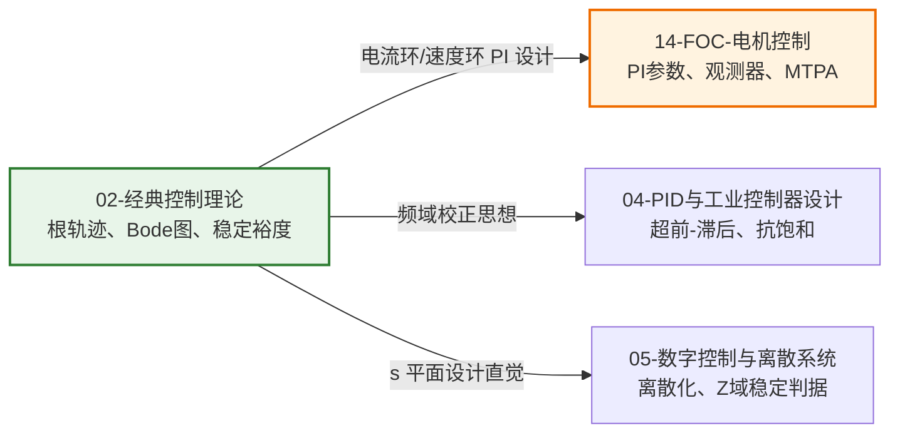
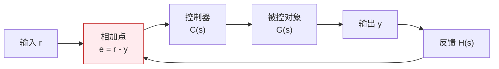
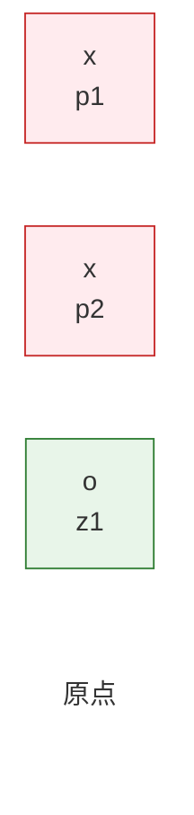

# 图解入门：从根轨迹到Bode图

## 核心认知锚点

> **经典控制理论是"变换链"中的复域系统分析层：在拉普拉斯域（$s$ 平面）上将微分方程转化为代数方程，通过极点-零点、根轨迹、Bode图等工具，直接从复域视角判断系统的稳定性、动态品质和频域特性。**

一句话概括：**它在"全局频率表示"（傅里叶）与"有限实现"（Z/DFT/数字控制）之间，架起了一座可设计、可分析的工程桥梁。**

---

## 为什么学：这个模块在统一框架中的位置

如果你已经学过 [[01-Foundations/05-信号与系统/000-信号与系统|05-信号与系统]]，你会知道傅里叶变换把信号分解为不同频率的正弦分量——这是**全局频率表示**层。但傅里叶变换有一个致命局限：它只能处理严格稳定（能量有限）的信号，对阶跃、增长指数甚至不稳定系统束手无策。

经典控制理论引入的**拉普拉斯变换**，本质上是对傅里叶变换加上指数衰减权重的推广：

$$X(s) = \int_{0}^{\infty} x(t) e^{-st} dt, \quad s = \sigma + j\omega$$

这里的 $s = \sigma + j\omega$ 同时编码了**衰减速度**（$\sigma$）和**振荡频率**（$\omega$）。当系统的收敛域（ROC）包含虚轴时，令 $s = j\omega$ 就退化为傅里叶变换——这正是经典控制理论与频域分析之间的第一条关键映射线：

$$\boxed{s = j\omega \quad \text{（从复域到频域的切片）}}$$

经典控制理论的核心价值，不是让你背更多公式，而是教你**在复平面上直接"看图说话"**——极点的位置告诉你系统是否稳定，根轨迹告诉你增益变化时极点如何"搬家"，Bode图告诉你系统对不同频率扰动的响应特性。这些工具直接支撑了后续 [[15-双控（控制理论与控制工程）/04-PID与工业控制器设计/000-图解入门：PID的物理直觉|04-PID与工业控制器设计]] 和 [[15-双控（控制理论与控制工程）/05-数字控制与离散系统/000-图解入门：数字控制与模拟控制的区别|05-数字控制与离散系统]] 的工程实现。

后续学习 [[15-双控（控制理论与控制工程）/05-数字控制与离散系统/000-图解入门：数字控制与模拟控制的区别|05-数字控制与离散系统]] 时，你会遇到第二条映射线 $z = e^{j\Omega}$（Z域到离散频域的切片）和第三条线 $z = e^{sT}$（连续域到离散域的模态映射）。**经典控制理论中的根轨迹、Bode图、稳定判据，在Z域中有完全平行的版本**。先吃透 $s$ 平面的直觉，Z域的学习就是一次"换坐标"的迁移，而不是重新学一套工具。

### 与 [[14-FOC-电机控制/00-README|14-FOC-电机控制]] 的直接关联

你可能已经在 [[14-FOC-电机控制/00-README|14-FOC-电机控制]] 中接触过 PI 控制器和电流环/速度环设计。FOC 中的电流环就是一个典型的**二阶系统**：PI 控制器的积分环节（$1/s$）与电机电感的惯性环节（$1/(Ls+R)$）串联，形成闭环传递函数。经典控制理论中的**根轨迹法**和**频域校正**正是 FOC 电流环 PI 参数整定的理论基础：

- 电流环带宽设计 ≈ 选择穿越频率 $\omega_c$，让 PI 的零点抵消电机极点
- 速度环抗扰性能 ≈ 通过 Bode 图保证足够的高频衰减
- 弱磁控制中的稳定性 ≈ 通过根轨迹分析增益裕度

**经典控制理论不是纸上谈兵，它是 FOC 中每一个 PI 参数背后的数学根基。**

---

## 与前后模块的关系：知识流向


### 纵向：变换链的层级递进



**上图揭示了本模块在"变换链"中的核心位置：**

- **上一层**（傅里叶）：回答"系统有哪些频率成分"——但无法判断这些成分是否衰减、系统是否稳定。
- **本层**（经典控制/拉普拉斯）：通过极点位置（$s$ 平面左/右半平面）直接判断稳定性，通过根轨迹和Bode图进行控制器设计——**这是工程上可直接用于设计控制器的第一层**。
- **下一层**（Z/数字控制）：通过 $z = e^{sT}$ 将连续域设计结果离散化，实现可编程控制——但设计直觉（极点该放哪、相位裕度该多大）几乎全部来自本层的经典控制理论。

### 横向：与 FOC 的闭环关联



---

## 控制系统的核心问题：让输出听话

### 开环 vs 闭环：直觉对比

想象你站在淋浴下调节水温。如果只是拧开阀门再也不看水温——这就是**开环控制**。你根据经验（模型）预估需要拧多少度，但水压变化、热水器延迟都会让实际水温偏离预期。

而如果你一边看温度计一边调节阀门——这就是**闭环控制（反馈控制）**。你的眼睛读取误差（期望值-实际值），大脑决定拧多少，手执行动作，水温再反馈给眼睛。这一圈构成了**反馈回路**。



> 一个闭环系统的核心就是：**检测误差，用控制器消除误差**。

### 控制系统的"体检报告"：性能指标

工程师用四个维度评估控制系统：

| 指标 | 符号 | 物理含义 | 通俗理解 |
|------|------|----------|----------|
| 上升时间 | $t_r$ | 响应从10%到90%终值的时间 | 多快开始动作 |
| 峰值时间 | $t_p$ | 到达第一个峰值的时间 | 多快达到最高点 |
| 超调量 | $M_p$ | 最大超出稳态值的百分比 | 会不会"冲过头" |
| 调节时间 | $t_s$ | 进入±2%（或±5%）误差带的时间 | 多快稳定下来 |
| 稳态误差 | $e_{ss}$ | 时间趋于无穷时的误差 | 最终准不准 |

这四个指标之间存在**根本性矛盾**：响应快（$t_r$小）往往意味着超调大（$M_p$大）；而超调小又可能导致响应慢。经典控制理论的核心任务，就是在这几者之间找到**工程可接受的平衡点**。

---

## 传递函数：系统的"身份证号"

### 从微分方程到"代数方程"

物理系统的动态通常由微分方程描述。例如，一个质量-弹簧-阻尼系统：

$$m\ddot{x} + c\dot{x} + kx = F(t)$$

直接求解这个方程需要知道初始条件，而且在设计控制器时非常不方便。**拉普拉斯变换的魔力在于：它把微分方程变成了代数方程。**

> **与变换链的关系**：这里用的是拉普拉斯变换（而非傅里叶变换），因为机械系统通常包含初始条件，且我们需要分析不稳定或临界稳定的情况。傅里叶变换只能处理严格能量有限的信号，而拉普拉斯通过指数权重 $e^{-\sigma t}$ 把更广泛的一类信号纳入分析。

设零初始条件，对上式取拉普拉斯变换：

$$(ms^2 + cs + k)X(s) = F(s)$$

于是，输出与输入之比就是**传递函数**：

$$G(s) = \frac{X(s)}{F(s)} = \frac{1}{ms^2 + cs + k}$$

传递函数 $G(s)$ 是一个复变量 $s$ 的有理分式。它完全刻画了系统的输入-输出关系，**与输入信号的具体形式无关**。一旦知道 $G(s)$，任何输入 $R(s)$ 的输出都是 $Y(s) = G(s)R(s)$。

> **与变换链的关系**：传递函数 $G(s)$ 定义在复平面 $s = \sigma + j\omega$ 上。当只需要了解系统的频率响应时，令 $s = j\omega$ 就得到频域传递函数 $G(j\omega)$——这正是经典控制理论连接"复域分析"与"频域分析"的核心操作。在 [[004-频域分析]] 和 [[005-频率法校正]] 中，我们将大量使用这一映射。

### 极点和零点：系统的"基因"

把传递函数写成标准形式：

$$G(s) = K\frac{(s - z_1)(s - z_2)\cdots}{(s - p_1)(s - p_2)\cdots}$$

其中 $p_i$ 是**极点**，$z_i$ 是**零点**。它们是系统的"基因"，决定了系统的动态行为。

- **极点**：使分母为零的 $s$ 值。如果极点在左半平面（实部 $< 0$），系统稳定；在右半平面则不稳定。极点位置决定了响应的"模态"——是振荡衰减、纯指数衰减还是发散。
- **零点**：使分子为零的 $s$ 值。零点影响不同模态的"权重"，但不改变模态本身。右半平面零点会导致非最小相位特性，使响应先反向再正向。

> **与变换链的关系**：极点 $s_p$ 对应的时域模态是 $e^{s_p t} = e^{(\sigma_p + j\omega_p)t} = e^{\sigma_p t} e^{j\omega_p t}$。$\sigma_p$ 决定衰减/增长（由拉普拉斯变换的实部编码），$\omega_p$ 决定振荡频率（由傅里叶变换的虚部编码）。**极点同时承载了频域信息和稳定性信息**，这是拉普拉斯变换超越傅里叶变换的关键优势。



（上图示意：x = 极点，o = 零点；左半平面稳定，右半平面不稳定）

---

## 根轨迹：极点"搬家"的可视化

### 核心思想

根轨迹回答的问题是：**当系统中某个可调参数（通常是控制器增益 $K$）从0变化到无穷大时，闭环极点在复平面上怎样移动？**

对于单位反馈系统，闭环传递函数为：

$$T(s) = \frac{KG(s)}{1 + KG(s)}$$

闭环极点满足特征方程：

$$1 + KG(s) = 0 \quad \Rightarrow \quad G(s) = -\frac{1}{K}$$

当 $K$ 从 0 变到 $+\infty$ 时，满足该方程的 $s$ 点形成的轨迹就是**180°根轨迹**。

### 根轨迹告诉你什么

| 观察位置 | 含义 |
|----------|------|
| 轨迹起点 ($K=0$) | 开环极点位置 |
| 轨迹终点 ($K\to\infty$) | 开环零点或无穷远处 |
| 轨迹与虚轴交点 | 临界稳定增益，系统即将振荡发散 |
| 轨迹上的阻尼角 $\beta$ | 对应阻尼比 $\zeta = \cos\beta$，决定超调量 |

根轨迹最直观的价值在于：**你不需要每次都求解特征方程，只需要画一条曲线，就能看出所有 $K$ 值下系统的稳定性与动态品质**。

> **与 FOC 的关联**：在 [[14-FOC-电机控制/00-README|14-FOC-电机控制]] 中，电流环的 PI 控制器可以看作在原点增加一个极点（积分项）和一个可调零点（比例项）。通过根轨迹，你可以直观地看到：当 PI 增益增大时，闭环极点从开环电机极点出发，如何被拉向期望的阻尼区域。这就是 "电流环带宽设计" 的图形化版本。

---

## Bode图：频率域的"放大镜"

### 为什么要看频率响应

实际系统面对的输入很少是理想的阶跃或脉冲。更多的是噪声、振动、周期扰动——这些本质上都是不同频率正弦信号的叠加。Bode图告诉我们：**系统对不同频率正弦信号的放大倍数和相位偏移是多少？**

### Bode图的两张面孔：$s = j\omega$ 的映射

给定传递函数 $G(s)$，令 $s = j\omega$（即沿虚轴切片），得到**频率响应函数** $G(j\omega)$。Bode图将其分解为两张图：

1. **幅频特性**：$L(\omega) = 20\log_{10}|G(j\omega)|$，单位 dB，对 $\omega$ 轴取对数坐标
2. **相频特性**：$\phi(\omega) = \angle G(j\omega)$，单位度

> **与变换链的关系**：Bode图是"复域分析"到"频域直觉"的直观桥梁。$G(j\omega)$ 就是 $G(s)$ 在 $s = j\omega$ 处的取值——当拉普拉斯变换的 ROC 包含虚轴时，这等价于傅里叶变换。因此，Bode图同时承载了两层信息：幅频特性对应傅里叶频谱的振幅分布，相位特性对应各频率分量的延迟。**经典控制理论通过 Bode图，把抽象的 $s$ 平面几何转化为工程师可以直接读图的设计语言。**

| 频率区域 | 低频段 | 中频段 | 高频段 |
|----------|--------|--------|--------|
| 幅频特性 | 反映稳态精度（积分环节数） | 反映动态性能（穿越频率） | 反映抗噪能力（衰减斜率） |
| 相频特性 | 影响稳态相位偏移 | 决定相位裕度 | 通常趋于-90°×(n-m) |

### 穿越频率与相位裕度

在幅频特性中，$|G(j\omega)| = 1$（即 0 dB）对应的频率称为**穿越频率** $\omega_c$。它大致反映了闭环系统的带宽和响应速度：$\omega_c$ 越大，系统越快。

在 $\omega_c$ 处，相频特性与 $-180°$ 的差值称为**相位裕度** $\gamma$：

$$\gamma = 180° + \angle G(j\omega_c)$$

相位裕度是系统稳定性的"安全垫"。经验上：
- $\gamma > 60°$：超调很小，阻尼好
- $30° < \gamma < 60°$：适中，工程常用范围
- $\gamma < 30°$：超调大，振荡剧烈
- $\gamma < 0°$：系统不稳定

> **与 FOC 的关联**：在 [[14-FOC-电机控制/00-README|14-FOC-电机控制]] 的电流环设计中，穿越频率 $\omega_c$ 通常被选为电机电气时间常数的倒数附近（例如 $1/(5T_{elec})$ 到 $1/(10T_{elec})$）。相位裕度 $\gamma$ 则确保电流环在负载突变时不会振荡。这些不是经验口诀，而是经典控制理论中 Bode 稳定判据的直接应用。

---

## 根轨迹与Bode图的关系：同一枚硬币的两面

| 方法 | 分析域 | 核心变量 | 最擅长回答的问题 | 设计工具 |
|------|--------|----------|------------------|----------|
| 根轨迹 | 复平面（s域） | 增益 $K$ | 极点在哪里？阻尼比是多少？ | 选择增益使极点落在期望区域 |
| Bode图 | 频率域（$j\omega$） | 频率 $\omega$ | 不同频率响应如何？抗噪能力？ | 调整相位裕度，添加校正环节 |

两者本质上是**同一枚硬币的两面**：根轨迹直接看极点位置，Bode图间接从频率响应推断闭环特性。根轨迹适合参数少、直观调参的场景；Bode图适合分析抗干扰、设计频域校正网络。

> **与变换链的统一理解**：根轨迹和Bode图分别代表了"复域"和"频域"两种观察视角，但它们在数学上是紧密耦合的：根轨迹上的点 $s = \sigma + j\omega$ 同时对应着时域模态的衰减率和振荡频率；Bode图上的 $G(j\omega)$ 是 $s$ 平面沿虚轴的"切片"。当 ROC 包含虚轴时，两者共享同一个数学对象 $G(s)$。**这正是统一框架的核心洞察：不是学了两种方法，而是学会用两种视角观察同一个复域对象。**

---

## 数值示例：从具体到抽象

### 示例：二阶系统的比较

考虑两个系统：

$$G_1(s) = \frac{1}{s^2 + s + 1}, \quad G_2(s) = \frac{1}{s^2 + 0.2s + 1}$$

两者的自然频率相同 $\omega_n = 1$ rad/s，但阻尼比不同：$\zeta_1 = 0.5$，$\zeta_2 = 0.1$。

| 参数 | $G_1(s)$ ($\zeta=0.5$) | $G_2(s)$ ($\zeta=0.1$) |
|------|------------------------|------------------------|
| 超调量 $M_p$ | $e^{-\pi\zeta/\sqrt{1-\zeta^2}} \approx 16.3\%$ | $e^{-\pi\cdot0.1/\sqrt{0.99}} \approx 72.9\%$ |
| 调节时间 $t_s$ (2%) | $\approx 4/(\zeta\omega_n) = 8$ s | $\approx 40$ s |
| 峰值时间 $t_p$ | $\pi/(\omega_n\sqrt{1-\zeta^2}) \approx 3.63$ s | $\approx 3.16$ s |

**结论**：阻尼比小，系统响应快（$t_p$ 小），但超调巨大、振荡持久。工程上需要在速度和平稳性之间折中。

> **与变换链的关系**：二阶系统的极点位置为 $s = -\zeta\omega_n \pm j\omega_n\sqrt{1-\zeta^2}$。$\zeta$ 越大，极点越靠近实轴（虚部小，振荡频率低）；$\zeta$ 越小，极点越靠近虚轴（虚部大，振荡频率高，且实部衰减慢）。**极点在 $s$ 平面上的几何位置直接编码了时域响应的物理特征**——这是拉普拉斯变换赋予我们的直觉超能力。

### Python代码：绘制阶跃响应

```python
import numpy as np
import matplotlib.pyplot as plt
from scipy import signal

def main():
    # Define two second-order systems with same wn but different zeta
    wn = 1.0
    zeta1 = 0.5
    zeta2 = 0.1
    
    sys1 = signal.TransferFunction([wn**2], [1, 2*zeta1*wn, wn**2])
    sys2 = signal.TransferFunction([wn**2], [1, 2*zeta2*wn, wn**2])
    
    t = np.linspace(0, 20, 1000)
    t1, y1 = signal.step(sys1, T=t)
    t2, y2 = signal.step(sys2, T=t)
    
    plt.figure(figsize=(10, 6))
    plt.plot(t1, y1, label=f'zeta={zeta1} (moderate damping)')
    plt.plot(t2, y2, label=f'zeta={zeta2} (light damping)')
    plt.axhline(y=1.0, color='k', linestyle='--', alpha=0.3)
    plt.xlabel('Time (s)')
    plt.ylabel('Output y(t)')
    plt.title('Step Response of Second-Order Systems')
    plt.legend()
    plt.grid(True)
    plt.savefig('step_response_comparison.png', dpi=150)
    plt.show()
    
if __name__ == '__main__':
    main()
```

---

## 常见错误与纠正

### 错误1：混淆开环极点和闭环极点

**错误做法**：看到开环传递函数 $G(s) = \frac{1}{s(s+1)}$，有两个开环极点 $s=0$ 和 $s=-1$，就认为闭环系统也是这两个极点。

**纠正**：闭环极点是满足 $1 + G(s)H(s) = 0$ 的根。对于单位反馈 $H(s)=1$，特征方程是 $s(s+1) + K = 0$，即 $s^2 + s + K = 0$。闭环极点随 $K$ 变化，与开环极点完全不同。只有 $K=0$ 时两者重合。

### 错误2：Bode图横坐标是 $\omega$ 但标注的是 $\log\omega$

**错误做法**：读Bode图时直接把横坐标的"10"当作 $\omega = 10$ rad/s，却认为相邻刻度是均匀差值。

**纠正**：Bode图的横坐标是**对数坐标**。刻度 1, 10, 100 之间是等距的，但 1 和 2 之间的距离远大于 2 和 10 之间的距离。在绘图或读取数据时，必须用 `semilogx` 或类似对数坐标函数。

```python
# Correct: use semilogx for Bode plot
plt.semilogx(omega, magnitude_db)
# Incorrect: plt.plot(omega, magnitude_db) gives wrong visual spacing
```

### 错误3：认为根轨迹和Bode图是"两种独立方法"

**错误做法**：根轨迹是根轨迹，Bode图是Bode图，两者互不相关。

**纠正**：两者分析的是同一个对象 $G(s)$ 的不同侧面。根轨迹直接追踪闭环极点 $s$ 在复平面上的轨迹；Bode图沿 $s = j\omega$ 切片观察 $G(s)$ 的频域特性。如果根轨迹显示在某一 $K$ 下极点靠近虚轴（阻尼小），那么Bode图在同一 $K$ 下的相位裕度也会很小——**两种方法会给出一致的判断**。这正是统一框架的力量：多种工具指向同一个物理真相。

---

## 自测习题

### 习题1

已知开环传递函数 $G(s) = \frac{K}{s(s+2)}$，单位负反馈。

(1) 写出闭环特征方程。

(2) 当 $K=3$ 时，求闭环极点并判断稳定性。

(3) 用根轨迹的直觉判断：$K$ 增大时，闭环极点如何移动？系统超调量如何变化？

### 习题2

某系统的Bode图显示：穿越频率 $\omega_c = 5$ rad/s，在 $\omega_c$ 处的相位为 $-140°$。

(1) 计算相位裕度。

(2) 根据经验判断，该系统的阶跃响应超调量大约是多少？

### 习题3

传递函数 $G(s) = \frac{10(s+2)}{(s+1)(s+10)}$。

(1) 指出零点和极点。

(2) 该系统是否有右半平面零点？是否属于非最小相位系统？

(3) 求该系统的频率响应函数 $G(j\omega)$，并解释它与变换链的关系。

## 习题答案

### 习题1

(1) 闭环特征方程：$1 + G(s) = 0 \Rightarrow s(s+2) + K = 0 \Rightarrow s^2 + 2s + K = 0$。

(2) $K=3$ 时：$s^2 + 2s + 3 = 0$，解得 $s = -1 \pm j\sqrt{2}$。实部为 $-1 < 0$，系统**稳定**。

(3) 特征根为 $s = -1 \pm \sqrt{1-K}$。当 $K < 1$ 时，两极点为相异实根（过阻尼）；$K=1$ 时为重根（临界阻尼）；$K > 1$ 时为共轭复根（欠阻尼）。$K$ 增大时，阻尼比 $\zeta = 1/\sqrt{K}$ 减小，**超调量增大**。

### 习题2

(1) 相位裕度：$\gamma = 180° + (-140°) = 40°$。

(2) 对于典型二阶系统，近似关系 $M_p \approx 100 e^{-\pi\zeta/\sqrt{1-\zeta^2}}$%，其中 $\zeta \approx \gamma/100$（粗略近似）。$\zeta \approx 0.4$，$M_p \approx 25\%$。实际超调量可能在 $20\% \sim 30\%$ 范围。

### 习题3

(1) 零点：$s = -2$（在左半平面）；极点：$s = -1$，$s = -10$（均在左半平面）。

(2) 无右半平面零点，所有零极点都在左半平面。这是**最小相位系统**。

(3) 令 $s = j\omega$，得到频率响应函数：
$$G(j\omega) = \frac{10(j\omega + 2)}{(j\omega + 1)(j\omega + 10)}$$

**与变换链的关系**：$G(j\omega)$ 是 $G(s)$ 在虚轴 $s = j\omega$ 上的取值。当 ROC 包含虚轴时（本系统所有极点均在左半平面，ROC 为 $\Re(s) > -1$，包含虚轴），$G(j\omega)$ 同时就是该系统的傅里叶变换。幅频特性 $|G(j\omega)|$ 描述系统对各频率正弦信号的增益，相频特性 $\angle G(j\omega)$ 描述相位延迟。这就是经典控制理论中"复域分析"（$G(s)$）与"频域分析"（$G(j\omega)$）之间的无缝切换。

---

## 下一步

掌握了本章的直觉框架后，接下来将逐步深入到每个工具的内部数学结构：

- [[001-传递函数与方框图化简]]：传递函数的代数规则、典型环节、梅森公式
- [[15-双控（控制理论与控制工程）/02-经典控制理论/002-时域分析|002-时域分析]]：一阶、二阶系统的精确解析解与极点-响应映射
- [[003-根轨迹法]]：绘制法则、参数化分析、与 $s$ 平面几何的深层联系
- [[004-频域分析]]：Bode图、Nyquist图的精确绘制与 $s = j\omega$ 的数学本质
- [[005-频率法校正]]：超前-滞后校正网络的设计步骤
- [[006-从经典到现代的过渡]]：为什么需要状态空间？经典方法的边界在哪里？

每一步都会从直觉出发，用图和数值例子建立感性认识，再补充数学推导。**记住：你不是在学孤立的方法，而是在学会用复域、频域、时域三种视角观察同一个系统。**
