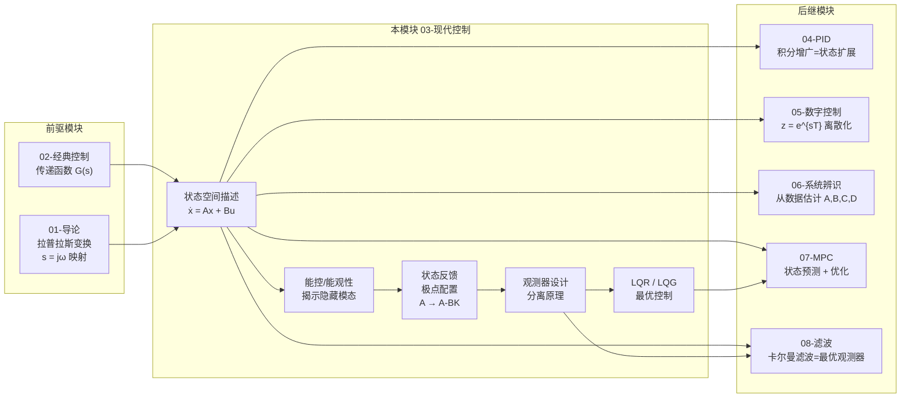
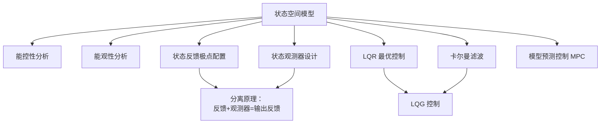

# 图解入门：状态空间为什么更强大

## 核心认知锚点

> **状态空间是"复域系统分析"的内化形式：它将传递函数的外部输入-输出映射 $G(s)$，转化为内部状态演化的微分方程组。在变换链中，它位于拉普拉斯复域分析之后，是连接"复域极点"与"多变量/时变/非线性系统"的桥梁。**

---

## 为什么学这个模块：它在统一框架中的位置

在 deep-research 的"变换统一框架"中，整个信号与控制分析沿着一条链条展开：


现代控制理论（状态空间）位于**第三阶段**——"有限实现与局部分析"。它不是与经典控制竞争的新工具，而是经典控制的自然延伸：

- **经典控制**（02模块）在 $s$ 域和 $j\omega$ 域上分析**输入-输出关系**：$G(s) = \frac{Y(s)}{U(s)}$。它关注"给什么输入，得到什么输出"。
- **现代控制**（本模块）将 $s$ 域的极点分析**内化**到状态方程：$\dot{\mathbf{x}} = \mathbf{A}\mathbf{x} + \mathbf{B}\mathbf{u}$。它关注"系统内部发生了什么，以及如何操控内部状态来塑造输出"。

关键认知：状态空间中的矩阵 $\mathbf{A}$ 的特征值，就是传递函数 $G(s)$ 的极点。它们住在同一个 $s$ 平面上。状态空间并没有创造新的数学域——它是在**已有的复域分析基础上**，增加了对系统内部的显式描述。

---

## 与前后模块的关系：知识流向



### 前向依赖（学了本模块才能深入理解）

| 后继模块 | 依赖本模块的什么 | 关联说明 |
|----------|----------------|----------|
| **04-PID** | 积分增广状态 | PID 的积分项可视为状态变量的扩展，状态反馈框架统一理解了 PI/PID 与状态反馈 |
| **05-数字控制** | 离散状态方程 $\mathbf{x}_{k+1} = \mathbf{G}\mathbf{x}_k + \mathbf{H}\mathbf{u}_k$ | $z = e^{sT}$ 将连续状态空间离散化，数字控制器在状态空间下设计最自然 |
| **06-系统辨识** | 从数据估计 $(\mathbf{A}, \mathbf{B}, \mathbf{C}, \mathbf{D})$ | 状态空间是系统辨识的目标模型形式，子空间辨识法直接输出状态空间矩阵 |
| **07-MPC** | 状态预测模型 | MPC 的核心是"用状态方程预测未来"，再优化控制序列 |
| **08-滤波** | 卡尔曼滤波 = 最优状态观测器 | 卡尔曼滤波器在数学上就是最小方差意义上的龙伯格观测器 |

### 后向衔接（本模块建立在前驱模块之上）

- **02-经典控制** 的传递函数 $G(s)$ 是状态空间模型的"输入-输出切片"。完全能控且能观的系统，二者等价。
- **01-导论** 的拉普拉斯变换 $s = j\omega$ 映射是理解状态空间特征值（极点）在 $s$ 平面上位置的先决知识。

---

## 与 [[14-FOC-电机控制/00-README|14-FOC-电机控制]] 的直接关联

FOC 微专业中的大量内容正是状态空间方法的直接应用：

| FOC 内容 | 状态空间概念 | 说明 |
|----------|-------------|------|
| PMSM 电压方程 | $\dot{\mathbf{x}} = \mathbf{A}\mathbf{x} + \mathbf{B}\mathbf{u}$ | $dq$ 轴电压方程就是状态空间形式，状态 = 电流，输入 = 电压 |
| 电流环 PI 设计 | 状态反馈 + 积分增广 | 电流环本质上是对电流状态（$i_d, i_q$）的反馈控制，PI 中的积分项是增广状态 |
| 滑模观测器 SMO | 状态观测器 | SMO 是一种非线性状态观测器，估计转子位置和速度 |
| 扩展卡尔曼滤波 EKF | 非线性状态估计 | EKF 是卡尔曼滤波在非线性状态空间模型上的推广 |
| 无传感器控制 | 观测器 → 分离原理 | 先估计状态（观测器），再反馈估计值（分离原理的实践） |
| 弱磁控制 | 状态约束 + 优化 | 在电压极限约束下优化电流状态，可视为约束状态反馈 |

> **认知锚点**：如果你在 FOC 中已经学过"dq 轴电流方程"和"观测器估计转子位置"，那么你已经接触到了状态空间的核心思想——只是当时没有用这个术语命名。本模块将把这些碎片化的工程经验，升级为系统化的理论框架。

---

## 从一个直觉问题出发

想象你正在驾驶一辆汽车。经典控制理论问的是："踩下油门后，车速会在多久后变化多少？" 它关注的是**输入与输出之间的映射关系**——一个黑箱。现代控制理论则问："发动机转速是多少？变速箱当前在几挡？车身的俯仰角是多少？" 它关注的是**系统内部发生了什么**。

这个视角的转换，就是状态空间方法的全部核心。

---

## 经典控制的盲区

### 传递函数的"黑箱"本质

经典控制理论使用传递函数描述系统：

$$G(s) = \frac{Y(s)}{U(s)}$$

这很好用——给正弦输入，得到正弦输出；画个 Bode 图就能判断稳定性。但它有一个根本性的盲区：**传递函数只描述了你看得见的那部分**。

考虑两个系统：

| 系统 | 内部结构 | 传递函数 | 问题 |
|------|---------|---------|------|
| 系统A | 两个相同极点串联，无零点对消 | $\frac{1}{(s+1)^2}$ | 内部状态全部可控可观 |
| 系统B | 一个极点被一个零点精确对消 | $\frac{s+1}{(s+1)(s+2)}$ | 内部有一个"隐藏"模态 |

系统B的传递函数简化后也是 $\frac{1}{s+2}$，看起来和单极点系统没区别。但内部那个被对消掉的极点 $s=-1$ 对应的模态**依然存在**——如果它不稳定，整个系统会内部发散，而输出却毫无察觉。

```text
        经典视角                状态空间视角
    +--------+              +------------------+
    |        |              |   x1 --> x2 -->   |
    |  G(s)  |              |   ↑              |
    |        |              |   u      y <-----|
    +--------+              +------------------+
    只看 u → y              看 u → x → y 的完整链条
```

这就是传递函数方法的"隐藏模态"问题。状态空间方法通过显式描述内部变量，从根本上避免了这一盲区。

> **与变换链的关系**：传递函数 $G(s)$ 是"复域系统分析"的外视角——从 $s$ 域看输入-输出映射。状态空间是内视角——看同一个 $s$ 域极点（即 $\mathbf{A}$ 的特征值）如何从内部状态演化中产生。二者通过 $G(s) = \mathbf{C}(s\mathbf{I} - \mathbf{A})^{-1}\mathbf{B} + \mathbf{D}$ 连接，$s$ 是同一个复变量。

---

## 状态空间是什么：一个存储器类比

把状态向量 $\mathbf{x}(t)$ 想象成系统的"存储器"。系统在每一时刻的全部"记忆"都保存在这个向量里。

$$
\underbrace{\dot{\mathbf{x}}(t)}_{\text{记忆的变化率}} = \underbrace{\mathbf{A}}_{\text{内部演化规律}} \underbrace{\mathbf{x}(t)}_{\text{当前记忆}} + \underbrace{\mathbf{B}}_{\text{输入影响}} \underbrace{\mathbf{u}(t)}_{\text{外部刺激}}
$$

$$
\underbrace{\mathbf{y}(t)}_{\text{你能观测到的}} = \underbrace{\mathbf{C}}_{\text{观测方式}} \underbrace{\mathbf{x}(t)}_{\text{内部记忆}} + \underbrace{\mathbf{D}}_{\text{直通项}} \underbrace{\mathbf{u}(t)}_{\text{输入直接作用}}
$$

这组方程的直觉是：**未来的变化只取决于现在和输入，与过去无关**——这是马尔可夫性的体现。一旦你知道了 $\mathbf{x}(t_0)$，就不需要知道 $t < t_0$ 的任何历史。

> **与变换链的关系**：从状态方程到传递函数，只需对状态方程取拉普拉斯变换（零初始条件）：
> $$s\mathbf{X}(s) = \mathbf{A}\mathbf{X}(s) + \mathbf{B}\mathbf{U}(s) \Rightarrow \mathbf{X}(s) = (s\mathbf{I} - \mathbf{A})^{-1}\mathbf{B}\mathbf{U}(s)$$
> $$\mathbf{Y}(s) = \mathbf{C}(s\mathbf{I} - \mathbf{A})^{-1}\mathbf{B}\mathbf{U}(s) + \mathbf{D}\mathbf{U}(s)$$
> 因此 $G(s) = \mathbf{C}(s\mathbf{I} - \mathbf{A})^{-1}\mathbf{B} + \mathbf{D}$。这里的 $s$ 就是拉普拉斯域的复变量，$(s\mathbf{I} - \mathbf{A})$ 的零点（即 $\det(s\mathbf{I} - \mathbf{A}) = 0$ 的根）就是 $\mathbf{A}$ 的特征值——也就是传递函数的极点。状态空间与传递函数共享同一个 $s$ 平面。

### 一维直觉：RC 电路

```text
      R
  +--\/\/\--+----+
  |         |    |
 u(t)      C    y(t)=u_C
  |         |    |
  +---------+----+
```

这个电路只有一个状态：电容电压 $u_C$。选择 $x = u_C$，则：

$$\dot{x} = -\frac{1}{RC} x + \frac{1}{RC} u$$

这里 $\mathbf{A} = -\frac{1}{RC}$ 是一个标量，它告诉我们：如果不去碰输入 $u$，电容电压会以时间常数 $\tau = RC$ 的指数规律衰减（或向某个平衡点演化）。

关键洞察：**状态变量的选择不是唯一的**，但状态的数量（状态空间的维数）是系统的固有属性。这个 RC 电路无论如何选择状态变量，都是一阶系统。

---

## 多变量系统的天然优势

### MIMO 系统的困境

经典控制理论处理多输入多输出（MIMO）系统时极为笨拙。一个 $2 \times 2$ 系统需要四个传递函数：

$$
\begin{bmatrix} Y_1 \\ Y_2 \end{bmatrix} = 
\begin{bmatrix} G_{11} & G_{12} \\ G_{21} & G_{22} \end{bmatrix}
\begin{bmatrix} U_1 \\ U_2 \end{bmatrix}
$$

$G_{12}$ 和 $G_{21}$ 代表了耦合——改变 $U_1$ 不仅影响 $Y_1$，还会通过内部路径影响 $Y_2$。经典方法需要复杂的解耦设计，而状态空间方法天然把耦合内化在矩阵 $\mathbf{A}$ 中，无需额外处理。

> **与 FOC 的关联**：PMSM 的 $dq$ 轴方程就是典型的 MIMO 系统。$d$ 轴和 $q$ 轴电流通过交叉耦合项 $\omega_e L_d i_d$ 和 $\omega_e L_q i_q$ 相互影响。在状态空间框架下，这种耦合是 $\mathbf{A}$ 矩阵的非对角元素，天然地被包含在模型中。

### 时变与非线性系统

状态空间框架的另一个巨大优势是它**无缝扩展**到时变系统：

$$\dot{\mathbf{x}} = \mathbf{A}(t) \mathbf{x} + \mathbf{B}(t) \mathbf{u}$$

以及非线性系统：

$$\dot{\mathbf{x}} = \mathbf{f}(\mathbf{x}, \mathbf{u})$$

传递函数对时变系统完全失效，而状态空间方程只需把常数矩阵换成时变矩阵即可。

> **与 FOC 的关联**：PMSM 的电压方程在旋转坐标系下是时变的（因为 $\omega_e$ 随时间变化），但状态空间框架下只需将 $\omega_e(t)$ 作为时变参数处理。扩展卡尔曼滤波（EKF）更是直接处理非线性状态空间模型 $\dot{\mathbf{x}} = \mathbf{f}(\mathbf{x}, \mathbf{u})$。

---

## 状态空间能做什么：能力全景图



这个模块后续各章将逐一展开这些主题。现在只需建立一个直觉：**状态空间是现代控制理论的通用语言**，几乎所有高级控制技术都在这个框架内运作。

---

## 从框图到状态方程：一个完整示例

考虑一个直流电机速度控制系统：

```text
  u(t)        +------+    i(t)    +--------+
    --------->| 电枢 |---------->| 电机   |----> ω(t)
              | 回路 |           | 机械   |
              +------+           +--------+
                ↑ L_a, R_a         ↑ J, b
                |                  |
              e_b = K_b ω        τ = K_t i
```

选取状态变量：$x_1 = i$（电枢电流），$x_2 = \omega$（角速度）。由基尔霍夫定律和牛顿第二定律：

$$
L_a \frac{di}{dt} + R_a i + K_b \omega = u \quad \Rightarrow \quad \dot{x}_1 = -\frac{R_a}{L_a} x_1 - \frac{K_b}{L_a} x_2 + \frac{1}{L_a} u
$$

$$
J \frac{d\omega}{dt} + b \omega = K_t i \quad \Rightarrow \quad \dot{x}_2 = \frac{K_t}{J} x_1 - \frac{b}{J} x_2
$$

写成矩阵形式：

$$
\begin{bmatrix} \dot{x}_1 \\ \dot{x}_2 \end{bmatrix} =
\begin{bmatrix} -R_a/L_a & -K_b/L_a \\ K_t/J & -b/J \end{bmatrix}
\begin{bmatrix} x_1 \\ x_2 \end{bmatrix} +
\begin{bmatrix} 1/L_a \\ 0 \end{bmatrix} u
$$

输出为角速度：$y = \omega = \begin{bmatrix} 0 & 1 \end{bmatrix} \mathbf{x}$。

> **与 FOC 的关联**：这个直流电机模型就是 PMSM 电流环的简化版本。在 FOC 中，PMSM 的 $dq$ 轴电压方程形式类似，只是多了交叉耦合项和反电动势项。理解了直流电机的状态空间模型，就理解了 FOC 电流环的底层结构。

### 数值示例

取典型直流电机参数：

| 参数 | 符号 | 数值 | 单位 |
|------|------|------|------|
| 电枢电阻 | $R_a$ | 2.0 | Ω |
| 电枢电感 | $L_a$ | 0.023 | H |
| 转矩常数 | $K_t$ | 0.5 | N·m/A |
| 反电动势常数 | $K_b$ | 0.5 | V·s/rad |
| 转动惯量 | $J$ | 0.01 | kg·m² |
| 阻尼系数 | $b$ | 0.01 | N·m·s/rad |

代入得：

$$
\mathbf{A} = \begin{bmatrix} -86.96 & -21.74 \\ 50 & -1 \end{bmatrix}, \quad
\mathbf{B} = \begin{bmatrix} 43.48 \\ 0 \end{bmatrix}
$$

特征值（即系统极点）为 $\lambda_{1,2} \approx -43.5 \pm 29.3j$。负实部表明开环系统稳定，复数表明存在振荡特性。

> **与变换链的关系**：这些特征值 $\lambda_{1,2}$ 就是传递函数 $G(s)$ 的极点。如果用经典控制方法，你会在根轨迹或 Bode 图上分析这些极点。状态空间方法直接告诉你：这些极点来自 $\mathbf{A}$ 矩阵的内在动力学，你可以通过状态反馈 $\mathbf{u} = -\mathbf{K}\mathbf{x}$ 将它们移动到 $s$ 平面的任意位置（只要系统能控）。

---

## 常见错误与纠正

### 错误1：状态变量选择不独立

**错误做法**：对一个弹簧-质量系统，选择 $x_1 = \text{位移}$ 和 $x_2 = \text{位移} + \text{速度}$ 作为状态。

**问题**：这两个变量不是独立的——知道 $x_1$ 的变化率就能推导出 $x_2$ 的某些信息。状态向量必须是**最小充分统计量**。

**纠正**：对于 $n$ 阶微分方程，恰需要 $n$ 个独立的状态变量。标准选择是 $x_1 = q, x_2 = \dot{q}$（相位变量），或任何与之非奇异线性变换的集合。

### 错误2：认为传递函数与状态空间描述完全等价

**错误说法**："传递函数和状态空间只是同一系统的两种表示，没有本质区别。"

**问题**：对于**完全能控且完全能观**的系统，二者确实等价。但如果系统存在不能控或不能观的模态，传递函数会"丢失"这些信息。最小实现（minimal realization）要求状态空间描述与传递函数维数相同——如果状态空间维数大于传递函数分母阶数，说明存在隐藏模态。

**纠正**：始终先做能控性和能观性分析，确认系统没有隐藏的动态模态。在工程实践中，传递函数用于初步分析和频域设计，状态空间用于深入分析和先进控制器设计。

> **与变换链的关系**：传递函数是状态空间的"输入-输出切片"——$G(s) = \mathbf{C}(s\mathbf{I} - \mathbf{A})^{-1}\mathbf{B} + \mathbf{D}$。这个公式本身就是连接两种视角的桥梁。如果 $(s\mathbf{I} - \mathbf{A})^{-1}$ 的某些极点被 $\mathbf{C}$ 或 $\mathbf{B}$ 对消，这些模态就会从 $G(s)$ 中消失，但在状态空间中依然存在（并可能导致内部不稳定）。

---

## 自测习题

**习题1**：为什么RC电路的状态空间模型是一阶的？如果电路中有两个串联的电容（中间有电阻），状态空间维数是多少？

**答案**：RC电路中只有一个独立的储能元件（电容），其能量状态 $E = \frac{1}{2}Cu_C^2$ 由单一变量 $u_C$ 决定。两个串联电容（中间有电阻）的情况下，两个电容电压都是独立的储能状态，因此是二阶系统。注意：如果两个电容直接串联（无中间电阻），则它们等价于一个电容，仍为一阶。

**习题2**：某系统的状态方程为 $\dot{\mathbf{x}} = \mathbf{A}\mathbf{x} + \mathbf{B}u$，其中 $\mathbf{A}$ 为 $4 \times 4$ 矩阵，其特征值为 $\lambda_1 = -1, \lambda_2 = -2, \lambda_3 = 0.5, \lambda_4 = -3$。不计算具体响应，判断系统的稳定性。

**答案**：不稳定。因为存在正实部特征值 $\lambda_3 = 0.5 > 0$。状态空间的稳定性判据是：线性时不变系统渐近稳定当且仅当所有特征值实部均为负（严格位于左半平面）。有一个正实部特征值就足以导致某些状态分量随时间指数增长。

> **与变换链的关系**：特征值 $\lambda_i$ 就是传递函数 $G(s)$ 在 $s$ 平面上的极点。经典控制说"极点在左半平面则稳定"，状态空间说"特征值实部为负则稳定"——说的是同一件事。

**习题3**：某系统的传递函数为 $G(s) = \frac{s-1}{(s+1)(s-1)}$。一个学生将其简化为 $G(s) = \frac{1}{s+1}$ 并据此设计状态空间模型。请指出问题所在。

**答案**：在 $s=1$ 处的零极点对消**不合法**——对消的极点位于右半平面（不稳定）。简化后的传递函数是一个一阶稳定系统，但原系统内部存在一个不稳定模态 $e^{t}$。这个模态不能控（被零点阻塞）或不能观（不传递到输出），因此会在系统内部无界增长，可能导致状态饱和甚至物理损坏。正确做法是保留二阶状态空间实现，并分析能控性和能观性。

> **与变换链的关系**：这就是状态空间视角的价值——传递函数 $G(s)$ 的简化可能掩盖 $s$ 平面上的隐藏模态。状态空间方法通过显式写出 $(\mathbf{A}, \mathbf{B}, \mathbf{C}, \mathbf{D})$，确保所有极点都可见、可控、可分析。

---

## 学习路径提示

学完本模块后，建议你按照以下顺序继续：

1. **001-状态空间描述与能控能观性**：深入数学结构，掌握 Kalman 秩判据、Lyapunov 稳定性
2. **002-状态反馈与极点配置**：学习如何用状态反馈在 $s$ 平面上"搬家"极点
3. **003-状态观测器与分离原理**：解决"状态不可测"问题——这与 FOC 中的无传感器观测器直接对应
4. **004-LQR 最优控制**：在"极点该放哪里"的问题上给出系统化的优化答案
5. **005-LQG 与卡尔曼滤波**：将观测器与最优控制结合——FOC 中 EKF 的理论基础

> **提示**：如果你已经学过 FOC 的电流环、观测器、EKF，那么在读本模块时，请不断问自己："这个抽象概念在电机控制中对应什么？" 这样你会学得更快，理解更深。
