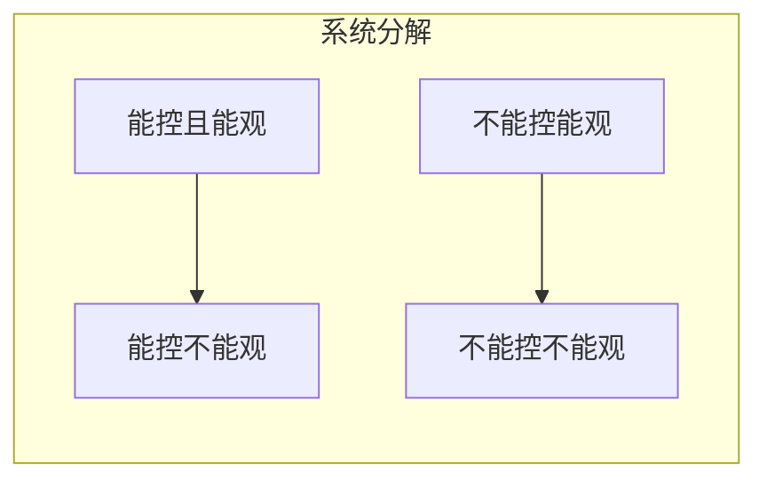

# 状态空间描述与能控能观性

## 状态空间的标准形式

### 连续时间 LTI 系统

一个 $n$ 阶线性时不变系统的状态空间描述为：

$$\dot{\mathbf{x}}(t) = \mathbf{A}\mathbf{x}(t) + \mathbf{B}\mathbf{u}(t)$$

$$\mathbf{y}(t) = \mathbf{C}\mathbf{x}(t) + \mathbf{D}\mathbf{u}(t)$$

其中：

| 符号 | 维度 | 物理意义 |
|------|------|---------|
| $\mathbf{x}$ | $n \times 1$ | 状态向量 |
| $\mathbf{u}$ | $m \times 1$ | 输入向量 |
| $\mathbf{y}$ | $p \times 1$ | 输出向量 |
| $\mathbf{A}$ | $n \times n$ | 系统矩阵（状态演化） |
| $\mathbf{B}$ | $n \times m$ | 输入矩阵 |
| $\mathbf{C}$ | $p \times n$ | 输出矩阵 |
| $\mathbf{D}$ | $p \times m$ | 前馈矩阵（通常为零） |

> **与变换链的关系**：对状态方程取拉普拉斯变换（零初始条件），得到：
> $$s\mathbf{X}(s) = \mathbf{A}\mathbf{X}(s) + \mathbf{B}\mathbf{U}(s) \Rightarrow \mathbf{X}(s) = (s\mathbf{I} - \mathbf{A})^{-1}\mathbf{B}\mathbf{U}(s)$$
> 输出方程变为：$\mathbf{Y}(s) = [\mathbf{C}(s\mathbf{I} - \mathbf{A})^{-1}\mathbf{B} + \mathbf{D}]\mathbf{U}(s)$
> 因此传递函数 $G(s) = \mathbf{C}(s\mathbf{I} - \mathbf{A})^{-1}\mathbf{B} + \mathbf{D}$。这里的 $s$ 就是拉普拉斯域的复变量，与经典控制中的 $s$ 完全相同。$\mathbf{A}$ 的特征值就是 $G(s)$ 的极点——它们住在同一个 $s$ 平面上。

### 从微分方程到状态空间：相位变量型

给定一个 $n$ 阶微分方程：

$$y^{(n)} + a_{n-1}y^{(n-1)} + \cdots + a_1\dot{y} + a_0 y = b_0 u$$

选取相位变量（phase variables）：

$$x_1 = y, \quad x_2 = \dot{y}, \quad x_3 = \ddot{y}, \quad \ldots, \quad x_n = y^{(n-1)}$$

得到能控标准型（controller canonical form）：

$$
\mathbf{A}_c = \begin{bmatrix}
0 & 1 & 0 & \cdots & 0 \\
0 & 0 & 1 & \cdots & 0 \\
\vdots & \vdots & \vdots & \ddots & \vdots \\
0 & 0 & 0 & \cdots & 1 \\
-a_0 & -a_1 & -a_2 & \cdots & -a_{n-1}
\end{bmatrix}, \quad
\mathbf{B}_c = \begin{bmatrix} 0 \\ 0 \\ \vdots \\ 0 \\ 1 \end{bmatrix}
$$

$$\mathbf{C}_c = \begin{bmatrix} b_0 & 0 & \cdots & 0 \end{bmatrix}$$

这个结构的直觉是：状态变量像多米诺骨牌一样串联——$\dot{x}_1 = x_2$，$\dot{x}_2 = x_3$，直到最后一个状态才受到输入 $u$ 的直接影响和所有状态的反馈。

### 能观标准型

通过对偶性，能观标准型（observer canonical form）把输出反馈结构展开：

$$
\mathbf{A}_o = \begin{bmatrix}
0 & 0 & \cdots & 0 & -a_0 \\
1 & 0 & \cdots & 0 & -a_1 \\
0 & 1 & \cdots & 0 & -a_2 \\
\vdots & \vdots & \ddots & \vdots & \vdots \\
0 & 0 & \cdots & 1 & -a_{n-1}
\end{bmatrix}, \quad
\mathbf{B}_o = \begin{bmatrix} b_0 \\ 0 \\ \vdots \\ 0 \end{bmatrix}
$$

$$\mathbf{C}_o = \begin{bmatrix} 0 & 0 & \cdots & 0 & 1 \end{bmatrix}$$

## 状态转移矩阵

### 齐次方程的解

考虑 $\dot{\mathbf{x}} = \mathbf{A}\mathbf{x}$，其解为：

$$\mathbf{x}(t) = e^{\mathbf{A}t} \mathbf{x}(0)$$

其中矩阵指数定义为：

$$e^{\mathbf{A}t} = \mathbf{I} + \mathbf{A}t + \frac{\mathbf{A}^2 t^2}{2!} + \frac{\mathbf{A}^3 t^3}{3!} + \cdots$$

$e^{\mathbf{A}t}$ 称为**状态转移矩阵**（state transition matrix），记作 $\boldsymbol{\Phi}(t)$。它完整描述了系统在没有外部输入时，从任意初始状态 $\mathbf{x}(0)$ 到 $\mathbf{x}(t)$ 的自由演化。

> **与变换链的关系**：状态转移矩阵 $e^{\mathbf{A}t}$ 与拉普拉斯域的 $(s\mathbf{I} - \mathbf{A})^{-1}$ 是一对拉普拉斯变换对：
> $$\mathcal{L}\{e^{\mathbf{A}t}\} = (s\mathbf{I} - \mathbf{A})^{-1}$$
> 这是矩阵版本的"指数衰减 $e^{-at}$ 对应拉普拉斯域 $\frac{1}{s+a}$"。对 $(s\mathbf{I} - \mathbf{A})^{-1}$ 做部分分式展开，其极点就是 $\mathbf{A}$ 的特征值 $\lambda_i$，对应时域的模态 $e^{\lambda_i t}$。

### 状态转移矩阵的性质

| 性质 | 表达式 | 直觉 |
|------|--------|------|
| 初值 | $\boldsymbol{\Phi}(0) = \mathbf{I}$ | 零时刻状态不变 |
| 半群性 | $\boldsymbol{\Phi}(t_1 + t_2) = \boldsymbol{\Phi}(t_1)\boldsymbol{\Phi}(t_2)$ | 分段转移等价于连续转移 |
| 可逆性 | $\boldsymbol{\Phi}^{-1}(t) = \boldsymbol{\Phi}(-t)$ | 时间可逆 |
| 导数 | $\dot{\boldsymbol{\Phi}}(t) = \mathbf{A}\boldsymbol{\Phi}(t)$ | 转移矩阵本身也满足原方程 |

### 非齐次方程的解

$$\mathbf{x}(t) = \boldsymbol{\Phi}(t)\mathbf{x}(0) + \int_0^t \boldsymbol{\Phi}(t-\tau)\mathbf{B}\mathbf{u}(\tau)\, d\tau$$

第一项是**零输入响应**（自由响应），第二项是**零状态响应**（卷积积分，强迫响应）。

### 数值示例：计算矩阵指数

设 $\mathbf{A} = \begin{bmatrix} 0 & 1 \\ -2 & -3 \end{bmatrix}$，求 $e^{\mathbf{A}t}$。

**方法：对角化**

特征值：$\det(\lambda\mathbf{I} - \mathbf{A}) = \lambda^2 + 3\lambda + 2 = 0 \Rightarrow \lambda_1 = -1, \lambda_2 = -2$。

特征向量：$\mathbf{v}_1 = \begin{bmatrix} 1 \\ -1 \end{bmatrix}$，$\mathbf{v}_2 = \begin{bmatrix} 1 \\ -2 \end{bmatrix}$。

$$\mathbf{A} = \mathbf{P}\mathbf{\Lambda}\mathbf{P}^{-1}, \quad \mathbf{P} = \begin{bmatrix} 1 & 1 \\ -1 & -2 \end{bmatrix}, \quad \mathbf{\Lambda} = \begin{bmatrix} -1 & 0 \\ 0 & -2 \end{bmatrix}$$

$$e^{\mathbf{A}t} = \mathbf{P} e^{\mathbf{\Lambda}t} \mathbf{P}^{-1} = \mathbf{P} \begin{bmatrix} e^{-t} & 0 \\ 0 & e^{-2t} \end{bmatrix} \mathbf{P}^{-1}$$

计算得：

$$e^{\mathbf{A}t} = \begin{bmatrix} 2e^{-t} - e^{-2t} & e^{-t} - e^{-2t} \\ -2e^{-t} + 2e^{-2t} & -e^{-t} + 2e^{-2t} \end{bmatrix}$$

## 能控性

### 能控性的直觉

一个状态能控，意味着**存在某个输入信号可以在有限时间内将该状态从任意初值驱动到任意终值**。不是"所有状态同时能控"，而是整个系统的状态空间能控。

### 能控性判据

**代数判据（PBH判据）**：$(\mathbf{A}, \mathbf{B})$ 能控当且仅当

$$\text{rank}\begin{bmatrix} \lambda\mathbf{I} - \mathbf{A} & \mathbf{B} \end{bmatrix} = n, \quad \forall \lambda \in \mathbb{C}$$

**秩判据（Kalman判据）**：$(\mathbf{A}, \mathbf{B})$ 能控当且仅当能控性矩阵满秩：

$$\mathcal{C} = \begin{bmatrix} \mathbf{B} & \mathbf{AB} & \mathbf{A}^2\mathbf{B} & \cdots & \mathbf{A}^{n-1}\mathbf{B} \end{bmatrix}$$

$$\text{rank}(\mathcal{C}) = n$$

### 能控性矩阵的直觉

$\mathcal{C}$ 的每一列代表输入通过不同"路径"影响状态的能力：

- $\mathbf{B}$：输入直接影响状态（1步）
- $\mathbf{AB}$：输入经过一次状态演化后影响（2步）
- $\mathbf{A}^{k}\mathbf{B}$：输入经过 $k$ 次演化后影响（$k+1$ 步）

如果这 $n$ 个方向的组合能够张成整个 $n$ 维状态空间，系统就是能控的。

### 数值示例：能控性分析

$$\mathbf{A} = \begin{bmatrix} 1 & 1 \\ 0 & 1 \end{bmatrix}, \quad \mathbf{B} = \begin{bmatrix} 1 \\ 0 \end{bmatrix}$$

$$\mathcal{C} = \begin{bmatrix} \mathbf{B} & \mathbf{AB} \end{bmatrix} = \begin{bmatrix} 1 & 1 \\ 0 & 0 \end{bmatrix}$$

$\text{rank}(\mathcal{C}) = 1 < 2$，系统不能控。

直觉验证：$\dot{x}_2 = x_2$，$x_2$ 不受 $u$ 任何影响，独立指数增长，无法控制。

## 能观性

### 能观性的直觉

一个状态能观，意味着**通过输出信号的历史观测，可以在有限时间内唯一确定该状态的初值**。不是"实时看到所有状态"，而是"事后推断出所有状态"。

### 能观性判据

**秩判据**：$(\mathbf{A}, \mathbf{C})$ 能观当且仅当能观性矩阵满秩：

$$\mathcal{O} = \begin{bmatrix} \mathbf{C} \\ \mathbf{CA} \\ \mathbf{CA}^2 \\ \vdots \\ \mathbf{CA}^{n-1} \end{bmatrix}$$

$$\text{rank}(\mathcal{O}) = n$$

### 对偶原理

能控性与能观性之间存在深刻的对偶关系：

| 原系统 | 对偶系统 |
|--------|---------|
| $(\mathbf{A}, \mathbf{B}, \mathbf{C})$ | $(\mathbf{A}^T, \mathbf{C}^T, \mathbf{B}^T)$ |
| 能控性 | 能观性 |
| 能控性矩阵 $\mathcal{C}$ | 能观性矩阵 $\mathcal{O}^T$ |

即：原系统能控 $\Leftrightarrow$ 对偶系统能观。

### 数值示例：能观性分析

$$\mathbf{A} = \begin{bmatrix} -1 & 0 \\ 1 & -2 \end{bmatrix}, \quad \mathbf{C} = \begin{bmatrix} 0 & 1 \end{bmatrix}$$

$$\mathcal{O} = \begin{bmatrix} \mathbf{C} \\ \mathbf{CA} \end{bmatrix} = \begin{bmatrix} 0 & 1 \\ 1 & -2 \end{bmatrix}$$

$\text{rank}(\mathcal{O}) = 2$，系统能观。

## 能控/能观分解

任何线性系统都可以通过相似变换分解为四个子系统：



变换后的系统矩阵呈标准结构：

$$
\bar{\mathbf{A}} = \begin{bmatrix}
\mathbf{A}_{co} & \mathbf{A}_{12} & 0 & 0 \\
0 & \mathbf{A}_{c\bar{o}} & 0 & 0 \\
\mathbf{A}_{31} & \mathbf{A}_{32} & \mathbf{A}_{\bar{c}o} & \mathbf{A}_{34} \\
0 & \mathbf{A}_{42} & 0 & \mathbf{A}_{\bar{c}\bar{o}}
\end{bmatrix}
$$

传递函数只保留能控且能观的部分：$G(s) = \mathbf{C}_{co}(s\mathbf{I} - \mathbf{A}_{co})^{-1}\mathbf{B}_{co} + \mathbf{D}$。

> **与变换链的关系**：这就是传递函数"丢失"隐藏模态的数学原因。$G(s)$ 只保留了能控且能观的子空间 $\mathbf{A}_{co}$，而不能控或不能观的子空间（$\mathbf{A}_{c\bar{o}}, \mathbf{A}_{\bar{c}o}, \mathbf{A}_{\bar{c}\bar{o}}$）虽然存在于状态空间中，却不参与输入-输出映射。经典控制只看见 $G(s)$，现代控制通过能控/能观分解看见全部四个子空间。

> **与 [[14-FOC-电机控制/00-README|14-FOC-电机控制]] 的关联**：PMSM 的 $dq$ 轴电流模型是完全能控且能观的（假设电流可测）。但在无传感器控制中，转子位置和速度是"不能观"的——它们不直接出现在输出（电流测量）中。这就是为什么需要观测器（如 SMO、EKF）来重构这些隐藏状态。能观性分析告诉我们：在仅有电流测量的条件下，转子位置是否可以从电流历史数据中唯一推断出来。

## 稳定性

### Lyapunov 稳定性

平衡点 $\mathbf{x}_e$ 是**Lyapunov 稳定**的，如果对于任意 $\epsilon > 0$，存在 $\delta > 0$，使得 $\|\mathbf{x}(0) - \mathbf{x}_e\| < \delta$ 蕴含 $\|\mathbf{x}(t) - \mathbf{x}_e\| < \epsilon$ 对所有 $t \geq 0$ 成立。

**渐近稳定**还要求 $\|\mathbf{x}(t) - \mathbf{x}_e\| \to 0$ 当 $t \to \infty$。

### LTI 系统的稳定性判据

对于 $\dot{\mathbf{x}} = \mathbf{A}\mathbf{x}$：

| 稳定性类型 | 条件 |
|-----------|------|
| Lyapunov 稳定 | 所有特征值实部 $\leq 0$，且实部为0的特征值几何重数等于代数重数 |
| 渐近稳定 | 所有特征值实部 $< 0$ |
| 不稳定 | 存在特征值实部 $> 0$，或实部为0但 Jordan 块阶数 $> 1$ |

> **与变换链的关系**：状态空间的稳定性判据（特征值实部 $< 0$）与经典控制的稳定性判据（极点在左半 $s$ 平面）是**完全等价**的——因为 $\mathbf{A}$ 的特征值就是传递函数 $G(s)$ 的极点。经典控制通过根轨迹或 Bode 图在 $s$ 域上判断稳定性，状态空间通过直接计算 $\mathbf{A}$ 的特征值判断。两种方法共享同一个 $s$ 平面，只是观察角度不同。

### Lyapunov 方程

对于渐近稳定的系统，存在唯一的正定矩阵 $\mathbf{P}$ 满足：

$$\mathbf{A}^T\mathbf{P} + \mathbf{P}\mathbf{A} = -\mathbf{Q}$$

其中 $\mathbf{Q}$ 为任意正定矩阵。$V(\mathbf{x}) = \mathbf{x}^T\mathbf{P}\mathbf{x}$ 是一个 Lyapunov 函数，沿轨迹的导数为：

$$\dot{V} = \mathbf{x}^T(\mathbf{A}^T\mathbf{P} + \mathbf{P}\mathbf{A})\mathbf{x} = -\mathbf{x}^T\mathbf{Q}\mathbf{x} < 0$$

> **与变换链的关系**：Lyapunov 稳定性是时域分析。对于 LTI 系统，它与 $s$ 域的极点判据等价：$\mathbf{A}$ 的所有特征值实部 $< 0$（$s$ 域判据）$\Leftrightarrow$ 对任意 $\mathbf{Q} > 0$，Lyapunov 方程有唯一解 $\mathbf{P} > 0$（时域判据）。这意味着你可以选择在时域验证稳定性（解 Lyapunov 方程），或在 $s$ 域验证（算特征值），两者结论一致。

### 数值求解 Lyapunov 方程

```python
import numpy as np
from scipy import linalg

A = np.array([[-1, 0.5], [0, -2]])
Q = np.eye(2)  # identity matrix

# Solve A^T P + P A = -Q
P = linalg.solve_continuous_lyapunov(A.T, -Q)

eigenvalues_P = np.linalg.eigvalsh(P)
print("P =", P)
print("Eigenvalues of P:", eigenvalues_P)
# All positive => asymptotically stable
```

```matlab
A = [-1, 0.5; 0, -2];
Q = eye(2);
P = lyap(A', Q);  % solve A'*P + P*A = -Q
eig(P)  % check positive definiteness
```

## 常见错误与纠正

### 错误1：混淆能控性与能达性

**错误说法**："能控就是能从任意状态到达任意状态。"

**问题**：能控性关注的是**从任意初态到任意终态**，但能达性（reachability）关注的是从零初态到任意状态。对于连续时间 LTI 系统，二者等价；但对于离散时间系统或时变系统，二者可能不同。更关键的是，能控性不保证路径上的约束（如输入饱和）得到满足。

**纠正**：工程实现中，在判断能控性后，还需计算**能控性 Gramian 矩阵**来量化控制的"难易程度"。条件数很大的能控性矩阵意味着系统"理论上能控，实际上很难控"。

### 错误2：通过传递函数判断能控能观性

**错误做法**：由 $G(s)$ 的分母阶数确定状态维数，直接写出一个标准型，假设系统完全能控能观。

**问题**：如前文所述，零极点对消会隐藏模态。一个传递函数可能对应多个状态空间实现，其中一些不能控或不能观。

**纠正**：从物理原理推导状态方程时，状态变量的选择由独立储能元件数量决定。验证能控性和能观性必须计算 Kalman 秩判据。对于从传递函数转换到状态空间的情况，使用 Gilbert 实现或串联/并联实现时，必须检查每个模态的能控能观性。

## 自测习题

**习题1**：给定 $\mathbf{A} = \begin{bmatrix} 0 & 1 \\ -6 & -5 \end{bmatrix}$，$\mathbf{B} = \begin{bmatrix} 0 \\ 1 \end{bmatrix}$，$\mathbf{C} = \begin{bmatrix} 1 & 0 \end{bmatrix}$。
(a) 判断系统的能控性和能观性。
(b) 求系统的传递函数。

**答案**：
(a) $\mathcal{C} = \begin{bmatrix} 0 & 1 \\ 1 & -5 \end{bmatrix}$，$\det(\mathcal{C}) = -1 \neq 0$，能控。$\mathcal{O} = \begin{bmatrix} 1 & 0 \\ 0 & 1 \end{bmatrix}$，满秩，能观。
(b) $G(s) = \mathbf{C}(s\mathbf{I} - \mathbf{A})^{-1}\mathbf{B} = \frac{1}{s^2 + 5s + 6} = \frac{1}{(s+2)(s+3)}$。

**习题2**：证明对于单输入系统，能控标准型总是完全能控的。

**答案**：能控标准型的 $\mathbf{A}_c$ 和 $\mathbf{B}_c$ 结构使得 $\mathcal{C}$ 成为下三角矩阵，对角线元素全为1，因此 $\det(\mathcal{C}) = 1 \neq 0$，恒满秩。这是能控标准型命名的由来——它天生就是能控的。

**习题3**：某系统的 Lyapunov 方程 $\mathbf{A}^T\mathbf{P} + \mathbf{P}\mathbf{A} = -\mathbf{I}$ 的解为 $\mathbf{P} = \begin{bmatrix} 1 & 2 \\ 2 & 3 \end{bmatrix}$。判断系统稳定性。

**答案**：$\mathbf{P}$ 不是正定矩阵——其顺序主子式 $\Delta_1 = 1 > 0$，但 $\Delta_2 = \det(\mathbf{P}) = 3 - 4 = -1 < 0$。因此该 $\mathbf{P}$ 不满足 Lyapunov 稳定性条件（正定要求）。如果这是方程的唯一解，说明系统不是渐近稳定的。实际上，此 $\mathbf{P}$ 不定意味着 Lyapunov 函数 $V = \mathbf{x}^T\mathbf{P}\mathbf{x}$ 在某些方向为正、某些方向为负，无法作为稳定性证明。
