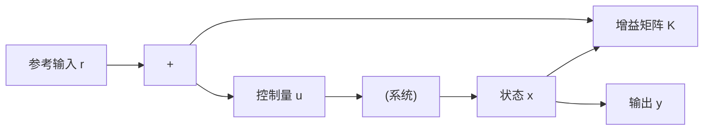

# 状态反馈与极点配置

## 状态反馈的基本思想

在经典控制中，我们反馈的是**输出** $y(t)$。但在状态空间框架中，如果我们能测量到全部状态 $\mathbf{x}(t)$，就可以直接对每个状态进行加权反馈：



控制律为：

$$\mathbf{u}(t) = \mathbf{r}(t) - \mathbf{K}\mathbf{x}(t)$$

其中 $\mathbf{K}$ 是 $m \times n$ 的状态反馈增益矩阵。代入状态方程：

$$\dot{\mathbf{x}} = (\mathbf{A} - \mathbf{B}\mathbf{K})\mathbf{x} + \mathbf{B}\mathbf{r}$$

闭环系统矩阵为 $\mathbf{A}_{cl} = \mathbf{A} - \mathbf{B}\mathbf{K}$。极点配置问题转化为：**选择 $\mathbf{K}$ 使得 $\mathbf{A}_{cl}$ 的特征值位于期望位置**。

> **与变换链的关系**：状态反馈极点配置本质上是在 $s$ 平面上"搬家"极点。经典控制通过根轨迹法间接选择增益 $K$ 来移动极点（沿着轨迹曲线）；状态反馈直接设计增益矩阵 $\mathbf{K}$，将极点放到 $s$ 平面上的**任意指定位置**（只要系统能控）。两种方法操作的是同一个对象——$s$ 平面上的极点。

## 极点配置定理

### 核心定理

对于单输入系统 $(\mathbf{A}, \mathbf{b})$，若系统完全能控，则可以通过适当选择反馈增益向量 $\mathbf{k}^T$ 将闭环极点配置到任意期望位置（复数极点必须共轭成对出现）。

对于多输入系统，若 $(\mathbf{A}, \mathbf{B})$ 能控，则同样可以进行任意极点配置，且 $\mathbf{K}$ 的解通常不唯一。

### 关键洞察

状态反馈不改变系统的**零点**，但可以改变**极点**。因为状态反馈相当于在系统内部重新配置了能量的耗散和交换方式——哪些模态衰减快、哪些慢、哪些振荡，都由 $\mathbf{K}$ 决定。

## Ackermann 公式

### 单输入系统的显式解法

设开环特征多项式：

$$\alpha(s) = \det(s\mathbf{I} - \mathbf{A}) = s^n + a_{n-1}s^{n-1} + \cdots + a_0$$

期望闭环特征多项式：

$$\alpha_c(s) = s^n + \alpha_{n-1}s^{n-1} + \cdots + \alpha_0$$

Ackermann 公式给出：

$$\mathbf{k}^T = \begin{bmatrix} 0 & 0 & \cdots & 0 & 1 \end{bmatrix} \mathcal{C}^{-1} \alpha_c(\mathbf{A})$$

其中 $\alpha_c(\mathbf{A}) = \mathbf{A}^n + \alpha_{n-1}\mathbf{A}^{n-1} + \cdots + \alpha_0\mathbf{I}$ 是矩阵多项式。

### Ackermann 公式的直觉

公式中的 $\begin{bmatrix} 0 & \cdots & 0 & 1 \end{bmatrix} \mathcal{C}^{-1}$ 实际上提取了能控性矩阵逆的最后一行。这一行对应于将系统变换为能控标准型后的那个"被输入直接驱动"的状态分量。通过在这个坐标系下设计反馈，可以精确控制特征多项式的系数。

### 数值示例：倒立摆稳定

考虑简化的倒立摆（小车上的单摆），在小角度线性化后：

$$\mathbf{A} = \begin{bmatrix} 0 & 1 & 0 & 0 \\ 20.6 & 0 & 0 & 0 \\ 0 & 0 & 0 & 1 \\ -0.5 & 0 & 0 & 0 \end{bmatrix}, \quad
\mathbf{B} = \begin{bmatrix} 0 \\ -2 \\ 0 \\ 0.5 \end{bmatrix}$$

开环极点为 $\pm 4.54$ 和 $0, 0$——显然不稳定（正实部极点）。

期望闭环极点：选择快速稳定的共轭对和一个实极点：

$$p_{1,2} = -2 \pm 2j, \quad p_3 = -5, \quad p_4 = -6$$

期望特征多项式：

$$\alpha_c(s) = (s+2-2j)(s+2+2j)(s+5)(s+6) = s^4 + 15s^3 + 78s^2 + 160s + 120$$

使用 MATLAB：

```matlab
A = [0 1 0 0; 20.6 0 0 0; 0 0 0 1; -0.5 0 0 0];
B = [0; -2; 0; 0.5];
p = [-2+2i, -2-2i, -5, -6];
K = acker(A, B, p);
% K = [-157.7  -36.4  -95.1  -28.1]
eig(A - B*K)  % verify: should match p
```

```python
import numpy as np
from scipy.signal import place_poles

A = np.array([[0, 1, 0, 0],
              [20.6, 0, 0, 0],
              [0, 0, 0, 1],
              [-0.5, 0, 0, 0]], dtype=float)
B = np.array([[0], [-2], [0], [0.5]], dtype=float)
p = np.array([-2+2j, -2-2j, -5, -6])

result = place_poles(A, B, p)
K = result.gain_matrix
print("K =", K)
# Verify
print("Closed-loop poles:", np.linalg.eigvals(A - B @ K))
```

## 极点选择的设计权衡

### 响应速度与控制 effort

| 极点位置 | 响应特性 | 控制 effort | 鲁棒性 |
|---------|---------|------------|--------|
| 靠近虚轴（实部小） | 慢响应 | 小 | 好 |
| 远离虚轴（实部大负） | 快响应 | 大 | 差 |
| 远离实轴（虚部大） | 振荡强 | 中 | 中 |

**经验法则**：
- 主导极点的实部决定调节时间：$t_s \approx \frac{4}{\zeta\omega_n}$
- 阻尼比 $\zeta \approx 0.7$ 给出约 5% 超调和较快响应的最佳折衷
- 非主导极点应比主导极点实部大 5~10 倍，避免干扰主导动态

### Butterworth 配置

对于 $n$ 阶系统，一种自然的选择是将极点均匀分布在左半平面的半圆上：

$$p_k = \omega_0 \exp\left(j\left(\frac{\pi}{2} + \frac{(2k+1)\pi}{2n}\right)\right), \quad k = 0, 1, \ldots, n-1$$

这种配置在所有 $n$ 阶多项式中具有最大的稳定性裕度（系数对扰动最不敏感）。

> **与变换链的关系**：Butterworth 配置最初来自滤波器设计（频域），但在状态空间极点配置中同样适用。它的本质是在 $s$ 平面的左半部分均匀分布极点，使得频率响应 $|G(j\omega)|$ 尽可能平坦。这体现了同一个 $s$ 平面同时服务于频域设计（经典控制）和时域设计（状态反馈）。

## 多输入系统的极点配置

### 非唯一性

多输入系统的状态反馈增益矩阵 $\mathbf{K}$ 有 $m \times n$ 个自由度，而极点配置只给出 $n$ 个约束。因此存在无穷多解。

### 利用自由度优化

可以额外优化：
- 最小化 $\|\mathbf{K}\|_F$（降低控制增益幅值）
- 最大化鲁棒性度量（如回差矩阵的条件数）
- 实现解耦控制（使某些输入只影响某些输出）

一种常见方法是**Lyapunov 方程法**：通过将多输入系统等价变换为单输入系统，然后应用 Ackermann 公式。

## 状态反馈的局限性

### 需要全部状态可测

状态反馈要求 $\mathbf{x}(t)$ 的每个分量都能实时测量。工程中往往只有输出 $\mathbf{y}(t)$ 可测（$p < n$）。

**解决方案**：当状态不完全可测时，使用**状态观测器**（下一章）来估计状态，再反馈估计值——这就是分离原理。

### 不改变零点

状态反馈只移动极点，不影响系统的传输零点。如果系统有右半平面零点（非最小相位系统），状态反馈无法消除其影响。

## 跟踪与稳态精度

### 引入积分作用

纯状态反馈对恒定参考输入可能存在稳态误差。解决方法是在状态向量中**增广积分状态**：

$$\dot{x}_{n+1} = r - y = r - \mathbf{C}\mathbf{x}$$

增广系统：

$$\begin{bmatrix} \dot{\mathbf{x}} \\ \dot{x}_{n+1} \end{bmatrix} =
\begin{bmatrix} \mathbf{A} & \mathbf{0} \\ -\mathbf{C} & 0 \end{bmatrix}
\begin{bmatrix} \mathbf{x} \\ x_{n+1} \end{bmatrix} +
\begin{bmatrix} \mathbf{B} \\ 0 \end{bmatrix} u +
\begin{bmatrix} \mathbf{0} \\ 1 \end{bmatrix} r$$

对增广系统设计状态反馈 $\mathbf{u} = -\begin{bmatrix} \mathbf{K} & k_I \end{bmatrix}\begin{bmatrix} \mathbf{x} \\ x_{n+1} \end{bmatrix}$，即可实现零稳态误差跟踪。

> **与 [[14-FOC-电机控制/00-README|14-FOC-电机控制]] 的关联**：这就是 FOC 中电流环 PI 控制的理论根基。PI 控制器中的积分项 $k_I \int (r - y) dt$ 正是这里的增广积分状态 $x_{n+1}$。在状态空间视角下，PI 不是"一个经验性的控制器"，而是"状态反馈 + 积分增广"这一系统化框架的特殊形式。当 FOC 中电流环的 PI 参数"消除稳态误差"时，实际上是积分状态在强制跟踪误差收敛到零。

### 数值示例：带积分的直流电机控制

```matlab
% DC motor with integral action
A = [0 1 0; 0 -10 0; -1 0 0];  % [omega; omega_dot; integral]
B = [0; 100; 0];
p = [-5, -5+3j, -5-3j];
K = acker(A, B, p);
% K contains both state feedback and integral gain
```

## 常见错误与纠正

### 错误1：在不能控系统上强行极点配置

**错误做法**：不检查能控性，直接调用 `acker` 或 `place_poles`，遇到奇异矩阵报错后尝试修改极点位置。

**问题**：如果系统不能控，能控性矩阵 $\mathcal{C}$ 奇异，Ackermann 公式中的 $\mathcal{C}^{-1}$ 不存在。更重要的是，不能控的模态无法通过任何状态反馈改变——它们"锁死"在开环位置。

**纠正**：设计前必须验证 $\text{rank}(\mathcal{C}) = n$。如果不能控，先进行能控性分解，将系统分为能控子空间和不能控子空间。只能配置能控子空间的极点，不能控子空间的极点必须本身稳定，否则系统不可镇定期望性能。

### 错误2：极点配置过"激进"

**错误做法**：为了获得极速响应，将所有极点配置到 $-100$ 等远离原点的位置。

**问题**：极点越靠左，所需的反馈增益越大，导致：
1. 控制信号饱和（执行器限幅）
2. 对模型不确定性极度敏感（鲁棒性差）
3. 放大测量噪声

**纠正**：遵循"主导极点"设计思想。大部分极点保持适中速度（实部在系统开环时间常数倒数的 2~5 倍范围内），只将少量关键极点配置得更快。始终仿真验证控制信号的幅值和频谱特性。

## 自测习题

**习题1**：给定 $\mathbf{A} = \begin{bmatrix} 0 & 1 \\ -2 & -3 \end{bmatrix}$，$\mathbf{B} = \begin{bmatrix} 0 \\ 1 \end{bmatrix}$。设计状态反馈使闭环极点为 $\lambda_{1,2} = -1 \pm j$。

**答案**：
期望特征多项式：$(s+1-j)(s+1+j) = s^2 + 2s + 2$。

开环系统已是能控标准型。能控标准型的状态反馈增益直接对应特征多项式系数差：

$\mathbf{k}^T = \begin{bmatrix} \alpha_0 - a_0 & \alpha_1 - a_1 \end{bmatrix} = \begin{bmatrix} 2 - 2 & 2 - 3 \end{bmatrix} = \begin{bmatrix} 0 & -1 \end{bmatrix}$。

验证：$\mathbf{A} - \mathbf{B}\mathbf{k}^T = \begin{bmatrix} 0 & 1 \\ -2 & -2 \end{bmatrix}$，特征方程 $s^2 + 2s + 2 = 0$，根为 $-1 \pm j$。正确。

**习题2**：某系统开环极点为 $-1, -2, -5$，设计状态反馈后闭环极点变为 $-3, -4, -6$。问：该系统的零点是否改变？为什么？

**答案**：状态反馈不改变系统的零点。因为零点由 $\det\begin{bmatrix} s\mathbf{I}-\mathbf{A} & -\mathbf{B} \\ \mathbf{C} & \mathbf{D} \end{bmatrix} = 0$ 决定，状态反馈只改变 $\mathbf{A}$，不改变 $(\mathbf{B}, \mathbf{C}, \mathbf{D})$，因此零点保持不变。注意：如果发生零极点对消（配置的新极点恰好落在零点位置），该零极点对被"抵消"，传递函数降阶，但内部模态依然存在。

**习题3**：证明对于单输入系统，状态反馈不改变能控性（即能控系统经状态反馈后仍能控）。

**答案**：设 $(\mathbf{A}, \mathbf{b})$ 能控。状态反馈后系统为 $(\mathbf{A} - \mathbf{b}\mathbf{k}^T, \mathbf{b})$。能控性矩阵为 $\tilde{\mathcal{C}} = \begin{bmatrix} \mathbf{b} & (\mathbf{A}-\mathbf{b}\mathbf{k}^T)\mathbf{b} & \cdots \end{bmatrix}$。注意到 $(\mathbf{A}-\mathbf{b}\mathbf{k}^T)^i\mathbf{b}$ 可以表示为 $\mathbf{A}^i\mathbf{b}$ 的线性组合（通过归纳法），因此 $\text{rank}(\tilde{\mathcal{C}}) = \text{rank}(\mathcal{C}) = n$。状态反馈不改变能控性子空间的维数。但注意：状态反馈**可能改变能观性**。
