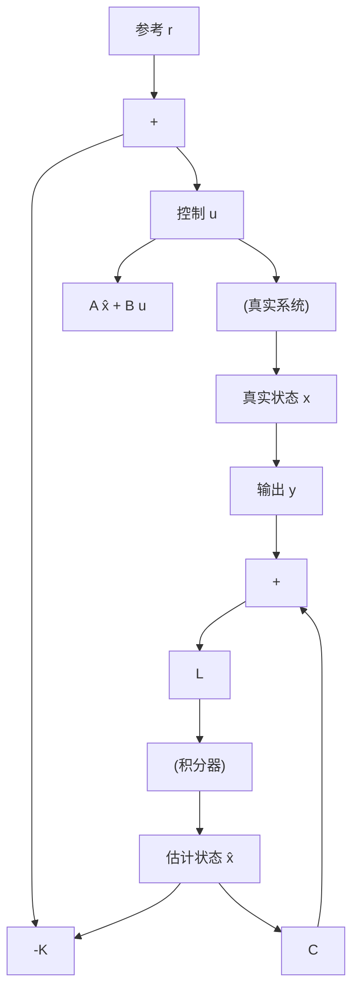

# 状态观测器与分离原理

## 问题背景：当状态不可直接测量

状态反馈很强大，但现实中传感器的数量和成本限制了可测量信号。一个五阶系统可能有五个状态变量，但你只装了一个编码器和一个电流传感器——只有两个输出。

核心问题：**能否仅通过输入 $u(t)$ 和输出 $y(t)$ 的历史信息，重构出全部状态 $\mathbf{x}(t)$？**

如果系统能观，答案是肯定的。实现这一重构的装置就是**状态观测器**（state observer）。

## 开环观测器及其缺陷

### 最直接的想法

既然知道系统模型，就用模型复制一个"虚拟系统"：

$$\dot{\hat{\mathbf{x}}} = \mathbf{A}\hat{\mathbf{x}} + \mathbf{B}\mathbf{u}$$

如果初始估计 $\hat{\mathbf{x}}(0) = \mathbf{x}(0)$，则 $\hat{\mathbf{x}}(t) = \mathbf{x}(t)$ 对所有 $t$ 成立。但问题是：

1. **初值永远不知道**——你无法精确知道系统的初始状态
2. **模型永远不准**——实际系统参数 $\mathbf{A}, \mathbf{B}$ 与模型有偏差
3. **没有外部信号校正**——误差 $\mathbf{e} = \mathbf{x} - \hat{\mathbf{x}}$ 会按 $\dot{\mathbf{e}} = \mathbf{A}\mathbf{e}$ 自由演化

如果 $\mathbf{A}$ 有不稳定模态，误差会指数增长。即使 $\mathbf{A}$ 稳定，收敛速度也由开环极点决定，无法调节。

## Luenberger 观测器

### 核心思想：用输出误差反馈校正估计

David Luenberger 在 1964 年提出了革命性的想法：把实际输出与估计输出的差异反馈回观测器，驱动估计向真实状态收敛：

$$\dot{\hat{\mathbf{x}}} = \mathbf{A}\hat{\mathbf{x}} + \mathbf{B}\mathbf{u} + \mathbf{L}(\mathbf{y} - \mathbf{C}\hat{\mathbf{x}})$$

其中 $\mathbf{L}$ 是 $n \times p$ 的观测器增益矩阵。第三项 $\mathbf{L}(\mathbf{y} - \mathbf{C}\hat{\mathbf{x}})$ 就是"校正项"。

### 误差动态

定义估计误差 $\mathbf{e} = \mathbf{x} - \hat{\mathbf{x}}$，则：

$$\dot{\mathbf{e}} = \dot{\mathbf{x}} - \dot{\hat{\mathbf{x}}} = \mathbf{A}\mathbf{x} + \mathbf{B}\mathbf{u} - \mathbf{A}\hat{\mathbf{x}} - \mathbf{B}\mathbf{u} - \mathbf{L}(\mathbf{C}\mathbf{x} - \mathbf{C}\hat{\mathbf{x}})$$

$$\dot{\mathbf{e}} = (\mathbf{A} - \mathbf{L}\mathbf{C})\mathbf{e}$$

误差动态完全由矩阵 $\mathbf{A} - \mathbf{L}\mathbf{C}$ 决定！如果 $(\mathbf{A}, \mathbf{C})$ 能观，则可以通过选择 $\mathbf{L}$ 将 $\mathbf{A} - \mathbf{L}\mathbf{C}$ 的特征值配置到任意位置。

### 观测器设计的对偶性

误差动态方程 $\dot{\mathbf{e}} = (\mathbf{A} - \mathbf{L}\mathbf{C})\mathbf{e}$ 与状态反馈方程 $\dot{\mathbf{x}} = (\mathbf{A} - \mathbf{B}\mathbf{K})\mathbf{x}$ 存在对偶关系：

| 状态反馈 | 观测器设计 |
|---------|-----------|
| 系统 $(\mathbf{A}, \mathbf{B})$ | 对偶系统 $(\mathbf{A}^T, \mathbf{C}^T)$ |
| 增益 $\mathbf{K}$ | 增益 $\mathbf{L}^T$ |
| 闭环矩阵 $\mathbf{A} - \mathbf{B}\mathbf{K}$ | 误差矩阵 $\mathbf{A} - \mathbf{L}\mathbf{C} = (\mathbf{A}^T - \mathbf{C}^T\mathbf{L}^T)^T$ |

因此，观测器增益的设计可以通过对偶系统的状态反馈设计完成。

### 数值示例：二阶系统观测器

$$\mathbf{A} = \begin{bmatrix} 0 & 1 \\ -2 & -3 \end{bmatrix}, \quad \mathbf{B} = \begin{bmatrix} 0 \\ 1 \end{bmatrix}, \quad \mathbf{C} = \begin{bmatrix} 1 & 0 \end{bmatrix}$$

能观性验证：$\mathcal{O} = \begin{bmatrix} 1 & 0 \\ 0 & 1 \end{bmatrix}$，满秩，能观。

期望观测器极点（通常比闭环控制极点快 2~5 倍）：$\lambda_{o1,2} = -5, -6$。

对偶系统的期望特征多项式：$(s+5)(s+6) = s^2 + 11s + 30$。

```matlab
A = [0 1; -2 -3];
B = [0; 1];
C = [1 0];
% Design observer using duality
L = acker(A', C', [-5, -6])';
% L = [7; 12]
eig(A - L*C)  % verify: -5, -6
```

```python
import numpy as np
from scipy.signal import place_poles

A = np.array([[0, 1], [-2, -3]], dtype=float)
C = np.array([[1, 0]], dtype=float)

# Design L via duality: place poles for (A^T, C^T)
result = place_poles(A.T, C.T, [-5, -6])
L = result.gain_matrix.T
print("L =", L)
print("Observer poles:", np.linalg.eigvals(A - L @ C))
```

## 带观测器的输出反馈系统

### 分离原理

现在把观测器和状态反馈结合起来。实际控制器不能反馈真实状态（不可测），只能反馈估计状态：

$$\mathbf{u} = -\mathbf{K}\hat{\mathbf{x}}$$



整个增广系统（真实状态 + 估计误差）为：

$$\begin{bmatrix} \dot{\mathbf{x}} \\ \dot{\mathbf{e}} \end{bmatrix} =
\begin{bmatrix} \mathbf{A} - \mathbf{B}\mathbf{K} & \mathbf{B}\mathbf{K} \\ \mathbf{0} & \mathbf{A} - \mathbf{L}\mathbf{C} \end{bmatrix}
\begin{bmatrix} \mathbf{x} \\ \mathbf{e} \end{bmatrix}$$

这是一个**上三角分块矩阵**！其特征值是 $\mathbf{A} - \mathbf{B}\mathbf{K}$ 的特征值与 $\mathbf{A} - \mathbf{L}\mathbf{C}$ 的特征值的并集。

### 分离原理的表述

**分离原理（Separation Principle）**：对于能控且能观的线性系统，状态反馈增益 $\mathbf{K}$ 和观测器增益 $\mathbf{L}$ 可以**独立设计**。闭环系统的极点由控制器极点和观测器极点两集合的并集组成，二者互不干扰。

这是现代控制理论中最优美的结果之一：设计可以分两步走——先假设状态已知设计 $\mathbf{K}$，再设计观测器得到 $\mathbf{L}$，最后拼接起来，系统性能保证与设计时一致。

### 设计权衡：观测器速度

| 观测器极点位置 | 收敛速度 | 噪声敏感度 |
|-------------|---------|----------|
| 慢（靠近虚轴） | 估计收敛慢 | 噪声滤波好 |
| 快（远离虚轴） | 估计收敛快 | 噪声放大严重 |

**经验法则**：观测器极点通常比控制器极点快 2~5 倍。过快会导致估计值对测量噪声过于敏感。

## 降维观测器

###  motivation

如果系统有 $p$ 个输出，且输出矩阵 $\mathbf{C}$ 行满秩，那么有 $p$ 个状态可以通过输出直接"测量"到（或线性组合得到）。我们只需要估计剩下的 $n-p$ 个状态。

### 构造方法

通过坐标变换，使输出直接对应部分状态：

$$\mathbf{T} = \begin{bmatrix} \mathbf{C} \\ \mathbf{M} \end{bmatrix}$$

其中 $\mathbf{M}$ 选择为使 $\mathbf{T}$ 非奇异。在新坐标下：

$$\mathbf{z} = \mathbf{T}\mathbf{x} = \begin{bmatrix} \mathbf{z}_a \\ \mathbf{z}_b \end{bmatrix}$$

$\mathbf{z}_a = \mathbf{y}$ 直接已知，只需估计 $\mathbf{z}_b$。降维观测器的维数为 $n-p$。

### 何时使用

| 场景 | 推荐观测器类型 |
|------|-------------|
| $p = 1$，$n$ 较大 | 全维 Luenberger 观测器 |
| $p$ 接近 $n$ | 降维观测器 |
| 测量噪声大 | 慢速全维观测器或卡尔曼滤波器 |
| 需要最优估计 | 卡尔曼滤波器（下一章） |

## 常见错误与纠正

### 错误1：观测器极点配置得比控制器还慢

**错误做法**：观测器极点配置在控制器极点右侧（更接近虚轴），导致估计误差收敛比闭环响应还慢。

**问题**：分离原理保证极点集合是并集，但如果观测器太慢，在过渡过程中估计值严重偏离真实状态，基于错误估计的状态反馈会产生"错误指令"，导致实际响应与设计的闭环动态大相径庭。

**纠正**：观测器极点应比控制器极点快 2~5 倍。一个简单的检验方法是仿真——在初始状态估计误差不为零的情况下，观察系统响应是否与全状态反馈一致。

### 错误2：忽略模型误差对观测器的影响

**错误假设**："模型是精确的，观测器能完美重构状态。"

**问题**：实际系统中，模型参数 $\mathbf{A}, \mathbf{B}, \mathbf{C}$ 与实际物理系统总有偏差。设实际系统为 $(\mathbf{A}_0, \mathbf{B}_0, \mathbf{C}_0)$，模型为 $(\mathbf{A}, \mathbf{B}, \mathbf{C})$，则误差动态变为：

$$\dot{\mathbf{e}} = (\mathbf{A} - \mathbf{L}\mathbf{C})\mathbf{e} + (\mathbf{A}_0 - \mathbf{A})\mathbf{x} + (\mathbf{B}_0 - \mathbf{B})\mathbf{u}$$

最后一项是**有界输入扰动**，如果 $\mathbf{A} - \mathbf{L}\mathbf{C}$ 的特征值不够靠左，稳态估计误差不会收敛到零。

**纠正**：
1. 进行参数灵敏度分析，验证观测器在参数摄动下的表现
2. 使用积分型观测器消除常值模型误差的稳态影响
3. 在模型不确定性大的情况下，改用鲁棒观测器或卡尔曼滤波器框架

## 自测习题

**习题1**：证明观测器误差动态与输入 $u$ 无关。

**答案**：由误差定义 $\mathbf{e} = \mathbf{x} - \hat{\mathbf{x}}$，有：

$$\dot{\mathbf{e}} = \mathbf{A}\mathbf{x} + \mathbf{B}\mathbf{u} - \mathbf{A}\hat{\mathbf{x}} - \mathbf{B}\mathbf{u} - \mathbf{L}(\mathbf{C}\mathbf{x} - \mathbf{C}\hat{\mathbf{x}}) = (\mathbf{A} - \mathbf{L}\mathbf{C})(\mathbf{x} - \hat{\mathbf{x}}) = (\mathbf{A} - \mathbf{L}\mathbf{C})\mathbf{e}$$

$\mathbf{B}\mathbf{u}$ 项恰好抵消。这说明观测器的收敛特性完全独立于控制输入——无论系统在被怎样驱动，估计误差都按相同的规律衰减。

**习题2**：某系统 $\mathbf{A} = \begin{bmatrix} 0 & 1 \\ 0 & 0 \end{bmatrix}$，$\mathbf{B} = \begin{bmatrix} 0 \\ 1 \end{bmatrix}$，$\mathbf{C} = \begin{bmatrix} 1 & 0 \end{bmatrix}$。设计全维观测器使误差极点为 $-4, -5$，然后设计状态反馈使闭环极点为 $-1 \pm j$。写出完整的闭环系统矩阵并验证分离原理。

**答案**：
观测器增益：$\mathbf{L} = \begin{bmatrix} 9 \\ 20 \end{bmatrix}$（验证：$\det(s\mathbf{I} - \mathbf{A} + \mathbf{L}\mathbf{C}) = s^2 + 9s + 20 = (s+4)(s+5)$）。

状态反馈增益：$\mathbf{K} = \begin{bmatrix} 2 & 2 \end{bmatrix}$（验证：$\det(s\mathbf{I} - \mathbf{A} + \mathbf{B}\mathbf{K}) = s^2 + 2s + 2 = (s+1)^2 + 1$）。

闭环系统矩阵：

$$\begin{bmatrix} \dot{\mathbf{x}} \\ \dot{\mathbf{e}} \end{bmatrix} =
\begin{bmatrix} \mathbf{A}-\mathbf{B}\mathbf{K} & \mathbf{B}\mathbf{K} \\ \mathbf{0} & \mathbf{A}-\mathbf{L}\mathbf{C} \end{bmatrix}
\begin{bmatrix} \mathbf{x} \\ \mathbf{e} \end{bmatrix} =
\begin{bmatrix} 0 & 1 & 0 & 0 \\ -2 & -2 & 2 & 2 \\ 0 & 0 & -9 & 1 \\ 0 & 0 & -20 & 0 \end{bmatrix}
\begin{bmatrix} \mathbf{x} \\ \mathbf{e} \end{bmatrix}$$

特征值为 $-1 \pm j$（来自 $\mathbf{A}-\mathbf{B}\mathbf{K}$）和 $-4, -5$（来自 $\mathbf{A}-\mathbf{L}\mathbf{C}$），验证了分离原理。

**习题3**：为什么降维观测器不能用于 $p = n$ 的系统？

**答案**：如果 $p = n$ 且 $\mathbf{C}$ 满秩，则 $\mathbf{C}$ 可逆，状态可以直接由 $\mathbf{x} = \mathbf{C}^{-1}\mathbf{y}$ 计算得到，无需观测器。降维观测器的维数为 $n-p = 0$，退化为代数计算而非动态估计。此时观测器的动态误差方程不存在，估计瞬时完成。
