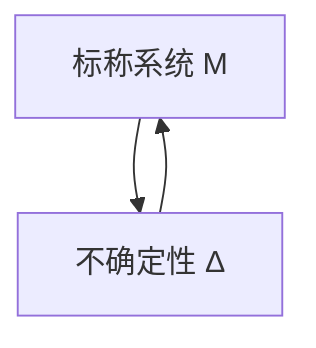

# 鲁棒控制初步

## 为什么需要鲁棒控制

到目前为止的所有设计方法都基于一个理想假设：**数学模型精确描述了物理系统**。但现实中：

- 参数辨识有误差（电阻、惯量的测量不准）
- 系统随时间老化（轴承磨损、电容老化）
- 工作条件变化（温度、负载变化）
- 高频未建模动态（柔性结构模态、传感器动力学）

**鲁棒控制**研究的是：在模型不确定的情况下，如何设计控制器使得闭环系统仍然保持稳定并满足性能指标。

## 不确定性的描述

### 加性不确定性与乘性不确定性

考虑标称传递函数 $G_0(s)$，实际系统 $G(s)$ 可以表示为：

**加性不确定性**：

$$G(s) = G_0(s) + \Delta(s)$$

**乘性（输入/输出）不确定性**：

$$G(s) = G_0(s)(I + \Delta_I(s)) \quad \text{或} \quad G(s) = (I + \Delta_O(s))G_0(s)$$

```text
    加性不确定性                乘性不确定性
    
    +------+                   +------+
    | G0(s)|---> + ---->       | G0(s)|--->
    +------+     ^              +------+
                 | Δ(s)
```

### 结构化的参数不确定性

$$G(s) = \frac{k}{\tau s + 1}, \quad k \in [0.8, 1.2], \tau \in [0.9, 1.1]$$

这种不确定性直接来自物理参数的变化范围。

## 灵敏度函数与补灵敏度函数

### 标准反馈回路

```text
          +------ e ------+
          |               |
    r --> (+) ----> C(s) ----> (+) ----> G(s) ----> y
          ^ -                  | d
          |                    |
          +-------- H(s) <-----+
```

设 $H(s) = 1$（单位反馈），回路传递函数 $L(s) = G(s)C(s)$。

### 关键传递函数

| 名称 | 定义 | 物理意义 |
|------|------|---------|
| 灵敏度函数 | $S(s) = \frac{1}{1 + L(s)}$ | 从扰动 $d$ 到输出 $y$ 的传递 |
| 补灵敏度函数 | $T(s) = \frac{L(s)}{1 + L(s)}$ | 从参考 $r$ 到输出 $y$ 的传递 |
| 控制器灵敏度 | $CS(s) = \frac{C(s)}{1 + L(s)}$ | 从 $r$ 到控制量 $u$ 的传递 |

**关键恒等式**：$S(s) + T(s) = 1$

这个恒等式揭示了鲁棒控制的基本困境：
- 要抑制扰动 $\rightarrow$ 需要 $|S(j\omega)|$ 小
- 要跟踪参考、抑制噪声 $\rightarrow$ 需要 $|T(j\omega)|$ 小
- 但 $S + T = 1$，二者不可能同时很小

## 鲁棒稳定性判据

### Nyquist 判据的鲁棒版本

考虑乘性输出不确定性：$G(s) = (1 + \Delta(s))G_0(s)$，其中 $|\Delta(j\omega)| < |W(j\omega)|$。

鲁棒稳定条件：

$$\|W(j\omega) T_0(j\omega)\|_{\infty} < 1$$

其中 $T_0$ 是标称补灵敏度函数，$\|\cdot\|_{\infty}$ 是 $H_{\infty}$ 范数（频率响应的最大幅值）。

### 小增益定理

更一般地，考虑反馈回路中的不确定性块 $\Delta$：



如果 $M$ 稳定且 $\Delta$ 稳定，则当：

$$\|M\|_{\infty} \cdot \|\Delta\|_{\infty} < 1$$

时，闭环系统鲁棒稳定。

这是鲁棒控制中最基本的结果：**不确定性增益与系统增益的乘积小于 1**。

## H₂ 与 H∞ 控制简介

### 信号范数

对于信号 $u(t)$ 和传递函数 $G(s)$：

| 范数 | 时域定义 | 频域含义 |
|------|---------|---------|
| L₂ 范数（信号能量） | $\|u\|_2 = \sqrt{\int_0^{\infty} u^2(t) dt}$ | — |
| H₂ 范数 | — | $\|G\|_2 = \sqrt{\frac{1}{2\pi}\int_{-\infty}^{\infty} \vertG(j\omega)\vert^2 d\omega}$ |
| H∞ 范数 | — | $\|G\|_{\infty} = \sup_{\omega} \vertG(j\omega)\vert$ |

### H₂ 最优控制

H₂ 控制最小化闭环传递函数的 H₂ 范数：

$$\min_{C} \|W_1 S + W_2 CS\|_2$$

这等价于**最小化白噪声输入下的输出方差**。有趣的是，LQG 控制就是 H₂ 控制的一个特例。

### H∞ 最优控制

H∞ 控制最小化闭环传递函数的 H∞ 范数：

$$\min_{C} \|W_1 S + W_2 T\|_{\infty} < \gamma$$

其中 $\gamma$ 是性能水平。H∞ 控制保证**最坏情况下的增益有界**——无论扰动频率如何，输入到输出的增益都不超过 $\gamma$。

### 数值示例：混合灵敏度设计

```matlab
% Plant with multiplicative uncertainty
G0 = tf(1, [1 2 1]);
W = tf([10 0], [1 100]);  % uncertainty weight: high at high freq

% Mixed sensitivity: minimize || [W1*S; W2*T; W3*CS] ||_inf
W1 = tf(100, [1 0.1]);    % sensitivity weight: low freq tracking
W2 = W;                   % robustness weight
W3 = 0.01;                % control effort penalty

P = augw(G0, W1, W2, W3);
[K, CL, gamma] = hinfsyn(P, 1, 1);
% gamma < 1 indicates robust performance achieved
```

## 鲁棒性分析工具

### 稳定裕度

| 裕度 | 定义 | 工程要求 |
|------|------|---------|
| 增益裕度 (GM) | 系统失稳前增益可变化的倍数 | > 6 dB (约 2 倍) |
| 相位裕度 (PM) | 系统失稳前相位可变化的度数 | > 30° |
| 延迟裕度 | 系统失稳前可增加的纯延迟时间 | > 采样周期的几倍 |

### 奇异值分析（多变量系统）

对于 MIMO 系统，增益不再是标量，而是矩阵的奇异值 $\sigma_i$。鲁棒性分析需要考察：

- 最小奇异值 $\underline{\sigma}(L(j\omega))$：反馈回路的"弱方向"
- 最大奇异值 $\bar{\sigma}(L(j\omega))$：反馈回路的"强方向"

鲁棒稳定条件推广为：

$$\bar{\sigma}(W(j\omega)T(j\omega)) < 1, \quad \forall \omega$$

## 常见错误与纠正

### 错误1：混淆名义稳定性与鲁棒稳定性

**错误说法**："闭环系统极点全在左半平面，所以控制器是鲁棒稳定的。"

**问题**：名义稳定只保证在**精确模型**下稳定。鲁棒稳定要求在所有**允许的模型摄动**下都稳定。一个名义稳定但鲁棒性差的系统，在参数微小变化后就可能失稳。

**纠正**：必须进行鲁棒性分析。至少检查：
1. 增益裕度和相位裕度（单输入单输出）
2. 奇异值裕度（多输入多输出）
3. 对关键参数的灵敏度分析：$\frac{\partial \lambda}{\partial p}$

### 错误2：过度设计鲁棒性

**错误做法**：为了鲁棒性，将 H∞ 性能水平 $\gamma$ 压得极低（如 $\gamma = 0.01$）。

**问题**：过度鲁棒性设计通常以牺牲**名义性能**为代价。H∞ 控制器趋向于保守——为了在最坏情况下也安全，在正常情况下表现平庸。过低的 $\gamma$ 可能导致：
- 控制器带宽过窄，响应 sluggish
- 控制器阶数过高，实现复杂
- 控制 effort 过大，执行器饱和

**纠正**：鲁棒性设计应遵循"足够好即可"原则。通常 $\gamma \approx 1$ 到 $3$ 是合理范围。比较不同 $\gamma$ 下的名义性能和鲁棒性，选择满足工程要求的折衷点。

## 自测习题

**习题1**：某系统的回路传递函数 $L(s) = \frac{10}{s(s+1)}$。计算灵敏度函数 $S(s)$ 和补灵敏度函数 $T(s)$，并验证 $S + T = 1$。

**答案**：

$$S(s) = \frac{1}{1 + L(s)} = \frac{s(s+1)}{s(s+1) + 10} = \frac{s^2 + s}{s^2 + s + 10}$$

$$T(s) = \frac{L(s)}{1 + L(s)} = \frac{10}{s^2 + s + 10}$$

$$S(s) + T(s) = \frac{s^2 + s + 10}{s^2 + s + 10} = 1$$

在直流（$s = 0$）：$S(0) = 0$，$T(0) = 1$。这意味着低频扰动被完全抑制（灵敏度接近 0），低频参考被完美跟踪（补灵敏度接近 1）。

**习题2**：解释为什么 $S(s)$ 和 $T(s)$ 不能同时在所有频率上都小。

**答案**：由 $S(s) + T(s) = 1$，如果在某个频率 $\omega_0$ 上 $|S(j\omega_0)| < \epsilon$，则 $|T(j\omega_0)| = |1 - S(j\omega_0)| \approx 1$。反之亦然。这体现了控制的根本权衡：
- 低频：需要 $|S| \ll 1$（抑制扰动、跟踪参考），接受 $|T| \approx 1$
- 高频：需要 $|T| \ll 1$（抑制测量噪声），接受 $|S| \approx 1$

好的控制器设计应在低频使 $|S|$ 小，在高频使 $|T|$ 小，二者通过截止频率过渡。

**习题3**：某系统的标称模型为 $G_0(s) = \frac{1}{s+1}$，实际系统可能在 $s = -10$ 处有一个未建模极点。这种不确定性属于哪种类型？分析它对闭环系统可能的影响。

**答案**：这属于**动态不确定性**（未建模动态），更具体地说可以建模为乘性不确定性。实际系统可写为：

$$G(s) = \frac{1}{(s+1)(s/10 + 1)} = G_0(s) \cdot \frac{1}{s/10 + 1} = G_0(s)(1 - \Delta(s))$$

其中 $\Delta(s) = \frac{s/10}{s/10 + 1}$，在 $\omega = 10$ rad/s 以上 $|\Delta(j\omega)| \approx 1$。

如果控制器带宽设计在 $\omega_c \ll 10$，未建模动态影响很小；但如果 $\omega_c$ 接近或超过 10，未建模极点会引入额外的相位滞后（约 -45° 在 $\omega = 10$），可能导致相位裕度不足甚至失稳。这就是为什么鲁棒控制要求控制器在不确定性显著的频段（通常是高频）衰减足够快。
