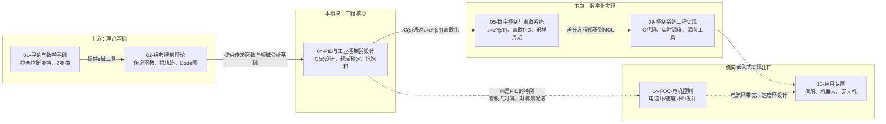
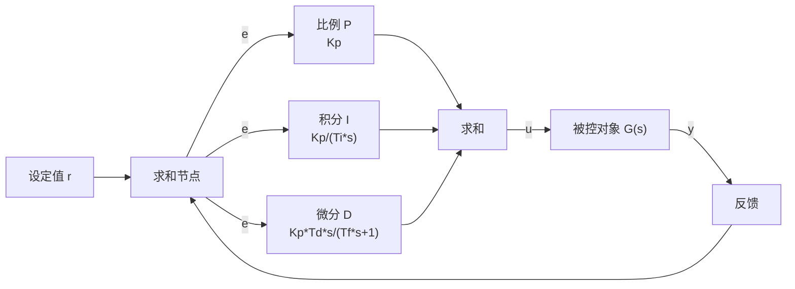

# 图解入门：PID 的物理直觉

> **目标**：在接触任何数学公式之前，先建立对 PID 的"肌肉记忆"。如果你是非科班出身，这一章就是为你写的。
>
> **核心认知锚点**：PID 是**变换链"复域系统分析 → 有限实现与局部分析"之间的第一座工程桥梁**——它直接在 $s$ 域用传递函数设计，通过 $s=j\omega$ 切片到频域验证，最终通过 $z=e^{sT}$ 离散化后在数字芯片上运行。

---

## 配套视频

**MathWorks：Understanding PID Control 第 1 集**

用同一个对象比较 P 与 PI 的阶跃响应，解释哪一项改变稳态误差。

<iframe src="https://www.youtube.com/embed/wkfEZmsQqiA" title="MathWorks：Understanding PID Control 第 1 集" width="100%" height="360" loading="lazy" referrerpolicy="strict-origin-when-cross-origin" allow="encrypted-media; picture-in-picture; fullscreen" allowfullscreen></iframe>

[打开原页](https://www.mathworks.com/videos/series/understanding-pid-control.html)

## 0. 为什么学这一章？它在统一框架中的位置

在整个双控微专业的知识体系中，**PID 模块处于最核心、最实用的位置**。它前面是经典控制理论的数学工具（传递函数、根轨迹、Bode 图），后面是数字控制与离散化实现；它本身则是这些理论走向工业现场的第一站。

从"变换链"的视角看，PID 模块的独特价值在于：

| 变换层级 | 该模块的角色 | 关键映射/工具 |
|---------|------------|-------------|
| 全局频率表示（傅里叶） | 理解噪声频谱、扰动频率 | $s=j\omega$ 切片 |
| 复域系统分析（拉普拉斯） | **核心战场**：用 $C(s)$ 直接设计控制器 | 传递函数、极点零点、Bode 图 |
| 有限实现与局部分析（Z/DFT） | 将连续 PID 离散为差分方程 | $z=e^{sT}$、后向欧拉/双线性变换 |

> **一句话**：PID 不是三个孤立的参数，而是**拉普拉斯域中一种结构最简单的动态补偿器**——一个极点（积分）加两个零点（P 与 D 的组合），却能解决 90% 以上的工业控制问题。

---

## 1. 与前后模块的关系

### 1.1 知识流向总览



### 1.2 模块间的具体衔接

**从 02-经典控制理论 到 04-PID：**

经典控制理论教你判断"一个系统稳不稳、快不快"。PID 模块则回答："**如果不够快或不够稳，我该加什么样的控制器？**"经典控制中的根轨迹和 Bode 图，就是 PID 参数整定的"导航地图"。

- 根轨迹告诉你：增大 $K_p$ 时，闭环极点往哪里移动
- Bode 图告诉你：积分引入 $-90^\circ$ 相位滞后，微分引入 $+90^\circ$ 相位超前，二者在频域"对冲"
- 稳定判据（Nyquist、Routh-Hurwitz）告诉你：$K_p$、$T_i$、$T_d$ 的安全边界在哪里

**从 04-PID 到 05-数字控制与离散系统：**

连续域 PID 的传递函数 $C(s) = K_p(1 + \frac{1}{T_i s} + T_d s)$ 在物理上无法直接实现——微分项是"理想"的，积分需要无限记忆。更重要的是，现代控制器运行在数字芯片上，必须变成差分方程。这正是下一模块的核心任务：

- 用 $s \approx \frac{z-1}{T_s}$（后向欧拉）或 $s \approx \frac{2}{T_s}\frac{z-1}{z+1}$（双线性/Tustin）把 $C(s)$ 转成 $C(z)$
- 理解 $z = e^{sT}$ 的映射：连续稳定（左半平面）→ 离散稳定（单位圆内）
- 采样周期 $T_s$ 的选择直接决定了离散 PID 与连续设计的逼近程度

**与 [[14-FOC-电机控制/00-README|14-FOC-电机控制]] 的关联（横向出口）：**

FOC 中最核心的控制层——电流环和速度环——本质上都由 PI 控制器实现。你在本模块学到的知识，会直接在 FOC 中发挥如下作用：

| 本模块概念 | FOC 中的具体应用 |
|-----------|---------------|
| 零极点对消 | 电流环 PI 零点对消电机极点 $s=-R_s/L_s$，闭环退为一阶惯性 |
| 对称最优法（Modulus Optimum） | 考虑 PWM 延迟小时间常数，优化电流环阻尼 |
| 积分抗饱和 | 电压限幅下反计算法，防止电流指令大阶跃时 windup |
| 离散化实现 | 50μs 周期内用差分方程更新 PI，输出经 SVPWM 调制 |
| 带宽设计 | 电流环带宽 $f_{bw}$ 决定速度环可分配的动态空间 |

> **FOC 工程师的常见场景**：你已经会 Clarke/Park 变换，会 SVPWM，但电流环 PI 参数怎么定？$K_p$ 和 $K_i$ 不是"试"出来的——它们由电机 $R_s$、$L_s$ 和期望带宽 $\omega_{bw}$ 唯一决定：$K_p = L_s \omega_{bw}$，$K_i = R_s \omega_{bw}$。这就是本模块 PI 设计在电机控制中的直接映射。

---

## 2. 从洗澡水调温说起

想象你站在淋浴喷头下，目标是让水温达到舒适的 $40^\circ\text{C}$。你手边有一个混水阀，可以向左（热水）或向右（冷水）旋转。这就是最原始的反馈控制系统：

- **设定值**（Setpoint, $r$）：$40^\circ\text{C}$
- **测量值**（Process Variable, $y$）：你皮肤感受到的实际水温
- **偏差**（Error, $e = r - y$）：当前水温和目标水温的差距
- **控制量**（Controller Output, $u$）：你旋转混水阀的角度

PID 控制器要做的事情，就是根据这个偏差 $e$ 来决定如何旋转混水阀。它由三个"本能反应"叠加而成：

---

## 3. P — 比例：现在有多大偏差？

**物理直觉**：如果水温太冷，立刻多开一点热水；如果偏差越大，就开得越多。

$$u_P(t) = K_p \, e(t)$$

$K_p$ 是比例增益。$K_p$ 大，你对偏差的反应就激烈；$K_p$ 小，你就温吞吞地调。

```text
        偏差 e
          │
    ┌─────┴─────┐
    │  Kp × e   │  ← 比例环节：现在偏差多少，就输出多少
    └─────┬─────┘
          │
        u_P
```

**与变换链的关系**：比例项在 $s$ 域中就是一个纯增益 $K_p$，与频率无关。在 $s=j\omega$ 切片下，$C_P(j\omega) = K_p$，幅值恒定为 $K_p$，相位为 $0^\circ$。它不改变频域中的相位特性，只是整体"抬升"幅频曲线，相当于把 Bode 图向上平移 $20\log_{10}K_p$ dB。

**局限**：纯比例控制就像只靠"当前感觉"调水温。如果管道本身有散热损失，你始终需要一个持续的热水流量才能维持 $40^\circ\text{C}$。这意味着偏差 $e$ 永远不能归零——否则输出 $u_P$ 也会归零，水温就会掉下来。这个残余的偏差叫做**稳态误差**（Steady-State Error）。

---

## 4. I — 积分：过去累积了多少偏差？

**物理直觉**：如果洗了五分钟还是觉得偏冷，说明你之前一直不够热，必须把热水再调大一点，来补偿历史欠账。

$$u_I(t) = K_i \int_0^t e(\tau) \, d\tau = \frac{K_p}{T_i} \int_0^t e(\tau) \, d\tau$$

积分环节记住了**整个历史过程**中的偏差累积。只要存在偏差，积分就会不断增长，直到把偏差彻底"填平"。

```text
        偏差 e
          │
    ┌─────┴─────┐
    │   ∫ e dt  │  ← 积分环节：历史欠账，一笔笔清算
    │  Ki × ... │
    └─────┬─────┘
          │
        u_I
```

**与变换链的关系**：积分在 $s$ 域中的传递函数是 $\frac{K_p}{T_i s}$。分母中的 $s$ 对应时域中的积分运算；在 $s=j\omega$ 切片下，$C_I(j\omega) = -j\frac{K_p}{T_i \omega}$，幅值随频率降低而增大（$\omega \to 0$ 时趋向无穷），相位恒为 $-90^\circ$。这意味着：

- 在直流处（$\omega = 0$，即 $s = 0$），积分提供**无穷大增益**，因此能"强制"稳态误差为零
- 代价是引入恒定 $-90^\circ$ 相位滞后，消耗相位裕度，可能降低稳定性

从拉普拉斯变换的视角，$1/s$ 是积分算子的复频域表示，与微分算子 $s$ 形成对偶。这正是变换链"让微分/积分方程变代数"的核心体现。

**关键作用**：PI 控制器（比例+积分）可以消除稳态误差。即使 $e$ 很小，只要它持续存在，积分项就会像滚雪球一样把控制量推高，直到偏差彻底归零。

**副作用**：积分环节也引入了"记忆"。如果系统发生剧烈扰动，积分项可能累积过大，导致**积分饱和**（Integral Windup）——后面会专门讨论。

---

## 5. D — 微分：偏差变化有多快？

**物理直觉**：你把手伸进水里，发现水温正在快速上升，即使当前还没达到 $40^\circ\text{C}$，你也会预感"马上就要过热了"，于是提前把热水关小一点。

$$u_D(t) = K_d \frac{de(t)}{dt} = K_p \, T_d \frac{de(t)}{dt}$$

微分环节关注的是**偏差的变化率**。它不提供"现在的偏差是多少"的信息，而是提供"偏差正在以什么速度变化"的信息。它像一种**预测性行为**：如果偏差在快速缩小，D 项会提前减小控制量，防止超调。

```text
        偏差 e
          │
    ┌─────┴─────┐
    │   de/dt   │  ← 微分环节：变化有多快？提前踩刹车！
    │  Kd × ... │
    └─────┬─────┘
          │
        u_D
```

**与变换链的关系**：理想微分在 $s$ 域中的传递函数是 $K_p T_d s$。在 $s=j\omega$ 切片下，$C_D(j\omega) = j K_p T_d \omega$，幅值随频率线性增长，相位恒为 $+90^\circ$。这意味着：

- 微分在低频到中频提供**相位超前**，可以抵消积分和其他滞后环节带来的相位滞后，从而提升稳定性（增大相位裕度 PM）
- 理想微分在 $s \to \infty$ 时增益无限增大，物理上不可实现，且会放大高频噪声
- 工程上必须加一阶滤波：$C_D(s) = \frac{K_p T_d s}{T_f s + 1}$，让高频增益饱和

注意：$s$ 在拉普拉斯域中代表微分算子，$j\omega$ 在傅里叶域中代表频率。$s=j\omega$ 的映射让微分从"时域的斜率"变成"频域的 $+90^\circ$ 相移"——这是同一数学对象在两种观察方式下的不同面貌。

**局限**：微分对噪声极其敏感。如果测量信号带有高频噪声，$de/dt$ 会把噪声放大成剧烈的输出抖动。工程上必须配合**微分滤波**使用。

---

## 6. 三兄弟合体：PID 控制回路

把 P、I、D 三者的输出相加，就得到了 PID 控制器的总输出：

$$u(t) = K_p \, e(t) + \frac{K_p}{T_i} \int_0^t e(\tau) \, d\tau + K_p \, T_d \frac{de(t)}{dt}$$

对两边取拉普拉斯变换，得到 PID 的传递函数形式：

$$C(s) = K_p \left( 1 + \frac{1}{T_i s} + T_d s \right) = \frac{K_p (T_i T_d s^2 + T_i s + 1)}{T_i s}$$

**与变换链的关系**：这个式子是本模块的**核心认知锚点**。它同时展示了 PID 在 $s$ 域中的完整面貌：

- 分母一个极点 $s=0$（来自积分），对应 $-20$ dB/dec 的低频渐近线
- 分子两个零点，由 $T_i$ 和 $T_d$ 决定位置，影响中频相位特性
- 令 $s=j\omega$ 可得到频域响应，用 Bode 图直观调参
- 令 $s=\sigma+j\omega$ 可分析极点零点与稳定性的关系
- 通过 $z=e^{sT}$ 的离散映射，可在 Z 域中设计等效数字 PID



**形象比喻**：

| 环节 | 生活比喻 | 控制作用 | 代价 | 在变换链中的角色 |
|------|----------|----------|------|----------------|
| P | 现在 | 快速响应当前偏差 | 稳态误差 | $s$ 域纯增益，频域 $0^\circ$ 相移 |
| I | 过去 | 消除累积误差 | 响应慢、易饱和 | $s$ 域 $1/s$，频域 $-90^\circ$ 滞后 |
| D | 未来 | 预测趋势、抑制超调 | 放大噪声 | $s$ 域 $s$，频域 $+90^\circ$ 超前 |

---

## 7. 数值示例：一阶系统的 P、PI、PID 对比

考虑一个简单的一阶惯性系统：

$$G(s) = \frac{1}{2s + 1}$$

时间常数 $T = 2\,\text{s}$，意味着系统对输入变化的响应比较"迟钝"。设定值从 $0$ 阶跃到 $1$，我们对比三种控制器。

### 7.1 纯 P 控制 ($K_p = 2$)

闭环传递函数为：

$$\frac{Y(s)}{R(s)} = \frac{K_p G(s)}{1 + K_p G(s)} = \frac{2}{2s + 3}$$

这是一个一阶系统，稳态增益为 $2/3$，所以稳态误差为：

$$e_{ss} = 1 - \frac{2}{3} = \frac{1}{3} \approx 33.3\%$$

```matlab
% MATLAB simulation: P control only
Kp = 2;
G = tf(1, [2 1]);
C_p = Kp;
step(feedback(C_p*G, 1));
title('Step Response: P Control Only');
```

**结果**：响应较快，但存在明显稳态误差。从 $s$ 域看，$C(s)=K_p$ 不含积分，无法在 $s=0$ 处提供无穷大增益来强制零误差。

### 7.2 PI 控制 ($K_p = 2, T_i = 2$)

加入积分后，稳态误差被消除。闭环特征方程变为：

$$1 + K_p \left(1 + \frac{1}{T_i s}\right) \frac{1}{2s+1} = 0$$

$$2s^2 + 3s + 1 = 0 \quad \Rightarrow \quad s = -1, -0.5$$

两个负实根，系统稳定且无超调。从 $s$ 域看，积分引入的极点 $s=0$ 在闭环中被"拉起"，但整个系统在直流处增益无穷大，因此稳态误差为零。

```matlab
% MATLAB simulation: PI control
Kp = 2; Ti = 2;
C_pi = Kp * tf([Ti 1], [Ti 0]);  % Kp*(1 + 1/(Ti*s))
step(feedback(C_pi*G, 1));
title('Step Response: PI Control');
```

**结果**：稳态误差为零，但响应速度比纯 P 略慢。

### 7.3 PID 控制 ($K_p = 2, T_i = 2, T_d = 0.5$)

加入微分后，系统的阻尼增大，超调被抑制。闭环特征方程为：

$$2s^2 + (3 + K_p T_d)s + (1 + K_p) = 0 \quad \Rightarrow \quad 2s^2 + 4s + 3 = 0$$

$$s = \frac{-4 \pm \sqrt{16 - 24}}{4} = -1 \pm j\frac{\sqrt{2}}{2}$$

共轭复根，阻尼比 $\zeta = 0.816$，有轻微超调但响应速度更快。

```matlab
% MATLAB simulation: PID control
Kp = 2; Ti = 2; Td = 0.5;
C_pid = Kp * tf([Ti*Td Ti 1], [Ti 0]);  % ideal PID form
step(feedback(C_pid*G, 1));
title('Step Response: PID Control');
```

**结果**：$K_p$ 保证了响应速度，$T_i$ 消除了稳态误差，$T_d$ 提供了阻尼使超调受控。三者在 $s$ 域中通过极点零点的配合，实现了时域性能的综合优化。

| 控制器 | 稳态误差 | 超调量 | 上升时间 | 调节时间 | 闭环极点位置 |
|--------|----------|--------|----------|----------|------------|
| P ($K_p=2$) | $33.3\%$ | $0$ | 快 | 较快 | $s = -1.5$（实极点） |
| PI ($K_p=2, T_i=2$) | $0$ | $0$ | 中等 | 中等 | $s = -1, -0.5$（两实极点） |
| PID ($K_p=2, T_i=2, T_d=0.5$) | $0$ | $<5\%$ | 快 | 快 | $s = -1 \pm j0.707$（共轭复极点） |

---

## 8. 常见错误与纠正

### 错误 1：盲目提高 $K_p$ 试图消除稳态误差

**现象**：工程师发现系统有稳态误差，于是不断增大 $K_p$。$K_p$ 从 2 提到 5，再提到 10，误差越来越小，但系统开始震荡，最终发散。

**原因**：纯 P 控制理论上无法消除对阶跃输入的稳态误差（对 Type 0 系统）。增大 $K_p$ 只是让误差变小，但会牺牲稳定性。从 $s$ 域看，$C(s)=K_p$ 在 $s=0$ 处有限，无法提供无穷大环路增益来强制零误差。

**纠正**：引入积分环节（PI 控制），用 $K_p$ 调节响应速度，用 $T_i$ 消除稳态误差。不要试图只用 P 解决所有问题。积分在 $s=0$ 处的极点才是消除稳态误差的数学根源。

### 错误 2：直接使用理想微分，导致噪声放大

**现象**：在温度控制或流量控制中加入微分项后，执行器（如调节阀）开始高频抖动，寿命急剧下降。

**原因**：理想微分 $K_d s$ 在物理上不可实现（因为它需要预知未来），且对测量噪声有无限增益（噪声频率越高，微分输出越大）。在 $s$ 域中，$s \to \infty$ 时 $|C_D(s)| \to \infty$，这在实际系统中不可能存在。

**纠正**：在工程中，微分环节必须配合低通滤波器使用。常用形式为：

$$D(s) = \frac{K_d s}{T_f s + 1}$$

其中 $T_f$ 为滤波时间常数，通常取 $T_f = T_d / 5 \sim T_d / 10$。这样既保留了微分的预测作用，又抑制了高频噪声。从频域看，滤波器在 $s=j\omega$ 中把高频增益从无穷大"钳制"到有限值 $K_p N$（其中 $N=T_d/T_f$）。

---

## 9. 自测习题

**习题 1**：为什么纯比例控制不能消除对阶跃输入的稳态误差？从物理直觉、数学和变换链三个角度简要解释。

**答案**：
- **物理直觉**：维持输出需要持续的控制量输入。纯比例控制量 $u = K_p e$ 与偏差成正比。如果偏差为零，输出就为零，系统输出会回落，因此必须存在一个非零的偏差来维持所需的控制量。
- **数学**：对 Type 0 系统，$G(s)$ 不含积分环节。由终值定理，$e_{ss} = \lim_{s\to 0} s \cdot \frac{1}{1+K_p G(s)} \cdot \frac{1}{s} = \frac{1}{1+K_p G(0)} \neq 0$。
- **变换链**：P 控制器的 $C(s)=K_p$ 在 $s=0$（直流）处有限，无法提供无穷大环路增益。在 $s=j\omega$ 切片中，这表现为低频处没有额外的增益提升来"压制"误差。只有引入 $1/s$ 积分项，才能在 $s=0$ 处创建极点，使环路增益趋向无穷。

**习题 2**：积分环节为什么能消除稳态误差？如果积分时间常数 $T_i$ 过小，会出现什么问题？从 $s$ 域和频域两个角度解释。

**答案**：
- **$s$ 域解释**：积分传递函数 $\frac{K_p}{T_i s}$ 在 $s=0$ 处有极点，使闭环在直流处增益无穷大。由终值定理，$e_{ss} = \lim_{s\to 0} s E(s) = 0$。
- **频域解释**：积分在 $\omega \to 0$ 时幅值 $|C_I(j\omega)| \to \infty$，且相位为 $-90^\circ$。$T_i$ 过小意味着积分转折频率 $\omega_i = 1/T_i$ 右移，中频段相位滞后增大，相位裕度减小，系统趋向振荡。

**习题 3**：一个系统的设定值从 $0$ 跃变到 $10$，在 $t = 1\,\text{s}$ 时偏差恰好从 $5$ 降到 $2$，比例增益 $K_p = 3$，微分增益 $K_d = 0.5$。求此时 P 项和 D 项的输出分别是多少？D 项的负号意味着什么？

**答案**：
- $u_P = K_p \cdot e = 3 \times 2 = 6$
- $de/dt \approx \Delta e / \Delta t = (2 - 5) / 1 = -3$
- $u_D = K_d \cdot (de/dt) = 0.5 \times (-3) = -1.5$
- P 项输出为 $6$，D 项输出为 $-1.5$（负号意味着"偏差在缩小，提前减小控制量"）。

---

## 10. 小结

| 概念 | 一句话总结 | 在变换链中的位置 |
|------|-----------|---------------|
| 比例 P | 看现在，偏差多大，就输出多少 | $s$ 域：纯增益 $K_p$；频域：$0^\circ$ 相移，全频段等幅放大 |
| 积分 I | 看过去，累积欠账，一笔笔清算 | $s$ 域：$1/s$ 极点；频域：$-90^\circ$ 滞后，低频无穷增益 |
| 微分 D | 看未来，变化趋势，提前踩刹车 | $s$ 域：$s$ 零点；频域：$+90^\circ$ 超前，高频需滤波钳制 |
| 稳态误差 | P 的"硬伤"，I 的"天职" | $s=0$ 处环路增益是否无穷大 |
| 噪声敏感 | D 的"软肋"，需要滤波保护 | 高频处 $\verts\vert \to \infty$ 的理想微分不可实现 |
| PID 传递函数 | $C(s)=K_p(1+\frac{1}{T_i s}+T_d s)$ | 一个极点+两个零点的最简动态补偿器 |

PID 不是三个孤立环节的简单相加，而是**时间维度上的三位一体**：P 活在当前，I 回望过去，D 眺望未来。从变换链的视角，它是**从 $s$ 域传递函数到工程实现的最短路径**——用最少的极点零点，解决最广泛的控制问题。理解了这一点，你就已经掌握了 PID 的灵魂。

---

> **知识出口提示**：
> - 下一章：[001-PID 的物理直觉与频域解释](001-PID的物理直觉与频域解释.md) —— 从时域直觉走向 $s=j\omega$ 频域分析，用 Bode 图揭示每个参数的频率角色。
> - 关联微专业：[[14-FOC-电机控制/02-FOC控制理论/002-电流环PI控制器设计]] —— 观察 PI 在电机控制中的零极点对消设计。
> - 后续模块：[[15-双控（控制理论与控制工程）/05-数字控制与离散系统/000-图解入门：数字控制与模拟控制的区别]] —— 理解 $C(s)$ 如何通过 $z=e^{sT}$ 变为离散 PID。

**DR_CAN｜PID 控制器**　[B 站作者合集](https://space.bilibili.com/230105574/lists)。配合本节的比例、积分和微分实例对照。
