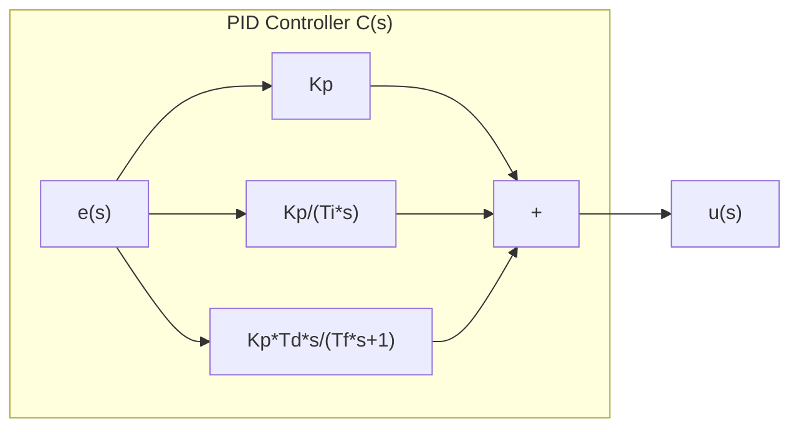
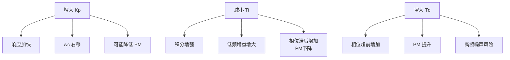

# PID 的物理直觉与频域解释

> **核心认知锚点**：PID 的频域分析是**拉普拉斯变换 $s$ 域到傅里叶变换 $j\omega$ 轴的切片操作**。令 $s=j\omega$ 代入 $C(s)$，P、I、D 三个环节便分解为幅值增益与相位偏移的组合——前者决定"多强"，后者决定"多稳"。
>
> **为什么需要频域视角**：时域让我们"感受" PID，频域让我们"设计" PID。工程中最关键的稳定性判据（相位裕度、增益裕度）和参数整定法则（Ziegler-Nichols、对称最优法）都建立在 $s=j\omega$ 的映射之上。

---

## 1. 从时域到频域：为什么需要频域视角

上一章我们用洗澡水、调温阀等直觉建立了对 PID 的感性认识。但工程实践中，仅凭直觉无法回答这些问题：

- 系统会不会振荡？振荡频率是多少？
- 为什么微分环节能抑制超调，却引入噪声？
- 参数 $K_p$、$T_i$、$T_d$ 到底改变了系统的哪些频率特性？

频域分析（Frequency-Domain Analysis）将系统分解为不同频率正弦信号的响应，通过**幅值增益**和**相位偏移**来刻画系统行为。对于 PID 控制器，频域视角是最锋利的手术刀。

**与变换链的关系**：频域分析的本质是**沿 $s$ 平面的虚轴做切片**。当拉普拉斯变换的 ROC（收敛域）包含虚轴时，频率响应函数 $H(j\omega)$ 就是传递函数 $H(s)$ 在 $s=j\omega$ 上的取值：

$$H(j\omega) = H(s)\big|_{s=j\omega}$$

这是把 PID 从"复域设计工具"切换到"频率特性观察工具"的关键操作。PID 的传递函数在 $s$ 域中设计，但它的性能验证和参数调优在 $j\omega$ 轴上完成——二者通过 $s=j\omega$ 无缝连接。

---

## 2. PID 的传递函数

连续时间理想 PID 控制器在时域中写作：

$$u(t) = K_p \left[ e(t) + \frac{1}{T_i} \int_0^t e(\tau) \, d\tau + T_d \frac{de(t)}{dt} \right]$$

对两边做拉普拉斯变换，得到传递函数：

$$C(s) = K_p \left( 1 + \frac{1}{T_i s} + T_d s \right) = \frac{K_p (T_i T_d s^2 + T_i s + 1)}{T_i s}$$



**关键观察与变换链关系**：
- 分母有一个 $s$，来自积分环节，意味着在 $s = 0$（直流）处增益为无穷大。这就是积分能消除稳态误差的数学根源——在 $s=j\omega$ 切片中，这表现为 $\omega \to 0$ 时 $|C_I(j\omega)| \to \infty$。
- 分子是二次多项式，有两个零点。零点位置由 $T_i$ 和 $T_d$ 决定。在 $s$ 域中，零点影响系统的相位特性；在 $j\omega$ 切片中，它们决定了相位从负到正的"转折区域"。
- 理想微分 $T_d s$ 在 $s \to \infty$ 时增益趋于无穷，物理上不可实现，工程上必须加滤波。这对应频域中高频噪声被无限放大的问题。

---

## 3. 各环节在频域中的角色

将 $s = j\omega$ 代入，分析 PID 在不同频率 $\omega$ 下的行为。这是本模块最核心的数学操作：**$s=j\omega$ 映射把复域的传递函数变成了频域的幅相特性**。

### 3.1 比例环节

$$C_P(j\omega) = K_p$$

- **幅值**：$|C_P| = K_p$（与频率无关）
- **相位**：$\angle C_P = 0^\circ$（无相位偏移）

比例环节是"全频段等增益"的放大器。它提升所有频率的环路增益，但也会提升所有频率的噪声。

**与变换链的关系**：比例项在 $s$ 域和 $j\omega$ 域中形式完全相同，因为 $K_p$ 不含 $s$。这说明纯增益在两种观察方式下是"透明"的——它不改变信号的相位，只改变幅值。

### 3.2 积分环节

$$C_I(j\omega) = \frac{K_p}{T_i j \omega} = -j \frac{K_p}{T_i \omega}$$

- **幅值**：$|C_I| = \frac{K_p}{T_i \omega}$（随频率降低而增大，低频增益极高）
- **相位**：$\angle C_I = -90^\circ$（恒定的滞后）

**物理含义与变换链关系**：积分环节在低频（接近直流）提供无穷大增益，因此能"压制"稳态误差。但代价是引入 $-90^\circ$ 的相位滞后，这会消耗系统的相位裕度，降低稳定性。

从变换链的视角，$1/(j\omega)$ 是 $1/s$ 在虚轴上的切片。$s$ 域中的极点 $s=0$ 对应频域中的"无穷大增益点"——这是同一数学事实在两种域中的不同表述。在 $s$ 平面中，极点位于原点；在 $j\omega$ 轴上，它表现为 $\omega \to 0$ 时的幅值发散。

### 3.3 微分环节（带滤波）

工程实用的微分不是纯理想微分，而是带有一阶滤波的形式：

$$C_D(s) = \frac{K_p T_d s}{T_f s + 1}$$

其中 $T_f = T_d / N$，$N$ 通常在 $5 \sim 20$ 之间。

令 $s = j\omega$：

$$C_D(j\omega) = \frac{K_p T_d j\omega}{1 + j T_f \omega}$$

- **低频**（$\omega \ll 1/T_f$）：$|C_D| \approx K_p T_d \omega$，相位约 $+90^\circ$
- **高频**（$\omega \gg 1/T_f$）：$|C_D| \approx K_p T_d / T_f = K_p N$（饱和），相位回到 $0^\circ$

**物理含义与变换链关系**：微分在低频到中频提供**相位超前**（$+90^\circ$），抵消积分和其他滞后环节带来的相位滞后，从而提升稳定性。但高频处被滤波器"钳制"，防止噪声放大。

注意：滤波器 $1/(T_f s + 1)$ 在 $s$ 域中引入了一个额外极点 $s = -1/T_f$，在 $j\omega$ 轴上表现为高频处增益饱和和相位回零。这是 $s$ 域设计直接影响 $j\omega$ 域行为的典型例子。

---

## 4. PID 的波特图解读

画出 $C(j\omega)$ 的幅频和相频特性，可以清晰看到每个频段由哪个环节主导。

```text
Amplitude (dB)
    │
40 ─┤                           ╱───── 高频段：微分主导（+20 dB/dec）
    │                          ╱
20 ─┤      ╱─────── 中频段：三者叠加
    │     ╱
 0 ─┤────╱───────── 比例主导线（0 dB参考）
    │   ╱
-20─┤──╱─────────── 低频段：积分主导（-20 dB/dec）
    │ ╱
-40─┤╱
    └───────────────────────────────
         ωi  ωp  ωd                  ω (log scale)
         ↑   ↑   ↑
      积分   比例   微分
      转折   主导   转折
      频率   区域   频率
```

| 频段 | 主导环节 | 幅值斜率 | 相位特征 | 工程意义 | 与变换链的关系 |
|------|----------|----------|----------|----------|-------------|
| 极低频 | 积分 | $-20\,\text{dB/dec}$ | 接近 $-90^\circ$ | 消除稳态误差 | $s=0$ 极点在 $j\omega$ 轴上的低频表现 |
| 中低频 | 比例+积分 | 过渡 | $-90^\circ \sim -45^\circ$ | 响应速度与精度折中 | 积分相位被比例"稀释" |
| 中频 | 比例 | $0\,\text{dB/dec}$ | 接近 $0^\circ$ | 系统带宽与响应速度 | $C(j\omega) \approx K_p$ |
| 中高频 | 比例+微分 | $+20\,\text{dB/dec}$ | $+45^\circ \sim +90^\circ$ | 相位超前、阻尼提升 | $s$ 域零点在 $j\omega$ 上的相位超前 |
| 高频 | 微分滤波 | 平坦 | 回到 $0^\circ$ | 噪声抑制 | $s$ 域滤波极点 $s=-1/T_f$ 的高频效应 |

---

## 5. 相位裕度与 PID 参数的关系

闭环系统的稳定性可以用**相位裕度**（Phase Margin, PM）来度量。一般工程要求 $PM \approx 30^\circ \sim 60^\circ$。

**与变换链的关系**：相位裕度是在**$j\omega$ 轴上**定义的。令开环传递函数 $L(s) = C(s)G(s)$，在增益交界频率 $\omega_c$（即 $|L(j\omega_c)| = 1$）处，相位裕度为：

$$PM = 180^\circ + \angle L(j\omega_c)$$

这是在 $s$ 域的虚轴上"测量"系统离不稳定边界（$-180^\circ$）还有多远。$s=j\omega$ 的映射让复域的稳定性判据变成了频域的可视化指标。

增加 $K_p$：
- 幅频曲线上移，**增益交界频率**（Gain Crossover Frequency, $\omega_c$）右移
- $\omega_c$ 右移意味着系统响应更快，但通常相位滞后更大
- $PM$ 可能减小，稳定性变差

减小 $T_i$（积分加强）：
- 积分转折频率 $\omega_i = 1/T_i$ 右移
- 在 $\omega_c$ 处积分相位滞后更多
- $PM$ 减小，系统趋向振荡

增加 $T_d$（微分加强）：
- 微分转折频率 $\omega_d = 1/T_d$ 左移
- 在 $\omega_c$ 附近提供更多相位超前
- $PM$ 增大，稳定性改善，但可能放大中频噪声



---

## 6. 与 FOC 电机控制的深度关联

[[14-FOC-电机控制/00-README|14-FOC-电机控制]] 中的电流环 PI 设计，是本章频域分析方法的直接工程应用。下面展示这种知识映射：

### 6.1 FOC 电流环的频域结构

FOC 中解耦后的 d/q 轴电流对象是一个一阶 RL 系统：

$$G_{motor}(s) = \frac{1}{R_s + L_s s} = \frac{1/R_s}{1 + \tau_e s}, \quad \tau_e = \frac{L_s}{R_s}$$

PI 控制器的传递函数为：

$$C_{PI}(s) = K_p + \frac{K_i}{s} = K_p \frac{1 + T_i s}{T_i s}$$

### 6.2 零极点对消的频域解释

令 $T_i = \tau_e = L_s/R_s$，则 PI 零点 $s = -1/T_i = -R_s/L_s$ 恰好与电机极点重合。开环传递函数变为：

$$C_{PI}(s) \cdot G_{motor}(s) = \frac{K_p}{R_s \tau_e s} = \frac{K_p}{L_s s}$$

这是一个**纯积分器**。在 $j\omega$ 轴上，其幅频特性为 $-20$ dB/dec 的直线，相位恒为 $-90^\circ$。闭环后系统退化为一个一阶惯性：

$$G_{cl}(s) = \frac{1}{1 + \frac{L_s}{K_p} s}$$

闭环带宽 $\omega_{bw} = K_p/L_s$——一个极其简洁的频域关系。这意味着：**$K_p$ 直接决定电流环的频域带宽**，而 $K_i$ 则通过零极点对消确保中频段的相位特性不被破坏。

### 6.3 从 PID 到 FOC 的知识映射表

| 本模块概念 | FOC 中的对应实践 | 变换链视角 |
|-----------|----------------|----------|
| 积分消除稳态误差 | 电流环稳态时 $i_d/i_q$ 无静差 | $s=0$ 处无穷大增益强制 $E(s)=0$ |
| 微分相位超前 | 电流环不加 D（纯 PI），但速度环可能加 | 电机对象本身有足够相位裕度，无需额外超前 |
| Bode 图设计 | 开环幅频在 $\omega_{bw}$ 处穿越 0 dB | $s=j\omega$ 切片验证设计 |
| 参数整定 | 极点配置：$K_p = L_s \omega_{bw}$，$K_i = R_s \omega_{bw}$ | $s$ 域零极点位置直接决定频域带宽 |
| 离散化实现 | 50μs 周期差分方程 | $z = e^{sT}$ 映射连续设计到离散芯片 |
| 抗饱和 | 电压限幅下反计算法 | 非线性处理超越线性变换，但基于 $s$ 域设计出发 |

> **给 FOC 学习者的提示**：当你在 FOC 中调试电流环 PI 时，你实际上是在操作本模块的频域设计工具。如果电流响应慢，增大 $K_p$（提升带宽）；如果电流有静差，检查 $K_i$（积分增益）；如果电流振荡，检查相位裕度是否过低（$T_i$ 可能太小或 $K_p$ 太大）。

---

## 7. 数值示例：从波特图看参数影响

被控对象：

$$G(s) = \frac{1}{(s+1)(0.5s+1)(0.2s+1)}$$

这是一个三阶惯性系统，本身具有相位滞后。我们设计三个 PID 控制器并比较。

### 控制器 A：弱 PID ($K_p=1, T_i=5, T_d=0.1$)

```matlab
% MATLAB: Bode plot comparison
G = tf(1, conv([1 1], conv([0.5 1], [0.2 1])));
Kp1 = 1; Ti1 = 5; Td1 = 0.1;
C1 = Kp1 * tf([Ti1*Td1 Ti1 1], [Ti1 0]);
figure; bode(C1*G); grid on;
[GM1, PM1, Wcg1, Wcp1] = margin(C1*G);
```

$PM \approx 45^\circ$，$\omega_c \approx 0.6\,\text{rad/s}$，响应偏慢但稳定。

**与变换链的关系**：$K_p=1$ 时增益交界频率较低，系统在中频段远离积分和微分的转折区，相位接近 $0^\circ$，因此 $PM$ 适中。

### 控制器 B：强比例 ($K_p=3, T_i=5, T_d=0.1$)

```matlab
Kp2 = 3; Ti2 = 5; Td2 = 0.1;
C2 = Kp2 * tf([Ti2*Td2 Ti2 1], [Ti2 0]);
[GM2, PM2, Wcg2, Wcp2] = margin(C2*G);
```

$PM \approx 18^\circ$，$\omega_c \approx 1.8\,\text{rad/s}$。响应更快，但相位裕度不足，阶跃响应会有明显超调和振荡。

**与变换链的关系**：$K_p$ 增大使幅频曲线上移，$\omega_c$ 右移到更高频率。但三阶对象在高频段相位滞后更大（三阶系统高频相位趋于 $-270^\circ$），因此 $PM$ 下降。这说明**$s$ 域中增益增大虽然不改变极点位置，但改变了闭环系统实际工作的频率区域**，从而间接影响稳定性。

### 控制器 C：强 PID ($K_p=3, T_i=2, T_d=0.5$)

```matlab
Kp3 = 3; Ti3 = 2; Td3 = 0.5;
C3 = Kp3 * tf([Ti3*Td3 Ti3 1], [Ti3 0]);
[GM3, PM3, Wcg3, Wcp3] = margin(C3*G);
```

$PM \approx 55^\circ$，$\omega_c \approx 1.2\,\text{rad/s}$。$K_p$ 提升了速度，$T_d$ 提供了足够的相位超前来补偿 $T_i$ 减小带来的相位滞后，系统响应快且稳定。

**与变换链的关系**：$T_d=0.5$ 使微分零点位于 $s=-1/T_d=-2$ 附近，在 $j\omega$ 轴上对应中频段提供相位超前。这"对冲"了 $T_i=2$ 使积分转折频率 $\omega_i=0.5$ rad/s 右移带来的相位滞后。三个参数在 $s$ 域中的零极点配合，最终在 $j\omega$ 轴上实现了理想的相位裕度。

| 控制器 | $K_p$ | $T_i$ | $T_d$ | $PM$ | $\omega_c$ | 稳定性评价 |
|--------|-------|-------|-------|------|-----------|-----------|
| A | 1 | 5 | 0.1 | $45^\circ$ | 0.6 | 稳定，偏慢 |
| B | 3 | 5 | 0.1 | $18^\circ$ | 1.8 | 欠阻尼，振荡 |
| C | 3 | 2 | 0.5 | $55^\circ$ | 1.2 | 快而稳定 |

---

## 8. 常见错误与纠正

### 错误 1：用波特图时忽略微分滤波，误算高频增益

**现象**：工程师用理想微分 $T_d s$ 画波特图，认为高频增益无限增大，结果实际系统高频噪声并未被严重放大，于是误判微分无效。

**原因**：实际 PID 控制器中微分必有滤波。理想 PID 的波特图在 $\omega \to \infty$ 时以 $+20\,\text{dB/dec}$ 上升，而实际 PID 在 $\omega > 1/T_f$ 后平坦。忽略滤波会导致对高频行为的错误预测。

**与变换链的关系**：理想微分 $s$ 在 $s$ 域中是一个在原点的零点，但在 $j\omega$ 轴上高频增益无限。加入滤波器 $1/(T_f s+1)$ 相当于在 $s=-1/T_f$ 处增加一个极点，把高频增益从无穷大"拉下来"。从 $s$ 域到 $j\omega$ 域的映射中，这个额外极点决定了高频处的真实行为。

**纠正**：工程分析时始终使用带滤波的微分形式：

$$C(s) = K_p \left( 1 + \frac{1}{T_i s} + \frac{T_d s}{T_f s + 1} \right)$$

MATLAB 中可用 `pidstd(Kp, Ti, Td, Tf)` 或手动构造。

### 错误 2：在尼奎斯特图上看到 PID 零点导致曲线右偏，误判系统不稳定

**现象**：画出 $C(s)G(s)$ 的尼奎斯特曲线，发现由于 PID 控制器引入的右半平面零点（如果参数设计不当），曲线从右侧绕过 $-1$ 点，有人据此认为系统不稳定。

**原因**：PID 控制器的分子是一个二次多项式。如果 $T_i < 4T_d$，分子有复零点，可能位于右半平面（非最小相位）。但这**不直接意味着闭环不稳定**。闭环稳定性取决于尼奎斯特判据的完整包围分析，而不是零点位置。

**与变换链的关系**：零点在 $s$ 域中的位置影响瞬态响应的"非最小相位"特性（响应先反向再正向），但稳定性由闭环极点决定。$s$ 域中的零点和极点有不同的工程意义：极点决定稳定性，零点影响响应形状和相位特性。

**纠正**：
- 使用闭环极点分析或 `margin()` 命令直接获取 $PM$ 和 $GM$。
- 非最小相位零点确实会限制可获得的性能，但正确设计下系统仍可稳定。
- 避免 $T_i < 4T_d$ 的极端参数组合，通常取 $T_i \approx 4T_d \sim 8T_d$ 为合理范围。

---

## 9. 自测习题

**习题 1**：理想 PID 控制器的传递函数 $C(s) = K_p(1 + 1/(T_i s) + T_d s)$ 中，为什么积分环节在 $s = 0$ 处增益无穷大？这如何解释它能消除阶跃输入的稳态误差？从 $s$ 域和 $j\omega$ 域两个角度回答。

**答案**：
- **$s$ 域**：积分环节的传递函数为 $1/(T_i s)$。当 $s \to 0$ 时，$|1/(T_i s)| \to \infty$。对于闭环系统，从误差到输入的传递函数为 $E(s)/R(s) = 1/(1 + C(s)G(s))$。在 $s = 0$ 处，如果 $C(0) = \infty$（因为积分），则 $E(0)/R(0) = 0$，即稳态误差为零。
- **$j\omega$ 域**：$C_I(j\omega) = -j\frac{K_p}{T_i \omega}$。当 $\omega \to 0$ 时，$|C_I(j\omega)| \to \infty$。从频域看，积分在直流处提供无限大增益，"强制"了零误差。这是 $s$ 域极点 $s=0$ 在 $j\omega$ 轴上的直接表现。

**习题 2**：某系统的开环传递函数加入 PID 后，增益交界频率 $\omega_c = 2\,\text{rad/s}$。在该频率处，积分环节贡献的相位滞后是多少？如果 $T_d = 0.5$，微分环节（含滤波 $T_f = 0.05$）在该频率处贡献的相位超前是多少？

**答案**：
- 积分相位：$\angle \frac{1}{j\omega T_i} = -90^\circ$（恒定，与 $\omega$ 和 $T_i$ 无关）。
- 微分（含滤波）相位：$\angle \frac{j\omega T_d}{1 + j\omega T_f} = 90^\circ - \arctan(\omega T_f)$。代入 $\omega = 2$，$T_f = 0.05$：$\arctan(0.1) \approx 5.7^\circ$，所以相位超前约 $84.3^\circ$。
- 实际净相位贡献还要考虑比例和对象 $G(s)$ 的相位。PM 的计算是在 $j\omega$ 轴上"汇总"所有环节的相位贡献。

**习题 3**：已知被控对象 $G(s) = \frac{2}{s+2}$，设计一个 PI 控制器 $C(s) = K_p(1 + 1/(T_i s))$，使得闭环系统对阶跃输入的稳态误差为零，且闭环极点位于 $s = -2$ 和 $s = -4$。求 $K_p$ 和 $T_i$。

**答案**：
- 闭环特征方程：$1 + C(s)G(s) = 0$
- $C(s)G(s) = K_p \frac{T_i s + 1}{T_i s} \cdot \frac{2}{s+2} = \frac{2K_p(T_i s + 1)}{T_i s(s+2)}$
- 特征方程：$T_i s(s+2) + 2K_p(T_i s + 1) = 0$
- 展开：$T_i s^2 + (2T_i + 2K_p T_i)s + 2K_p = 0$
- 期望特征多项式：$(s+2)(s+4) = s^2 + 6s + 8 = 0$
- 对比系数：令 $T_i = 0.5$（使控制器零点在 $s=-2$ 对消对象极点），闭环降阶为一阶：$s + 4K_p = 0$。要极点在 $-4$，则 $K_p = 1$。
- **修正后的答案**：$K_p = 1$，$T_i = 0.5$。此时控制器零点在 $s = -2$ 与对象极点对消，闭环一阶系统极点在 $s = -4$。频域上，这对应一个带宽为 4 rad/s 的一阶系统。

---

## 10. 小结

| 视角 | 核心结论 | 与变换链的关系 |
|------|----------|-------------|
| 传递函数 | PID 在 $s=0$ 处有极点（积分），分子有两个零点（P+I, D） | $s$ 域的零极点结构直接决定频域特性 |
| 波特图 | 低频积分主导（-20 dB/dec），中频比例主导，高频微分主导（+20 dB/dec，被滤波钳制） | $s=j\omega$ 映射把 $s$ 域零极点"翻译"为幅相曲线 |
| 相位 | I 贡献 $-90^\circ$ 滞后，D 贡献 $+90^\circ$ 超前（低频），二者"对冲" | $1/s$ 与 $s$ 在 $j\omega$ 上的相位互为相反数 |
| 稳定性 | $K_p$ 影响速度（$\omega_c$），$T_i$ 影响低频精度与相位滞后，$T_d$ 提供相位超前改善 PM | 所有稳定性判据都在 $j\omega$ 轴上定义（PM、GM） |
| 工程实现 | 微分必须加滤波，否则噪声灾难 | $s$ 域中理想微分的高频无穷增益在 $j\omega$ 上表现为噪声放大 |
| FOC 应用 | 电流环 PI 是零极点对消的频域设计典范 | $K_p = L_s \omega_{bw}$ 直接体现 $s$ 域参数到频域带宽的映射 |

频域不是时域的替代，而是互补。时域让你"感觉"系统，频域让你"设计"系统。**$s=j\omega$ 是连接这两个世界的桥梁**——当你能在 $s$ 域和 $j\omega$ 域之间自由切换，PID 的设计就不再是试凑，而是工程。

---

> **知识出口提示**：
> - 上一章：[000-图解入门：PID 的物理直觉](000-图解入门：PID的物理直觉.md) —— 建立时域直觉和变换链定位。
> - 下一章：[002-参数整定方法论](002-参数整定方法论.md) —— 从频域分析走向系统化的参数整定方法。
> - 关联微专业：[[14-FOC-电机控制/02-FOC控制理论/002-电流环PI控制器设计]] —— 频域设计在电机控制中的直接应用。
> - 后续模块：[[15-双控（控制理论与控制工程）/05-数字控制与离散系统/003-离散PID实现]] —— 从 $C(s)$ 到 $C(z)$ 的离散化实现。
