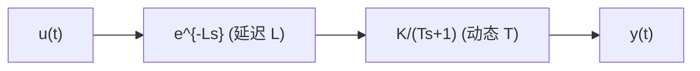
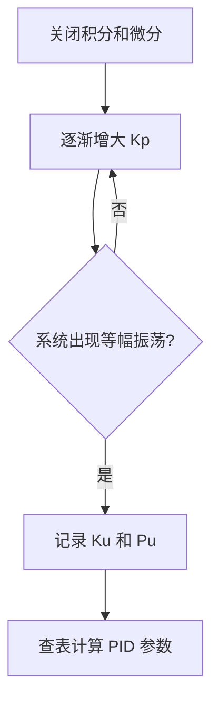
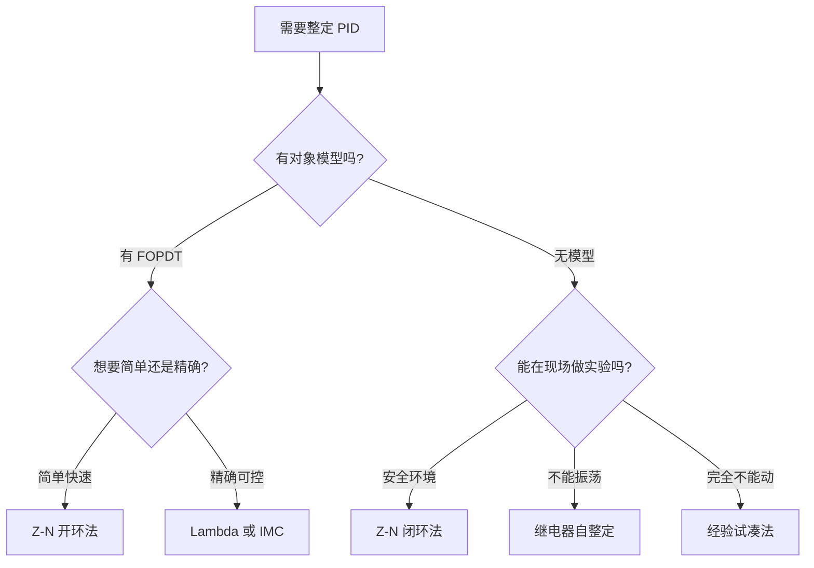

# 参数整定方法论

> PID 参数整定不是玄学，而是有章可循的工程方法。本章覆盖从经典试凑到现代解析的完整方法论，每种方法都配有数值示例和可执行的 MATLAB 代码。

---

## 1. 为什么参数整定如此重要

PID 控制器的性能完全取决于三个参数：$K_p$（比例增益）、$T_i$（积分时间常数）、$T_d$（微分时间常数）。参数选得好，一台便宜的控制器可以驯服复杂的工业对象；参数选得差，再昂贵的系统也会振荡失控。

**整定的核心目标**：在**稳定性**、**响应速度**、**超调量**、**抗干扰能力**之间取得平衡。没有"最优"参数，只有"最适合当前工况"的参数。

---

## 2. 被控对象模型：FOPDT 近似

工业上 $80\%$ 以上的过程对象可以用**一阶惯性加纯滞后**（First-Order Plus Dead Time, FOPDT）模型来近似：

$$G(s) = \frac{K}{Ts + 1} e^{-Ls}$$

| 参数 | 符号 | 物理意义 | 获取方法 |
|------|------|----------|----------|
| 静态增益 | $K$ | 输入单位变化引起的稳态输出变化 | 阶跃响应终值比 |
| 时间常数 | $T$ | 系统响应速度的量度（达到 $63.2\%$ 终值的时间） | 阶跃响应曲线拟合 |
| 纯滞后 | $L$ | 输入变化后输出无响应的死区时间 | 阶跃响应起点到切线交点 |



### 从阶跃响应获取 FOPDT 参数：两点法

对系统施加单位阶跃输入，记录输出 $y(t)$。找到输出达到终值 $28.3\%$ 和 $63.2\%$ 的时间点 $t_{28.3}$ 和 $t_{63.2}$：

$$T = \frac{3}{2}(t_{63.2} - t_{28.3}), \quad L = t_{63.2} - T$$

**数值示例**：某加热炉的阶跃响应中，$y$ 在 $t = 2.5\,\text{min}$ 达到 $28.3\%$，在 $t = 5.0\,\text{min}$ 达到 $63.2\%$。

$$T = 1.5 \times (5.0 - 2.5) = 3.75\,\text{min}, \quad L = 5.0 - 3.75 = 1.25\,\text{min}$$

---

## 3. Ziegler-Nichols 方法

Ziegler-Nichols（Z-N）是 PID 整定史上最具影响力的方法，分为**开环**（Reaction Curve）和**闭环**（Ultimate Gain）两种。

### 3.1 Z-N 开环法（反应曲线法）

适用于可以用 FOPDT 模型近似的对象。从开环阶跃响应获取 $K$、$T$、$L$ 后，直接查表：

| 控制器 | $K_p$ | $T_i$ | $T_d$ |
|--------|-------|-------|-------|
| P | $T/(KL)$ | — | — |
| PI | $0.9T/(KL)$ | $3L$ | — |
| PID | $1.2T/(KL)$ | $2L$ | $0.5L$ |

**数值示例**：$K = 2$，$T = 3.75\,\text{min}$，$L = 1.25\,\text{min}$。

$$K_p = \frac{1.2 \times 3.75}{2 \times 1.25} = 1.8, \quad T_i = 2 \times 1.25 = 2.5\,\text{min}, \quad T_d = 0.5 \times 1.25 = 0.625\,\text{min}$$

```matlab
% MATLAB: Z-N Open Loop tuning
K = 2; T = 3.75*60; L = 1.25*60;  % convert to seconds
G = tf(K, [T 1], 'InputDelay', L);
Kp_zn = 1.2*T/(K*L);
Ti_zn = 2*L;
Td_zn = 0.5*L;
C_zn = pidstd(Kp_zn, Ti_zn, Td_zn);
step(feedback(C_zn*G, 1));
```

**特点**：算法简单，但 Z-N 的设计目标是达到 $1/4$ 衰减比（振幅衰减为前一次的 $25\%$），这意味着**大约 $20\sim30\%$ 的超调**，对很多精密应用来说过于激进。

### 3.2 Z-N 闭环法（临界振荡法）

不需要对象模型。先只用比例控制，逐渐增大 $K_p$ 直到系统产生**等幅振荡**，记录临界增益 $K_u$ 和临界周期 $P_u$：

| 控制器 | $K_p$ | $T_i$ | $T_d$ |
|--------|-------|-------|-------|
| P | $0.5 K_u$ | — | — |
| PI | $0.45 K_u$ | $P_u / 1.2$ | — |
| PID | $0.6 K_u$ | $P_u / 2$ | $P_u / 8$ |



**数值示例**：某系统纯比例控制时，$K_p = 8$ 出现等幅振荡，振荡周期 $P_u = 4\,\text{s}$。

$$K_p = 0.6 \times 8 = 4.8, \quad T_i = 4/2 = 2\,\text{s}, \quad T_d = 4/8 = 0.5\,\text{s}$$

**警告**：临界振荡法在工业现场**风险很高**。等幅振荡可能导致系统失控或损坏设备。仅在仿真或安全环境下使用。

---

## 4. Cohen-Coon 方法

Cohen-Coon（C-C）在 Z-N 基础上改进，将目标衰减比从 $1/4$ 改为更温和的设定，旨在提供更大的稳定裕度。公式更复杂，但结果通常更保守：

| 控制器 | $K_p$ | $T_i$ | $T_d$ |
|--------|-------|-------|-------|
| P | $\frac{T}{KL}\left(1 + \frac{0.35T}{T+3.5L}\right)$ | — | — |
| PI | $\frac{0.9T}{KL}\left(1 + \frac{0.92L}{T+2.2L}\right)$ | $\frac{3.3L(T+0.2L)}{T+1.2L}$ | — |
| PID | $\frac{1.35T}{KL}\left(1 + \frac{0.18L}{T+0.5L}\right)$ | $\frac{2.5L(T+0.36L)}{T+0.6L}$ | $\frac{0.37L(T)}{T+0.2L}$ |

**数值示例**：继续使用 $K=2$，$T=3.75\,\text{min}$，$L=1.25\,\text{min}$。

PID 参数：

$$K_p = \frac{1.35 \times 3.75}{2 \times 1.25} \left(1 + \frac{0.18 \times 1.25}{3.75 + 0.5 \times 1.25}\right) = 2.025 \times 1.056 = 2.14$$

$$T_i = \frac{2.5 \times 1.25 \times (3.75 + 0.36 \times 1.25)}{3.75 + 0.6 \times 1.25} = \frac{3.125 \times 4.2}{4.5} = 2.92\,\text{min}$$

$$T_d = \frac{0.37 \times 1.25 \times 3.75}{3.75 + 0.2 \times 1.25} = \frac{1.734}{4.0} = 0.434\,\text{min}$$

**C-C vs Z-N**：C-C 的 $K_p$ 通常更大，但 $T_i$ 和 $T_d$ 更精细，整体响应更平滑。

---

## 5. Lambda 整定法

Lambda 整定法是工业上最实用的方法之一，它直接指定闭环的**响应时间常数**（Lambda, $\lambda$），而不是指定衰减比。

对于 FOPDT 对象，PI 控制器的参数为：

$$K_p = \frac{T}{K(\lambda + L)}, \quad T_i = T$$

Lambda 的选择：

| $\lambda / T$ | 响应特征 | 适用场景 |
|---------------|----------|----------|
| $0.5$ | 快速，有超调 | 流量、压力 |
| $1.0$ | 适中，轻微超调 | 一般温度、液位 |
| $2.0$ | 缓慢，无超调 | 大型热惯性系统 |
| $3.0$ | 保守，极慢 | 安全关键系统 |

**数值示例**：$K=2$，$T=3.75\,\text{min}$，$L=1.25\,\text{min}$，选择 $\lambda = T = 3.75\,\text{min}$。

$$K_p = \frac{3.75}{2 \times (3.75 + 1.25)} = \frac{3.75}{10} = 0.375, \quad T_i = 3.75\,\text{min}$$

**Lambda 法的优势**：
- 参数意义直观：你直接说"我要系统 $3.75$ 分钟内达到 $63\%$ 响应"。
- 对积分过程（$T \to \infty$）也适用，只需调整公式。
- 鲁棒性好，参数变化时性能退化可控。

---

## 6. 直接综合法（IMC）与 IMC-PID

内模控制（Internal Model Control, IMC）是一种基于模型的设计方法，其核心思想是：如果控制器 $C(s)$ 包含被控对象的逆模型，就可以实现"理想控制"。

对于 FOPDT 对象，通过 IMC 设计并转换为 PID 形式，得到 **IMC-PID**：

$$K_p = \frac{2T + L}{2K(\lambda + L)}, \quad T_i = T + \frac{L}{2}, \quad T_d = \frac{TL}{2T + L}$$

**数值示例**：$K=2$，$T=3.75\,\text{min}$，$L=1.25\,\text{min}$，$\lambda = 3.75\,\text{min}$。

$$K_p = \frac{2 \times 3.75 + 1.25}{2 \times 2 \times (3.75 + 1.25)} = \frac{8.75}{20} = 0.4375$$

$$T_i = 3.75 + \frac{1.25}{2} = 4.375\,\text{min}$$

$$T_d = \frac{3.75 \times 1.25}{2 \times 3.75 + 1.25} = \frac{4.6875}{8.75} = 0.536\,\text{min}$$

**IMC-PID 的特点**：
- 有严格的理论保证，闭环性能与模型误差之间有明确的鲁棒性关系。
- $\lambda$ 是唯一的调节旋钮，调参极其简单。
- 当模型准确时性能优秀，模型失配时性能 gracefully 退化。

---

## 7. 方法对比与选择策略



| 方法 | 需要模型 | 鲁棒性 | 超调 | 调参复杂度 | 推荐场景 |
|------|----------|--------|------|-----------|----------|
| Z-N 开环 | FOPDT | 中 | 大 | 低 | 快速启动、允许超调 |
| Z-N 闭环 | 无 | 中 | 大 | 低 | 仿真、安全实验 |
| Cohen-Coon | FOPDT | 中 | 中 | 中 | 比 Z-N 更保守的替代 |
| Lambda | FOPDT | 高 | 可调 | 低 | 工业首选、鲁棒性要求 |
| IMC-PID | FOPDT | 高 | 可调 | 低 | 有模型、理论保证 |

---

## 8. 常见错误与纠正

### 错误 1：直接套用 Z-N 参数到精密系统，导致超调超标

**现象**：某精密温度控制系统（要求超调 $< 1\%$）使用 Z-N 开环法整定后，超调达到 $25\%$，产品报废。

**原因**：Z-N 方法的设计目标是 $1/4$ 衰减比，对应约 $20\sim30\%$ 超调。它从来就不是为"无超调"设计的。

**纠正**：
- 对无超调要求，使用 Lambda 整定法，取 $\lambda = 2T \sim 3T$。
- 或直接使用 IMC 法，增大 $\lambda$ 直到超调满足要求。
- 记住：Z-N 是"第一稿"，不是"最终稿"。

### 错误 2：忽略单位一致性，导致整定参数数量级错误

**现象**：FOPDT 模型中 $T$ 和 $L$ 以分钟为单位，工程师直接代入秒为单位的 PID 控制器，结果 $T_i = 2L = 150\,\text{s}$，但实际应该是 $150$ 秒对应 $2.5$ 分钟。控制器执行时，积分作用慢了 $60$ 倍，稳态误差消除极慢。

**原因**：PID 参数的单位必须与控制器执行周期和对象时间尺度一致。很多工业 DCS/PLC 中 PID 参数以秒为单位，而工艺数据常以分钟或小时给出。

**纠正**：
- 整定前统一单位，通常全部转换为秒。
- 在 MATLAB 仿真时，确认时间单位一致。
- 在 PLC 中实现时，检查 PID 块的时间基准参数（如 $T_i$ 的单位是秒还是分钟）。

---

## 9. 自测习题

**习题 1**：某 FOPDT 对象 $G(s) = \frac{3}{5s+1}e^{-2s}$，分别用 Z-N 开环法和 Lambda 法（取 $\lambda = 5$）计算 PI 控制器参数，并比较两者的 $K_p$ 和 $T_i$。

**答案**：
- **Z-N 开环**：$K_p = 0.9T/(KL) = 0.9 \times 5 / (3 \times 2) = 0.75$，$T_i = 3L = 6$。
- **Lambda**：$K_p = T/(K(\lambda+L)) = 5/(3 \times 7) = 0.238$，$T_i = T = 5$。
- Z-N 的 $K_p$ 更大，响应更快但更激进；Lambda 的 $K_p$ 更小，响应更平缓、鲁棒性更好。

**习题 2**：用 Z-N 闭环法时，为什么逐渐增大 $K_p$ 过程中，系统最终会从稳定变为等幅振荡，再变为发散振荡？用根轨迹的概念解释。

**答案**：纯比例控制下，闭环特征方程为 $1 + K_p G(s) = 0$。随着 $K_p$ 增大，闭环极点沿根轨迹移动。当 $K_p < K_u$ 时，所有极点仍在左半平面，系统稳定；当 $K_p = K_u$ 时，一对共轭极点恰好穿越虚轴（实部为零），产生等幅振荡；当 $K_p > K_u$ 时，极点进入右半平面，系统发散。

**习题 3**：某工程师用 Lambda 法整定时选择了 $\lambda = 0.2T$，期望系统响应极快。结果系统出现剧烈振荡。为什么？Lambda 的选取原则是什么？

**答案**：
- $\lambda$ 直接决定了闭环带宽。$\lambda$ 越小，闭环响应越快，但对模型误差和滞后的敏感度越高。当 $\lambda < L$ 时，闭环带宽接近甚至超过系统的极限（由滞后 $L$ 决定），系统无法响应这么快，必然振荡。
- 原则：$\lambda \geq L$，通常取 $\lambda = T \sim 3T$。流量/压力等快过程可取小值，温度/成分等慢过程取大值。

---

## 10. 小结

| 方法 | 核心思想 | 优点 | 缺点 |
|------|----------|------|------|
| Z-N 开环 | 从阶跃响应查表 | 简单、无需实验 | 超调大、鲁棒性一般 |
| Z-N 闭环 | 临界振荡查表 | 无需模型 | 有破坏风险、超调大 |
| Cohen-Coon | 改进 Z-N 衰减目标 | 比 Z-N 更平滑 | 公式复杂、改善有限 |
| Lambda | 直接指定闭环时间常数 | 直观、鲁棒、可调 | 需 FOPDT 模型 |
| IMC-PID | 内模控制 + 模型逆 | 理论保证、单参数调 | 依赖模型精度 |

参数整定没有银弹。Z-N 是起跑线，Lambda 和 IMC 是工业主赛道。理解每种方法背后的假设和目标，才能为正确的场景选择正确的工具。

---

> 上一章：[001-PID 的物理直觉与频域解释](001-PID的物理直觉与频域解释.md)
> 下一章：[003-抗积分饱和与微分先行](003-抗积分饱和与微分先行.md)
