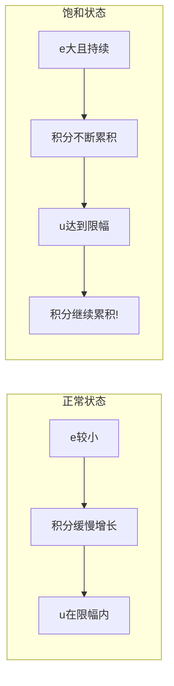
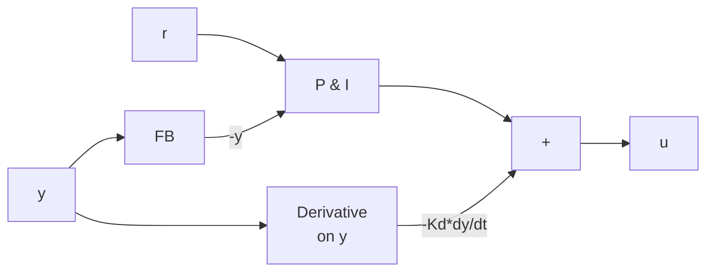

# 抗积分饱和与微分先行

> PID 的理想公式在纸面上完美无瑕，但在真实工业环境中，两个"暗礁"会将其击沉：积分饱和与微分噪声。本章深入这两个工程难题的本质和解决方案。

---

## 1. 积分饱和：现象与危害

### 1.1 什么是积分饱和

积分饱和（Integral Windup）指在系统存在**持续大偏差**时，积分项不断累积，导致控制器输出远超执行器的物理极限。当偏差最终减小时，巨大的积分值需要很长时间才能"退潮"，造成严重的**超调**和**恢复延迟**。

**典型场景**：
- 设定值大幅阶跃（如加热炉从 $20^\circ\text{C}$ 升到 $500^\circ\text{C}$）
- 执行器饱和（调节阀已全开，但热量仍不够）
- 系统启动阶段（被控变量离设定值很远）



### 1.2 物理直觉：为什么积分会"失控"

想象你在控制一艘船的速度。目标是 $20$ 节，但引擎最大只能输出 $10$ 节等效的推力。你用 PI 控制器：

- 偏差 $e = 20 - 0 = 20$，持续存在
- 积分项 $u_I = K_i \int e \, dt$ 每秒钟都在增加
- 即使 $u_P + u_I$ 已经超过引擎上限，积分仍继续增长
- 当船速接近 $20$ 节时，$e$ 变小了，但 $u_I$ 已经累积了天文数字
- 控制器需要 $e$ 为负值（超调）一段时间，才能抵消巨大的 $u_I$

这就是积分饱和导致超调的本质。

---

## 2. 抗积分饱和策略

### 2.1 条件积分（Conditional Integration）

最简单的策略：当控制器输出饱和时，**停止积分**。

```c
/* Conditional Integration - C pseudocode */
float compute_pid(float e, float dt, float u_min, float u_max) {
    float u_p = Kp * e;
    
    // Only integrate if output is NOT saturated
    if ((u_prev > u_min) && (u_prev < u_max)) {
        integral += Ki * e * dt;
    }
    
    float u_d = Kd * (e - e_prev) / dt;
    float u = u_p + integral + u_d;
    
    u_prev = u;
    e_prev = e;
    return u;
}
```

**优点**：实现简单，计算量小。

**缺点**：在饱和边界处频繁切换，可能导致抖动；对积分项已经过大但尚未饱和的情况无能为力。

### 2.2 积分限幅（Integral Clamping）

直接对积分项本身设置上下限：

```c
/* Integral Clamping - C pseudocode */
float compute_pid_clamp(float e, float dt, float u_min, float u_max) {
    float u_p = Kp * e;
    integral += Ki * e * dt;
    
    // Clamp integral to prevent windup
    float u_unclamped = u_p + integral + Kd * (e - e_prev) / dt;
    if (u_unclamped > u_max) {
        integral = u_max - u_p - Kd * (e - e_prev) / dt;
    } else if (u_unclamped < u_min) {
        integral = u_min - u_p - Kd * (e - e_prev) / dt;
    }
    
    e_prev = e;
    return u_p + integral + Kd * (e - e_prev) / dt;
}
```

**核心思想**：保证 $u_P + u_I + u_D$ 始终不超出限幅范围，通过反向计算来"钳制"积分项。

### 2.3 回算抗饱和（Back-Calculation and Tracking）

最优雅、最广泛使用的策略。基本思想：当实际输出 $u_{\text{real}}$ 被限幅时，计算"饱和误差"，并用一个额外的时间常数 $T_t$ 来**缓慢修正**积分项。

$$\frac{d}{dt}u_I = K_i \, e + \frac{1}{T_t}(u_{\text{real}} - u)$$

其中 $u$ 是理想（未限幅）输出，$u_{\text{real}} = \text{sat}(u)$ 是限幅后的实际输出。$T_t$ 通常取 $T_t = \sqrt{T_i \cdot T_d}$。

```c
/* Back-Calculation Anti-Windup - C implementation */
#define KP  2.0f
#define TI  5.0f
#define TD  1.0f
#define TT  2.24f  /* sqrt(TI * TD) */

static float integral = 0.0f;
static float e_prev = 0.0f;

float compute_pid_backcalc(float e, float dt, float u_min, float u_max) {
    float Ki = KP / TI;
    float Kd = KP * TD;
    
    float u_p = KP * e;
    float u_d = Kd * (e - e_prev) / dt;
    float u = u_p + integral + u_d;
    
    float u_real = u;
    if (u > u_max) u_real = u_max;
    else if (u < u_min) u_real = u_min;
    
    /* Back-calculation: drive integral towards saturation boundary */
    integral += Ki * e * dt + (u_real - u) * dt / TT;
    
    e_prev = e;
    return u_real;
}
```

**为什么这是最好的方法**：
- 当未饱和时，$u_{\text{real}} = u$，回算项为零，就是普通 PI。
- 当饱和时，$u_{\text{real}} - u \neq 0$，回算项像一个"泄压阀"，以时间常数 $T_t$ 的速度将积分项推向恰好使 $u$ 达到饱和边界的值。
- 退出饱和时，积分项已经处于正确值，没有超调。

---

## 3. 微分先行：Derivative on Measurement

### 3.1 理想微分的陷阱

理想 PID 中微分作用于偏差：

$$u_D = K_d \frac{d}{dt}(r - y) = K_d \left(\frac{dr}{dt} - \frac{dy}{dt}\right)$$

问题在于：**设定值 $r$ 的阶跃变化会导致 $dr/dt$ 为无穷大（脉冲）**，即使输出 $y$ 还没变化，微分项也会瞬间输出一个巨大脉冲。这被称为**设定值冲击**（Setpoint Kick）。

### 3.2 微分先行：只对测量值微分

解决方案：将微分只作用于**测量值** $y$，而不是偏差 $e$。

$$u_D = -K_d \frac{dy}{dt}$$

这样设定值变化时，微分项不会剧烈响应；只有被控变量实际变化时，微分才起作用。



对应的传递函数：

$$U(s) = K_p E(s) + \frac{K_p}{T_i s}E(s) - K_p T_d s Y(s)$$

注意：PI 部分仍然处理偏差，只有 D 部分处理测量值。这是工业 PID 的标准实现。

---

## 4. 微分滤波：噪声的克星

### 4.1 噪声放大的数学根源

理想微分 $s$ 在频域中是一个高通滤波器：

$$|D(j\omega)| = \omega$$

频率越高，增益越大。测量噪声通常是高频的，微分把它们放大了。

### 4.2 一阶滤波器

工业标准做法：在微分通路中加入一阶低通滤波器：

$$D(s) = \frac{K_p T_d s}{T_f s + 1}, \quad T_f = \frac{T_d}{N}$$

$N$ 是滤波系数，通常取 $5 \sim 20$。$N$ 越大，滤波越弱，微分越"锐利"；$N$ 越小，滤波越强，但微分的相位超前效果也减弱。

| $N$ | 滤波时间常数 $T_f$ | 高频衰减 | 相位超前 | 适用场景 |
|-----|-------------------|----------|----------|----------|
| 5 | $T_d/5$ | 强 | 较弱 | 噪声大的温度/液位 |
| 10 | $T_d/10$ | 中等 | 中等 | 一般过程控制 |
| 20 | $T_d/20$ | 弱 | 较强 | 清洁的速度/位置信号 |

### 4.3 实现形式

```c
/* Derivative with first-order filter - C implementation */
static float y_prev = 0.0f;
static float y_filt_prev = 0.0f;

float compute_derivative_filtered(float y, float dt, float Kd, float Tf) {
    float alpha = Tf / (Tf + dt);  /* filter coefficient */
    float y_filt = alpha * y_filt_prev + (1.0f - alpha) * y;
    
    float dy = (y_filt - y_filt_prev) / dt;
    float u_d = Kd * dy;
    
    y_prev = y;
    y_filt_prev = y_filt;
    return u_d;
}
```

---

## 5. 数值示例：抗饱和效果对比

被控对象：

$$G(s) = \frac{1}{(s+1)^3}$$

PID 参数：$K_p = 4$，$T_i = 2$，$T_d = 0.5$，执行器限幅 $[-5, 5]$。设定值从 $0$ 阶跃到 $10$。

### 5.1 无抗饱和

```matlab
% MATLAB: Integral windup demonstration
G = tf(1, [1 3 3 1]);
Kp = 4; Ti = 2; Td = 0.5;
C = pidstd(Kp, Ti, Td);

% Simulink or manual simulation with saturation
% Result: output overshoots to 12+ before settling
```

积分项在饱和期间持续累积，当输出接近设定值时，积分项仍非常大，系统严重超调（可能超过 $50\%$），恢复时间数倍于正常值。

### 5.2 回算抗饱和（$T_t = \sqrt{T_i T_d} = 1$）

```matlab
% MATLAB: PID with back-calculation anti-windup
% Using pidstd with anti-windup settings or manual implementation
% Result: output reaches 10 with minimal overshoot (<5%)
```

饱和期间积分项被回算机制限制在合理范围，退出饱和时输出平稳过渡。

| 指标 | 无抗饱和 | 回算抗饱和 | 改善 |
|------|---------|-----------|------|
| 最大超调 | $> 50\%$ | $< 5\%$ | $10\times$ |
| 调节时间 | $> 30\,\text{s}$ | $\approx 8\,\text{s}$ | $4\times$ |
| 执行器抖动 | 严重 | 无 | 显著 |

---

## 6. 常见错误与纠正

### 错误 1：用输出限幅代替抗饱和，认为"输出限制住了就没问题"

**现象**：工程师在控制器输出端加了限幅，但没有对积分项做任何处理。认为既然输出被限制住了，系统就不会出问题。

**原因**：输出限幅只限制了执行器看到的信号，但 PID 内部的积分项仍在"不知情"地疯狂累积。这就像你在踩油门，但油门连杆被卡住了——踏板（积分）已经被踩到了底，一旦连杆松开（退出饱和），车就会冲出去。

**纠正**：必须将饱和信息**反馈回控制器内部**。回算法是最佳实践：把限幅后的实际输出与理想输出的差反馈到积分项，实现真正的闭环抗饱和。

### 错误 2：在微分先行中忘记改变符号，导致微分变为正反馈

**现象**：工程师将微分改为对测量值微分，但写成了：

$$u_D = K_d \frac{dy}{dt}$$

（注意是正号，而不是负号）

结果当 $y$ 上升（比如温度超调）时，微分项反而增加控制输出，进一步推高温度，形成正反馈。

**纠正**：微分先行必须带负号：

$$u_D = -K_d \frac{dy}{dt}$$

因为 $y$ 增大意味着偏差 $e = r - y$ 在减小，微分应该减小控制量来"抑制"这个变化。负号确保了微分仍然是"阻尼"作用。

---

## 7. 自测习题

**习题 1**：为什么积分饱和只在系统存在**持续偏差**且**执行器饱和**时发生？如果偏差很大但执行器没有饱和，积分会饱和吗？

**答案**：
- 积分饱和的本质是积分项的累积值超过了"维持当前输出所需"的值。
- 如果执行器没有饱和，控制量可以无限制地增大，系统响应加快，偏差迅速减小，积分项来不及累积到离谱的程度。
- 只有当执行器已到极限（如阀门全开），控制量无法继续增大，偏差持续存在，积分项才会在"无效"的情况下继续增长，形成饱和。

**习题 2**：某 PID 控制器的 $K_p = 2$，$T_i = 4$，$T_d = 1$。设定值在 $t=0$ 时刻从 $0$ 阶跃到 $5$，输出 $y$ 在 $t=0^+$ 时刻仍为 $0$。分别计算理想 PID（微分对偏差）和微分先行（微分对测量）在 $t=0^+$ 时刻的微分输出。微分滤波暂不考虑。

**答案**：
- **理想 PID**：$e = 5 - 0 = 5$。$de/dt$ 在阶跃瞬间为无穷大（脉冲），所以 $u_D$ 为脉冲。实际离散中，若上一时刻 $e_{prev} = 0$，则 $de/dt = (5-0)/\Delta t \to \infty$。
- **微分先行**：$dy/dt = 0$（$y$ 在 $t=0^+$ 尚未变化），所以 $u_D = -K_d \cdot 0 = 0$。没有设定值冲击。
- 结论：微分先行消除了设定值阶跃对微分项的冲击。

**习题 3**：回算抗饱和中，$T_t$ 取过大或过小分别有什么影响？

**答案**：
- $T_t$ 过小：回算项 $(u_{\text{real}} - u)/T_t$ 很大，积分项被快速"拉回"，可能过于激进，导致积分作用在退出饱和时响应过快。
- $T_t$ 过大：回算项很小，积分项退饱和缓慢，抗饱和效果变差，仍可能有明显超调。
- 经验值：$T_t = \sqrt{T_i T_d}$ 是一个良好的折中。也可以取 $T_t = T_i$ 或 $T_t = T_d$，取决于更注重积分速度还是稳定性。

---

## 8. 小结

| 问题 | 症状 | 解决方案 | 实现复杂度 |
|------|------|----------|-----------|
| 积分饱和 | 大偏差后严重超调、恢复慢 | 回算抗饱和（Back-Calculation） | 中 |
| 设定值冲击 | 设定值变化时执行器剧烈抖动 | 微分先行（Derivative on Measurement） | 低 |
| 微分噪声 | 执行器高频抖动、磨损 | 一阶低通滤波（$N = 5 \sim 20$） | 低 |

理想 PID 公式只是起点。真正的工业 PID 必须解决饱和、冲击和噪声这三个工程现实。回算抗饱和 + 微分先行 + 微分滤波，是工业标准 PID 的"铁三角"。

---

> 上一章：[002-参数整定方法论](002-参数整定方法论.md)
> 下一章：[004-前馈控制与串级控制](004-前馈控制与串级控制.md)
