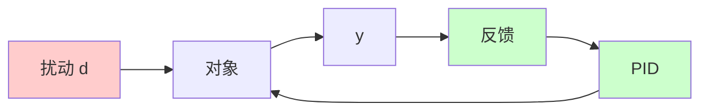
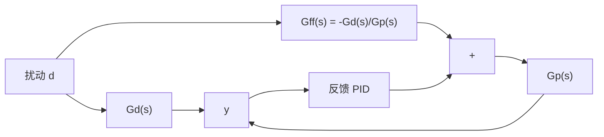
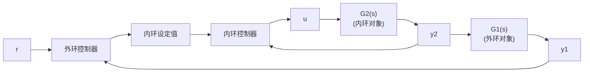
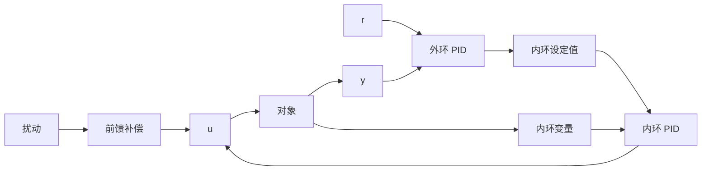

# 前馈控制与串级控制

> 单靠 PID 反馈控制只能"事后补救"。前馈控制让你"防患于未然"，串级控制让你"分层治理"。本章掌握这两个将 PID 性能推向工业极限的核心技术。

---

## 1. 前馈控制：防患于未然

### 1.1 反馈控制的局限性

反馈控制的本质：先看到偏差，再纠正偏差。这意味着：

- 扰动必须先引起偏差，控制器才能动作（**滞后性**）
- 被控对象有惯性或滞后时，偏差已经造成损失（**被动性**）
- 强扰动下，即使最终能稳定，过程变量也会大幅波动（**代价性**）



**关键问题**：扰动走了弯路——先影响输出，再被检测，再被纠正。有没有办法让控制器在扰动影响输出之前就提前动作？

### 1.2 前馈控制的基本思想

前馈控制（Feedforward Control）直接测量**扰动**，在被控变量偏离之前，就计算出需要补偿的控制量，直接抵消扰动的影响。

$$u_{ff}(t) = -\frac{G_d(s)}{G_p(s)} \cdot d(t)$$

其中 $G_d(s)$ 是扰动到输出的传递函数，$G_p(s)$ 是控制量到输出的传递函数。



### 1.3 静态前馈与动态前馈

| 类型 | 公式 | 特点 | 适用场景 |
|------|------|------|----------|
| 静态前馈 | $G_{ff}(0) = -G_d(0)/G_p(0)$ | 只补偿稳态，实现简单 | 扰动变化慢 |
| 动态前馈 | $G_{ff}(s) = -G_d(s)/G_p(s)$ | 全频段补偿，设计复杂 | 扰动变化快、精度要求高 |

**数值示例**：某加热系统中，控制量到温度的传递函数为 $G_p(s) = \frac{2}{10s+1}$，入口冷水流量扰动到温度的传递函数为 $G_d(s) = \frac{-5}{8s+1}$。设计前馈补偿器。

- **静态前馈**：$G_{ff}(0) = -(-5)/2 = 2.5$。即流量每增加 $1\,\text{L/min}$，提前增加加热量 $2.5$ 单位。
- **动态前馈**：$G_{ff}(s) = -\frac{-5/(8s+1)}{2/(10s+1)} = \frac{5(10s+1)}{2(8s+1)} = 2.5 \cdot \frac{10s+1}{8s+1}$。超前-滞后环节，补偿动态差异。

```matlab
% MATLAB: Feedforward + feedback control
Gp = tf(2, [10 1]);
Gd = tf(-5, [8 1]);
Gff = -Gd/Gp;  % Dynamic feedforward

% Combined with feedback PID
Kp = 1; Ti = 5; Td = 0.5;
C = pidstd(Kp, Ti, Td);
% In Simulink: sum of C*e and Gff*d drives Gp
```

### 1.4 前馈控制的设计原则

1. **可测性**：扰动必须能够被测量（或可估计）。不可测的扰动无法前馈。
2. **可逆性**：$G_p(s)$ 必须可逆，即不能包含右半平面零点或纯滞后。
3. **模型依赖**：前馈的性能完全依赖 $G_d$ 和 $G_p$ 的模型精度。模型失配时，前馈补偿不完美，需要反馈来兜底。
4. **不与反馈冲突**：前馈解决"大方向"，反馈解决"精细修正"。两者是互补而非替代。

---

## 2. 串级控制：分层治理

### 2.1 为什么需要串级

单一 PID 控制回路在面对以下问题时力不从心：

- 被控对象有明显的**内部动态**（如加热炉中，内腔温度和外壁温度变化速度不同）
- 扰动发生在**系统内部**（如燃料压力波动影响燃烧器，进而影响炉温）
- 对象具有**显著滞后**，单一回路响应太慢

串级控制（Cascade Control）通过构建**内外两个回路**来解决这些问题。

### 2.2 串级控制的结构



| 回路 | 被控变量 | 控制器 | 功能 |
|------|----------|--------|------|
| 外环（主环） | $y_1$（最终目标） | 主控制器 | 保证最终输出跟踪设定值 |
| 内环（副环） | $y_2$（中间变量） | 副控制器 | 快速抑制内部扰动，改善外环对象的动态特性 |

**外环输出**作为内环的设定值。内环的响应速度必须比外环**快 $3 \sim 5$ 倍**以上。

### 2.3 串级控制的优势

1. **快速抑制内环扰动**：扰动进入内环后，在内环回路内就被快速抑制，不必等到影响外环输出。
2. **改善外环对象的动态**：内环闭合后，从外环控制量到 $y_1$ 的等效对象变得更"快"、更"线性"。
3. **允许更激进的外环参数**：因为内环已经稳定了中间变量，外环可以使用更强的积分和更大的比例增益。

### 2.4 设计原则：内外环的分离

**时间尺度分离原则**：内环的闭环时间常数 $\tau_{\text{inner}}$ 应该远小于外环的期望时间常数 $\tau_{\text{outer}}$：

$$\tau_{\text{inner}} \leq \frac{1}{3} \tau_{\text{outer}}$$

**设计步骤**：

1. 先设计内环（副控制器），忽略外环存在。内环通常用 P 或 PI 即可。
2. 内环闭环后，将其等效为一个快速响应环节。
3. 再设计外环（主控制器），将等效内环看作外环对象的一部分。

**数值示例**：加热炉温度控制。

- 内环：燃料流量控制（流量变送器 + 调节阀），对象 $G_2(s) = \frac{1}{0.5s+1}$，时间常数 $0.5\,\text{s}$。
- 外环：炉膛温度控制（热电偶），对象 $G_1(s) = \frac{2}{20s+1}$，时间常数 $20\,\text{s}$。

内环 PI 设计：$K_{p2} = 2$，$T_{i2} = 0.5$。闭环后等效时间常数约 $0.25\,\text{s}$。

外环看到的等效对象：$G_{1,eq}(s) = G_1(s) \cdot \frac{1}{0.25s+1} \approx \frac{2}{20s+1}$（内环足够快，对外环几乎无影响）。

外环 PI 设计：$K_{p1} = 0.5$，$T_{i1} = 10$。

```matlab
% MATLAB: Cascade control design
G2 = tf(1, [0.5 1]);      % Inner loop plant
G1 = tf(2, [20 1]);       % Outer loop plant
C2 = pidstd(2, 0.5);       % Inner controller
G2_cl = feedback(C2*G2, 1);  % Inner closed loop
G_outer = G2_cl * G1;       % Equivalent outer plant
C1 = pidstd(0.5, 10);        % Outer controller
% Full cascade: C1 drives C2's setpoint
```

---

## 3. 前馈 + 串级：工业控制的"黄金组合"

在高端工业应用中，前馈和串级经常同时使用：



- **前馈**：处理可测的主要扰动，提供快速、粗调补偿
- **串级**：分层控制，内环快速抑制内部扰动，外环保证最终精度
- **PID**：在每个回路中提供鲁棒的反馈修正

---

## 4. 常见错误与纠正

### 错误 1：在串级控制中把内环设计得和外环一样慢

**现象**：某工程师设计串级控制时，内环控制器参数非常保守（$K_{p2}$ 很小，$T_{i2}$ 很大），内环响应时间常数约 $5\,\text{s}$，而外环期望时间常数也是 $10\,\text{s}$。结果内环扰动抑制慢，外环不得不频繁大幅调整，整体效果比单回路还差。

**原因**：串级控制的收益完全依赖于内环的**速度优势**。如果内环不够快，它无法在内环扰动影响外环之前将其抑制，串级就失去了意义。

**纠正**：
- 内环必须显著快于外环。经验法则：内环闭环带宽 $\geq 3 \times$ 外环带宽。
- 内环对象选择时，优先选择响应快、时间常数小的中间变量。
- 内环控制器可以激进一些（允许轻微超调），因为内环的设定值由外环产生，是"软目标"。

### 错误 2：前馈补偿器模型失配时，直接关闭前馈而非结合反馈

**现象**：某系统前馈补偿器基于设计工况设计，运行一段时间后工艺参数变化，前馈补偿不完全，有时反而加大扰动。工程师直接关闭前馈，回到纯反馈控制，系统性能大幅下降。

**原因**：前馈的模型失配是常态，不是异常。完全关闭前馈等于放弃了"防患于未然"的能力。

**纠正**：
- 前馈不应该替代反馈，而是辅助反馈。即使前馈不完美，它也能消除大部分扰动影响，剩余部分由反馈处理。
- 可以引入**前馈增益自适应**：根据反馈控制器的输出量（即反馈补偿的剩余部分），在线调整前馈增益。
- 更高级的做法是前馈 + 模型参考自适应，但即使在最简单的应用中，保留前馈（哪怕 imperfect）也优于纯反馈。

---

## 5. 自测习题

**习题 1**：前馈控制能否完全消除扰动对输出的影响？如果不能，原因是什么？反馈控制在其中扮演什么角色？

**答案**：
- **理论上**，如果 $G_{ff}(s) = -G_d(s)/G_p(s)$ 完全精确且可实现，前馈可以完全消除扰动影响。
- **实际上**，模型总有误差（$G_d$ 和 $G_p$ 不精确），且 $G_p$ 可能包含时滞或右半平面零点，导致 $G_{ff}$ 不可实现。因此前馈只能**减小**扰动影响，不能**完全消除**。
- 反馈控制处理前馈未完全补偿的残余误差，提供鲁棒的精度保证。前馈解决"大方向"，反馈解决"剩余细节"。

**习题 2**：某串级控制系统中，外环对象时间常数 $T_1 = 50\,\text{s}$，内环对象时间常数 $T_2 = 2\,\text{s}$。判断这个串级设计是否合理？如果内环对象改为 $T_2 = 15\,\text{s}$，串级是否还有优势？

**答案**：
- $T_1 = 50\,\text{s}$，$T_2 = 2\,\text{s}$，比值 $25:1$。内环远快于外环，串级设计非常合理，内环可以快速抑制进入内环的扰动。
- 如果 $T_2 = 15\,\text{s}$，比值仅约 $3.3:1$。虽然仍满足 $>3:1$ 的最低要求，但优势已不明显。内环扰动抑制不够快，外环会感受到更多扰动。如果内环还有显著滞后，串级可能得不偿失。

**习题 3**：静态前馈补偿器的增益 $G_{ff}(0) = -G_d(0)/G_p(0)$。如果 $G_p(0)$ 很小（对象增益很小），前馈增益会很大。这有什么潜在风险？

**答案**：
- $G_p(0)$ 很小意味着需要很大的控制量才能影响输出。前馈增益很大意味着对测量噪声和模型误差非常敏感。
- 如果 $G_p(0)$ 的估计有 $10\%$ 误差，前馈补偿的误差会被放大 $10\times$。
- 风险：前馈反而可能引入新的扰动，甚至导致系统不稳定。这种情况下应该更保守地设计前馈增益，或者使用动态前馈来限制高频增益。

---

## 6. 小结

| 技术 | 解决的问题 | 核心条件 | 与 PID 的关系 |
|------|-----------|----------|--------------|
| 前馈控制 | 可测扰动的提前补偿 | 扰动可测、模型可逆 | 与 PID 并行，不是替代 |
| 串级控制 | 内环扰动快速抑制、对象动态改善 | 内环显著快于外环（$\geq 3\times$） | 每个回路内部仍用 PID |
| 前馈+串级 | 复杂工业过程的全面控制 | 上述条件同时满足 | 黄金组合 |

前馈让你"防患于未然"，串级让你"分层治理"。两者都是把 PID 从"够用"推向"卓越"的工业级武器。掌握它们，你就掌握了过程控制的精髓。

---

> 上一章：[003-抗积分饱和与微分先行](003-抗积分饱和与微分先行.md)
> 下一章：[005-增益调度与自适应 PID](005-增益调度与自适应PID.md)
