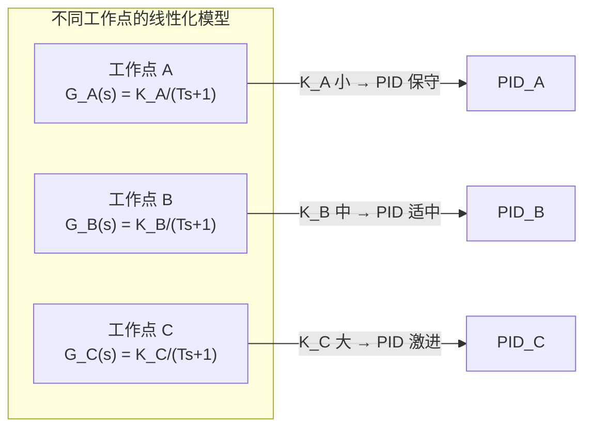
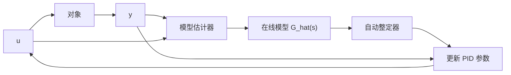
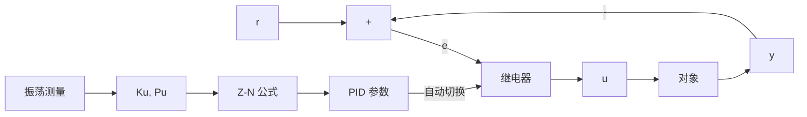

# 增益调度与自适应 PID

> 固定参数的 PID 只能在一个"甜蜜点"上工作。当工况大范围变化时，增益调度（Gain Scheduling）和自适应 PID 让控制器"随环境而变"，从线性控制走向非线性控制的第一步。

---

## 1. 为什么固定 PID 不够

### 1.1 非线性对象的挑战

工业过程中，很多对象的本质是**非线性**的：

- 飞行器的空气动力学随高度和速度变化
- 化学反应速率随温度和浓度变化
- 阀门流量特性在低开度和大开度时完全不同
- 电机在不同转速下的电气时间常数变化

用一个固定参数的 PID 去控制这些对象，相当于用一把固定尺码的扳手去拧所有规格的螺母——在某个点刚好合适，其他地方不是松就是紧。

### 1.2 线性化的本质

PID 的设计基于线性系统理论。当我们用固定 PID 控制非线性对象时，实际上是在某个**工作点**（Operating Point）附近做了线性化。远离这个工作点时，线性化模型失效，PID 参数也不再合适。



---

## 2. 增益调度：按工况切换参数

### 2.1 核心思想

增益调度是最简单、最可靠的非线性控制方法。其思想：把非线性对象在不同工作点的行为用多个**局部线性模型**描述，为每个模型设计一套 PID 参数，然后在线根据**调度变量**（Scheduling Variable）切换或插值参数。

**调度变量**：能够表征当前工作点的可测变量，如：

| 应用场景 | 调度变量 | 被控变量 | 变化的参数 |
|----------|----------|----------|-----------|
| 飞行控制 | 马赫数、高度 | 姿态角 | $K_p, T_i, T_d$ |
| 化工反应 | 反应温度 | 产物浓度 | $K_p, T_i$ |
| 阀门控制 | 阀门开度 | 流量 | $K_p$ |
| 电机调速 | 转速 | 位置/速度 | $K_p, K_i$ |

### 2.2 调度表设计

步骤：

1. 确定调度变量的范围，划分为若干区间（如低速、中速、高速）。
2. 在每个区间的工作点，通过实验或机理建模获得线性化模型。
3. 用标准整定方法（如 Lambda 或 IMC）为每个模型设计 PID 参数。
4. 构建**调度表**（Lookup Table）。
5. 在线运行时，根据当前调度变量查表，切换或插值参数。

**数值示例**：某 pH 中和控制系统中，控制阀开度到 pH 值的增益随当前 pH 值剧烈变化（滴定曲线的 S 形特性）。

| 当前 pH 区间 | 对象增益 $K$ | 设计 $K_p$ | 设计 $T_i$ | 设计 $T_d$ |
|-------------|-------------|-----------|-----------|-----------|
| pH < 5 | 小（曲线平缓） | 8 | 10 | 1 |
| $5 \leq$ pH $\leq 9$ | 大（曲线陡峭） | 1 | 10 | 1 |
| pH > 9 | 小（曲线平缓） | 8 | 10 | 1 |

```c
/* Gain Scheduling - C implementation example */
float compute_pid_scheduled(float e, float pH, float dt) {
    float Kp, Ti, Td;
    
    if (pH < 5.0f) {
        Kp = 8.0f; Ti = 10.0f; Td = 1.0f;
    } else if (pH <= 9.0f) {
        Kp = 1.0f; Ti = 10.0f; Td = 1.0f;
    } else {
        Kp = 8.0f; Ti = 10.0f; Td = 1.0f;
    }
    
    return compute_pid_standard(e, dt, Kp, Ti, Td);
}
```

### 2.3 插值 vs 硬切换

| 方式 | 描述 | 优点 | 缺点 |
|------|------|------|------|
| 硬切换 | 到达阈值直接切换参数 | 简单、快速 | 可能产生抖动（bump） |
| 线性插值 | 在相邻工作点之间线性过渡 | 平滑无抖动 | 需要计算、响应稍慢 |

**插值公式**（两个工作点 $\alpha_1, \alpha_2$ 之间）：

$$K_p(\alpha) = K_{p1} + \frac{\alpha - \alpha_1}{\alpha_2 - \alpha_1}(K_{p2} - K_{p1})$$

同样适用于 $T_i$ 和 $T_d$。注意：$K_p$ 和 $T_i$ 是**参数**，插值后还需要重新计算积分和微分增益系数。

### 2.4 增益调度的工程边界

增益调度不是万能的：

- **调度变量必须与被控对象动态变化强相关**。如果选错变量，调度无效。
- **切换速度必须慢于回路响应速度**。如果工况变化比控制回路还快，调度来不及生效。
- **工作点数量要适中**。太少不能覆盖非线性，太多设计和维护困难。
- **稳定性保证是局部的**。全局稳定性没有理论保证，但通过工程经验可以大概率实现。

---

## 3. 自适应 PID：在线自动调整

### 3.1 从增益调度到自适应

增益调度需要预先知道所有工作点的模型并离线设计。自适应 PID 更进一步：在线实时估计对象模型，并自动调整 PID 参数。



### 3.2 模型参考自适应控制（MRAC）

MRAC 是最经典的自适应控制框架。其思想：定义一个**参考模型**（理想的闭环响应），然后在线调整控制器参数，使实际输出与参考模型输出之间的误差最小化。

**MIT 规则**：

$$\frac{d\theta}{dt} = -\gamma \, e \, \frac{\partial e}{\partial \theta}$$

其中 $\theta$ 是控制器参数（如 $K_p$），$e = y - y_m$ 是跟踪误差，$\gamma$ 是自适应增益。

对于 PID 参数的自适应，通常简化为：在线估计对象的关键参数（如 $K$、$T$、$L$），然后用整定公式重新计算 PID。

### 3.3 继电器自整定（Åström-Hägglund 方法）

工业上最实用的自适应方法，由 Åström 和 Hägglund 提出：

1. 在反馈回路中引入一个**继电器非线性**（Relay）代替 PID。
2. 系统会产生**极限环振荡**，测量振荡的振幅 $A$ 和周期 $P_u$。
3. 临界增益 $K_u = \frac{4d}{\pi A}$（$d$ 为继电器幅值）。
4. 用 Z-N 或改进公式自动计算 PID 参数。
5. 自动切换回 PID 控制。



**优点**：
- 无需人工干预，自动完成整定
- 不需要预先知道对象模型
- 可以在运行中周期性重新整定，跟踪对象变化

**缺点**：
- 整定过程中系统处于振荡状态，对某些过程不可接受
- 对噪声敏感，需要信号处理
- 本质上是 Z-N 的自动化，超调问题仍然存在

```matlab
% MATLAB: Relay auto-tuning concept
% Using Simulink or manual relay feedback loop
% relay amplitude = 1, plant = tf(1, [1 3 3 1])
% Measure oscillation amplitude A and period Pu
% Ku = 4/(pi*A);
% Then apply Z-N PID formulas
```

### 3.4 自适应 PID 的工业变体

| 变体 | 自适应机制 | 优点 | 缺点 |
|------|-----------|------|------|
| 继电器自整定 | 在线继电实验 + 查表 | 全自动、无需模型 | 需要振荡实验 |
| 模式识别 | 检测超调/衰减比，调整参数 | 无需专门实验 | 调整慢，靠经验规则 |
| 递推最小二乘 | 在线 RLS 估计模型 + 重算 PID | 理论严谨 | 计算量大、对噪声敏感 |
| 模糊自整定 | 模糊规则调整参数 | 鲁棒性好 | 规则设计依赖经验 |

---

## 4. 数值示例：增益调度在飞行控制中的应用

某飞行器俯仰角控制中，短周期模态参数随马赫数 $M$ 变化：

| 马赫数 $M$ | 俯仰角速率增益 $K_q$ | 时间常数 $T$ | 设计 $K_p$ | 设计 $T_i$ |
|-----------|---------------------|-------------|-----------|-----------|
| 0.3 | 1.0 | 2.0 | 2.0 | 2.0 |
| 0.6 | 1.5 | 1.5 | 1.5 | 1.5 |
| 0.9 | 2.5 | 1.0 | 1.0 | 1.0 |
| 1.2 | 1.8 | 0.8 | 1.2 | 1.0 |

```c
/* Aircraft pitch gain scheduling */
float compute_pitch_pid(float e, float mach, float dt) {
    struct { float mach; float Kp; float Ti; float Td; } table[] = {
        {0.3f, 2.0f, 2.0f, 0.2f},
        {0.6f, 1.5f, 1.5f, 0.15f},
        {0.9f, 1.0f, 1.0f, 0.1f},
        {1.2f, 1.2f, 1.0f, 0.08f}
    };
    
    /* Linear interpolation */
    int i;
    for (i = 0; i < 3; i++) {
        if (mach >= table[i].mach && mach <= table[i+1].mach) break;
    }
    
    float alpha = (mach - table[i].mach) / (table[i+1].mach - table[i].mach);
    float Kp = table[i].Kp + alpha * (table[i+1].Kp - table[i].Kp);
    float Ti = table[i].Ti + alpha * (table[i+1].Ti - table[i].Ti);
    float Td = table[i].Td + alpha * (table[i+1].Td - table[i].Td);
    
    return compute_pid_standard(e, dt, Kp, Ti, Td);
}
```

---

## 5. 常见错误与纠正

### 错误 1：在快速切换的工况中使用硬切换增益调度，导致系统抖动

**现象**：某化学反应器温度控制中，增益调度按反应温度每 $10^\circ\text{C}$ 一个区间硬切换 PID 参数。当温度在边界附近波动时，参数在两个极端之间频繁跳变，控制输出剧烈抖动，反而加剧温度波动。

**原因**：硬切换在边界处引入不连续性。即使被控变量本身波动很小，跨越阈值就会触发参数突变。

**纠正**：
- 使用**线性插值**或**平滑过渡**（如 sigmoid 函数）。
- 引入**滞环**（Hysteresis）：切换阈值和回切阈值不同，避免在边界频繁切换。
- 确保调度变量的滤波足够，不因噪声引起虚假切换。

### 错误 2：自适应整定时自适应增益 $\gamma$ 过大，导致参数振荡

**现象**：MRAC 自适应 PID 中，工程师为了快速跟踪对象变化，设置了很大的自适应增益 $\gamma$。结果对象参数稍有变化，PID 参数就剧烈调整，系统控制输出上下震荡，稳定性比固定 PID 还差。

**原因**：自适应回路本身是一个动态系统。$\gamma$ 过大相当于自适应回路的增益过高，导致自适应回路自身不稳定。

**纠正**：
- $\gamma$ 应该从小值开始（如 $0.001$），逐步增大直到自适应速度满足要求但系统不震荡。
- 使用"归一化"自适应律：$\frac{d\theta}{dt} = -\gamma \frac{e \phi}{1 + \phi^T \phi}$，防止参数漂移。
- 加入**参数投影**：限制参数在合理的物理范围内，防止发散。

---

## 6. 自测习题

**习题 1**：增益调度和自适应 PID 的核心区别是什么？各自的适用场景是什么？

**答案**：
- **增益调度**：离线设计多个工作点的 PID 参数，在线按调度变量切换/插值。适用于非线性特性已知、工作点可预测且数量不多的场景（如飞行器、阀门特性补偿）。
- **自适应 PID**：在线估计对象模型或性能指标，自动调整 PID 参数。适用于对象特性缓慢变化或不可预测的场景（如催化剂老化、物料特性变化）。
- 增益调度更可靠、更可预测，但前提是非线性模式已知。自适应更灵活，但引入了额外的动态和稳定性风险。

**习题 2**：某增益调度系统使用马赫数作为调度变量，两个工作点分别为 $M=0.5$（$K_p=2$）和 $M=1.0$（$K_p=1$）。计算 $M=0.7$ 时线性插值得到的 $K_p$。如果系统实际运行在 $M=0.7$ 但误用 $M=0.5$ 的参数，会有什么后果？

**答案**：
- 插值：$K_p = 2 + \frac{0.7-0.5}{1.0-0.5} \times (1-2) = 2 - 0.4 = 1.6$。
- 误用 $K_p=2$：在 $M=0.7$ 时对象增益比 $M=0.5$ 时更高，环路增益 $K_p K_{obj}$ 更大，系统可能欠阻尼、超调增大，甚至不稳定。

**习题 3**：继电器自整定中，为什么测量到的振荡振幅 $A$ 越小，计算出的 $K_u$ 越大？

**答案**：$K_u = 4d/(\pi A)$。$A$ 在分母上，所以 $A$ 越小，$K_u$ 越大。物理意义：如果系统对同样的继电器输入产生很小的振荡，说明系统很"敏感"（增益高），需要很小的临界增益就能引发振荡。注意：这里 $K_u$ 是临界增益，系统越敏感（$A$ 小），$K_u$ 越大，意味着用纯比例控制时系统更趋向不稳定。

---

## 7. 小结

| 技术 | 关键思想 | 设计前提 | 主要风险 |
|------|----------|----------|----------|
| 增益调度 | 按工况切换预设计的 PID 参数 | 非线性模式已知、调度变量可测 | 边界抖动、切换不稳定 |
| 继电器自整定 | 在线继电实验获取临界参数 | 允许短暂振荡 | 超调、噪声敏感 |
| MRAC | 跟踪参考模型，在线调整参数 | 参考模型可设计 | 自适应增益难调、参数漂移 |
| 递推最小二乘 | 在线估计模型，重算 PID | 激励信号充分（PE条件） | 计算量大、噪声敏感 |

增益调度是"离线聪明"，自适应是"在线学习"。两者都试图回答同一个问题：PID 参数不应是固定的，而应与对象和环境的动态相匹配。从简单的查表到复杂的自适应律，这是一个工程成熟度谱系。初学者从增益调度入门，有经验后再探索自适应。

---

> 上一章：[004-前馈控制与串级控制](004-前馈控制与串级控制.md)
> 下一章：[006-工业 PID 实现](006-工业PID实现.md)
