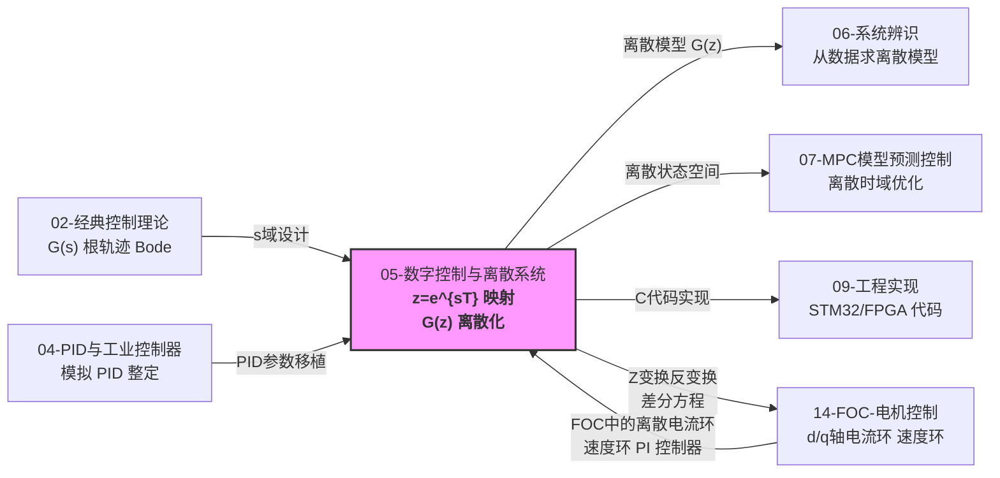
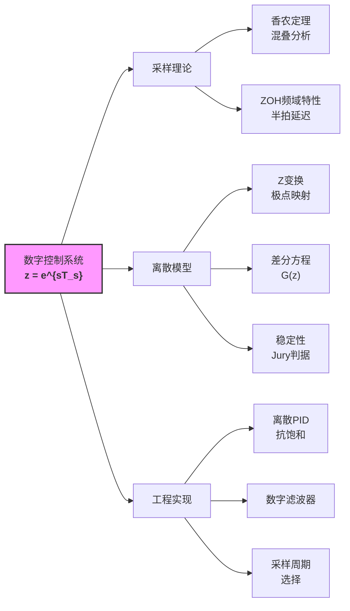

# 图解入门：数字控制与模拟控制的区别

> 本章用一张图建立宏观直觉：数字控制系统中，信号是"阶梯状"的，而模拟控制系统中，信号是"连续流动"的。更重要的是——数字控制不是对连续控制的"近似补丁"，而是**变换链中从复域分析走向有限实现的关键一环**。

---

## 核心认知锚点

> **数字控制与离散系统 = 变换链的"最后一公里"**：从拉普拉斯 $s$ 平面到 Z 平面 $z = e^{sT_s}$，从连续传递函数 $G(s)$ 到离散传递函数 $G(z)$，从模拟 PID 到一行 C 代码——这里完成的是**理论可分析 → 工程可实现**的跨越。

---

## 为什么学：这个模块在统一框架中的位置

如果你已经学过了傅里叶变换、拉普拉斯变换和系统稳定性，你可能会有这样的疑问：

> "连续系统的分析和设计已经够用了，为什么还要搞一套离散的？"

答案藏在**工程现实**里：

| 连续世界 | 数字世界 |
|---------|---------|
| 运放、RC 网络 | MCU、DSP、FPGA |
| 模拟 PID 电路 | 一行 C 代码 `u = Kp*e + integral + Kd*de` |
| 无限时间分辨率 | 一拍一拍地执行（$T_s = 1\,\text{ms}$ 或 $10\,\mu\text{s}$） |
| 带宽受限于物理元件 | 带宽受限于采样率和算力 |

更重要的是，从**统一变换链**的视角看：

- **傅里叶变换**（$j\omega$ 轴）回答"有哪些频率成分"
- **拉普拉斯变换**（$s$ 平面）回答"这些频率是否伴随增长/衰减，系统是否稳定"
- **Z 变换**（$z$ 平面）回答"**如何在有限采样时刻、用有限算力把上述分析实现出来**"

数字控制不是"二等公民"——它是**同一分析链在采样和有限实现条件下的自然延伸**。从 $s$ 到 $z = e^{sT_s}$ 的映射，正是把连续系统的极点、零点、频率响应精确地"翻译"到离散域，让控制器可以运行在微处理器上。

---

## 与前后模块的关系



**知识流向说明**：

- **前向依赖**：本模块接收来自 `02-经典控制理论` 的连续域设计结果（传递函数 $G(s)$、Bode 图、稳定裕度），以及来自 `04-PID` 的模拟 PID 参数。前者通过 $z = e^{sT_s}$ 或近似离散化映射为 $G(z)$；后者通过差分方程变成可执行的数字 PID。
- **后向输出**：本模块输出离散模型 $G(z)$、离散状态空间，供 `06-系统辨识` 和 `07-MPC` 使用；输出可直接部署的差分方程和 C 代码，供 `09-工程实现` 使用。
- **与 FOC 的闭环关联**：[[14-FOC-电机控制/00-README|14-FOC-电机控制]] 中的 $d/q$ 轴电流环本质上是一个**高频数字控制**系统（典型控制周期 $50\!\sim\!100\,\mu\text{s}$）。FOC 中的 PI 控制器不是模拟电路实现的，而是 MCU 中断里每 $T_s$ 执行一次的离散 PI。理解本模块的 Z 变换、零阶保持、混叠、抗饱和等概念，是理解 FOC 代码中 `current_controller_update()` 函数的数学前提。

---

## 从厨房温控器说起

想象你家的烤箱温控系统。

**模拟控制**的世界里，一只精密的温度计实时监测炉温，一根连续的导线把温度信号送进一个模拟 PID 电路，电路输出的电压连续地、无级地调节加热管的功率。整个过程如同一条平滑的河流——温度、电压、功率都在时间轴上连续变化，没有"断点"。

**数字控制**的世界里，情形完全不同。一个数字传感器每隔 $T_s = 0.1\,\text{s}$ 读取一次温度，microcontroller 里的程序看到一个整数（比如 $247$ 代表 $24.7°\text{C}$），用一段代码算出"需要多少加热功率"，再通过 PWM（脉宽调制）输出一个占空比信号。控制动作不是连续的，而是**一拍一拍**进行的。

这就像模拟控制是"交响乐团实时即兴演奏"，数字控制是"按照乐谱一拍一拍演奏"。

> **与变换链的联系**：模拟控制器用 $G(s)$ 描述，数字控制器用 $G(z)$ 描述。从 $G(s)$ 到 $G(z)$ 的转换，不是"随便近似"，而是通过 $z = e^{sT_s}$ 的**精确映射**或经过 ZOH 的精确离散化来完成的。PWM 的占空比更新，本质上是 $u[k]$ 经 DAC+ZOH 后变成的阶梯信号。

---

## 系统框图对比

### 模拟闭环控制系统

```text
        r(t)   e(t)        u(t)         y(t)
    ┌──────┐  ┌──────┐   ┌──────┐    ┌──────┐
───►│  +   ├──►│Controller├──►│ Plant├──►──┘
    │  -   │  └──────┘   └──────┘    │
    └──┬───┘                          │
       │◄─────────────────────────────┘
                    连续反馈
```

所有信号都是**时间的连续函数**：$r(t), e(t), u(t), y(t)$。控制器通常由运放、RC 网络实现。

### 数字闭环控制系统

```text
        r[k]         e[k]          u[k]
    ┌────────┐    ┌────────┐   ┌────────┐
───►│  数字  │───►│ 数字   │──►│  DAC   │──┐
    │ 参考   │    │ 控制器 │   │+ ZOH   │  │
    └──┬─────┘    └────────┘   └────────┘  │
       │                                    │
       │    ┌────────┐    ┌────────┐       │
       │◄───│  ADC   │◄───│ Plant  │◄──────┘
       │    │ 采样   │    │ 连续   │
       │    └────────┘    └────────┘
       │         ↑
       │      t = k·Ts
```

信号类型发生了根本性变化：

| 位置 | 信号类型 | 数学描述 | 物理实现 |
|------|----------|----------|----------|
| 参考输入 $r$ | 离散序列 | $r[k]$ | 上位机指令 |
| 误差信号 $e$ | 离散序列 | $e[k] = r[k] - y[k]$ | 软件计算 |
| 控制输出 $u$ | 离散序列 → 连续阶梯 | $u(t) = u[k]$ for $kT_s \le t < (k+1)T_s$ | DAC + ZOH |
| 被控量 $y$ | 连续信号 → 离散序列 | $y[k] = y(kT_s)$ | 传感器 + ADC |

**关键洞察**：数字控制器本身只"认识"数字，它与物理世界之间隔着两个关键桥梁——**ADC（模数转换）**和 **DAC（数模转换）**。ADC 负责"采样"，DAC+ZOH 负责"保持"。

> **与变换链的联系**：
> - ADC 的采样操作在频域产生**频谱的周期性复制**（$X^*(j\omega) = \frac{1}{T_s} \sum X(j(\omega - n\omega_s))$），这是**混叠**的根源。
> - ZOH 的传递函数 $G_{ZOH}(s) = \frac{1 - e^{-sT_s}}{s}$ 正是**从离散序列 $u[k]$ 重建阶梯信号 $u(t)$** 的数学模型。令 $s = j\omega$ 可得其频率响应，说明 ZOH 本身是一个低通滤波器并引入半拍延迟。

---

## 为什么工业界全面转向数字控制？

| 维度 | 模拟控制 | 数字控制 |
|------|----------|----------|
| **参数调整** | 换电阻/电容，焊接改动 | 改一行代码，在线下载 |
| **精度** | 受元件温漂、老化影响 | 由 ADC 位数决定，长期稳定 |
| **复杂算法** | 高阶补偿器需要大量运放 | 一段代码实现任意阶数 |
| **通信与记录** | 需要额外硬件 | 天然支持 CAN/EtherCAT/日志 |
| **成本（复杂系统）** | 随复杂度急剧上升 | 边际成本极低 |
| **实时性** | 无限带宽（理想） | 受采样周期限制 |
| **抗噪声** | 模拟噪声难以消除 | 可数字滤波 |

> **工程直觉**：对于 90% 的工业控制场景，数字控制已经全面取代模拟控制。剩下的模拟控制仅出现在极高频（射频、微波）、极低功耗（模拟手表）或极端可靠性（航天器备份模拟通道）等 niche 领域。

> **FOC 关联**：在 [[14-FOC-电机控制/00-README|14-FOC-电机控制]] 中，电流环控制周期通常为 $50\!\sim\!100\,\mu\text{s}$（$10\!\sim\!20\,\text{kHz}$），速度环为 $1\,\text{ms}$。这不是模拟电路能做到的——数字控制让 FOC 的复杂坐标变换、SVPWM 计算、观测器更新全部在一颗 MCU 上完成。没有数字控制，就没有现代 FOC。

---

## 核心概念：采样与重建

数字控制系统的本质是**采样-计算-保持**的循环。理解下面这张图，你就理解了数字控制的一半：

```text
连续信号 y(t)
     │
     │  ┌──┐    ┌──┐    ┌──┐    ┌──┐
     │  │  │    │  │    │  │    │  │
     └──┘  └────┘  └────┘  └────┘  └────
        ↑        ↑        ↑        ↑
      t=0      t=Ts     t=2Ts    t=3Ts

采样后 y[k]
     │
     │  ●           ●           ●           ●
     │  │           │           │           │
     └──┴───────────┴───────────┴───────────┴──► k
        0           1           2           3

零阶保持后 yh(t)
     │
     │  ┌────┐    ┌────┐    ┌────┐    ┌────┐
     │  │    │    │    │    │    │    │    │
     └──┘    └────┘    └────┘    └────┘    └─► t
        0    Ts  2Ts  3Ts  4Ts
```

上图展示了三个关键阶段：

1. **连续信号** $y(t)$：物理世界的本来面目，无限时间分辨率。
2. **采样序列** $y[k] = y(kT_s)$：ADC 在每个采样时刻"抓拍"一个值，时间信息丢失了中间的所有细节。
3. **零阶保持(ZOH)** $y_h(t)$：DAC 把每个离散值保持一个采样周期，输出变成阶梯状。这个阶梯信号才是真实输入到被控对象的控制量。

> **与变换链的联系**：
> - 采样定理指出：若信号带宽 $f_m < f_s/2$，则可完美重建。从复域看，这是 $z = e^{sT_s}$ 映射**不重叠**（无混叠）的条件。
> - ZOH 的半拍延迟 $T_s/2$ 是数字控制系统的**内禀延迟**，在连续域设计时必须预留裕量。FOC 电流环选择 $10\!\sim\!20\,\text{kHz}$ 采样率，正是为了在电机带宽内把这个相位损失降到可忽略的水平。

---

## 数值示例：同一系统，两种实现

考虑一个一阶惯性环节：

$$ G(s) = \frac{1}{s + 1} $$

### 模拟实现

在模拟域中，输出完全由微分方程决定：

$$ \frac{dy}{dt} + y = u $$

若输入为单位阶跃 $u(t) = 1(t)$，则解析解为：

$$ y(t) = 1 - e^{-t}, \quad t \ge 0 $$

### 数字实现（预览）

取采样周期 $T_s = 0.2\,\text{s}$，使用欧拉前向近似 $s \approx \frac{z-1}{T_s}$，离散传递函数为：

$$ G_d(z) = \frac{T_s}{z - (1 - T_s)} = \frac{0.2}{z - 0.8} $$

对应的差分方程：

$$ y[k] = 0.8\,y[k-1] + 0.2\,u[k-1] $$

**对比结果**：

| $t$ (s) | $k$ | 模拟输出 $y(t)$ | 数字输出 $y[k]$ | 误差 |
|---------|-----|-----------------|-----------------|------|
| 0.0 | 0 | 0.000 | 0.000 | 0.0% |
| 0.2 | 1 | 0.181 | 0.200 | 10.5% |
| 0.4 | 2 | 0.330 | 0.360 | 9.1% |
| 0.6 | 3 | 0.451 | 0.488 | 8.2% |
| 1.0 | 5 | 0.632 | 0.672 | 6.3% |
| 2.0 | 10 | 0.865 | 0.892 | 3.1% |

> **观察**：$T_s = 0.2\,\text{s}$ 时，瞬态阶段误差约 $8\!\sim\!10\%$，稳态时趋于一致。这说明**采样周期越小，数字实现越逼近模拟实现**——但过小的 $T_s$ 会带来计算负担和数值精度问题。

> **与变换链的联系**：精确 ZOH 离散化给出 $G_d(z) = \frac{1 - e^{-T_s}}{z - e^{-T_s}} = \frac{0.181}{z - 0.819}$，其极点 $z = e^{-T_s}$ 正是 $s = -1$ 通过 $z = e^{sT_s}$ 的精确映射。而欧拉前向的极点 $z = 0.8$ 是近似映射。这一差异说明：**离散化方法的选择影响系统动态，但 $z = e^{sT_s}$ 提供了判断基准**。

---

## 常见错误与纠正

### 错误1：认为"离散化只是近似，没有理论根基"

**错误表现**：不少工程师把 Z 变换当作"不得已的近似工具"，认为它不如拉普拉斯变换"正统"。

**纠正**：Z 变换不是近似的补丁，而是**采样系统严格的数学理论**。离散时间信号 $x[k]$ 的 Z 变换定义为：

$$ X(z) = \sum_{k=0}^{\infty} x[k]\,z^{-k} $$

它与拉普拉斯变换有严格的对应关系——$z = e^{sT_s}$。采样后的系统分析完全可以在 Z 域中严格进行，包括稳定性判据（Jury 判据）、频率响应、根轨迹等。离散控制系统理论是一套**与连续系统理论平行且完备**的体系。

> **从统一框架理解**：Z 变换是拉普拉斯变换在**采样和序列化**条件下的自然延伸。就像拉普拉斯是傅里叶加上指数衰减因子 $e^{-\sigma t}$，Z 变换是 DTFT 加上径向加权 $r^{-n}$。理解这一点，就不会觉得 Z 变换是"二等公民"。

### 错误2：采样周期越小越好

**错误表现**：为了"接近连续系统"，工程师把采样周期设得非常小（比如 $1\,\mu\text{s}$），导致控制器算力浪费、数值积分累积误差增大。

**纠正**：采样周期的选取需要遵循**香农采样定理**的实用版本：

$$ T_s \approx \frac{1}{10} \sim \frac{1}{30} \, t_r $$

其中 $t_r$ 是系统的上升时间。过小的 $T_s$ 不仅没有必要，还会放大有限字长效应。经验法则将在 [[006-采样周期选择]] 中详细讨论。

> **FOC 关联**：FOC 电流环的 $T_s$ 选择是一个典型的权衡。电机电流带宽通常 $500\!\sim\!1000\,\text{Hz}$，而 PWM 开关频率 $10\!\sim\!20\,\text{kHz}$。电流环通常取 $T_s = 50\!\sim\!100\,\mu\text{s}$（即 $10\!\sim\!20\,\text{kHz}$），这是为了在电机带宽内保持足够相位裕度，同时让 MCU 有足够时间完成 Clarke/Park 变换、PI 计算和 SVPWM 生成。

---

## 本章知识地图



---

## 自测习题

### 习题1

判断题：数字控制系统中，DAC 输出的信号是严格连续的吗？

<details>
<summary>点击查看答案</summary>

**答案**：不是严格连续的。

DAC 配合零阶保持器（ZOH）输出的是**阶梯状信号**——在每个采样周期内保持恒定值，在采样时刻发生跳变。从数学上讲，这种信号在采样时刻不可导，属于**分段连续**。只有经过被控对象（通常含惯性环节）的低通滤波后，被控对象的输出才会变得平滑。
</details>

### 习题2

某模拟控制器使用三个运放实现 PID，带宽约 $50\,\text{Hz}$。现改用数字实现，ADC 采样率为 $100\,\text{Hz}$。你认为这个采样率足够吗？为什么？

<details>
<summary>点击查看答案</summary>

**答案**：不够。

按照香农采样定理，采样率应至少为信号最高频率的 2 倍，即 $f_s \ge 2 \times 50 = 100\,\text{Hz}$。但这只是**绝对下限**，实际控制工程中通常要求采样频率为闭环带宽的 $20\!\sim\!30$ 倍。因此合理采样率应为 $1000\!\sim\!1500\,\text{Hz}$。$100\,\text{Hz}$ 太接近奈奎斯特极限，会导致严重的混叠和相位滞后。

> 在 FOC 电流环中，如果电流带宽 $500\,\text{Hz}$，采样率至少 $5\,\text{kHz}$，工程上通常取 $10\,\text{kHz}$ 以上。
</details>

### 习题3

用 Python 绘制模拟响应 $y(t) = 1 - e^{-t}$ 和数字近似响应 $y[k] = 0.8^k \cdot 0 + 0.2\sum_{i=0}^{k-1}0.8^{k-1-i}$ 在同一图中，观察差异随 $k$ 的变化。并思考：如果采用精确 ZOH 离散化（极点 $z = e^{-T_s}$），结果会如何改善？

<details>
<summary>点击查看答案</summary>

```python
import numpy as np
import matplotlib.pyplot as plt

# continuous response
t = np.linspace(0, 3, 300)
y_cont = 1 - np.exp(-t)

# discrete response (Ts = 0.2)
Ts = 0.2
k = np.arange(0, 16)
y_disc = np.zeros_like(k, dtype=float)
for i in range(1, len(k)):
    y_disc[i] = 0.8 * y_disc[i-1] + 0.2 * 1.0  # unit step input

# exact ZOH: y[k] = e^{-Ts} y[k-1] + (1-e^{-Ts}) u[k-1]
a_zoh = np.exp(-Ts)
y_zoh = np.zeros_like(k, dtype=float)
for i in range(1, len(k)):
    y_zoh[i] = a_zoh * y_zoh[i-1] + (1 - a_zoh) * 1.0

plt.figure(figsize=(8, 4))
plt.plot(t, y_cont, 'b-', label='Analog: $y(t)=1-e^{-t}$')
plt.step(k*Ts, y_disc, 'r-o', where='post', label='Euler: $y[k]$ (Ts=0.2s)')
plt.step(k*Ts, y_zoh, 'g-s', where='post', label='Exact ZOH: $y[k]$ (Ts=0.2s)')
plt.xlabel('Time [s]')
plt.ylabel('Output')
plt.legend()
plt.grid(True)
plt.title('Analog vs Digital Step Response')
plt.tight_layout()
plt.show()
```

**观察要点**：
- 在 $t \to \infty$ 时三者都趋于 1；
- 欧拉前向在每个台阶顶部略低于连续曲线，这是 ZOH 引入的**半拍滞后**效应；
- 精确 ZOH（极点 $z = e^{-T_s} = 0.8187$）比欧拉前向（极点 $z = 0.8$）更接近真实响应，因为 $z = e^{sT_s}$ 是连续极点的**精确映射**。
</details>

---

## 延伸阅读锚点

- [[001-采样与保持的数学效应]] — 深入理解 ADC/ZOH 的数学模型与变换链中的位置
- [[002-离散传递函数与差分方程]] — Z 变换与差分方程的完整推导，$z = e^{sT_s}$ 的精确映射
- [[003-离散PID实现]] — 从模拟 PID 到 C 代码的完整映射，含 FOC 中的工程考量
- [[01-Foundations/05-信号与系统/010-采样、混叠与重建|05-信号与系统/02-采样定理]] — 香农定理的频域证明
- [[14-FOC-电机控制/00-README#02-FOC控制理论|FOC 控制理论]] — FOC 中的离散电流环与速度环 PI 实现
