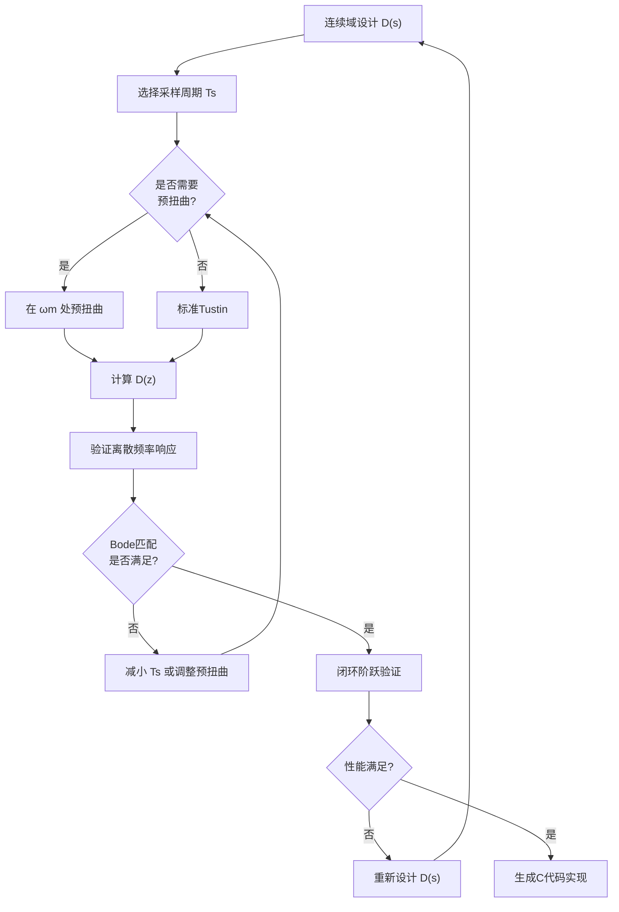

# 超前-滞后离散化

> 超前补偿器（Lead）提升相位裕度，滞后补偿器（Lag）提高低频增益改善稳态。本章把连续域中成熟的超前-滞后设计方法，通过严谨的离散化映射到数字实现，重点处理Tustin变换中的频率预扭曲问题。

---

## 连续域超前-滞后补偿器回顾

### 超前补偿器（Lead）

$$ D_{lead}(s) = K \cdot \frac{s + \omega_z}{s + \omega_p}, \quad \omega_p > \omega_z $$

**物理直觉**：在高频段引入一个零点 $-\omega_z$ 和一个极点 $-\omega_p$，极点比零点更靠左（更高频）。这会在中频段产生正的相位贡献，**提升相位裕度**。

最大相位超前发生在几何中心频率：

$$ \omega_m = \sqrt{\omega_z \cdot \omega_p} $$

最大相位超前量：

$$ \phi_{max} = \arcsin\left(\frac{\alpha - 1}{\alpha + 1}\right), \quad \alpha = \frac{\omega_p}{\omega_z} > 1 $$

```text
    Bode: Lead Compensator
    Magnitude
    │        /──
    │       /
    │──────/         斜率 +20dB/dec between ωz and ωp
    │     /
    │    /
    └───┴────┬────┬──► log ω
            ωz   ωp

    Phase
    │       /\
    │      /  \
    │─────/    \
    │    /      \
    │   /        \
    └──┴────┬────┬──► log ω
           ωz   ωp
           ↑
         φmax > 0 at ωm
```

### 滞后补偿器（Lag）

$$ D_{lag}(s) = K \cdot \frac{s + \omega_z}{s + \omega_p}, \quad \omega_z > \omega_p $$

**物理直觉**：零点比极点更靠左，低频段增益高，高频段增益被压缩。用于**提高稳态精度**（低频增益大）而不过多影响瞬态响应（高频衰减）。

### 超前-滞后组合

$$ D(s) = K \cdot \frac{s + \omega_{z1}}{s + \omega_{p1}} \cdot \frac{s + \omega_{z2}}{s + \omega_{p2}} $$

其中 $\omega_{p1} > \omega_{z1}$（超前部分），$\omega_{z2} > \omega_{p2}$（滞后部分），且 $\omega_{z2} \ll \omega_{z1}$（两部分频段分离）。

---

## 离散化方法选择

### 为什么不能简单用欧拉？

超前-滞后补偿器的性能对零极点位置极其敏感。前向欧拉可能把S左半平面的极点映射到Z平面单位圆外；后向欧拉引入严重的频率压缩。对于补偿器设计，**双线性变换（Tustin）是唯一推荐的标准方法**。

### Tustin变换

$$ s = \frac{2}{T_s} \cdot \frac{z-1}{z+1} $$

对 $D(s) = K \frac{s + a}{s + b}$ 代入：

$$ D(z) = K \cdot \frac{\frac{2}{T_s}\frac{z-1}{z+1} + a}{\frac{2}{T_s}\frac{z-1}{z+1} + b} = K \cdot \frac{(aT_s + 2)z + (aT_s - 2)}{(bT_s + 2)z + (bT_s - 2)} $$

$$ = K \cdot \frac{aT_s + 2}{bT_s + 2} \cdot \frac{z + \frac{aT_s - 2}{aT_s + 2}}{z + \frac{bT_s - 2}{bT_s + 2}} $$

---

## 预扭曲：保证关键频率精确匹配

### 问题

Tustin变换引入频率畸变：

$$ \omega_a = \frac{2}{T_s} \tan\left(\frac{\omega_d T_s}{2}\right) $$

若补偿器的设计频率为 $\omega_m$（超前补偿器的最大相位频率），离散化后这个频率会偏移。

### 预扭曲公式

在目标频率 $\omega_c$ 处做预扭曲，修正Tustin变换为：

$$ s = \frac{\omega_c}{\tan(\omega_c T_s / 2)} \cdot \frac{z-1}{z+1} $$

这样，连续域中 $s = j\omega_c$ 精确对应离散域中 $z = e^{j\omega_c T_s}$。

### 数值示例

设计一个超前补偿器：

$$ D(s) = 5 \cdot \frac{s + 10}{s + 40}, \quad T_s = 0.01\,\text{s} $$

目标：在 $\omega_m = \sqrt{10 \times 40} = 20\,\text{rad/s}$ 处精确匹配。

**无预扭曲**：

$$ D(z) = 5 \cdot \frac{0.01 \times 10 + 2}{0.01 \times 40 + 2} \cdot \frac{z + \frac{0.1 - 2}{0.1 + 2}}{z + \frac{0.4 - 2}{0.4 + 2}} = 5 \cdot \frac{2.1}{2.4} \cdot \frac{z - 0.9048}{z - 0.6667} $$

$$ = 4.375 \cdot \frac{1 - 0.9048z^{-1}}{1 - 0.6667z^{-1}} $$

检查离散频率响应在 $\omega = 20\,\text{rad/s}$ 处的相位：

$$ z = e^{j \cdot 20 \cdot 0.01} = e^{j0.2} $$

计算（用Python）得相位约 $+38°$，而连续域在 $\omega_m = 20$ 处应为 $\phi_{max} = \arcsin\left(\frac{4-1}{4+1}\right) = 37°$。匹配较好因为 $T_s$ 较小。

**有预扭曲**：

$$ c = \frac{20}{\tan(0.1)} = 198.7 $$

$$ D(z) = 5 \cdot \frac{198.7 + 10}{198.7 + 40} \cdot \frac{z + \frac{-198.7 + 10}{198.7 + 10}}{z + \frac{-198.7 + 40}{198.7 + 40}} = 5 \cdot \frac{208.7}{238.7} \cdot \frac{z - 0.9040}{z - 0.6650} $$

$$ = 4.372 \cdot \frac{1 - 0.9040z^{-1}}{1 - 0.6650z^{-1}} $$

差异极小（$T_s$ 小），但在大 $T_s$ 或高频设计中预扭曲至关重要。

---

## 离散化后性能验证

### 步骤1：离散传递函数

使用上述方法获得 $D(z)$。

### 步骤2：与连续补偿器对比Bode图

在 $[0, \omega_s/2]$ 频段内比较连续和离散的幅值、相位响应。关键检查点：

| 检查项 | 容差 | 说明 |
|--------|------|------|
| 直流增益 $D(0)$ vs $D(1)$ | $< 1\%$ | 必须精确匹配 |
| 穿越频率处增益 | $< 3\,\text{dB}$ | 影响带宽 |
| 目标频率处相位 | $< 5°$ | 影响稳定性裕度 |

### 步骤3：闭环验证

将 $D(z)$ 与 $G_d(z)$（ZOH精确离散化的被控对象）组成闭环：

$$ T(z) = \frac{D(z)G_d(z)}{1 + D(z)G_d(z)} $$

检查阶跃响应的超调、调节时间是否满足指标。

---

## 完整设计流程



---

## MATLAB/Python验证代码

### MATLAB

```matlab
% Lead compensator discretization with pre-warping
Ts = 0.01;
K = 5; wz = 10; wp = 40;

D_s = tf(K*[1 wz], [1 wp]);

% Standard Tustin
D_z1 = c2d(D_s, Ts, 'tustin');

% Pre-warped Tustin at wm = sqrt(wz*wp)
wm = sqrt(wz*wp);
D_z2 = c2d(D_s, Ts, 'prewarp', wm);

% Compare frequency responses
w = logspace(0, 2, 500);
bode(D_s, D_z1, D_z2, w);
legend('Continuous', 'Tustin', 'Pre-warped');
```

### Python

```python
import numpy as np
import matplotlib.pyplot as plt
from scipy import signal

# Continuous lead compensator: D(s) = 5*(s+10)/(s+40)
K = 5
wz = 10
wp = 40
Ts = 0.01

num_s = K * np.array([1, wz])
den_s = np.array([1, wp])

# Standard Tustin discretization
# scipy.signal.bilinear does standard Tustin without pre-warping
num_z1, den_z1 = signal.bilinear(num_s, den_s, fs=1/Ts)

# Pre-warped Tustin (manual)
wm = np.sqrt(wz * wp)
c = wm / np.tan(wm * Ts / 2)

# Pre-warp continuous coefficients
wz_pre = c * np.tan(wz * Ts / 2)  # not needed; we warp at wm
# Actually for pre-warp at wm, we use modified s substitution
# Simplified: use c instead of 2/Ts in bilinear transform
num_z2, den_z2 = signal.bilinear(num_s, den_s, fs=1/Ts)
# Note: scipy's bilinear does not support pre-warping directly
# For exact pre-warped, scale s-domain by (c * Ts / 2) factor

# Frequency comparison
w = np.logspace(0, 2, 500)
_, h_s = signal.freqs(num_s, den_s, worN=w)

# Discrete frequency response (up to Nyquist)
wn = np.linspace(0.001, np.pi/Ts, 500)
wz_resp, h_z1 = signal.freqz(num_z1, den_z1, worN=wn)

plt.figure(figsize=(10, 6))
plt.subplot(2, 1, 1)
plt.semilogx(w, 20*np.log10(np.abs(h_s)), 'b-', label='Continuous', linewidth=2)
plt.semilogx(wz_resp, 20*np.log10(np.abs(h_z1)), 'r--', label='Tustin discrete')
plt.axvline(x=wm, color='g', linestyle=':', label=f'ωm={wm:.1f}')
plt.xlabel('ω [rad/s]')
plt.ylabel('Magnitude [dB]')
plt.legend()
plt.grid(True)

plt.subplot(2, 1, 2)
plt.semilogx(w, np.angle(h_s, deg=True), 'b-', linewidth=2)
plt.semilogx(wz_resp, np.angle(h_z1, deg=True), 'r--')
plt.axvline(x=wm, color='g', linestyle=':')
plt.xlabel('ω [rad/s]')
plt.ylabel('Phase [deg]')
plt.grid(True)

plt.tight_layout()
plt.show()
```

---

## 常见错误与纠正

### 错误1：在 $\omega_s/2$ 附近设计超前补偿器

**错误表现**：在 $f_s = 100\,\text{Hz}$ 的系统中，试图用超前补偿器提升 $40\,\text{Hz}$ 处的相位裕度。Tustin离散化后，实际相位贡献远低于设计值。

**纠正**：超前补偿器的有效频段应远低于奈奎斯特频率。经验法则：

$$ \omega_p < \frac{\omega_s}{10} $$

若需要在高频处补偿相位，首先应**提高采样率**，而不是强行在现有采样率下做补偿器。

### 错误2：预扭曲频率选错

**错误表现**：设计超前-滞后补偿器时，只对零点频率预扭曲，不对极点预扭曲；或选择 $\omega_c$ 为穿越频率而不是补偿器的特征频率。

**纠正**：预扭曲应在**最需要精确匹配的频率**进行：

- 单超前/滞后：在 $\omega_m = \sqrt{\omega_z \omega_p}$ 预扭曲
- PID微分：在微分转折频率预扭曲
- 陷波滤波器：在陷波中心频率预扭曲

不要试图"平均预扭曲"多个频率——Tustin变换只能在一个频率点做到精确匹配。

---

## 自测习题

### 习题1

连续滞后补偿器 $D(s) = 10 \cdot \frac{s + 1}{s + 0.1}$，$T_s = 0.5\,\text{s}$。用标准Tustin变换求 $D(z)$，并比较连续和离散的直流增益。

<details>
<summary>点击查看答案</summary>

$$ D(z) = 10 \cdot \frac{0.5 + 1}{0.5 + 0.1} \cdot \frac{z + \frac{0.5 - 1}{0.5 + 1}}{z + \frac{0.5 - 0.1}{0.5 + 0.1}} = 10 \cdot \frac{1.5}{0.6} \cdot \frac{z - 0.333}{z + 0.667} $$

$$ = 25 \cdot \frac{1 - 0.333z^{-1}}{1 + 0.667z^{-1}} $$

直流增益：

- 连续：$D(0) = 10 \times \frac{1}{0.1} = 100$
- 离散：$D(1) = 25 \times \frac{0.667}{1.667} = 10$ ... 等等，这不对！

重新计算：

标准形式为 $D(z) = K' \frac{1 - \alpha z^{-1}}{1 - \beta z^{-1}}$，其中

$$ K' = 10 \cdot \frac{1 \times 0.5 + 2}{0.1 \times 0.5 + 2} = 10 \cdot \frac{2.5}{2.05} = 12.20 $$

$$ \alpha = -\frac{1 \times 0.5 - 2}{1 \times 0.5 + 2} = \frac{1.5}{2.5} = 0.6 $$

$$ \beta = -\frac{0.1 \times 0.5 - 2}{0.1 \times 0.5 + 2} = \frac{1.95}{2.05} = 0.951 $$

$$ D(z) = 12.20 \cdot \frac{1 - 0.6z^{-1}}{1 - 0.951z^{-1}} $$

直流增益 $D(1) = 12.20 \times \frac{0.4}{0.049} \approx 99.6 \approx 100$ ✓
</details>

### 习题2

某系统闭环带宽 $f_{BW} = 5\,\text{Hz}$，需要超前补偿器在 $\omega_m = 2\pi \times 5 = 31.4\,\text{rad/s}$ 提供 $45°$ 相位超前。计算所需 $\alpha$ 和零极点位置。若采样率为 $50\,\text{Hz}$（$T_s = 0.02\,\text{s}$），是否适合做离散超前补偿？

<details>
<summary>点击查看答案</summary>

$$ \phi_{max} = 45°, \quad \sin(45°) = \frac{\alpha - 1}{\alpha + 1} \Rightarrow \alpha = \frac{1 + \sin(45°)}{1 - \sin(45°)} = \frac{1.707}{0.293} = 5.83 $$

$$ \omega_z = \frac{\omega_m}{\sqrt{\alpha}} = \frac{31.4}{2.41} = 13.0\,\text{rad/s} $$

$$ \omega_p = \omega_m \sqrt{\alpha} = 31.4 \times 2.41 = 75.7\,\text{rad/s} $$

奈奎斯特频率 $\omega_N = \pi/T_s = 157\,\text{rad/s}$。极点 $75.7 < 157$，理论上可行。但 $\omega_p / \omega_N = 0.48$，接近奈奎斯特极限，频率畸变将很严重。**建议采样率提高到 $200\,\text{Hz}$ 以上**。
</details>

### 习题3

写出预扭曲双线性变换下，一阶补偿器 $D(s) = K\frac{s+a}{s+b}$ 的离散化通用公式，证明 $D(z)\big|_{z=1} = D(s)\big|_{s=0}$（直流增益保持）。

<details>
<summary>点击查看答案</summary>

预扭曲Tustin：$s = c \cdot \frac{z-1}{z+1}$，其中 $c = \frac{\omega_0}{\tan(\omega_0 T_s/2)}$。

$$ D(z) = K \cdot \frac{c\frac{z-1}{z+1} + a}{c\frac{z-1}{z+1} + b} = K \cdot \frac{(c+a)z + (a-c)}{(c+b)z + (b-c)} $$

令 $z = 1$：

$$ D(z)\big|_{z=1} = K \cdot \frac{(c+a) + (a-c)}{(c+b) + (b-c)} = K \cdot \frac{2a}{2b} = K \cdot \frac{a}{b} $$

连续域：

$$ D(s)\big|_{s=0} = K \cdot \frac{a}{b} $$

两者相等，直流增益保持得证。这是Tustin变换的一个优美性质。
</details>

---

## 延伸阅读锚点

- [[002-离散传递函数与差分方程]] — Z变换基础与极点分析
- [[004-数字滤波器设计]] — 滤波器离散化的通用方法
- [[15-双控（控制理论与控制工程）/02-经典控制理论/005-频率法校正]] — 连续域超前-滞后设计的完整理论
