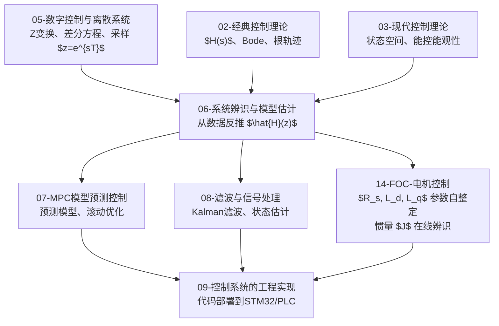
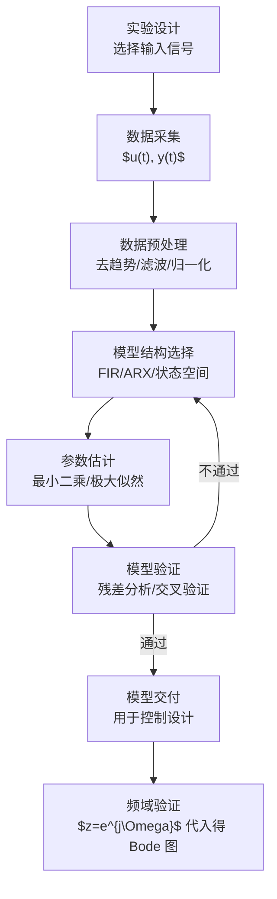

# 图解入门：如何用数据反推模型

> **核心认知锚点**：系统辨识是"变换链"的**逆向工程**——不是从 $H(s)$ 计算响应，而是从输入输出数据 $\{u[k], y[k]\}$ 反推 $\hat{H}(z)$，让抽象的复域模型获得物理世界的锚定。

---

## 0. 为什么学：这个模块在统一框架中的位置

在"信号—系统—控制"的统一框架中，有一条从**全局频率表示** → **复域系统分析** → **有限实现与局部分析**的变换链。系统辨识恰好站在这条链的**逆向入口**：

| 方向 | 起点 | 工具 / 映射 | 终点 | 你的角色 |
|------|------|-------------|------|----------|
| **前向**（已知模型） | $H(s)$ 或 $H(z)$ | 拉普拉斯反变换 / Z 反变换 | $y(t)$ 或 $y[k]$ | 分析者 |
| **逆向**（已知数据） | $\{u[k], y[k]\}$ | **系统辨识**（最小二乘、频域拟合、子空间方法） | $\hat{H}(z)$ 或 $\hat{H}(s)$ | **工程师** |
| **验证** | $\hat{H}(z)$ | 令 $z = e^{j\Omega}$ | $\hat{H}(e^{j\Omega})$，与实测 Bode 对比 | 质检员 |

**关键洞察**：你在 [[15-双控（控制理论与控制工程）/05-数字控制与离散系统/000-图解入门：数字控制与模拟控制的区别|05-数字控制与离散系统]] 中已经掌握了 $z = e^{sT}$ 的映射和差分方程；在 [[15-双控（控制理论与控制工程）/02-经典控制理论/000-图解入门：从根轨迹到Bode图|02-经典控制理论]] 中已经学会了用 Bode 图、根轨迹分析 $H(s)$。**系统辨识让你能从真实世界的数据中"长"出这些模型**，而不是从课本例题里得到它们。

这个模块的产出——**一个经过验证的数学模型**——是后续所有控制设计的先决条件：
- 没有模型，MPC 无法做滚动优化（[[15-双控（控制理论与控制工程）/07-MPC模型预测控制/000-图解入门：MPC就像下棋想三步|07-MPC模型预测控制]]）
- 没有模型，卡尔曼滤波无法设计状态观测器（[[15-双控（控制理论与控制工程）/08-滤波与信号处理在控制中的应用/000-图解入门：滤波器是控制系统的感官|08-滤波与信号处理在控制中的应用]]）
- 没有准确的电机参数，FOC 的电流环整定和观测器增益都是盲猜（[[14-FOC-电机控制/00-README|14-FOC-电机控制]]）

---

## 与前后模块的关系：知识流向图



> **读图提示**：
> - 左侧流入的是**数学基础**（Z 变换、传递函数、状态空间）
> - 右侧流出的是**应用出口**（MPC、滤波、FOC 都需要"好模型"）
> - 系统辨识是整条学习路径中**"从理论回到现实"**的转折点

---

## 1. 一个直观的例子：你从未见过的黑盒子

想象你面前有一个神秘的黑盒子，上面有两个接口：一个输入 $u(t)$，一个输出 $y(t)$。你不知道盒子里面是什么——可能是电阻电容网络，可能是电机驱动系统，也可能是化学反应釜。但你有一台示波器，可以记录输入输出的时间序列数据。

**系统辨识的核心问题**：给定输入输出数据 $\{u(t), y(t)\}_{t=1}^{N}$，能否"猜"出盒子内部的数学模型？

这就像考古学家用有限的碎片还原完整的陶器：数据是碎片，模型是对原貌的推测，而辨识算法就是拼接碎片的逻辑。

```
        输入 u(t)                未知系统                输出 y(t)
           │                       ┌───┐                    │
           │──────────────────────▶│ ? │───────────────────▶│
           │                       └───┘                    │
           │                        ↑                       │
           │                     我们想求出                  │
           │                      它的模型                   │
           │                                                │
     ┌─────┴─────┐                                      ┌───┴───┐
     │  信号发生器  │                                      │  示波器  │
     └───────────┘                                      └───────┘
```

---

## 2. 辨识与变换链：从数据域到复域

系统辨识的数学本质，是在**数据域**（有限长的离散时间序列）和**复域**（传递函数、状态空间）之间建立映射。这个映射与变换链的**前向方向正好相反**：

```
前向问题（已知模型 → 求响应）：
    H(s)  ──拉普拉斯反变换──▶  y(t)  =  ℒ^{-1}{H(s)U(s)}
    H(z)  ──Z 反变换──────▶  y[k]  =  𝒵^{-1}{H(z)U(z)}

逆向问题（已知数据 → 求模型）：
    {u[k], y[k]}  ──系统辨识──▶  Ĥ(z) = B(z)/A(z)
    {u(t), y(t)}  ──系统辨识──▶  Ĥ(s) = B(s)/A(s)
```

**关键映射关系**（来自统一框架）：
- $s = j\omega$：连续频域响应是传递函数在虚轴上的切片。频域辨识直接估计这个切片。
- $z = e^{j\Omega}$：离散频域响应是 Z 域传递函数在单位圆上的切片。时域辨识得到的差分模型，代入 $z = e^{j\Omega}$ 即可得到频率响应。
- $z = e^{sT}$：如果辨识得到的是连续模型 $H(s)$，离散化后就是 $H_d(z)$；反之，从离散数据辨识出 $H(z)$，也可通过 $s = \frac{1}{T}\ln z$ 反推连续模型（需处理多值性）。

---

## 3. 系统辨识的三大支柱

任何系统辨识问题都由三个基本要素构成，缺一不可：

### 3.1 数据 (Data)

数据是辨识的原料。没有高质量的数据，任何算法都是巧妇难为无米之炊。数据质量取决于：

- **持续激励 (Persistent Excitation)**：输入信号必须"足够丰富"，才能激发系统的所有动态模式。用一个频率单一的正弦波去辨识一个多模态系统，就像用一把钥匙去开所有的锁——注定失败。
- **信噪比 (SNR)**：输出中的噪声水平。如果噪声淹没了真实信号，辨识结果将严重失真。
- **采样率与时长**：采样太快会浪费计算资源，太慢会丢失高频信息；时长太短则无法捕捉慢动态。

> **与变换链的关联**：你在 [[15-双控（控制理论与控制工程）/05-数字控制与离散系统/000-图解入门：数字控制与模拟控制的区别|05-数字控制与离散系统]] 中学习了香农采样定理和 $z = e^{sT}$ 的映射。辨识中的采样率选择，直接决定了你能"看到"的最高频率，以及离散模型与连续真实系统之间的保真度。

### 3.2 模型集 (Model Set)

模型集是我们"猜测"的候选模型集合。常见选择包括：

| 模型类型 | 数学形式 | 对应变换域 | 适用场景 |
|---------|---------|-----------|---------|
| FIR (有限脉冲响应) | $y(t) = \sum_{k=0}^{M} b_k u(t-k)$ | 脉冲响应 $h[k]$ 的有限截断 | 稳定系统，无反馈 |
| ARX | $A(q)y(t) = B(q)u(t) + e(t)$ | $q^{-1}$ 等价于 $z^{-1}$，即 Z 域的延迟算子 | 线性系统，有噪声 |
| ARMAX | $A(q)y(t) = B(q)u(t) + C(q)e(t)$ | 在 ARX 基础上增加噪声模型 | 有色噪声环境 |
| 状态空间 | $x_{t+1} = A x_t + B u_t, \; y_t = C x_t + D u_t$ | Z 域：$H(z) = C(zI-A)^{-1}B + D$ | 多输入多输出 (MIMO) |
| 非线性 | 神经网络、NARX、Hammerstein-Wiener | 无闭式传递函数 | 强非线性系统 |

> **关键认知**：ARX 模型中的 $q^{-1}$ 就是 Z 变换中的 $z^{-1}$。因此 $A(q)y(t) = B(q)u(t)$ 在 Z 域中就是 $Y(z) = \frac{B(z)}{A(z)}U(z)$，这正是你在 [[15-双控（控制理论与控制工程）/02-经典控制理论/000-图解入门：从根轨迹到Bode图|02-经典控制理论]] 中熟悉的传递函数形式。

### 3.3 准则函数 (Criterion)

准则告诉我们"哪个模型最好"。最常用的准则是**最小化预测误差的平方和**：

$$
J(\theta) = \sum_{t=1}^{N} \left[ y(t) - \hat{y}(t|\theta) \right]^2
$$

其中 $\theta$ 是模型参数向量，$\hat{y}(t|\theta)$ 是模型在参数 $\theta$ 下对输出的预测值。

---

## 4. 系统辨识的标准流程



> **流程中的变换链**：辨识得到的模型（例如 $\hat{H}(z)$）通过令 $z = e^{j\Omega}$ 代入，可以得到频率响应 $\hat{H}(e^{j\Omega})$，与独立实验测得的 Bode 图对比，验证模型是否"真实"。

---

## 5. 辨识 vs. 控制：从数据闭环到控制闭环

系统辨识通常服务于控制器设计。一个典型的"辨识-控制"联合流程如下：

```
┌─────────────────────────────────────────────────────────────┐
│                                                            │
│   被控对象 ──▶ 采集输入输出数据 ──▶ 系统辨识 ──▶ 获得模型    │
│       ↑                                                      │
│       │                                                      │
│       └──── 控制器设计 ◀── 设计控制器 ◀── 模型验证通过 ─────┘
│                                                            │
│   这是一个迭代过程：                                         │
│   1. 开环采集数据                                            │
│   2. 辨识模型（时域 → 差分方程 → Z 域传递函数）                │
│   3. 频域验证（$z=e^{j\Omega}$ 得 Bode 图）                  │
│   4. 设计控制器（根轨迹 / 频域法 / 状态反馈）                │
│   5. 闭环运行                                                │
│   6. 如有需要，重新辨识（在线 RLS 更新参数）                 │
│                                                            │
└─────────────────────────────────────────────────────────────┘
```

---

## 6. 辨识问题的分类

从应用角度，辨识问题可按以下维度分类：

### 6.1 按模型线性度

- **线性辨识**：假设系统可用线性差分方程或传递函数描述。数学上成熟，有大量工具可用。得到的 Z 域模型可直接用于频域分析（$z=e^{j\Omega}$）。
- **非线性辨识**：系统存在显著非线性，需要神经网络、Volterra级数或NARX模型等。

### 6.2 按辨识环境

- **离线辨识 (Batch Identification)**：所有数据一次性采集完毕，然后集中处理。适合实验室环境。相当于对一批数据做"批量变换"。
- **在线辨识 (Online/Recursive Identification)**：数据逐点到达，模型实时更新。适合自适应控制和嵌入式系统。每一步更新相当于在 Z 域中**实时修正传递函数**。

> **FOC 应用**：在线辨识在 FOC 电机控制中至关重要。电机运行时绕组温度变化导致定子电阻 $R_s$ 漂移，递推最小二乘（RLS）实时更新 $R_s$ 估计值，保证电流控制器和观测器性能不劣化。见 [[14-FOC-电机控制/00-README|14-FOC-电机控制]] 中的参数自整定章节。

### 6.3 按噪声假设

- **白噪声输出误差**：$y(t) = G(q,\theta) u(t) + e(t)$，$e(t)$ 为白噪声。
- **方程误差 (ARX)**：噪声进入方程内部，最小二乘可直接求解。对应的 Z 域模型 $H(z) = B(z)/A(z)$ 结构清晰。
- **输出误差 (OE)**：噪声仅叠加在输出上，需要迭代优化。

---

## 7. 数值示例：从一个简单系统开始

考虑一个一阶离散系统：

$$
y(t) = 0.8 \, y(t-1) + 0.2 \, u(t-1) + e(t)
$$

其中 $e(t) \sim \mathcal{N}(0, 0.01)$ 为高斯白噪声。

**变换链视角**：这个差分方程对应的 Z 域传递函数是

$$
H(z) = \frac{0.2 z^{-1}}{1 - 0.8 z^{-1}} = \frac{0.2}{z - 0.8}
$$

令 $z = e^{j\Omega}$ 代入，得到频率响应：

$$
H(e^{j\Omega}) = \frac{0.2}{e^{j\Omega} - 0.8}
$$

这就是该系统的"真实"频域特性。系统辨识的目标，正是从数据中恢复出这个 $H(z)$。

我们设计一个持续激励输入：白噪声序列 $u(t) \sim \mathcal{U}(-1, 1)$，采集 $N = 500$ 组数据，然后用最小二乘法估计参数。

### MATLAB 实现

```matlab
% System Identification Demo: First-Order ARX Model
% Parameters of the true system
a_true = 0.8;
b_true = 0.2;
N = 500;

% Generate input: uniform white noise
rng(42);                    % for reproducibility
u = 2 * rand(N, 1) - 1;     % uniform in [-1, 1]
e = 0.1 * randn(N, 1);      % measurement noise

% Simulate the true system
y = zeros(N, 1);
for t = 2:N
    y(t) = a_true * y(t-1) + b_true * u(t-1) + e(t);
end

% Build regression matrix for ARX(1,1,1)
% y(t) = a*y(t-1) + b*u(t-1) + e(t)
Phi = [-y(1:N-1), u(1:N-1)];
Y = y(2:N);

% Least squares estimation
theta_est = (Phi' * Phi) \ (Phi' * Y);
a_est = -theta_est(1);
b_est = theta_est(2);

fprintf('True:  a = %.4f, b = %.4f\n', a_true, b_true);
fprintf('Est:   a = %.4f, b = %.4f\n', a_est, b_est);
```

运行结果（典型值）：

```
True:  a = 0.8000, b = 0.2000
Est:   a = 0.7962, b = 0.2018
```

误差在 2% 以内——这就是系统辨识的力量：仅用输入输出数据，就能高精度还原系统动态。辨识得到 $\hat{a}=0.7962$，$\hat{b}=0.2018$，对应的 Z 域传递函数 $\hat{H}(z) = \frac{0.2018}{z - 0.7962}$ 与真实 $H(z)$ 几乎无法区分。

---

## 8. 常见错误与纠正

### 错误 1：输入信号没有持续激励

**场景**：用阶跃信号辨识一个二阶振荡系统。

**问题**：阶跃信号只在 $t=0$ 时变化一次，频域上能量集中在直流附近，无法激发系统的高频振荡模态。从变换链视角看，阶跃信号的 Z 变换是 $U(z) = \frac{1}{1-z^{-1}}$，其频谱在 $\Omega=0$ 处有一个冲激，其他频率几乎为零——这意味着你试图用一条频率信息去辨识一个多模态系统，必然失败。

**纠正**：使用白噪声、伪随机二进制序列 (PRBS) 或多正弦信号作为输入。对于 $n$ 阶系统，输入信号的频谱应覆盖系统的所有固有频率。在 FOC 参数辨识中，通常注入 PRBS 或特定频率的扫频信号来激发电机电气和机械模态。

### 错误 2：忽略数据预处理

**场景**：直接对原始传感器数据进行辨识，数据中包含明显的线性趋势（如温度漂移）。

**问题**：趋势会被辨识算法误认为是系统的积分特性，导致模型出现虚假的极点或零点。从变换链看，趋势相当于在频域中引入了 $\Omega=0$ 处的虚假能量，扭曲了低频段的传递函数估计。

**纠正**：辨识前进行去趋势处理，如：

```matlab
% Remove linear trend
y_detrend = detrend(y, 'linear');
u_detrend = detrend(u, 'linear');
```

或者对信号做高通滤波，去除低频漂移。

---

## 9. 自测习题

**习题 1**：为什么系统辨识需要"持续激励"输入？如果输入是一个恒定值 $u(t) = 5$，能否辨识出系统的动态特性？

<details>
<summary>答案</summary>

恒定输入 $u(t)=5$ 无法激发系统的动态模式。此时稳态输出也是常数，我们只能知道系统的静态增益（$H(1)$，即 $z=1$ 处的值），但无法区分一阶系统、二阶系统或更高阶系统。持续激励要求输入信号在频域上有足够丰富的能量分布，以"唤醒"系统的所有模态。从变换链视角看，恒定输入的 Z 变换是 $U(z) = \frac{5}{1-z^{-1}}$，仅在 $z=1$（即 $\Omega=0$）处有能量，其他频率点无信息，因此无法辨识出完整的 $H(z)$。

</details>

**习题 2**：一个真实的系统模型为 $y(t) = 0.5 y(t-1) + 0.3 u(t-1) + v(t)$，其中 $v(t)$ 是噪声。如果采集了 $N=100$ 组数据，用最小二乘法估计参数，估计值与真值之间为什么会有偏差？如何减小偏差？

<details>
<summary>答案</summary>

当噪声 $v(t)$ 与回归向量（即过去的输出）相关时，最小二乘估计会产生**偏差 (Bias)**。在上述 ARX 模型中，如果 $v(t)$ 是白噪声，则它与 $y(t-1)$ 不相关，LS 是无偏的。但如果实际噪声是有色的（如 ARMA 过程），则 $v(t)$ 与 $y(t-1)$ 相关，LS 估计会有偏。

减小偏差的方法：
1. 使用**辅助变量法 (IV)**：引入与输入相关、但与噪声无关的辅助变量。
2. 使用**极大似然法 (ML)**：对噪声结构做更精确的建模。
3. 增加数据量 $N$：偏差随 $N$ 增大而减小（一致性）。

</details>

**习题 3**：系统辨识中，"模型集"的选择如何影响最终结果？如果真实系统是二阶的，但我们选择了一阶模型集，会发生什么？

<details>
<summary>答案</summary>

模型集定义了搜索空间。如果选择了一阶模型去逼近二阶系统，结果必然存在**结构误差 (Structural Error)**——模型无法捕捉系统的第二个模态。这会导致：

1. 残差分析中残差不再白化，呈现自相关；
2. 预测精度下降，特别是在中频段；
3. 基于该模型设计的控制器可能性能不佳甚至不稳定。

解决方法是使用模型阶次选择准则（如 AIC、BIC）来自动确定合适的阶次，见 [[005-模型验证与阶次选择]]。

</details>
