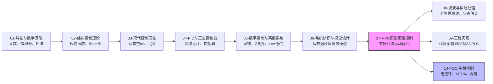
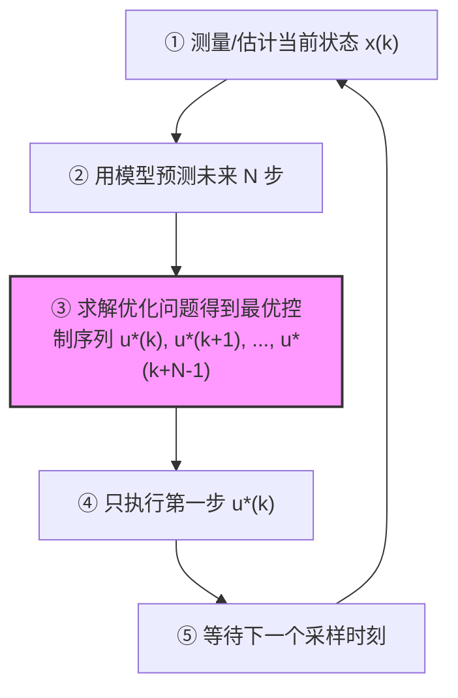

# 图解入门：MPC就像下棋想三步

> **目标**：用直觉和类比建立对模型预测控制（Model Predictive Control, MPC）的宏观理解，不需要任何数学推导。读完之后，你应该能向一位同事用一句话解释MPC是什么，并画出它的核心工作流程图。

---

## 核心认知锚点

> **MPC 是"有限实现与局部分析"层级的集大成者：它把连续系统的复频域分析（拉普拉斯/Z）压缩到有限时域的滚动优化中，在数字控制器的每一个采样周期里实时求解"未来有限步"的最优策略。**

如果你理解了 [[01-Foundations/05-信号与系统/000-信号与系统|05-信号与系统]] 中 $s = j\omega$ 把频率响应从复平面切出来，理解了 [[15-双控（控制理论与控制工程）/05-数字控制与离散系统/000-图解入门：数字控制与模拟控制的区别|05-数字控制与离散系统]] 中 $z = e^{sT}$ 把连续模态映射到离散极点，那么 MPC 就是这个映射链的**工程终点**——它用这些工具在数字控制器里做实时决策。

---

### 为什么学这个模块？

在双控微专业的"变换链"中，知识沿着三条主线展开：

| 层级 | 代表工具 | 回答的核心问题 |
|------|----------|---------------|
| 全局频率表示 | 傅里叶级数/变换 | 信号里有哪些频率成分？ |
| 复域系统分析 | 拉普拉斯变换、Z变换 | 系统是否稳定/因果？极点在哪里？ |
| **有限实现与局部分析** | **MPC、数字滤波、状态观测器** | **在有限的计算资源和采样周期内，如何做出最优控制决策？** |

MPC 之所以位于这个链条的末端，是因为：

- 它依赖**离散时间状态空间模型**（由 Z 域/差分方程描述，源自 $z = e^{sT}$ 的连续→离散映射）
- 它在**有限预测时域**内做优化（"有限实现"的典型特征）
- 它在**每个采样时刻**重新计算（数字控制器的实时性约束）
- 它天然处理**约束**（如电机电流上限、电压饱和），这是纯频域方法无法直接做到的

---

### 与前后模块的关系



**知识流向说明**：

- **从 05-数字控制 流入**：MPC 的预测模型是离散时间状态空间 $x(k+1) = Ax(k) + Bu(k)$，它来自对连续系统的 ZOH 离散化。没有 $z = e^{sT}$ 的映射认知，就无法理解为什么连续极点 $s$ 会映射到离散极点 $z$，也无法正确选择采样周期。
- **从 06-系统辨识 流入**：MPC 的名字里就有"模型"二字。如果模型不准，预测就失真，优化出的控制序列会系统性地偏离最优。系统辨识提供了从实验数据获取 $A, B, C, D$ 的方法。
- **向 08-滤波 流出**：MPC 需要状态反馈。当状态无法全部测量时（如电机速度需要差分编码器信号），需要卡尔曼滤波器或 Luenberger 观测器来估计状态。
- **向 14-FOC 流出**：[[14-FOC-电机控制/00-README|14-FOC-电机控制]] 中的 PI 电流环、速度环、MTPA 轨迹跟踪、弱磁控制——这些都可以被 MPC 统一替代。MPC 能在一次优化中同时处理 d-q 轴电流耦合、电压约束、转矩最大化，这是传统级联 PI 无法做到的。
- **向 09-工程实现 流出**：MPC 每步求解 QP，需要理解定点/浮点运算、实时调度、代码优化。

---

### 与 FOC 的直接关联

如果你已经学过 [[14-FOC-电机控制/00-README|14-FOC-电机控制]]，MPC 是**把 FOC 中"分散的 PI 环"升级为"统一的多变量优化器"**的钥匙：

| FOC 中的问题 | 传统 PI 的局限 | MPC 的解决方案 |
|-------------|--------------|---------------|
| d-q 轴电流耦合 | 两个独立 PI 环，靠前馈解耦 | 统一优化 $i_d, i_q$，自然处理耦合 |
| 电流/电压约束 | 靠外部限幅，易积分饱和 | 直接嵌入 QP 的不等式约束 |
| MTPA 轨迹跟踪 | 查表 + 前馈，离线设计 | 在线优化，自适应不同工况 |
| 弱磁区过渡 | 切换逻辑复杂，易抖动 | 约束自动处理电压边界，平滑过渡 |

> 一句话：**FOC 教你"怎么让电机转"，MPC 教你"怎么让电机转得最优"——在有限计算、有限采样、有约束的条件下。**

---

## 一、直觉引入：MPC与下棋的共同之处

想象一下你在下围棋或象棋。高手不会只看当前这一步，而是会**往前看**："如果我走这里，对方最可能走哪里？我再下一步又该如何应对？" 这种"想三步"的思维方式，正是MPC的灵魂。

> **与变换链的关系**：在[[15-双控（控制理论与控制工程）/02-经典控制理论/000-图解入门：从根轨迹到Bode图|02-经典控制理论]]中，我们用 $H(s)$ 在复平面上分析系统稳定性（"复域系统分析"层）；在[[15-双控（控制理论与控制工程）/05-数字控制与离散系统/000-图解入门：数字控制与模拟控制的区别|05-数字控制与离散系统]]中，用 $z = e^{sT}$ 把连续系统映射到离散域。MPC 则是**站在这些分析结果的肩膀上**，在数字控制器的每个采样周期里，用离散模型做"有限步"的前瞻优化——这就是"有限实现与局部分析"层的核心工程方法。

在传统控制（如PID）中，控制器就像一个只根据**当前误差**做出反应的人：

- 水温高了？→ 关小加热功率
- 小车偏右了？→ 往左打方向
- 电机慢了？→ 增大电压

PID只关注**现在**的偏差，不直接考虑**未来**会发生什么。这在很多简单系统上工作得很好，但遇到以下情况就会力不从心：

| 场景 | PID的困境 | MPC的解决思路 |
|------|----------|-------------|
| 小车需要停在目标点，但不能冲过头 | PID比例大则超调，比例小则响应慢 | 提前减速，精确规划轨迹 |
| 两个阀门同时调节温度和压力 | 单回路PID会互相耦合打架 | 统一优化，协调多个执行器 |
| 电机电流不能超过安全阈值 | PID突加负载时可能瞬间过流 | 在优化中直接加入电流上限约束 |
| 无人机需要绕过障碍物 | PID看不到障碍物，只能碰撞后修正 | 预测未来轨迹，提前规划绕行 |

**MPC的核心理念**：在每一个控制时刻，用一个**数学模型**预测系统未来一段时间的行为，然后**求解一个优化问题**，选出最优的控制序列，但只执行序列中的**第一步**，下一个时刻重新再来一遍。

---

## 二、MPC的"三步走"：预测、优化、执行

MPC的在线循环可以用以下流程图表示：



> 上图是整个MPC最核心的循环。步骤③中的优化问题是MPC的"大脑"，而步骤⑤的"重新测量→重新优化"是MPC的"滚动时域"机制。

让我们用一个具体例子——**小车定点停车**——来理解这三步。

**物理场景**：一辆质量为 $m = 1\,\text{kg}$ 的小车在一维轨道上运动，位置为 $s$，速度为 $v$，通过施加力 $F$ 控制。目标是从初始位置 $s_0 = 10\,\text{m}$ 出发，停在 $s = 0$。

**第一步：预测**

在 $k = 0$ 时刻，假设系统测得 $s = 10, v = 0$。MPC有一个模型（可以简单到牛顿定律）：

$$s(k+1) = s(k) + T_s \cdot v(k)$$
$$v(k+1) = v(k) + \frac{T_s}{m} \cdot F(k)$$

取采样周期 $T_s = 0.1\,\text{s}$，预测时域 $N = 10$ 步。MPC会问自己：

> "如果我施加一组力 $F(0), F(1), ..., F(9)$，未来10步内小车的位置和速度会是多少？"

通过递推计算，可以得到一条预测的轨迹。例如，假设一直施加 $F = -1\,\text{N}$：

| 时间步 $k$ | 位置 $s$ (m) | 速度 $v$ (m/s) | 力 $F$ (N) |
|-----------|-------------|---------------|-----------|
| 0 | 10.00 | 0.00 | -1.00 |
| 1 | 10.00 | -0.10 | -1.00 |
| 2 | 9.99 | -0.20 | -1.00 |
| ... | ... | ... | ... |
| 10 | 9.55 | -1.00 | -1.00 |

这个预测告诉我们：一直施加 $-1\,\text{N}$ 的力，小车会减速并向左移动，但10步后（1秒）还在 $s = 9.55\,\text{m}$ 附近，没有完全停下。这不是最优的。

**第二步：优化**

MPC不会随便猜一组力，而是**求解一个数学优化问题**。直观地说，它在寻找一组力序列，使得：

1. 小车尽快到达 $s = 0$
2. 到达时速度尽量接近0
3. 使用的力不要太大（节能、平滑）
4. 力不能超过电机最大输出（约束）

优化后的力序列可能是：先施加较大的负力减速，然后逐渐减小力的幅值，最后微调使速度归零。这就像一个经验丰富的司机踩刹车：先重踩，再缓松，最后平稳停下。

**第三步：执行**

优化给出了一组理想的力 $F^*(0), F^*(1), ..., F^*(9)$。MPC**只执行第一步** $F^*(0)$，然后把小车推进到 $k = 1$ 时刻。在 $k = 1$ 时刻，重新测量位置和速度，再次预测、优化、执行第一步。这个过程不断滚动，就像车轮一样向前。

**Python演示：MPC滚动循环的骨架**

```python
# mpc_rolling_horizon_skeleton.py
import numpy as np

def mpc_controller(x_current, model, horizon, weights):
    """
    MPC controller: predict, optimize, return first control.
    """
    # Step 1: Predict future trajectories for candidate control sequences
    # Step 2: Solve optimization (simplified: brute-force or QP)
    # Step 3: Extract first control input
    u_optimal_sequence = optimize_control_sequence(x_current, model, horizon, weights)
    return u_optimal_sequence[0]

# Main loop
x = np.array([10.0, 0.0])  # initial state [position, velocity]
for k in range(100):
    u = mpc_controller(x, model=double_integrator, horizon=10, weights=Q_R)
    x = model_update(x, u)  # apply first control and propagate
    # next iteration: re-measure, re-optimize, re-apply
```

> 这段代码是MPC的骨架：核心逻辑就是**预测→优化→执行第一步→滚动**。实际实现中，`optimize_control_sequence` 会调用QP求解器或显式查表。

---

## 三、MPC vs. PID vs. LQR：控制策略的进化

为了理解MPC的定位，我们用一张对比表总结三种主流控制方法的区别。

| 特性 | PID | LQR | MPC |
|------|-----|-----|-----|
| 反馈形式 | 基于当前误差 | 基于状态线性反馈 $u = -Kx$ | 在线优化求解 |
| 预测未来 | 否 | 否（离线设计时隐含） | 是（核心机制） |
| 处理约束 | 困难（靠抗饱和等补丁） | 否（无约束最优） | 天然支持（核心优势） |
| 多变量协调 | 靠解耦或配对 | 支持（通过加权矩阵） | 支持（统一优化） |
| 计算量 | 极小 | 极小（离线求K） | 较大（每步求解QP） |
| 稳定性保证 | 经验/调参 | 理论保证（Riccati方程） | 理论保证（终端代价/约束） |
| 典型应用 | 工业单回路 | 航空航天 | 过程控制、机器人、汽车 |

**关键洞察**：MPC可以看作LQR的"带约束在线版本"。如果你把MPC的约束去掉，预测时域设得足够长，在某些情况下MPC的解会退化成LQR的静态反馈律。但正是**约束**和**在线重优化**让MPC在工业界无可替代。

> **与变换链的关系**：LQR 在"复域系统分析"层通过 Riccati 方程离线设计静态反馈律 $u = -Kx$，对应于 $s$ 域或 $z$ 域的极点配置。MPC 则把这个离线设计**在线化**——它在 $z$ 域的离散状态空间上，每步重新求解一个有限时域优化，把 $z$ 域的稳定性洞察（极点位置、收敛速度）转化为实时控制动作。对于 [[14-FOC-电机控制/00-README|14-FOC-电机控制]] 的读者，这意味着：MPC 把 FOC 中"离线整定的 PI 参数"替换为"在线求解的最优控制律"，且能直接处理电流/电压约束。

---

## 四、MPC为什么需要"模型"？

MPC的名字里就有"模型"二字。这里的模型不是指3D CAD模型，而是指**描述系统输入如何影响输出的数学方程**。最简单的例子就是上面小车的牛顿定律模型。

> **与变换链的关系**：MPC 使用的模型通常是**离散时间状态空间** $x(k+1) = Ax(k) + Bu(k)$。它从何而来？从连续时间模型 $\dot{x} = A_c x + B_c u$ 通过**ZOH离散化**得到，其中 $A = e^{A_c T_s}$，而 $e^{A_c T_s}$ 的矩阵指数正是拉普拉斯逆变换 $\mathcal{L}^{-1}\{(sI - A_c)^{-1}\}$ 在 $t = T_s$ 处的取值。因此，MPC 的离散模型本质上是**连续复域分析结果在采样时刻的"快照"**——这就是 $z = e^{sT}$ 映射在工程中的直接体现。

模型的精度直接影响MPC的性能。想象一个场景：你告诉MPC"施加 $1\,\text{N}$ 的力，小车会在 $0.1\,\text{s}$ 后加速 $0.1\,\text{m/s}$"。但实际上轨道有摩擦力，力施加后只加速了 $0.08\,\text{m/s}$。如果MPC一直信任不准确的模型，它会系统地过度估计控制力，导致超调或振荡。

**好消息**：MPC的滚动优化机制天生具有一定的**鲁棒性**。即使模型有误差，下一个时刻重新测量、重新优化，会部分修正之前的偏差。但模型误差太大时，MPC的性能会显著下降。这就是为什么MPC通常与**系统辨识**（见[[15-双控（控制理论与控制工程）/06-系统辨识与模型估计/000-图解入门：如何用数据反推模型|06-系统辨识与模型估计]]）配合使用——先用数据建立准确模型，再上线MPC。

---

## 五、数值示例：预测轨迹的直观展示

让我们用一个更直观的数值例子说明MPC的预测能力。假设一个简化的一阶系统：

$$y(k+1) = 0.8 \, y(k) + 0.2 \, u(k)$$

当前 $y(0) = 0$，目标 $y_{ref} = 1$。用MPC预测未来 $N = 5$ 步，控制时域 $N_u = 2$（即 $u$ 在前2步自由变化，之后保持恒定）。

如果假设 $u = 1$ 恒定：

| $k$ | $y(k)$ | $u(k)$ |
|-----|--------|--------|
| 0 | 0.00 | 1.00 |
| 1 | 0.20 | 1.00 |
| 2 | 0.36 | 1.00 |
| 3 | 0.49 | 1.00 |
| 4 | 0.59 | 1.00 |
| 5 | 0.67 | 1.00 |

MPC的优化器会寻找更好的 $u$ 序列。例如，优化可能给出：先给一个较大的 $u$ 使输出快速上升，然后减小 $u$ 避免超调。假设优化结果是 $u^*(0) = 1.5, u^*(1) = 0.6$：

| $k$ | $y(k)$ | $u(k)$ |
|-----|--------|--------|
| 0 | 0.00 | 1.50 |
| 1 | 0.30 | 1.50 |
| 2 | 0.54 | 0.60 |
| 3 | 0.67 | 0.60 |
| 4 | 0.74 | 0.60 |
| 5 | 0.79 | 0.60 |

对比两表，优化后的 $u$ 序列在初期更快地推高了 $y$，但代价是控制输入变化更剧烈。这正是MPC优化的本质：**在跟踪性能与控制代价之间寻找平衡**。

---

## 六、常见错误与纠正

### 错误1：把MPC当作"超前控制"或"史密斯预估器"

**错误认识**：有些人认为MPC就是"提前看一下未来误差，然后做个补偿"，类似于前馈或史密斯预估。

**纠正**：MPC不是简单的前馈补偿。它是一个**在线优化器**，在每一步都重新求解一个完整的有限时域最优控制问题。前馈和史密斯预估是开环结构的补丁，而MPC是闭环的、基于模型的、滚动优化的框架。两者的数学本质完全不同。

### 错误2：认为"预测时域越长越好"

**错误认识**：既然MPC能预测未来，那把预测时域 $N$ 设得很大，控制器就能看得更远、更聪明。

**纠正**：过长的预测时域会带来几个问题：
1. **计算量爆炸**：优化问题的规模随 $N$ 线性增长，实时性恶化；
2. **模型误差累积**：预测越远，模型误差越会放大，导致优化结果不可靠；
3. **数值病态**：某些系统的离散化矩阵在高次幂下会出现数值问题。

工程上，$N$ 通常选择为系统主导时间常数的 $5 \sim 20$ 倍（以采样周期为单位）。例如，若系统 settling time 约为 $2\,\text{s}$，采样周期 $T_s = 0.1\,\text{s}$，则 $N \approx 20 \sim 40$ 是合理的起点。

---

## 七、自测习题

**习题1**：MPC在每一步优化后，为什么只执行控制序列的第一步，而不是把优化出的整个序列全部执行完？

> **答案**：因为在 $k$ 时刻优化所用的模型和测量值是基于当前状态的。如果执行完整个序列，后面几步的实际状态必然与预测产生偏差。执行第一步后重新测量、重新优化，能利用最新反馈信息修正预测误差，这是MPC的核心机制——**滚动时域反馈校正**。

**习题2**：PID控制器难以直接处理"控制量不能超过某个最大值"这类约束，MPC是如何天然支持这类约束的？

> **答案**：MPC在每一步求解的优化问题中，可以把约束直接写成不等式条件（如 $u_{min} \le u(k) \le u_{max}$）。优化求解器在寻找最优解时，会自动保证这些约束被满足。而PID没有优化框架，只能通过外部限幅（clamping）等补丁方式近似处理，且可能导致积分饱和等问题。

**习题3**：为什么说MPC需要一个好的模型？如果模型不准确，MPC一定会失败吗？

> **答案**：MPC的优化完全基于模型的预测。模型越准确，预测越可靠，优化出的控制序列越有效。但模型有误差时，MPC的滚动重优化机制提供了一定的容错能力：下一个时刻重新测量真实状态，可以在一定程度上修正模型误差带来的偏差。然而，如果模型误差过大（如增益偏差超过30%或动态特性严重不匹配），MPC性能会显著下降，甚至不稳定。因此，工业MPC通常配合在线辨识或自适应机制。

---

## 八、小结与进阶路径

本文通过"下棋想三步"的类比，建立了MPC的直觉理解：

- **预测**：用模型推演未来轨迹；
- **优化**：寻找最优控制序列；
- **滚动**：只执行一步，然后重新测量、重新优化。

> 在统一框架中，MPC 是**从"复域分析"走向"有限实现"的桥梁**：它把拉普拉斯/Z 变换提供的系统洞察（稳定性、极点位置）转化为数字控制器在每个采样周期内的实时决策。

从下一篇开始，我们将逐步深入：

1. [[001-MPC的滚动时域优化思想]] — 数学化描述滚动时域，引入预测时域、控制时域、反馈校正；
2. [[002-预测模型与代价函数]] — 状态空间模型、代价函数中 $Q, R, P$ 的物理意义；
3. [[003-约束处理与QP求解器]] — 把MPC写成标准二次规划，了解求解器原理；
4. [[004-显式MPC与实时性]] — 离线求解、在线查表，让MPC跑在毫秒级控制器上；
5. [[005-MPC应用案例]] — 倒立摆、无人机、过程控制等完整案例（含 [[14-FOC-电机控制/00-README|14-FOC-电机控制]] 中的 MPC 电流环设计）；
6. [[006-CasADI与acados实现]] — 用现代工具链实现高效NMPC。

**进阶提示**：学习 MPC 时，每看到一个公式，都问自己三个问题：
- 这个模型是从哪个连续系统通过 $z = e^{sT}$ 映射来的？
- 这个"有限时域"是对无穷时域的哪种近似？
- 这个约束在 [[14-FOC-电机控制/00-README|14-FOC-电机控制]] 中对应哪个物理限制（电流上限？电压饱和？）？
