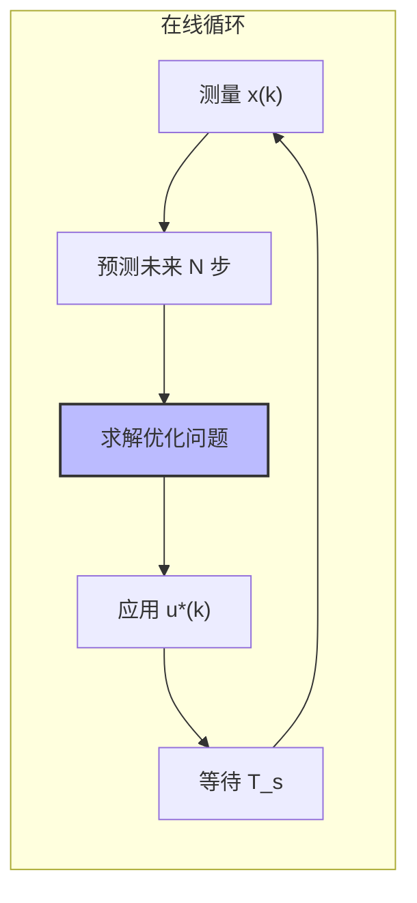
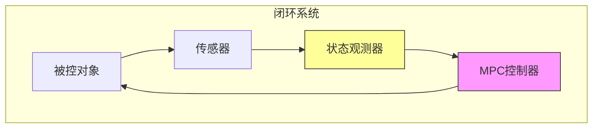

# MPC的滚动时域优化思想

> **目标**：将MPC的直觉转化为严格的数学描述。读完之后，你应该能写出MPC的滚动时域算法流程，理解预测时域 $N$、控制时域 $N_u$、反馈校正的作用，并能用手算或代码验证一个简单的双积分系统。

---

## 核心认知锚点

> **滚动时域优化是"有限实现"思想在控制中的极致体现：它把无穷时域的最优控制问题（对应于 $z$ 域上的无穷级数）截断为有限时域，在每个采样时刻用最新状态重新求解，用反馈校正弥补截断带来的信息损失。**

如果你理解了 [[15-双控（控制理论与控制工程）/05-数字控制与离散系统/000-图解入门：数字控制与模拟控制的区别|05-数字控制与离散系统]] 中 $z = e^{sT}$ 把连续系统映射到离散域，那么 MPC 的滚动时域就是在这个离散域上，把**无穷时域的最优控制**（理论上需要知道未来所有时刻的状态）替换为**有限时域的近似最优**（只往前看 $N$ 步），并通过**在线重新优化**来不断修正近似误差。

---

### 与变换链的关系

本文讨论的所有公式都建立在**离散时间状态空间** $x(k+1) = Ax(k) + Bu(k)$ 之上。这个模型不是凭空出现的——它是 [[15-双控（控制理论与控制工程）/05-数字控制与离散系统/000-图解入门：数字控制与模拟控制的区别|05-数字控制与离散系统]] 中连续系统 ZOH 离散化的直接结果：

- 连续系统极点 $s_p$ 通过 $z = e^{sT}$ 映射到离散极点 $z_p = e^{s_p T}$
- 连续系统的稳定性（$\Re(s_p) < 0$）对应离散系统的稳定性（$|z_p| < 1$）
- DARE 给出的 $P$ 是无穷时域 LQR 的值函数矩阵。在满足稳定化、可检测等条件并配合相应终端控制律时，它可用于构造稳定的终端设计；仅加入终端代价并不能单独保证受约束 MPC 稳定

> **一句话：MPC 不是独立于变换链的新工具，而是 Z 域分析在"有限计算、实时约束"条件下的工程化实现。**

---

## 一、从开环优化到闭环控制

上一篇我们用"下棋想三步"建立了直觉。现在让我们把这个想法精确化。

**开环最优控制问题**：给定一个离散时间系统

$$x(k+1) = A x(k) + B u(k)$$

和初始状态 $x(0)$，寻找一个控制序列 $u(0), u(1), ..., u(N-1)$ 使某个代价函数 $J$ 最小。这是**一次性**的优化，优化出的序列直接执行，中间不再调整。如果模型完美且没有扰动，开环最优就是完美的。但现实中扰动无处不在，模型永远不完美。

> **与变换链的关系**：这个离散时间状态方程 $x(k+1) = Ax(k) + Bu(k)$ 对应于 $z$ 域中的 $(zI - A)X(z) = BU(z)$，即系统的传递函数为 $H(z) = C(zI - A)^{-1}B + D$。MPC 的优化不是在这个传递函数上做频域设计，而是直接在时域（差分方程）上推演未来轨迹——这是"有限实现"层的方法论特征：不追求全局解析解，追求有限步内的数值最优解。

**MPC的闭环思想**：不执行整个优化序列，而是只执行第一步，在下一个时刻重新测量状态，重新求解优化问题。这样，每次优化都基于**最新的真实状态**，而不是基于 $k = 0$ 时刻的旧预测。

这就像一个领航员在雾中驾船：他计划了一条航线，但每航行一小段，就重新确认位置和风向，然后修正剩余航线。而不是在出发时定好航线后就闭眼开到底。

---

## 二、滚动时域的数学描述

考虑一个线性离散时间系统：

$$x(k+1) = A x(k) + B u(k)$$
$$y(k) = C x(k) + D u(k)$$

其中 $x \in \mathbb{R}^{n_x}$ 是状态，$u \in \mathbb{R}^{n_u}$ 是输入，$y \in \mathbb{R}^{n_y}$ 是输出。

在时刻 $k$，测得（或估计得）状态 $x(k)$。MPC求解以下有限时域最优控制问题：

$$\min_{u(k), ..., u(k+N-1)} J = \sum_{i=0}^{N-1} \left[ \| y(k+i) - y_{ref}(k+i) \|_Q^2 + \| u(k+i) - u_{ref}(k+i) \|_R^2 \right] + \| x(k+N) - x_{ref}(k+N) \|_P^2$$

subject to:

$$x(k+i+1) = A x(k+i) + B u(k+i), \quad i = 0, 1, ..., N-1$$
$$u_{min} \le u(k+i) \le u_{max}, \quad i = 0, 1, ..., N_u - 1$$
$$x_{min} \le x(k+i) \le x_{max}, \quad i = 1, 2, ..., N$$

其中：

- $N$：预测时域（Prediction Horizon），预测未来 $N$ 步的系统行为；
- $N_u$：控制时域（Control Horizon），前 $N_u$ 步的控制输入自由优化，之后通常假设 $u(k+i) = u(k+N_u-1)$（恒定保持）或 $u(k+i) = K x(k+i)$（终端反馈）；
- $Q, R, P$：权重矩阵，分别 penalize 输出误差、控制量、终端状态误差；
- $y_{ref}$：参考输出轨迹（可以随时间变化，支持跟踪问题）。

> **与变换链的关系**：这个代价函数中的求和项 $\sum_{i=0}^{N-1}$ 是**有限时域**的——它截断了无穷时域的代价 $J_{\infty} = \sum_{i=0}^{\infty} [\|y - y_{ref}\|_Q^2 + \|u - u_{ref}\|_R^2]$。如果 $N \to \infty$ 且系统稳定，这个有限求和会收敛到某个无穷级数，对应于 $z$ 域中围绕单位圆的围线积分。但工程上我们无法计算无穷求和，所以用"有限时域 + 终端代价 $P$"来近似。终端代价 $P$ 通常取 DARE 的解，它把无穷时域的"尾部"折叠进了有限时域的末端。

**滚动时域算法**：



---

## 三、预测时域 $N$ 与控制时域 $N_u$ 的选取

这两个参数是MPC调参中最关键的。

**预测时域 $N$**

$N$ 决定了MPC往前看多远。如果 $N$ 太小，控制器可能过于短视，例如为了快速接近目标而采取激进动作，导致后续不稳定。如果 $N$ 太大，优化问题变大，计算时间增加，且模型误差在远端预测中被放大。

**经验法则**：$N$ 应覆盖系统的主要动态响应。具体而言，如果闭环系统的期望调节时间（settling time）为 $T_s^{settle}$，则

$$N \approx \frac{T_s^{settle}}{T_s} \times (5 \sim 10)$$

例如，一个直流电机的机械时间常数约为 $0.5\,\text{s}$，若 $T_s = 0.01\,\text{s}$，则 $N \approx 50 \sim 100$。

> **与变换链的关系**：从 $z$ 域角度看，$N$ 的选取相当于在复平面上"往前看多远"。系统的离散极点 $z_p = e^{s_p T}$ 决定了模态的衰减速度：$|z_p|$ 越接近 1（对应 $\Re(s_p)$ 接近 0），衰减越慢，需要更大的 $N$ 才能覆盖主要动态。这正是为什么慢动态系统（如大惯性负载的电机）需要更长的预测时域。

**控制时域 $N_u$**

$N_u \le N$ 表示只有前 $N_u$ 个控制输入是自由变量。从第 $N_u$ 步开始，控制输入通常被假设为恒定或遵循某个固定律。这样可以减少优化变量数，降低计算负担。

| $N_u$ 较小 | $N_u$ 较大 |
|-----------|-----------|
| 计算量小 | 计算量大 |
| 控制动作更保守、平滑 | 控制动作更灵活、可能更激进 |
| 可能不足以应对快速变化 | 跟踪性能更好 |

工程上通常取 $N_u \approx 0.2 N \sim 0.3 N$。对于响应快速的过程，$N_u$ 可以取 $2 \sim 5$。

---

## 四、状态估计与反馈校正

MPC的优化从当前状态 $x(k)$ 开始。但很多时候，我们无法直接测量所有状态。例如，测量小车的位置容易（编码器），但精确测量速度可能较困难（需要差分或额外传感器）。这时需要**状态观测器**（如卡尔曼滤波器或Luenberger观测器）来估计状态。

> **与变换链的关系**：状态观测器可以看作在 $z$ 域上设计的一个滤波器：它用系统的输入输出历史来估计当前状态，其误差动态由观测器极点决定。在 [[15-双控（控制理论与控制工程）/08-滤波与信号处理在控制中的应用/000-图解入门：滤波器是控制系统的感官|08-滤波与信号处理在控制中的应用]] 中，我们会深入讨论卡尔曼滤波器的频域解释。对于 [[14-FOC-电机控制/00-README|14-FOC-电机控制]] 的读者，电机控制中的速度估计（编码器差分、观测器）正是MPC所需的"状态观测器"的同一类工具。

**观测器-MPC结构**：



**反馈校正的重要性**：即使模型准确，外部扰动（如风吹、负载突变）也会使实际状态偏离预测。滚动时域机制通过重新测量来部分修正这些偏差，但观测器的精度直接影响MPC的"眼睛"是否清晰。

如果观测器收敛慢，MPC可能在很长一段时间内基于错误的状态估计做决策，导致性能下降甚至不稳定。因此，观测器带宽通常设计得比MPC闭环带宽快 $5 \sim 10$ 倍。

> **FOC 关联**：在 [[14-FOC-电机控制/00-README|14-FOC-电机控制]] 的无传感器控制中，速度/位置观测器（如滑模观测器、扩展卡尔曼滤波器）的带宽设计遵循同样的原则：观测器必须比控制环快得多，否则MPC会基于滞后的状态估计做出错误决策。对于 PMSM，观测器通常运行在 $5 \sim 10\,\text{kHz}$，而MPC控制环可能在 $1 \sim 2\,\text{kHz}$，满足 $5 \sim 10$ 倍的关系。

---

## 五、数值示例：双积分系统的滚动MPC

**系统模型**：小车位置控制，双积分系统

$$x = \begin{bmatrix} s \\ v \end{bmatrix}, \quad x(k+1) = A x(k) + B u(k)$$

取 $T_s = 0.1\,\text{s}$，离散化后：

$$A = \begin{bmatrix} 1 & 0.1 \\ 0 & 1 \end{bmatrix}, \quad B = \begin{bmatrix} 0.005 \\ 0.1 \end{bmatrix}$$

参数：$N = 10$, $N_u = 3$, $Q = \text{diag}(1, 0.1)$, $R = 0.01$。约束：$|u| \le 2$。

> **与变换链的关系**：这个离散矩阵 $A$ 来自连续双积分器 $\dot{x} = A_c x + B_c u$ 的 ZOH 离散化，其中 $A_c = \begin{bmatrix} 0 & 1 \\ 0 & 0 \end{bmatrix}$。特征值 $s_1 = s_2 = 0$（连续域原点处的重极点）映射到 $z_1 = z_2 = e^{0 \cdot T_s} = 1$。离散系统的极点在单位圆上（临界稳定），这正是为什么需要MPC的约束来限制控制输入，防止系统发散。如果约束去掉，这个系统会在有限控制输入下持续加速。

**MATLAB实现（无约束版本，直观理解）**：

```matlab
% mpc_receding_horizon_demo.m
% Double integrator MPC with receding horizon

% System parameters
Ts = 0.1;           % sampling time [s]
A = [1, Ts; 0, 1];
B = [Ts^2/2; Ts];
Q = diag([1, 0.1]); % state weight
R = 0.01;           % input weight
N = 10;             % prediction horizon
Nu = 3;             % control horizon

% Initial state
x = [10; 0];        % s = 10 m, v = 0 m/s
x_ref = [0; 0];     % target: stop at origin

% Simulation
T_sim = 50;         % 50 steps = 5 seconds
x_hist = zeros(2, T_sim+1);
u_hist = zeros(1, T_sim);
x_hist(:,1) = x;

for k = 1:T_sim
    % Build prediction matrices for batch formulation
    % This is a simplified unconstrained version for illustration
    
    % Solve using dynamic programming / Riccati-like approach for demo
    % In practice, use quadprog or custom QP solver for constrained case
    
    % For this demo, use finite-horizon LQR to compute optimal control
    P = Q;
    K = cell(1, N);
    for i = N:-1:1
        K{i} = inv(R + B'*P*B) * B'*P*A;
        P = Q + A'*P*A - A'*P*B*inv(R + B'*P*B)*B'*P*A;
    end
    
    % Apply first control from the policy (simplified)
    u = -K{1} * (x - x_ref);
    
    % Input saturation (simple clipping for demo)
    u = max(min(u, 2), -2);
    
    % Apply control and propagate
    x = A*x + B*u;
    x_hist(:,k+1) = x;
    u_hist(k) = u;
end

% Plot results
figure;
subplot(3,1,1);
plot(0:Ts:Ts*T_sim, x_hist(1,:), 'b-', 'LineWidth', 1.5);
hold on; yline(0, 'r--'); xlabel('Time [s]'); ylabel('Position [m]');
title('MPC Receding Horizon: Position'); grid on;

subplot(3,1,2);
plot(0:Ts:Ts*T_sim, x_hist(2,:), 'b-', 'LineWidth', 1.5);
hold on; yline(0, 'r--'); xlabel('Time [s]'); ylabel('Velocity [m/s]');
title('MPC Receding Horizon: Velocity'); grid on;

subplot(3,1,3);
stairs(0:Ts:Ts*(T_sim-1), u_hist, 'b-', 'LineWidth', 1.5);
hold on; yline(2, 'r--'); yline(-2, 'r--'); xlabel('Time [s]'); ylabel('Force [N]');
title('MPC Receding Horizon: Control Input'); grid on;
```

运行上述代码，你会看到：位置从 $10\,\text{m}$ 平滑下降，速度先负向增大（向左加速），然后负向减小（向左减速），最后在 $0$ 附近稳定。控制力在初期达到饱和上限 $2\,\text{N}$，然后逐渐减小到接近0。这就是MPC的"先全力减速，再微调"策略。

> **FOC 关联**：这个"双积分器"模型与 [[14-FOC-电机控制/00-README|14-FOC-电机控制]] 中的机械子系统完全一致：如果 $s$ 是电机转子角度，$v$ 是转速，$u$ 是电磁转矩，那么这个模型就是 PMSM 的机械运动方程。在 FOC 中，速度环 PI 控制器试图把转速调到参考值，但 PI 看不到未来的位置误差；MPC 则能同时优化角度和转速，并直接处理转矩约束（电流上限对应转矩上限）。

---

## 六、稳定性与递归可行性

MPC的稳定性不是自动保证的。开环最优控制问题在有限时域 $N$ 内的最优解，不一定保证闭环稳定。为此，MPC理论引入了**终端条件**来确保稳定性：

1. **终端代价（Terminal Cost）**：在代价函数中加入终端惩罚项 $\|x(k+N)\|_P^2$，$P$ 可取局部无穷时域 LQR 的 Riccati 解。它用于近似预测时域之后的尾部代价，但单独加入该项通常不足以证明受约束 MPC 的闭环稳定性。

> **与变换链的关系**：DARE 的稳定化解 $P_{\infty}$ 给出无穷时域 LQR 的二次型值函数 $V(x)=x^T P_{\infty}x$。有限时域 MPC 采用它作为终端代价，是用局部 LQR 值函数近似预测时域之后的剩余代价。严格稳定性还需要检查终端集合、终端控制律、递归可行性以及模型和约束条件，不能由 $P_{\infty}$ 单独推出。

2. **终端约束（Terminal Constraint）**：要求 $x(k+N)$ 落在某个终端集 $\mathbb{X}_f$ 内。这个终端集通常设计为不变集，确保一旦进入，系统可以在无约束LQR控制下保持收敛。

3. **终端反馈（Terminal Controller）**：在预测时域末端，假设控制律切换为 $u = K_{LQR} x$，其中 $K_{LQR}$ 是LQR的稳态增益。

**工程实践**：对某些开环稳定、约束温和的系统，长预测时域且没有严格终端集的控制器也可能在目标工作区表现稳定，但这属于需要分析或仿真验证的设计选择，不能由“时域足够长”直接推出稳定性。对开环不稳定或约束紧的系统，更应明确递归可行性与 Lyapunov 下降条件。

> **FOC 关联**：若为 PMSM 电流 MPC 构造了控制不变终端集、可行的局部反馈律和满足下降条件的终端代价，便可把“预测时域以后仍有可行稳定控制”纳入证明。缺少这些条件时，只能通过闭环仿真、参数摄动和硬件限幅测试评估，不能笼统保证第 $N+1$ 步后的电流不发散。

---

## 七、常见错误与纠正

### 错误1：混淆预测时域和控制时域，设 $N_u = N$ 而不自知

**错误表现**：初学者常常设 $N_u = N$，即所有 $N$ 步的控制输入都自由优化。这导致优化变量过多，求解时间增加，且控制律在远端可能过于激进（因为远端控制对当前代价影响小，优化器可能给不合理的值）。

**纠正**：明确区分 $N$ 和 $N_u$。$N$ 是预测长度，$N_u$ 是自由优化长度。通常 $N_u \ll N$。在远端施加控制约束（如 $u$ 恒定或LQR反馈），既减少计算量，又改善数值稳定性。

### 错误2：忽略反馈校正，把MPC当作"一次性离线轨迹优化"

**错误表现**：有人离线优化出一条控制轨迹，然后在实际系统中直接播放这条轨迹，不在线重新优化。这本质上不是MPC，而是开环最优控制。

**纠正**：MPC的核心在于**在线滚动**。如果硬件算力不足以支持在线QP求解，可以考虑**显式MPC**（见[[004-显式MPC与实时性]]），即离线求解并把控制律做成查表。但即便如此，也是在每个采样时刻查表，而不是播放固定轨迹。开环轨迹在模型误差或扰动下会严重偏离预期。

---

## 八、自测习题

**习题1**：为什么MPC采用"滚动时域"机制？它与开环最优控制有什么区别？

> **答案**：开环最优控制一次性求解整个控制序列并执行，不利用运行过程中获得的新的状态信息。而MPC只执行优化序列的第一步，在下一个时刻重新测量状态，重新求解优化。这样，MPC能够利用反馈信息修正模型误差和外部扰动的影响，实现闭环鲁棒性。滚动时域是MPC从"计划"走向"自适应控制"的关键机制。

**习题2**：设某系统采样周期 $T_s = 0.05\,\text{s}$，其闭环期望调节时间约为 $1.5\,\text{s}$。建议的预测时域 $N$ 范围是多少？如果控制时域 $N_u$ 取得过大，会有什么后果？

> **答案**：$N \approx T_s^{settle}/T_s \times (5 \sim 10) = 1.5/0.05 \times (5 \sim 10) = 150 \sim 300$。但工程上通常取更保守的值，如 $N = 50 \sim 100$。如果 $N_u$ 过大，优化变量数增加，导致QP求解时间显著增加；同时，远端控制输入对当前代价影响很小，优化器可能给出不合理的剧烈控制动作，导致数值不稳定或控制品质下降。通常取 $N_u = 2 \sim 5$ 或 $N_u \approx 0.2 N$。

**习题3**：MPC需要状态反馈。如果状态无法全部测量，应该如何处理？观测器的设计速度应与MPC控制器本身有什么关系？

> **答案**：当状态不可全测时，需要使用状态观测器（如卡尔曼滤波器或Luenberger观测器）来估计状态，然后将估计值 $\hat{x}(k)$ 送入MPC优化器。观测器的收敛速度应显著快于MPC闭环系统的动态响应，通常建议观测器带宽是MPC闭环带宽的 $5 \sim 10$ 倍。如果观测器太慢，MPC会在状态估计存在较大误差的情况下做决策，导致性能下降甚至不稳定。

---

## 九、小结

本文将MPC的直觉翻译成了数学语言：

- **滚动时域**：只执行第一步，重新测量，重新优化；
- **预测时域 $N$** 与 **控制时域 $N_u$**：预测看多远，控制自由度有多少；
- **状态估计**：观测器为MPC提供"眼睛"；
- **终端条件**：保证闭环稳定性的理论工具。

> **与变换链的总结**：MPC 的数学描述完全建立在离散时间状态空间上。这个状态空间来自连续系统的 ZOH 离散化（$z = e^{sT}$ 的映射），代价函数的有限求和是对无穷 $z$ 域积分的时间截断，终端代价 $P$ 是对无穷时域"尾部"的折叠。MPC 不是独立的新理论，而是**在"有限计算"约束下，对经典复频域分析结果的在线工程化利用**。

下一篇，我们将深入MPC的核心数学构件——**预测模型**和**代价函数**，并展示它们如何与 [[14-FOC-电机控制/00-README|14-FOC-电机控制]] 中的电机模型对接。
