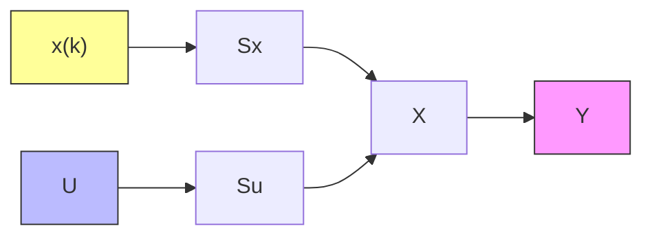

# 预测模型与代价函数

> **目标**：深入MPC的数学核心。读完之后，你应该能独立写出MPC的批量预测（batch prediction）矩阵，理解代价函数中 $Q, R, P$ 的物理意义，并能为一个具体系统选择合适的权重矩阵。包含完整的数值示例和Python/MATLAB代码。

---

## 核心认知锚点

> **预测模型与代价函数是MPC"有限实现"的两个数学支柱：预测模型回答"在有限时域内系统会怎么演化"，代价函数回答"什么才算最优"。两者都建立在离散状态空间 $z$ 域的基础上，是连续系统复频域分析在数字控制器中的工程化表达。**

如果你理解了 [[15-双控（控制理论与控制工程）/05-数字控制与离散系统/000-图解入门：数字控制与模拟控制的区别|05-数字控制与离散系统]] 中 $z = e^{sT}$ 的映射，那么预测模型 $x(k+1) = Ax(k) + Bu(k)$ 就是这个映射的时域表现；代价函数中的权重矩阵 $Q, R, P$ 则对应于 $z$ 域上对不同频率分量的"惩罚力度"——$Q$ 大意味着高频跟踪误差被严厉惩罚，$R$ 大意味着不希望控制量在高频变化剧烈。

---

### 与变换链的关系

本文讨论的两个核心数学对象——**预测模型**和**代价函数**——都不是孤立的工具，而是"变换链"的自然延伸：

| 变换链层级 | 对应工具 | 在MPC中的角色 |
|-----------|---------|--------------|
| 连续复频域 | $H(s)$, 拉普拉斯 | 建立被控对象的微分方程模型 |
| 离散映射 | $z = e^{sT}$, ZOH | 把连续模型转为 $x(k+1) = Ax(k) + Bu(k)$ |
| 有限实现 | 批量预测矩阵 $S_x, S_u$ | 把 $N$ 步递推写成矩阵乘法（有限计算） |
| 优化目标 | 代价函数 $J$, 权重 $Q, R, P$ | 把"最优"量化为二次型（凸优化） |

> **一句话：MPC 的数学核心不是发明新工具，而是把 Z 域已有的系统分析结果，用矩阵和二次型的形式组织成可实时求解的优化问题。**

---

## 一、状态空间模型作为预测基础

MPC的预测需要一个**离散时间状态空间模型**。对于线性系统：

$$x(k+1) = A x(k) + B u(k)$$
$$y(k) = C x(k) + D u(k)$$

其中 $A \in \mathbb{R}^{n_x \times n_x}$，$B \in \mathbb{R}^{n_x \times n_u}$，$C \in \mathbb{R}^{n_y \times n_x}$，$D \in \mathbb{R}^{n_y \times n_u}$。

如果原始模型是连续时间的：

$$\dot{x}(t) = A_c x(t) + B_c u(t)$$

需要通过离散化转换为离散时间形式。常用的**零阶保持（ZOH）**离散化：

$$A = e^{A_c T_s}, \quad B = \int_0^{T_s} e^{A_c \tau} B_c \, d\tau$$

> **与变换链的关系**：这里 $A = e^{A_c T_s}$ 是矩阵指数，而矩阵指数 $e^{A_c T_s}$ 可以通过拉普拉斯逆变换计算：$e^{A_c t} = \mathcal{L}^{-1}\{(sI - A_c)^{-1}\}\big|_{t=T_s}$。在 $z$ 域中，这个离散化等价于 $z = e^{sT}$ 的映射：连续系统的特征值 $s_i$（$A_c$ 的特征值）映射到离散特征值 $z_i = e^{s_i T_s}$（$A$ 的特征值）。因此，连续系统的稳定性（$\Re(s_i) < 0$）直接对应于离散系统的稳定性（$|z_i| < 1$）。
>
> **工程要点**：ZOH 离散化假设控制输入在一个采样周期内保持恒定，这与数字控制器中的 DAC 实际行为一致。如果你使用其他离散化方法（如双线性变换），会得到不同的 $A, B$，其极点映射关系也不同。对于控制应用，ZOH 通常是最准确的选择，因为它直接建模了"数字控制器输出→保持→被控对象"的物理过程。

对于简单系统（如 $A_c$ 为常数矩阵），可以用解析公式或MATLAB/Python的 `c2d` 函数。

---

## 二、批量预测公式：从递推到矩阵形式

MPC的优化求解器通常需要把预测轨迹写成**控制输入的线性函数**。这就是**批量预测（Batch Prediction）**技术。

从 $x(k)$ 出发，递推 $N$ 步：

$$x(k+1) = A x(k) + B u(k)$$
$$x(k+2) = A x(k+1) + B u(k+1) = A^2 x(k) + A B u(k) + B u(k+1)$$
$$x(k+3) = A^3 x(k) + A^2 B u(k) + A B u(k+1) + B u(k+2)$$
$$\vdots$$

把 $N$ 步的状态和输出堆叠成向量：

$$X = \begin{bmatrix} x(k+1) \\ x(k+2) \\ \vdots \\ x(k+N) \end{bmatrix}, \quad Y = \begin{bmatrix} y(k+1) \\ y(k+2) \\ \vdots \\ y(k+N) \end{bmatrix}, \quad U = \begin{bmatrix} u(k) \\ u(k+1) \\ \vdots \\ u(k+N-1) \end{bmatrix}$$

则批量预测公式为：

$$X = S_x x(k) + S_u U$$
$$Y = F x(k) + G U$$

其中：

$$S_x = \begin{bmatrix} A \\ A^2 \\ \vdots \\ A^N \end{bmatrix}, \quad S_u = \begin{bmatrix} B & 0 & \cdots & 0 \\ AB & B & \cdots & 0 \\ \vdots & \vdots & \ddots & \vdots \\ A^{N-1}B & A^{N-2}B & \cdots & B \end{bmatrix}$$

$$F = \begin{bmatrix} C A \\ C A^2 \\ \vdots \\ C A^N \end{bmatrix}, \quad G = \begin{bmatrix} C B + D & D & \cdots & D \\ C A B + C B & C B + D & \cdots & D \\ \vdots & \vdots & \ddots & \vdots \\ C A^{N-1}B + \cdots & C A^{N-2}B + \cdots & \cdots & C B + D \end{bmatrix}$$

> **关键洞察**：这个矩阵形式把未来的状态和输出完全表示为**当前状态** $x(k)$ 和**控制序列** $U$ 的线性函数。这意味着MPC的代价函数可以写成关于 $U$ 的二次函数，从而转化为标准的二次规划（QP）问题。
>
> **与变换链的关系**：从 $z$ 域角度看，递推 $x(k+1) = Ax(k) + Bu(k)$ 等价于在 $z$ 域中 $(zI - A)X(z) = BU(z)$。批量预测矩阵 $S_u$ 的结构——下三角分块矩阵——正是 $z$ 域传递函数 $(zI - A)^{-1}B$ 在时域中的脉冲响应矩阵。$S_u$ 的第 $i$ 行第 $j$ 列块对应于系统在第 $i-j$ 步的脉冲响应。因此，批量预测不是"新数学"，而是把 $z$ 域的卷积和写成了矩阵乘法形式，便于数值优化器处理。

**批量预测的结构化视图**：



> 其中 $X = [x(k+1),...,x(k+N)]^T$，$U = [u(k),...,u(k+N-1)]^T$，$Y = [y(k+1),...,y(k+N)]^T$。

---

## 三、代价函数设计：$Q, R, P$ 的物理意义

MPC的代价函数通常形如：

$$J = \sum_{i=0}^{N-1} \left[ (y(k+i) - y_{ref}(k+i))^T Q (y(k+i) - y_{ref}(k+i)) + (u(k+i) - u_{ref}(k+i))^T R (u(k+i) - u_{ref}(k+i)) \right] + (x(k+N) - x_{ref}(k+N))^T P (x(k+N) - x_{ref}(k+N))$$

> **与变换链的关系**：这个代价函数在 $z$ 域中对应于一个加权积分。如果 $N \to \infty$ 且系统稳定，求和收敛为 $J_{\infty} = \frac{1}{2\pi j} \oint_{|z|=1} [E_y^*(z) Q E_y(z) + E_u^*(z) R E_u(z)] \frac{dz}{z}$，其中 $E_y(z), E_u(z)$ 是输出误差和控制误差的 $z$ 变换。权重矩阵 $Q, R$ 决定了不同频率分量的"惩罚力度"：$Q$ 大意味着对跟踪误差敏感（高频响应快），$R$ 大意味着抑制控制量的高频变化（低通特性）。有限时域 $N$ 是对这个无穷积分的截断，而终端代价 $P$ 补偿了截断后的"尾部"。

**权重矩阵 $Q$**：惩罚输出误差。$Q$ 是对角矩阵（或半正定矩阵），对角元素越大，表示对应的输出分量越重要，控制器会更努力地让该输出跟踪参考值。

| $Q$ 元素大 | 输出跟踪更精准，但可能控制更剧烈 |
| $Q$ 元素小 | 输出跟踪较松，控制更平滑 |

**权重矩阵 $R$**：惩罚控制输入。$R$ 是正定矩阵，对角元素越大，表示越不希望控制输入变化剧烈。

| $R$ 元素大 | 控制动作保守、平滑，但响应慢 |
| $R$ 元素小 | 控制动作积极、响应快，但可能振荡 |

**终端权重 $P$**：惩罚终端状态误差。通常取无穷时域LQR的Riccati解，保证闭环稳定性。

> **FOC 关联**：在 [[14-FOC-电机控制/00-README|14-FOC-电机控制]] 的电流环中，$Q$ 对应于电流跟踪的权重（如 $Q = \text{diag}(Q_d, Q_q)$ 分别惩罚 $i_d$ 和 $i_q$ 的误差），$R$ 对应于控制电压的平滑性权重。在 FOC 中，PI 参数通过经验整定；在 MPC 中，$Q$ 和 $R$ 通过优化问题自动映射为最优控制律。对于 MTPA 控制，$Q$ 的相对大小可以反映"转矩最大化"的优先级：$Q_q > Q_d$ 意味着控制器更关注 $i_q$ 的跟踪精度（因为转矩正比于 $i_q$）。

---

## 四、终端代价与终端约束：稳定性的数学保证

有限时域MPC的闭环稳定性不是自动的。需要引入终端条件。

**终端代价（Terminal Cost）**：

取 $P = P_{\infty}$，其中 $P_{\infty}$ 满足离散时间代数Riccati方程（DARE）：

$$P_{\infty} = A^T P_{\infty} A + Q - A^T P_{\infty} B (R + B^T P_{\infty} B)^{-1} B^T P_{\infty} A$$

这相当于在有限时域代价中"嫁接"了无穷时域LQR的尾部代价，使得优化器在规划时不仅考虑近期表现，还隐含着长期稳定的考量。

> **与闭环极点的关系**：在 $(A,B)$ 可稳定、权重满足相应条件时，DARE 的稳定化解给出 $K_{LQR}=(R+B^TP_{\infty}B)^{-1}B^TP_{\infty}A$，并使 $A-BK_{LQR}$ 的极点位于单位圆内。MPC 把 $x_N^TP_{\infty}x_N$ 用作局部尾部代价；要把 LQR 的局部稳定性扩展为受约束 MPC 的稳定性，还需终端集、局部控制律、可行性和下降条件配合。

**终端约束（Terminal Constraint）**：

要求 $x(k+N) \in \mathbb{X}_f$，其中 $\mathbb{X}_f$ 是系统的**最大不变集**（Maximal Invariant Set）或**终端集**。在这个集合内，系统可以在无约束LQR控制律 $u = -K_{LQR} x$ 下保持可行且收敛到原点。

**工程简化**：某些开环稳定系统在长时域和适当权重下可省略显式终端约束并获得良好闭环表现，但“仅靠终端代价保证稳定”需要额外定理条件，不能作为通用结论。开环不稳定或约束紧的系统应显式分析终端可行性和递归可行性。

---

## 五、数值示例：倒立摆的MPC预测与代价函数

**物理模型**：倒立摆，线性化后在平衡点附近：

$$\dot{x} = A_c x + B_c u$$

其中 $x = [\theta, \dot{\theta}]^T$，$\theta$ 是摆角（rad），$u$ 是电机力矩（N·m）。取摆杆质量 $m = 0.1\,\text{kg}$，长度 $l = 0.5\,\text{m}$，重力加速度 $g = 9.81\,\text{m/s}^2$。

线性化后（小角度近似 $\sin\theta \approx \theta$）：

$$A_c = \begin{bmatrix} 0 & 1 \\ \frac{g}{l} & 0 \end{bmatrix} = \begin{bmatrix} 0 & 1 \\ 19.62 & 0 \end{bmatrix}, \quad B_c = \begin{bmatrix} 0 \\ \frac{1}{m l^2} \end{bmatrix} = \begin{bmatrix} 0 \\ 40 \end{bmatrix}$$

取 $T_s = 0.02\,\text{s}$，ZOH离散化（MATLAB `c2d`）：

> **与变换链的关系**：$A_c$ 的特征值是 $s = \pm \sqrt{g/l} = \pm 4.43\,\text{rad/s}$。正实部的极点 $s = +4.43$ 意味着连续系统不稳定。ZOH 离散化后，离散极点为 $z = e^{s T_s} = e^{\pm 4.43 \times 0.02} = e^{\pm 0.0886} \approx 1.093$ 和 $0.915$。其中 $z = 1.093$ 在单位圆外，确认了离散开环模型不稳定。MPC 根据当前状态在线计算反馈输入，使闭环轨迹收敛并满足约束；它不会改变被控对象自身的开环极点。

```matlab
% pendulum_mpc_setup.m
Ac = [0, 1; 19.62, 0];
Bc = [0; 40];
Ts = 0.02;
sys_c = ss(Ac, Bc, [1, 0], 0);  % output is theta
sys_d = c2d(sys_c, Ts, 'zoh');
[A, B, C, D] = ssdata(sys_d);

% MPC parameters
N = 20;             % prediction horizon
Q = 10;             % weight on theta error
R = 0.1;            % weight on control effort
P = dare(A, B, C'*Q*C, R);  % terminal weight from DARE

% Build batch prediction matrices
Sx = zeros(N*2, 2);
Su = zeros(N*2, N);
for i = 1:N
    Sx((i-1)*2+1:i*2, :) = A^i;
    for j = 1:i
        Su((i-1)*2+1:i*2, j) = A^(i-j)*B;
    end
end

F = kron(eye(N), C) * Sx;
G = kron(eye(N), C) * Su + kron(eye(N), D);

% Cost function in standard QP form: min 0.5*U'*H*U + f'*U
Q_bar = Q * eye(N);
R_bar = R * eye(N);
H = 2*(G'*Q_bar*G + R_bar);
f = 2*G'*Q_bar*(F*x);  % for a given x
```

**Python实现（批量预测矩阵构建）**：

```python
# mpc_batch_prediction.py
import numpy as np
from scipy.linalg import expm, solve_discrete_are

# Continuous-time dynamics
Ac = np.array([[0.0, 1.0], [19.62, 0.0]])
Bc = np.array([[0.0], [40.0]])
Ts = 0.02

# ZOH discretization
A = expm(Ac * Ts)
# B = integral_0^Ts expm(Ac*tau) dt * Bc
n = Ac.shape[0]
M = np.block([[Ac, Bc], [np.zeros((1, n)), np.zeros((1, 1))]])
M_exp = expm(M * Ts)
B = M_exp[:n, n:]

C = np.array([[1.0, 0.0]])
D = np.array([[0.0]])

N = 20
nx = A.shape[0]
nu = B.shape[1]
ny = C.shape[0]

# Build Sx
Sx = np.zeros((N * nx, nx))
for i in range(N):
    Sx[i*nx:(i+1)*nx, :] = np.linalg.matrix_power(A, i+1)

# Build Su
Su = np.zeros((N * nx, N * nu))
for i in range(N):
    for j in range(i+1):
        Su[i*nx:(i+1)*nx, j*nu:(j+1)*nu] = np.linalg.matrix_power(A, i-j) @ B

# Build F and G
F = np.kron(np.eye(N), C) @ Sx
G = np.kron(np.eye(N), C) @ Su + np.kron(np.eye(N), D)

# Terminal weight from DARE
Q_state = C.T @ np.array([[10.0]]) @ C  # weight on theta
R_input = np.array([[0.1]])
P = solve_discrete_are(A, B, Q_state, R_input)

print("A =\n", A)
print("B =\n", B)
print("P (terminal weight) =\n", P)
print("F shape:", F.shape)
print("G shape:", G.shape)
```

运行上述Python代码，可以得到离散化后的 $A, B$ 矩阵和终端权重 $P$。$P$ 是一个 $2 \times 2$ 的半正定矩阵，其值反映了在平衡点附近，角度和角速度的相对"价格"——偏离平衡点的惩罚成本。

> **FOC 关联**：倒立摆的控制问题与 [[14-FOC-电机控制/00-README|14-FOC-电机控制]] 中的 PMSM 位置控制非常相似。在 FOC 中，电机转子位置 $\theta$ 和速度 $\omega$ 构成状态向量，电磁转矩 $T_e$ 是控制输入。倒立摆的不稳定极点（$s = +4.43$）对应于 PMSM 机械时间常数的倒数；如果负载惯量大、阻尼小，机械极点可能接近虚轴，系统响应慢。MPC 通过预测模型和代价函数，在这种慢动态系统上实现"提前补偿"——这正是传统 PI 难以做到的。

---

## 六、常见错误与纠正

### 错误1：$Q$ 和 $R$ 的数值量级差异过大，导致优化器数值病态

**错误表现**：例如 $Q = 10000$，$R = 0.0001$。代价函数中两项的量级差了 $10^8$，Hessian矩阵的条件数很大，QP求解器收敛慢甚至发散。

**纠正**：$Q$ 和 $R$ 的相对大小有意义，但绝对量级应保持在合理范围内。通常建议将所有状态和控制量归一化到相近量级（例如用工程单位或百分比），然后 $Q$ 和 $R$ 的对角元素取值在 $0.1 \sim 100$ 之间。如果量纲差异大，先对状态和控制量做缩放变换。

> **与变换链的关系**：从 $z$ 域的频谱积分角度看，$Q$ 和 $R$ 的量级差异对应于不同频率分量的权重差异。如果 $Q \gg R$，意味着优化器极度重视跟踪精度而轻视控制平滑性，这在频域中表现为高增益（极点靠近单位圆边界），容易导致数值病态和闭环振荡。

### 错误2：忽略终端代价 $P$，或随意设置 $P = Q$

**错误表现**：初学者为了简化，直接把终端代价设为 $P = Q$，或者干脆不设终端代价（$P = 0$）。这会导致有限时域的优化器"短视"，在预测时域末端可能选择使系统不稳定的方向，因为末端代价不惩罚未来的发散。

**纠正**：对于线性系统，终端代价应取DARE的解 $P_{\infty}$。如果无法求解DARE（例如非线性系统），至少应设计一个Lyapunov函数型的终端代价，或通过仿真验证闭环稳定性。工程上，另一个常用技巧是取足够大的 $N$（使得系统在开环下 $N$ 步内基本稳定），这样终端代价的影响相对减小，但严格来说这不是稳定性保证。

> **与变换链的关系**：$P = Q$ 意味着把终端状态的惩罚等同于单步输出的惩罚，这在 $z$ 域上是不合理的。DARE 的解 $P_{\infty}$ 对应于无穷时域的累积代价，它在 $z$ 域上通过谱分解保证了闭环极点严格位于单位圆内。$P = Q$ 没有这个保证，因此可能导致优化器在预测时域末端规划出"不稳定方向"。

---

## 七、自测习题

**习题1**：写出从 $x(k)$ 和 $U = [u(k), u(k+1), ..., u(k+N-1)]^T$ 出发的批量预测公式 $X = S_x x(k) + S_u U$ 中，$S_x$ 和 $S_u$ 的前三行（$N = 3$）的显式表达式。

> **答案**：
> $$S_x = \begin{bmatrix} A \\ A^2 \\ A^3 \end{bmatrix}, \quad S_u = \begin{bmatrix} B & 0 & 0 \\ AB & B & 0 \\ A^2B & AB & B \end{bmatrix}$$
>
> 解释：$x(k+1) = A x(k) + B u(k)$，$x(k+2) = A^2 x(k) + A B u(k) + B u(k+1)$，$x(k+3) = A^3 x(k) + A^2 B u(k) + A B u(k+1) + B u(k+2)$。
>
> **与变换链的关系**：$S_u$ 的下三角结构正是离散系统脉冲响应的时域表现。在 $z$ 域中，$(zI - A)^{-1}B = \sum_{i=0}^{\infty} A^i B z^{-(i+1)}$，而 $S_u$ 的每一块 $A^{i-j}B$ 对应于这个级数中的第 $(i-j)$ 项。

**习题2**：在MPC代价函数中，如果把 $R$ 从 $0.1$ 增大到 $10$，而 $Q$ 保持不变，你会预期控制器的响应变得更快还是更慢？控制输入的幅值会变大还是变小？

> **答案**：$R$ 增大意味着控制输入的代价更高，优化器会更"吝啬"地使用控制量。因此，控制器的响应会变得更慢、更保守，但控制输入的幅值会变小，系统更平滑。代价是跟踪误差可能变大，响应时间延长。
>
> **与变换链的关系**：从 $z$ 域的频谱积分角度看，$R$ 增大相当于在代价函数中加强了对控制量高频分量的惩罚。闭环系统的带宽会降低（极点向单位圆中心移动），因此响应变慢但更平滑。这与经典控制中减小控制器增益的效果一致。

**习题3**：为什么终端代价 $P$ 通常取DARE的解？如果系统开环不稳定，终端约束 $\mathbb{X}_f$ 是否仍然必要？

> **答案**：DARE的解 $P_{\infty}$ 对应于无穷时域LQR的最优代价矩阵。在有限时域代价中使用 $P_{\infty}$ 作为终端代价，相当于在末端"嫁接"了无穷时域的最优尾部代价，使得有限时域优化器在规划时隐含着长期稳定的考量。如果系统开环不稳定，终端约束尤其必要，因为优化器在有限时域内可能计划将系统推向不稳定方向，而严格的终端约束确保系统最终进入一个可以由局部LQR稳定控制的区域。
>
> **与变换链的关系**：DARE 的解保证了闭环极点严格位于单位圆内（$|z_{\text{closed}}| < 1$）。对于开环不稳定系统，$A$ 的某些极点已经在单位圆外（$|z| > 1$），终端约束 $\mathbb{X}_f$ 确保 MPC 在预测时域末端把状态推进到 LQR 可控区域内，然后由 LQR 的反馈律把极点"拉"回单位圆内。

---

## 八、小结

本文深入了MPC的数学核心：

- **批量预测**：把 $N$ 步状态轨迹写成 $U$ 的线性函数，为QP转化做准备；
- **代价函数**：$Q$ 管跟踪精度，$R$ 管控制平滑，$P$ 管长期稳定；
- **终端代价**：DARE解 $P_{\infty}$ 是稳定性的关键保障；
- **数值示例**：倒立摆的完整建模和离散化流程。

> **与变换链的总结**：预测模型 $x(k+1) = Ax(k) + Bu(k)$ 可以由连续系统经 ZOH 离散化得到；批量预测矩阵 $S_u$ 汇集了有限时域内的离散脉冲响应。权重 $Q$、$R$ 决定状态误差和控制作用之间的取舍。DARE 终端代价只有在相应假设与终端设计成立时才参与稳定性保证，不能单独等同于闭环极点配置。

下一篇，我们将把预测模型和代价函数组合成标准二次规划问题，并学习约束处理与QP求解器。
