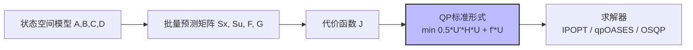
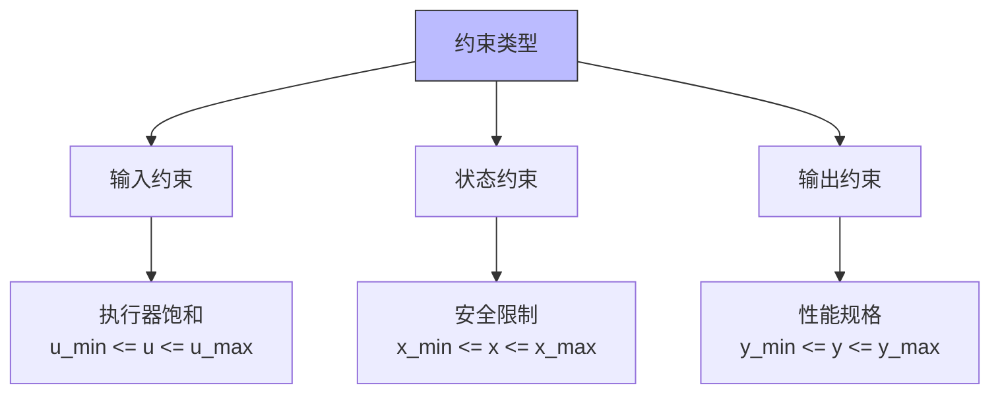

# 约束处理与QP求解器

> **目标**：理解MPC如何转化为标准二次规划问题，掌握约束的数学表达形式，了解QP求解器的基本原理（活跃集法与内点法），并能在MATLAB/Python中实现带约束的MPC。包含软约束处理、不可行问题处理策略。

---

## 一、MPC优化问题的标准QP形式

上一篇我们将预测轨迹写成了控制输入的线性函数。现在，我们把代价函数也转化为标准二次规划形式。

回顾MPC代价函数：

$$J = \sum_{i=0}^{N-1} \left[ (y(k+i) - y_{ref})^T Q (y(k+i) - y_{ref}) + (u(k+i) - u_{ref})^T R (u(k+i) - u_{ref}) \right] + (x(k+N) - x_{ref})^T P (x(k+N) - x_{ref})$$

利用批量预测公式 $Y = F x(k) + G U$，以及 $X = S_x x(k) + S_u U$，可以把代价函数写成：

$$J = U^T H U + 2 f^T U + \text{const}$$

其中：

$$H = G^T \bar{Q} G + \bar{R}$$
$$f = G^T \bar{Q} (F x(k) - Y_{ref})$$

这里 $\bar{Q} = \text{blkdiag}(Q, Q, ..., Q, P)$ 是 $N$ 块 $Q$ 加一块 $P$ 组成的分块对角矩阵，$\bar{R} = \text{blkdiag}(R, R, ..., R)$。

**MPC到QP的转化流程**：



**标准QP形式**：

$$\min_U \quad \frac{1}{2} U^T H U + f^T U$$
$$\text{s.t.} \quad A_{ineq} U \le b_{ineq}$$

这个形式就是**二次规划（Quadratic Programming, QP）**。$H$ 是Hessian矩阵，由于代价函数是二次的，$H$ 半正定（如果 $R > 0$，则 $H > 0$）。$A_{ineq} U \le b_{ineq}$ 是不等式约束。

---

## 二、约束的数学表达：输入约束、状态约束、输出约束

MPC的强大之处在于能系统性地处理约束。约束分为三类：



**输入约束（Actuator Limits）**：

$$u_{min} \le u(k+i) \le u_{max}, \quad i = 0, 1, ..., N_u - 1$$

这是工程中最常见的约束。例如电机电流限制、阀门开度限制、舵机角度限制。这些约束反映了执行器的物理饱和。

在QP形式中，输入约束写成：

$$\begin{bmatrix} I \\ -I \end{bmatrix} U \le \begin{bmatrix} \mathbf{1} \otimes u_{max} \\ -\mathbf{1} \otimes u_{min} \end{bmatrix}$$

**状态约束（State Constraints）**：

$$x_{min} \le x(k+i) \le x_{max}, \quad i = 1, 2, ..., N$$

例如，化工反应器的温度不能超过安全上限，无人机的俯仰角不能过大，机械臂的关节速度不能超限。

利用批量预测 $X = S_x x(k) + S_u U$，状态约束转化为：

$$S_u U \le X_{max} - S_x x(k), \quad -S_u U \le -X_{min} + S_x x(k)$$

注意：状态约束依赖于当前状态 $x(k)$，因此右侧的 $b_{ineq}$ 在每个时刻都要重新计算。

**输出约束（Output Constraints）**：

$$y_{min} \le y(k+i) \le y_{max}, \quad i = 1, 2, ..., N$$

类似地，利用 $Y = F x(k) + G U$：

$$G U \le Y_{max} - F x(k), \quad -G U \le -Y_{min} + F x(k)$$

| 约束类型 | 来源 | QP中的线性不等式 | 工程意义 |
|---------|------|-----------------|---------|
| 输入约束 | 执行器饱和 | $I \cdot U \le u_{max}$ | 电流、力矩、阀门开度上限 |
| 状态约束 | 安全/物理限制 | $S_u \cdot U \le X_{max} - S_x x(k)$ | 温度、速度、角度限制 |
| 输出约束 | 性能/规格要求 | $G \cdot U \le Y_{max} - F x(k)$ | 跟踪误差、压力范围 |

---

## 三、QP求解器：活跃集法与内点法

MPC的实时性要求QP求解器在毫秒甚至微秒级内给出解。主流求解方法有两大类：

**活跃集法（Active Set Method）**

思路：在迭代过程中维护一个“活跃约束集”（即认为在当前解处取等号的约束），然后在这个约束集定义的等式约束子问题中求解。如果解违反了新约束，就调整活跃集。

| 优点 | 缺点 |
|------|------|
|  warm-start友好（用上一步解作为初始点） | 最坏情况指数复杂度 |
|  在约束变化不大时收敛很快 | 需要处理退化和循环 |
|  适合MPC（相邻时刻约束变化小） | 代码复杂 |

代表求解器：qpOASES（专门为MPC设计，支持warm-start）。

**内点法（Interior Point Method）**

思路：将不等式约束通过障碍函数（barrier function）转化为等式约束子问题，然后迭代求解。迭代点在可行域内部，逐步逼近边界。

| 优点 | 缺点 |
|------|------|
|  多项式复杂度，理论保证 |  warm-start不如活跃集法自然 |
|  对大规模问题效率高 |  在嵌入式平台上代码体积大 |
|  对初始点不敏感 |  收敛到中等精度需要较多迭代 |

代表求解器：OSQP, ECOS, MOSEK。

**MPC专用求解器**：

- **qpOASES**：活跃集法，C++实现，支持warm-start，广泛用于学术界和工业原型；
- **OSQP**：基于ADMM（交替方向乘子法）的算子分裂方法，对稀疏问题非常高效，支持嵌入式；
- **acados**：基于HPIPM（高性能内点法），专门为目标平台（ARM, x86）优化，支持SQP（非线性MPC）。

---

## 四、软约束与不可行问题处理

**硬约束的问题**：如果约束设置过于严格，QP问题可能变得**不可行**（infeasible）。例如，要求系统在2步内从 $x = 10$ 到达 $x = 0$，但执行器最大输出只能提供有限的加速度。优化器找不到任何满足约束的解，MPC控制器崩溃。

**软约束（Soft Constraints）**解决方案：引入**松弛变量（slack variables）**，允许约束在小范围内被违反，但施加惩罚。

例如，对于状态约束 $x \le x_{max}$，改写为：

$$x \le x_{max} + \epsilon, \quad \epsilon \ge 0$$

然后在代价函数中加入惩罚项：

$$J_{soft} = J + \rho \cdot \epsilon^2 + \mu \cdot \epsilon$$

其中 $\rho$ 是二次惩罚系数，$\mu$ 是线性惩罚系数（通常取 $\mu \gg 0$ 以驱动 $\epsilon$ 尽可能小）。

| 策略 | 优点 | 缺点 |
|------|------|------|
| 硬约束 | 严格保证安全性 | 可能不可行，导致控制器崩溃 |
| 软约束 | 始终有解，鲁棒性高 | 安全性在极端情况下被妥协 |
| 混合策略 | 关键约束硬、次要约束软 | 需要仔细分类约束优先级 |

**工程建议**：
- 安全关键约束（如过压、过温）保持硬约束，但留足裕度；
- 性能约束（如跟踪误差、响应时间）使用软约束；
- 永远为软约束设置合理的惩罚权重，避免松弛变量过大导致约束名存实亡。

---

## 五、数值示例：带输入约束的倒立摆MPC

延续上一篇的倒立摆模型，加入输入约束 $|u| \le 1.5\,\text{N·m}$。

**Python实现（使用cvxpy求解QP）**：

```python
# mpc_constrained_qp.py
import numpy as np
import cvxpy as cp
from scipy.linalg import expm, solve_discrete_are

# Discrete-time pendulum model (from previous note)
Ac = np.array([[0.0, 1.0], [19.62, 0.0]])
Bc = np.array([[0.0], [40.0]])
Ts = 0.02

# ZOH discretization
A = expm(Ac * Ts)
M = np.block([[Ac, Bc], [np.zeros((1, 2)), np.zeros((1, 1))]])
M_exp = expm(M * Ts)
B = M_exp[:2, 2:]
C = np.array([[1.0, 0.0]])
D = np.array([[0.0]])

# MPC parameters
N = 20
Q = np.array([[10.0]])  # weight on theta
R = np.array([[0.1]])   # weight on torque
u_max = 1.5
u_min = -1.5

# Build batch prediction matrices
nx, nu = A.shape[0], B.shape[1]
Sx = np.zeros((N * nx, nx))
Su = np.zeros((N * nx, N * nu))
for i in range(N):
    Sx[i*nx:(i+1)*nx, :] = np.linalg.matrix_power(A, i+1)
    for j in range(i+1):
        Su[i*nx:(i+1)*nx, j*nu:(j+1)*nu] = np.linalg.matrix_power(A, i-j) @ B

F = np.kron(np.eye(N), C) @ Sx
G = np.kron(np.eye(N), C) @ Su + np.kron(np.eye(N), D)

# QP matrices
Q_bar = np.kron(np.eye(N), Q)
R_bar = np.kron(np.eye(N), R)
H = 2 * (G.T @ Q_bar @ G + R_bar)

# Terminal weight from DARE
P = solve_discrete_are(A, B, C.T @ Q @ C, R)

# Simulation
T_sim = 150
x = np.array([[0.3], [0.0]])  # initial angle 0.3 rad, zero velocity
x_ref = np.zeros((N * C.shape[0], 1))
x_hist = np.zeros((nx, T_sim + 1))
u_hist = np.zeros((nu, T_sim))
x_hist[:, 0] = x.flatten()

for k in range(T_sim):
    # Build QP
    f = 2 * G.T @ Q_bar @ (F @ x - x_ref)
    U = cp.Variable((N * nu, 1))
    
    objective = cp.Minimize(0.5 * cp.quad_form(U, H) + f.T @ U)
    constraints = [
        U <= u_max,
        U >= u_min
    ]
    prob = cp.Problem(objective, constraints)
    prob.solve(solver=cp.OSQP)
    
    u_opt = U.value[:nu]
    u_hist[:, k] = u_opt.flatten()
    x = A @ x + B @ u_opt
    x_hist[:, k+1] = x.flatten()

print("Final state:", x.flatten())
print("Max control:", np.max(np.abs(u_hist)))
```

**结果分析**：运行上述代码，你会观察到：

1. 摆角 $\theta$ 从 $0.3\,\text{rad}$ 开始，在约 $0.5\,\text{s}$ 内被迅速拉回 $0$；
2. 控制力 $u$ 在初期达到饱和上限 $1.5\,\text{N·m}$，这是MPC在约束边界上“最优利用”执行器能力的体现；
3. 如果没有输入约束（即 $u$ 可以任意大），摆角会恢复得更快，但控制力可能达到不切实际的值。

这个对比清楚地展示了约束MPC的工程价值：它不仅在物理可行范围内寻找最优，而且会**主动利用约束边界**来最大化性能。

---

## 六、常见错误与纠正

### 错误1：硬约束设置过于严格，导致QP不可行，控制器崩溃

**错误表现**：在调参时，为了追求性能，把状态约束设得过于紧（如要求系统在极短时间内达到目标），同时执行器饱和上限又很低。优化器找不到任何可行解，返回`infeasible`，MPC控制器没有输出，系统失控。

**纠正**：
1. 为所有硬约束留出 $10\% \sim 20\%$ 的裕度；
2. 对非安全关键约束使用软约束；
3. 在代码中加入不可行检测机制，当QP不可行时回退到安全控制律（如 $u = 0$ 或切换到PID保底的紧急模式）。

### 错误2：忽略输出约束，只处理输入约束

**错误表现**：很多工程师实现MPC时只加入输入饱和约束，认为“控制量不超，输出自然就不会超”。但MPC的预测模型可能预估系统响应偏慢，导致实际输出（如温度、速度）在约束恢复前已经越界。

**纠正**：如果输出（或状态）有明确的安全限制，必须直接在MPC中将其作为约束加入。例如，反应器温度上限是硬安全约束，即使这意味着要降低控制输入，牺牲一部分响应速度。输出约束的处理方式与输入约束相同，只是约束矩阵从 $I$ 变为 $G$ 或 $S_u$，右侧依赖于当前状态。

---

## 七、自测习题

**习题1**：将MPC的代价函数转化为标准QP形式 $\min \frac{1}{2} U^T H U + f^T U$ 时，$H$ 和 $f$ 的表达式分别是什么？为什么要求 $H$ 是正定（或半正定）矩阵？

> **答案**：$H = 2(G^T \bar{Q} G + \bar{R})$，$f = 2 G^T \bar{Q} (F x(k) - Y_{ref})$。$H$ 的半正定性来源于代价函数的二次型结构：$G^T \bar{Q} G$ 是半正定的（因为 $\bar{Q} \succeq 0$），$\bar{R}$ 是正定的（因为 $R \succ 0$）。如果 $H$ 不是正定的，QP问题可能无界（存在下降方向），优化器找不到有限的最优解。正定 $H$ 保证QP是严格凸的，有唯一全局最优解。

**习题2**：软约束引入的松弛变量 $\epsilon$ 如果惩罚系数 $\rho$ 设置得太小，会出现什么问题？

> **答案**：如果 $\rho$ 太小，软约束的惩罚项在代价函数中占比很小，优化器会优先降低跟踪误差和控制代价，而“不在乎”违反约束。结果可能是松弛变量 $\epsilon$ 很大，状态或输出大幅超出原始约束范围，软约束名存实亡。工程上，通常先设置较大的 $\rho$ 和线性惩罚 $\mu$（如 $10^3 \sim 10^6$），然后根据实际约束违反情况微调。

**习题3**：为什么MPC相邻时刻的QP问题具有“warm-start”特性？活跃集法如何利用这一特性？

> **答案**：MPC在相邻时刻的优化问题具有相同的结构（相同的 $H$，只有 $f$ 和约束右侧 $b$ 随 $x(k)$ 缓慢变化），且最优解通常也接近。活跃集法可以将上一时刻的最优解作为当前时刻的初始点，由于活跃约束集变化不大，往往只需少量迭代就能收敛到新解。这显著降低了MPC每步的平均求解时间，是嵌入式MPC实现的关键优化手段。

---

## 八、小结

本文将MPC彻底转化为了一个标准的工程优化问题：

- **批量预测**将未来轨迹写成 $U$ 的线性函数；
- **代价函数**转化为QP的二次型；
- **输入/状态/输出约束**统一写成线性不等式；
- **QP求解器**（活跃集法、内点法）是MPC的实时计算引擎；
- **软约束**保证控制器在极端情况下不崩溃；
- **数值示例**展示了带约束MPC如何利用饱和边界最大化性能。

下一篇，我们将讨论如何在计算资源受限的嵌入式平台上实现MPC——**显式MPC**。
